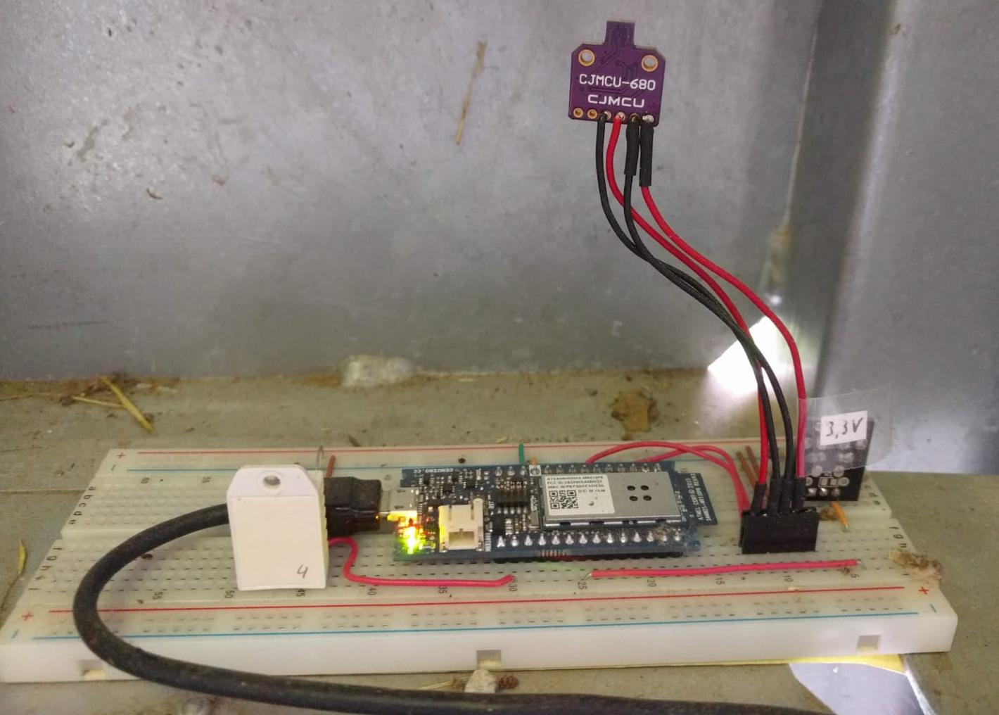
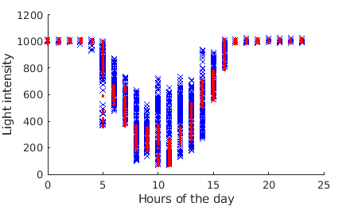
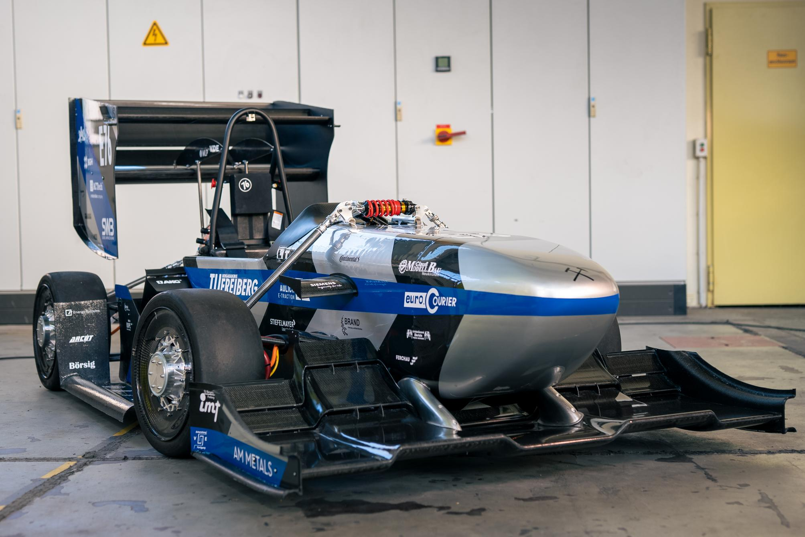

<!--

author:   Sebastian Zug, André Dietrich & `fjangfaragesh`, `FnHm`, `gjaeger`, `ShyFlyGuy`, `Lalelele`
email:    sebastian.zug@informatik.tu-freiberg.de & andre.dietrich@informatik.tu-freiberg.de & fabian.baer@student.tu-freiberg.de
version:  0.6.4
language: de
narrator: Deutsch Female

import:   https://raw.githubusercontent.com/liascript-templates/plantUML/master/README.md
          https://raw.githubusercontent.com/liaTemplates/AVR8js/main/README.md
          https://raw.githubusercontent.com/LiaTemplates/DigiSim/master/README.md
          https://raw.githubusercontent.com/TUBAF-IfI-LiaScript/VL_EingebetteteSysteme/master/config.md

-->

# Einführung

    --{{0}}--
Bevor wir starten: Haben Sie schon einmal darüber nachgedacht, wie aus einem Hochsprachen-Programm ein tatsächliches Verhalten eines Computers wird? Die Idee liegt darin, die Komplexität dieser Frage in handhabbare Schichten zu unterteilen. Wie diese Schichten genau aussehen, werden wir in dieser Vorlesung systematisch erarbeiten.

[](https://liascript.github.io/course/?https://raw.githubusercontent.com/TUBAF-IfI-LiaScript/VL_EingebetteteSysteme/master/00_Einfuehrung.md#1)

| Parameter                | Kursinformationen                                                                                        |
| ------------------------ | -------------------------------------------------------------------------------------------------------- |
| **Veranstaltung:**       | @config.lecture                                                                                          |
| **Semester:**            | @config.semester                                                                                         |
| **Hochschule:**          | `Technische Universität Freiberg`                                                                        |
| **Inhalte:**             | `Motivation der Vorlesung "Eingebettete Systeme" und Beschreibung der Organisation der Veranstaltung`   |
| **Link auf GitHub:**     | https://github.com/TUBAF-IfI-LiaScript/VL_EingebetteteSysteme/blob/master/00_Einfuehrung.md             |
| **Autoren:**             | @author                                                                                                  |

---------------------------------------------------------------------

**Fragen an die Veranstaltung**

+ Welche Abstraktionsebenen durchlaufen wir vom Programm im Arduino-Framework bis zur Hardware-Ebene?
+ Warum lohnt sich das Verständnis eingebetteter Systeme für Informatik, Robotik und Ingenieurwesen?
+ Welche Rolle spielen Mikrocontroller in modernen digitalen Systemen?
+ Wie unterscheiden sich eingebettete Systeme von herkömmlichen Computersystemen?
+ Welche praktischen Anwendungsgebiete finden Sie für eingebettete Systeme in Ihrem Alltag?
+ Was bedeutet „Echtzeit“ im Kontext eingebetteter Systeme?
+ Wie wirken sich Ressourcenbeschränkungen (Speicher, Rechenzeit, Energie) auf die Programmierung aus?

---------------------------------------------------------------------

## Worum geht es in dieser Vorlesung?

> Starten wir mit etwas Code ...

<div id="example1">
<wokwi-led color="red"   pin="13" label="13"></wokwi-led>
<wokwi-led color="green" pin="12" label="12"></wokwi-led>
<wokwi-led color="blue"  pin="11" label="11"></wokwi-led>
<wokwi-led color="blue"  pin="10" label="10"></wokwi-led>
<span id="simulation-time"></span>
<avr-chart signals="D13, D12, D11, D10" window="2s" title="Pegel an den Pins 13 bis 10"></avr-chart>
</div>

```cpp BlinkLEDs.ino
byte leds[] = {13, 12, 11, 10};

void setup() {
  Serial.begin(115200);
  for (byte i = 0; i < sizeof(leds); i++) {
    pinMode(leds[i], OUTPUT);
  }
}

int i = 0;
void loop() {
  Serial.print("LED: ");
  Serial.println(i);
  digitalWrite(leds[i], HIGH);
  delay(250);
  digitalWrite(leds[i], LOW);
  i = (i + 1) % sizeof(leds);
}
```
@AVR8js.sketch(example1)

      {{1}}
> **Frage:** Welche Funktion hat der Code? Lesen Sie die Antwort im Diagramm ab, bevor Sie weiterklicken.

    --{{1}}--
Der Code schaltet nacheinander vier LEDs an den Pins 13 bis 10 ein und aus, jede für 250 Millisekunden. Das Diagramm darunter zeigt dasselbe wie ein Logikanalysator: Zu jedem Zeitpunkt ist höchstens ein Pin auf HIGH. Hinter diesen knapp zwanzig Zeilen steckt viel mehr, als man sieht – Bibliothekscode der Arduino-Umgebung, ein Compiler und am Ende Transistoren, die schalten. Die Befehle können Sie unter https://www.arduino.cc/reference/en/ nachschlagen.

      {{2}}
> **Frage:** Was ist notwendig, damit dieses Programm auf einem Mikrocontroller ausgeführt werden kann?

    --{{2}}--
Der Code muss übersetzt werden. Der Compiler macht aus dem C++-Code Assemblerbefehle für die AVR-Architektur, der Assembler daraus Maschinencode – Zahlen, die der Mikrocontroller direkt ausführen kann. Der Linker fügt die benötigten Teile der Arduino-Bibliothek hinzu und legt fest, wo im Speicher alles steht. Das Ergebnis wird als Hex-Datei auf den Controller übertragen.

      {{3}}
******************************************************

> Keine Sorge: Diese Zahlen müssen Sie heute nicht lesen können – es geht nur darum, wohin die Reise geht.

```hex
:100000000C945D000C9485000C9485000C94850084
:100010000C9485000C9485000C9485000C9485004C
:100020000C9485000C9485000C9485000C9485003C
:100030000C9485000C9485000C9485000C9485002C
:100040000C9412020C9485000C9482020C945C02B5
:100050000C9485000C9485000C9485000C9485000C
:100060000C9485000C9485000000000024002700FB
:100070002A0000000000250028002B0004040404CE
:100080000404040402020202020203030303030342
:10009000010204081020408001020408102001021F
...
```

Jede Zeile hat dasselbe Format: `:` · Anzahl der Datenbytes (`10` = 16) · Adresse im Programmspeicher (`0000`) · Typ (`00` = Daten) · die Datenbytes · eine Prüfsumme.

> **Am Ende des Semesters können Sie jeden Schritt dieser Transformation erklären.**

******************************************************

    --{{3}}--
Schauen Sie auf die ersten vier Datenbytes: 0C 94 5D 00. Das ist ein einziger Maschinenbefehl, ein Sprungbefehl – jmp 0xBA. Im Befehl steht die Wortadresse 5D; weil jedes Befehlswort zwei Bytes lang ist, entspricht das der Byteadresse 0xBA. Der Befehl steht an Adresse 0, dort beginnt der Controller nach einem Reset. Von dort springt er zum Startcode, der das Programm vorbereitet und schließlich setup und loop aufruft. Die Grundprinzipien, die wir an diesem kleinen Controller lernen, gelten für jeden Rechner.

### Was ist ein eingebettetes System?

    --{{0}}--
Die Vorlesung heißt „Eingebettete Systeme“ – also klären wir den Begriff, bevor wir losgehen. Der Mikrocontroller ATmega328P (Microchip, 8-Bit-AVR) auf dem Board Arduino UNO R3 mit den vier LEDs ist bereits eines.

Ein **eingebettetes System** ist ein Rechner, der fest in ein technisches Gerät eingebaut ist und dort eine bestimmte Aufgabe erfüllt – meist ohne dass man ihn als Rechner wahrnimmt. Typisch sind:

+ eine **feste Aufgabe** statt beliebiger Programme (Waschmaschine, Motorsteuerung, Wetterstation),
+ **Sensoren und Aktoren** statt Tastatur und Bildschirm,
+ **knappe Ressourcen**: wenig Speicher, wenig Rechenleistung, wenig Energie, geringe Kosten,
+ oft **Echtzeitanforderungen**: Die Reaktion muss nicht nur richtig, sondern auch rechtzeitig kommen – ein Airbag, der eine Sekunde zu spät auslöst, ist nutzlos.

Welche dieser Geräte sind eingebettete Systeme?

[[X]] die Steuerung einer Waschmaschine
[[X]] ein Herzschrittmacher
[[ ]] ein Laptop, auf dem Sie Ihre Hausaufgaben schreiben
[[X]] das Steuergerät für die Bremsen im Auto
***************************************************************

Der Laptop ist ein Universalrechner: Er führt beliebige Programme aus, die Sie installieren – auch wenn in ihm selbst kleine eingebettete Controller stecken, etwa für Tastatur oder Akku. Die anderen drei Geräte haben einen eingebauten Rechner mit einer festen Aufgabe, Sensoren und Aktoren – und Herzschrittmacher und Bremse müssen rechtzeitig reagieren.

***************************************************************

### Die Reise: 16 Vorlesungen zum Verständnis

<!-- data-type="none" -->
| Vorlesung                                           | Termin | Was lernen Sie hier?          | Wo steckt das im ATmega328P?                       |
| --------------------------------------------------- | ---- | ----------------------------- | -------------------------------------------------- |
| [00 Einführung](00_Einfuehrung.md)                  | Mi 21.10. | Die große Vision              | vom Sketch zur Hex-Datei                           |
| [01 Historie](01_HistorischerUeberblick.md)         | Mi 28.10. | Von Leibniz zum Mikrocontroller | warum der Chip so aussieht, wie er aussieht        |
| [02 Boolesche Algebra](02_BoolscheAlgebra.md)       | Do 29.10. | 0 und 1 verstehen             | `if (a && b)`, Bitmasken                           |
| [03 Minimierung](03_Minimierung.md)                 | Mi 04.11. | Effizienz in Logik            | weniger Gatter für dieselbe Funktion               |
| [04 Schaltnetze](04_Schaltnetze.md)                 | Mi 11.11. | Logik wird Hardware           | die Logik im Chip, inklusive ihrer Laufzeiten      |
| [05 Standardschaltnetze](05_Standardschaltnetze.md) | Do 12.11. | Decoder & Multiplexer         | Registerauswahl, Kanalwahl beim `analogRead`       |
| [06 FlipFlops](06_FlipFlops.md)                     | Mi 25.11. | Speicher entsteht             | das Bit in `DDRB`, das sich „Ausgang“ merkt        |
| [07 Schaltwerke](07_Schaltwerke.md)                 | Do 26.11. | Zustandsmaschinen             | Steuerungen mit Zuständen, z. B. eine Ampel        |
| [08 Standardschaltwerke](08_StandardSchaltwerke.md) | Mi 02.12. | Counter & Register            | der Zähler hinter `millis()`                       |
| [09 Rechnerarithmetik](09_Rechnerarithmetik.md)     | Mi 09.12. | Addition in Hardware          | `int`, Überlauf, `float`                           |
| [10 CPU-Basis](10_CPU_Basis.md)                     | Do 10.12. | Der erste Prozessor           | Rechenwerk, Steuerwerk, Speicher                   |
| [11 Modell-CPU](11_Modell_CPU.md)                   | Mi 16.12. | Befehl für Befehl             | was mit `0C 94 5D 00` passiert                     |
| [12 AVR-CPU](12_AVR_CPU.md)                         | Mi 06.01. + Mi 13.01. | **Ihr Controller: ATmega328P** | ATmega328P, Toolchain, Register                    |
| [13 ADC](13_ADC.md)                                 | Do 14.01. | Analog trifft Digital         | `analogRead`                                       |
| [14 Timer & Interrupts](14_TimerUndInterrupts.md)   | Mi 20.01. + Mi 27.01. | Unterprogramme, Stack, Timing | `attachInterrupt`, `delay`, `analogWrite`, Echtzeit |
| [15 Aktoren](15_Aktoren.md)                         | Do 28.01. + Mi 03.02. | Hardware bewegen, Ausblick    | Servo, Schrittmotor, Echtzeit, Energiesparen – und die Hex-Datei vom Anfang komplett lesen |

> Für 16 Vorlesungen haben wir 21 Termine: Die Vorlesungen 12, 14 und 15 erstrecken sich über zwei Termine (Teil I und Teil II). Am Mi 10.02. wiederholen wir den Stoff und besprechen die Probeklausur, Do 11.02. ist ein Puffer. Am Mi 18.11. (Buß- und Bettag) ist keine Vorlesung.

### Was steht am Ende?

    --{{0}}--
Diese Fragen klingen heute noch nach Zauberei. Am Ende des Semesters sollten Sie jede davon in wenigen Sätzen beantworten können – und genau solche Fragen finden Sie in der Klausur wieder.

**Sie können diese Fragen fundiert beantworten:**

1. **„Wie wird `pinMode(13, OUTPUT)` zu einer Hardware-Konfiguration?“**  
   *Von der Funktion des Arduino-Frameworks über Assembler zum Bit im Register `DDRB` und zur Tri-State-Logik am Pin*

2. **„Was bedeutet `Serial.begin(115200)`?“**  
   *Die serielle Schnittstelle (UART) überträgt Bit für Bit ohne gemeinsamen Takt – deshalb vereinbaren beide Seiten zu Beginn die „Sprechgeschwindigkeit“.*

3. **„Ist ein `delay(1000)` tatsächlich genau 16.000.000 Taktzyklen lang?“**  
   *Taktfrequenz, Befehlszyklen und Timer-Hardware verstehen*

4. **„Was passiert im ATmega328P während `analogRead(A0)`?“**  
   *ADC-Wandlung, Abtastung, Quantisierung und Speicherung*

5. **„Wie führt die CPU den Maschinenbefehl `0C 94 5D 00` aus?“**  
   *Befehl holen, dekodieren, ausführen; Register und Programmzähler*

6. **„Wie sähe `if (digitalRead(2) && digitalRead(3))` als Schaltung aus – und was wäre daran anders als im Programm?“**  
   *Boolesche Algebra, Gatter, Grenze zwischen Hardware und Software*

7. **„Wie kann ein 8-bit-Mikrocontroller 16-bit-Zahlen addieren?“**  
   *Rechnen in mehreren Schritten, Carry-Flag, Aufbau der ALU*

8. **„Woher weiß der Controller nach einem Interrupt, wo er weitermachen muss?“**  
   *Unterprogramme, Rücksprungadresse und Stack*


## Der Unterschied zu einem "Arduino-Kurs"

    --{{0}}--
Nach einem typischen Arduino-Workshop können Sie LEDs blinken lassen. Nach diesem Kurs können Sie erklären, welche Register dabei beschrieben werden, warum digitalWrite deutlich mehr Befehle braucht als ein direkter Registerzugriff und wie aus dem Bit im Register ein Pegel am Pin wird. Das ist der Unterschied zwischen „es funktioniert“ und „ich verstehe, warum es funktioniert“.

**Arduino-Kurs:** "Drücke diesen Button, LEDs blinken" ✨ *Magie!*

**Unser Kurs:** "Warum passiert das und wie funktioniert es bis hinunter zum Transistor?"

### Unsere Bottom-Up-Reise

    --{{0}}--
Schauen Sie sich diese Abstraktionsebenen an: Die meisten Programmierer arbeiten auf Ebene 6, nur wenige schauen auf Ebene 5 hinunter. Wir steigen bis auf Ebene 1 hinab und arbeiten uns systematisch nach oben.

<!--
style="width: 80%; min-width: 420px; max-width: 720px;"
-->
```ascii

                Abstraktionsebenen

           +----------------------------+ -.
  Ebene 6  | Problemorientierte Sprache |  |
           +----------------------------+  |
                                           ⎬ Anwendungssoftware
           +----------------------------+  |
  Ebene 5  | Assemblersprache           |  |
           +----------------------------+ -.

           +----------------------------+
  Ebene 4  | Betriebssystem             |     Systemsoftware (brauchen wir nicht :-) )
           +----------------------------+

           +----------------------------+
  Ebene 3  | Instruktionsset            |     Maschinensprache
           +----------------------------+

           +----------------------------+  -.
  Ebene 2  | Mikroarchitektur           |   |
           +----------------------------+   |
                                            ⎬ Automaten, Speicher, Logik
           +----------------------------+   |       ╔══════════════════╗
  Ebene 1  | Digitale Logik             |   |    ◀══║ HIER STARTEN WIR!║
           +----------------------------+  -.       ╚══════════════════╝

           +----------------------------+
  Ebene 0  | E-Technik, Physik          |     Analoge Phänomene
           +----------------------------+                                      .
```


### Beispiel 1: Mikroarchitektur

> Ein Rechner ist eine ziemlich komplizierte Maschine. Moderne CPUs oder GPUs umfassen Milliarden von Transistoren! Wir brauchen ein methodisches Verständnis und mehrere Abstraktionsebenen, um das zu verstehen.

```text @plantUML.png
@startditaa
               +------------------+
               |c88F              |
               |     Speicher     |
               |                  |
               +---------+-+------+
                       ^ | ^
                       | | |
+----------+  Adresse  | | |               +-----+-----+
|cF88      +-----------+ | |               |  A  |  B  |
|          |             | |        Daten  +-----+-----+
|          |   Befehl    | +-------------->+cFF4       |
|  Steuer- |<------------+                 |           |
|   werk   |                     Kontrolle |    ALU    |
|          +------------------------------>+           |
|          |                               |           |
|          |                       Status  |           |
|          |<------------------------------+           |
|          |                               |           |
|          | Kontrolle                     |           |
|          +-------------+         Daten   |           |
|          |             | +-------------->|           |
|          |  Status     | |               |           |
|          |<----------+ | |               |           |
+----------+           | | |               +-----------+
                       | | |
                       | V V
               +-------+-----------+
               |c8F8               |
               |    Ein/Ausgabe    |
               |                   |
               +-------------------+
@endditaa
```

    --{{0}}--
Die Aufteilung in Steuerwerk, Rechenwerk, Speicher und Ein-/Ausgabe hat John von Neumann 1945 beschrieben, sie gilt bis heute – vom Mobiltelefon bis zum Mikrocontroller. Der ATmega328P weicht in einem Punkt ab: Programm und Daten liegen in getrennten Speichern. Man nennt das Harvard-Architektur; mehr dazu in Vorlesung 10 und 12.


### Beispiel 2: Quer über alle Ebenen

                   {{0-1}}
*****************************************************

    --{{0}}--
Wir verfolgen jetzt eine einzige Programmzeile durch die Abstraktionsebenen – so lange, bis wir beim Transistor ankommen, der die eigentliche Arbeit macht.

**Wir bauen von den Grundlagen nach oben!** Jede Ebene erklärt die nächste, bis Sie verstehen, wie Ihr `pinMode()` am Ende einen Transistor schaltet.

**Schauen wir uns konkret an, was auf den einzelnen Ebenen passiert:**

> **Sie müssen heute noch nicht alles verstehen.** Begriffe wie Interrupt, Register oder Flip-Flop sind heute nur Wegmarken – jeder davon bekommt im Semester seine eigene Vorlesung (Hinweise in Klammern).

*****************************************************


                   {{1-2}}
*****************************************************

**Ebene 6 – Ihr Programm (Arduino-Framework):**

    --{{1}}--
Ebene sechs sieht harmlos aus. Pin 13 ist übrigens kein Zufall – an ihm hängt die eingebaute LED des Boards Arduino UNO R3. Die 13 ist allerdings nur die Beschriftung auf dem Board; am ATmega328P heißt dieser Anschluss PB5, Port B, Bit 5.

```cpp
pinMode(13, OUTPUT);  // Pin 13 als Ausgang konfigurieren
```

*****************************************************

                   {{2-3}}
*****************************************************

**Ebene 6 – darunter: die Arduino-Bibliothek (C, gekürzt aus `wiring_digital.c`):**

    --{{2}}--
Auch die Arduino-Bibliothek ist in C geschrieben, also noch Ebene sechs. Sie übersetzt die Pin-Nummer in ein Register und ein Bit. Bevor sie das Register ändert, schaltet sie Interrupts kurz ab: Eine Interrupt-Routine könnte sonst zwischen Lesen und Zurückschreiben dasselbe Register verändern. Das nennt man eine Race Condition.

```c
void pinMode(uint8_t pin, uint8_t mode) {
  uint8_t bit  = digitalPinToBitMask(pin);           // Pin 13 → Bit 5
  uint8_t port = digitalPinToPort(pin);              // Pin 13 → Port B
  volatile uint8_t *reg = portModeRegister(port);    // → &DDRB
  ...
  if (mode == OUTPUT) {
    uint8_t oldSREG = SREG;   // Statusregister sichern
    cli();                    // Interrupts aus
    *reg |= bit;              // DDRB |= (1 << 5)
    SREG = oldSREG;           // alten Zustand wiederherstellen
  }
}
```

Den Code müssen Sie nur überfliegen. Interrupts und Race Conditions behandeln wir in Vorlesung 14.

Kern des Ganzen ist eine einzige Zeile: `DDRB |= (1 << 5);` – setze Bit 5 im Register `DDRB`. Dabei schiebt `1 << 5` eine Eins um fünf Stellen nach links (`0000 0001` → `0010 0000`), und `|=` verknüpft das Register bitweise mit ODER: Bit 5 wird 1, alle anderen Bits bleiben, wie sie waren.

> Sie hören „Algorithmen und Datenstrukturen“ nicht parallel? Die Bitoperatoren von C erklärt zum Beispiel das [Wikibook C-Programmierung](https://de.wikibooks.org/wiki/C-Programmierung:_Ausdr%C3%BCcke_und_Operatoren).

*****************************************************

                   {{3-4}}
*****************************************************

**Ebene 5 – Assembler:**

Nur die Kernzeile `DDRB |= (1 << 5);` wird zu einem einzigen Befehl. Die ganze Funktion `pinMode` – mit Tabellen, Sichern des Statusregisters und Interrupt-Sperre – übersetzt der Compiler in deutlich mehr Befehle.

    --{{3}}--
Schreiben wir die Kernzeile DDRB oder-gleich eins geschoben um fünf direkt, macht der Compiler daraus einen einzigen Assemblerbefehl: sbi, set bit in I/O register. 0x04 ist die Adresse von DDRB im Ein-/Ausgabebereich des Controllers. Dieses Programm können Sie direkt ausführen – es lässt die LED an Pin 13 blinken.

<div id="asm-example">
<wokwi-led color="red" pin="13" label="13"></wokwi-led>
<span id="simulation-time"></span>
</div>

```asm
; Pin 13 (Port B, Bit 5) als Ausgang, dann blinken
#include <avr/io.h>

.global main
main:
  sbi   _SFR_IO_ADDR(DDRB), 5   ; DDRB |= (1 << 5)  →  sbi 0x04, 5

loop:
  sbi   _SFR_IO_ADDR(PINB), 5   ; eine 1 in PINB schaltet PORTB5 um
  rcall wait
  rjmp  loop

; 41 * 256 * 256 * 3 Takte ≈ 8.000.000 Takte = 0,5 s bei 16 MHz
wait:
  ldi   r20, 41
wait_outer:
  ldi   r19, 0                  ; 0 heißt hier: 256 Durchläufe (dec 0 → 255)
wait_middle:
  ldi   r18, 0
wait_inner:
  dec   r18
  brne  wait_inner
  dec   r19
  brne  wait_middle
  dec   r20
  brne  wait_outer
  ret
```
@AVR8js.asm(asm-example)

*****************************************************

                   {{4-5}}
*****************************************************

**Ebene 3 – Maschinencode:**

    --{{4}}--
Der Assembler übersetzt sbi 0x04, 5 in genau zwei Bytes: 25 und 9A. Bytes dieser Art – wenn auch nicht genau diese – stehen in der Hex-Datei vom Anfang. Wie das Steuerwerk aus diesen Bits erkennt, was zu tun ist, sehen wir in Vorlesung 11.

| Assembler     | Maschinencode im Speicher | Bedeutung der Bits                                 |
| ------------- | ------------------------- | -------------------------------------------------- |
| `sbi 0x04, 5` | `25 9A`                   | `1001 1010` = sbi · `00100` = Adresse 4 · `101` = Bit 5 |

Der Befehl ist das 16-Bit-Wort `0x9A25`; im Speicher steht das niederwertige Byte zuerst.

**Ebene 2 – Mikroarchitektur:** Das Steuerwerk erkennt am Bitmuster `1001 1010` den Befehl `sbi`, leitet die Adresse 4 an den Ein-/Ausgabebereich weiter und setzt dort Bit 5. Wie ein Steuerwerk das macht, bauen wir in Vorlesung 10 und 11 selbst nach.

*****************************************************

                   {{5-6}}
*****************************************************

**Ebene 1 – Hardware-Konfiguration:**

    --{{5}}--
Am Ziel: echte Hardware. Das Register DDRB besteht aus acht Flip-Flops, jedes gehört zu einem Pin. Ist Bit 5 gesetzt, wird der Ausgangstreiber von Pin 13 freigeschaltet: Ein Transistor kann den Pin mit der Versorgungsspannung verbinden, ein anderer mit Masse – das ist genau genommen schon Ebene 0. Das ist der Moment, in dem Software zu Physik wird.

, in der Mitte PORTxn (Ausgabewert), unten der Eingang PINxn; Microchip, ATmega328P Datenblatt, General Digital I/O")<!-- width="70%" -->

Für Pin 13 ist im Bild x = B und n = 5: Das Flip-Flop DDxn ist also DDB5, Bit 5 im Register `DDRB`. Der Ausgangstreiber ist der dreieckige Verstärker in der Mitte, der den Pin Pxn treibt; der Transistor oben links gehört zum Pull-up-Widerstand.

**HIGH und LOW sind Spannungen:** Beim ATmega328P mit 5 V Versorgung liegt HIGH nahe der Versorgungsspannung, LOW nahe 0 V, der Masse. Laut Datenblatt erkennt ein Eingang sicher LOW unter 1,5 V und sicher HIGH über 3,0 V.

Das `DDRB`-Register steuert direkt die **Tri-State-Logik** des I/O-Pins:

- **DDRB[5] = 1**: Ausgangstreiber wird aktiviert → Pin kann HIGH/LOW ausgeben
- **DDRB[5] = 0**: Hochohmig → Pin kann Eingangssignale lesen; ist zusätzlich `PORTB[5] = 1` (das macht `INPUT_PULLUP`), zieht der Pull-up-Widerstand den Pin auf HIGH, solange ihn nichts auf LOW zieht

„Tri-State“ heißt: Ein Ausgang kennt drei Zustände – HIGH, LOW und „abgeschaltet“. Abgeschaltet (hochohmig) beeinflusst der Pin die angeschlossene Leitung praktisch nicht und kann so als Eingang dienen. Mehr dazu in Vorlesung 05 und 12.

*****************************************************

                   {{6}}
*****************************************************

**Ordnen Sie zu:** Auf welcher Ebene liegt die jeweilige Darstellung?

[[Ebene 6] [Ebene 5] [Ebene 3] [Ebene 1]]
[    (X)       ( )       ( )       ( )    ]  `pinMode(13, OUTPUT);`
[    (X)       ( )       ( )       ( )    ]  `DDRB |= (1 << 5);`
[    ( )       (X)       ( )       ( )    ]  `sbi 0x04, 5`
[    ( )       ( )       (X)       ( )    ]  `25 9A`
[    ( )       ( )       ( )       (X)    ]  das Flip-Flop für Bit 5 in `DDRB`

*****************************************************

## Was können Sie damit bauen?

    --{{0}}--
Mit diesem Verständnis können Sie Systeme gezielt verbessern, statt nur Bibliotheken zu benutzen. Sie wissen, warum der Analog-Digital-Wandler manchmal „rauscht“, wie Sie Timer-Interrupts für präzises Timing einsetzen und warum manche Sensoren 5 V brauchen und andere mit 3,3 V auskommen.

**Von einfachen LEDs zu echten Projekten:**

<!-- width="70%" -->

Nach diesem Kurs wissen Sie nicht nur, wie man Sensordaten ausliest, sondern **warum** der 10-Bit-Analog-Digital-Wandler höchstens 1023 liefert und wie Timer-Interrupts die Abtastung steuern.

<!-- width="70%" -->

In diesem Aufbau bedeuten hohe Werte Dunkelheit und niedrige Werte Helligkeit – das liegt an der Beschaltung des Lichtsensors, nicht am Wandler. Sie verstehen, warum die Messwerte so aussehen, und können die Referenzspannung des Wandlers für präzisere Messungen wählen.

### Wozu brauche ich das in meinem Studiengang?

    --{{0}}--
Die Vorlesung hören Studierende aus sehr unterschiedlichen Richtungen. Jede Gruppe nimmt etwas anderes mit – aber alle profitieren davon, eine Schicht tiefer schauen zu können als bisher.

+ **Robotik**: Jeder Roboter ist ein eingebettetes System – Sensoren lesen, Motoren ansteuern, rechtzeitig reagieren.
+ **Angewandte Informatik**: Sie verstehen, was Ihr Programm auf der Hardware tatsächlich tut, und warum manches langsam oder speicherhungrig ist.
+ **Mathematik**: Boolesche Algebra und Automaten werden hier zu Schaltungen – mit Laufzeiten, Takten und Grenzen der Physik.
+ **Ingenieurwissenschaften**: Messen, Steuern und Regeln laufen heute fast immer auf einem Mikrocontroller. Abtastung, Quantisierung und Pulsweitenmodulation kennen Sie vielleicht aus der Messtechnik – hier sehen Sie, wie der Controller sie umsetzt (Vorlesung 13–15), bis hin zu Servo und Schrittmotor; in Vorlesung 12 wird auch ein Simulink-Modell zu Code für den Controller.

## Organisation

| Name                    | Email                                   | Aufgabe                                  |
| :---------------------- | :-------------------------------------- | :--------------------------------------- |
| Prof. Dr. Sebastian Zug | sebastian.zug@informatik.tu-freiberg.de | Vorlesung, theoretische Übungsblätter    |
| N.N.                    |                                         | praktische Übungen ab Januar             |

> Bitte melden Sie sich im OPAL unter [Digitale Systeme](https://bildungsportal.sachsen.de/opal/auth/RepositoryEntry/37204033543) für die Veranstaltung an – dort heißt sie kurz „Digitale Systeme“. Dort finden Sie auch die aktuellen Informationen zur Veranstaltung.

### Ihre Vorkenntnisse

    --{{0}}--
Die Vorlesung hören Studierende mit sehr unterschiedlichen Vorkenntnissen. Ihre Antworten helfen uns, Beispiele und Übungen passend zu wählen. Die Abfrage ist anonym; wir sammeln die Antworten im Hörsaal über das LiaScript-Klassenzimmer.

> Den Link zum LiaScript-Klassenzimmer zeigen wir Ihnen im Hörsaal. Treten Sie bei, bevor Sie antworten – sonst bleiben Ihre Antworten nur in Ihrem eigenen Browser.

**Aus welchem Studiengang kommen Sie?**

[(informatik)] Angewandte Informatik
[(robotik)] Robotik
[(mathe)] Mathematik
[(ingenieur)] ein Ingenieurstudiengang
[(anderer)] ein anderer Studiengang

**Welche Erfahrung haben Sie mit Arduino oder anderen Mikrocontrollern?**

[(keine)] keine Vorerfahrung
[(kurz)] kurz ausprobiert, Praktikum oder Ähnliches
[(basteln)] umfangreiche „Basteleien“
[(beruf)] Berufserfahrung mit Mikrocontrollern

**Können Sie in C programmieren?**

[(parallel)] ich lerne C in diesem Semester (Algorithmen und Datenstrukturen)
[(ja)] ja, schon vorher
[(nein)] nein, und ich höre auch keine C-Vorlesung

**Haben Sie Zugriff auf einen Arduino UNO, Nano oder einen anderen ATmega-Mikrocontroller?**

[(ja)] ja, ein Controller ist vorhanden
[(nein)] nein

### Zeitplan

Die Veranstaltung wird sowohl für die Vorlesung als auch die Übung in Präsenz durchgeführt.

<!-- data-type="none" -->
| Veranstaltungen | Tag        | Zeitslot      | Ort      | Bemerkung                    |
| --------------- | ---------- | ------------- | -------- | ---------------------------- |
| Vorlesung I     | Mittwoch   | 16:15 - 17:45 | FOR-0270 | wöchentlich                  |
| Vorlesung II    | Donnerstag | 11:30 - 13:00 | FOR-0270 | gerade Kalenderwochen        |
| Übung, Gruppe 1 | Montag     | 18:00 - 19:30 | KKB-2097 | ab Ende November             |
| Übung, Gruppe 2 | Donnerstag | 18:00 - 19:30 | KKB-2097 | ab Ende November             |

Am **Mittwoch, 18.11.** (Buß- und Bettag), entfällt die Vorlesung.

> Die Übungen starten Ende November mit theoretischen Übungsblättern. Ab Januar vertiefen Sie Ihre Kenntnisse in praktischen Übungen an Mikrocontrollerschaltungen. Datum, Rhythmus und Gruppeneinteilung geben wir bis Mitte November im OPAL bekannt.

### Prüfungsmodalitäten

> *Prüfungsform:* Die Veranstaltung wird mit einer schriftlichen Prüfung abgeschlossen. Diese wird als __Open Book Klausur__ entworfen. Sie dürfen dazu alle schriftlichen, nicht-digitalen Materialien verwenden.

Eine druckbare PDF-Fassung jeder Vorlesung finden Sie in der [Kursübersicht](https://tubaf-ifi-liascript.github.io/digitalesysteme.html) – ideal, um eigene Notizen für die Klausur direkt daneben zu schreiben.

Im Laufe der Übungen werden wir "alte" Übungsaufgaben durchspielen, die Ihnen einen Eindruck von der Prüfung vermitteln sollen. Ende Januar stellen wir eine Probeklausur bereit, die wir in der letzten Vorlesung am 10.02. besprechen.

### Literaturempfehlungen

1. Umfassende Lehrbücher

   + David A. Patterson, John L. Hennessy: Computer Organization & Design
   + B. Becker, R. Drechsler, P. Molitor: Technische Informatik - Eine Einführung, Pearson Studium, 2005
   + Hoffmann, D. W.: Grundlagen der technischen Informatik, Hanser Verlag

2. Videos

   + Youtube – „How a CPU Works“ [Link](https://www.youtube.com/watch?v=cNN_tTXABUA)

Bei den jeweiligen Vorlesungsinhalten werden zusätzliche Materialien angegeben.

## Engagement und Motivation

> *Credit-Points:* 6

> *Arbeitsaufwand:* Der Zeitaufwand beträgt 180 h. Davon sind rund **45 h Präsenzzeit** – pro Woche im Mittel 1,5 × 90 Minuten Vorlesung und 0,5 × 90 Minuten Übung – und rund **135 h Selbststudium**. Das Selbststudium umfasst die Vor- und Nachbereitung der Lehrveranstaltung, die eigenständige Lösung von Übungsaufgaben sowie die Prüfungsvorbereitung.

### Open Educational Resources

Die Lehrmaterialien sind offen verfügbar und liegen auf GitHub:

[https://github.com/TUBAF-IfI-LiaScript/VL_EingebetteteSysteme](https://github.com/TUBAF-IfI-LiaScript/VL_EingebetteteSysteme)

Sie sind in LiaScript geschrieben, einer Erweiterung von Markdown. Markdown beschreibt Texte mit wenigen, gut lesbaren Zeichen – `# Überschrift`, `*kursiv*`, `**fett**`, `+ Aufzählung`. LiaScript ergänzt, was in der Lehre fehlt: ausführbaren Code, Simulationen, Quizze und Animationen. Den Simulator haben Sie oben schon benutzt.

Zum Weiterlesen: [Markdown Guide](https://www.markdownguide.org/getting-started/) · [LiaScript-Dokumentation](https://liascript.github.io/course/?https://raw.githubusercontent.com/liaScript/docs/master/README.md#1) · [Einführungsvideos](https://www.youtube.com/channel/UCyiTe2GkW_u05HSdvUblGYg)

Eine Übersicht über alle Begriffe und roten Fäden der Vorlesung bietet die [Kurslandkarte](https://tubaf-ifi-liascript.github.io/VL_EingebetteteSysteme/kurslandkarte/). Sie wächst mit dem Semester: Am Ende jeder Vorlesung fragen wir Sie nach den Begriffen des Tages.

### Zwei Simulatoren begleiten Sie durchs Semester

    --{{0}}--
Zwei Werkzeuge werden Sie das ganze Semester über begleiten. Mit dem Schaltungssimulator bauen Sie Gatter, Flip-Flops und Zähler. Mit dem Mikrocontroller-Simulator lassen Sie Programme auf einem simulierten ATmega328P mit der Pinbelegung des Arduino UNO R3 laufen – inzwischen mit Tastern, Potentiometern, Servos und einem Blick in das Innere des Controllers.

**Schaltungen mit DigiSim** (ab Vorlesung 04): Klicken Sie auf die beiden Taster `a` und `b`. Wann leuchtet die Lampe?

``` json @DigiSim.evalJson
{"devices":{"a":{"label":"a","type":"Button","propagation":0,"position":{"x":0,"y":0}},"b":{"label":"b","type":"Button","propagation":0,"position":{"x":0,"y":60}},"and1":{"label":"UND","type":"And","propagation":0,"bits":1,"position":{"x":150,"y":25}},"y":{"label":"Lampe","type":"Lamp","propagation":0,"position":{"x":300,"y":30}}},"connectors":[{"from":{"id":"a","port":"out"},"to":{"id":"and1","port":"in1"}},{"from":{"id":"b","port":"out"},"to":{"id":"and1","port":"in2"}},{"from":{"id":"and1","port":"out"},"to":{"id":"y","port":"in"}}],"subcircuits":{}}
```

**Mikrocontroller mit AVR8js** (ab Vorlesung 12): Starten Sie das Programm, drücken Sie den Taster und drehen Sie am Potentiometer. Der Logikanalysator darunter zeigt die Pegel an Pin 2 und 13 und die Spannung am Analogeingang A0.

<div id="sim-tour">
<wokwi-pushbutton color="green" pin="2"></wokwi-pushbutton>
<wokwi-led color="red" pin="13" label="13"></wokwi-led>
<wokwi-potentiometer pin="A0" value="512"></wokwi-potentiometer>
<wokwi-servo pin="9"></wokwi-servo>
<avr-chart signals="D2, D13, ADC0" window="2s" title="Taster, LED und Analogeingang"></avr-chart>
</div>

```cpp Rundgang.ino
#include <Servo.h>

Servo servo;

void setup() {
  pinMode(2, INPUT_PULLUP);   // Taster gedrückt = LOW
  pinMode(13, OUTPUT);
  servo.attach(9);
}

void loop() {
  digitalWrite(13, digitalRead(2) == LOW);  // gedrückt: LED an
  servo.write(map(analogRead(A0), 0, 1023, 0, 180));  // Poti stellt den Servo
  delay(20);
}
```
@AVR8js.sketch(sim-tour)

Was hier passiert, verstehen Sie im Laufe des Semesters Schicht für Schicht: den Pull-up am Taster und die Pegel (Vorlesung 02 und 12), den Analog-Digital-Wandler hinter `analogRead` (Vorlesung 13) und die Pulsweitenmodulation, mit der der Servo gestellt wird (Vorlesung 14 und 15).

### Trotz Simulation und Virtuellem ...

... braucht es aber auch immer etwas zum Anfassen. Der Simulator zeigt viel – aber er verzeiht auch Dinge, die echte Hardware nicht verzeiht: falsche Verdrahtung, zu hohe Ströme, prellende Taster. Ab Januar arbeiten Sie deshalb in der Übung mit echten Mikrocontrollerschaltungen.

### Generelles Engagement

* Stellen Sie Fragen, seien Sie kommunikativ!

* Organisieren Sie sich in Arbeitsgruppen!

* Bringen Sie sich mit Implementierungen als Vortragende in die Veranstaltung ein.

### Und wenn Sie dann immer noch programmieren wollen ...

Dann wartet das __racetech__ Team auf Sie ... autonomes Fahren im Formula Student Kontext.

<!--
style="width: 80%; display: block; margin-left: auto; margin-right: auto;" -->

### Schauen Sie im RoboLab vorbei!

Im RoboLab arbeiten Studierende an eigenen Robotik-Projekten – kommen Sie vorbei und machen Sie mit!


## Was Sie heute mitnehmen

+ Ein **eingebettetes System** ist ein Rechner mit fester Aufgabe in einem Gerät – mit Sensoren, Aktoren, knappen Ressourcen und oft Echtzeitanforderungen.
+ Zwischen `pinMode(13, OUTPUT)` und dem Pegel an Pin 13 liegen **Abstraktionsebenen**: Hochsprache, Assembler, Maschinencode, Mikroarchitektur, digitale Logik, Physik.
+ Am Ende steht eine einfache Bitoperation – `sbi 0x04, 5` setzt ein Flip-Flop in `DDRB` –, und die Hex-Datei ist nichts anderes als solche Befehle hintereinander.
+ Wir gehen **von unten nach oben**: Nächste Woche beginnen wir mit der Geschichte und der Logik, im Januar sind wir beim Controller angekommen.

## Ihre Begriffe für die Kurslandkarte

Die [Kurslandkarte](https://tubaf-ifi-liascript.github.io/VL_EingebetteteSysteme/kurslandkarte/) wächst mit dem Semester, und Sie bestimmen mit, was hineinkommt. Ihre Antworten sammeln wir im Hörsaal gemeinsam über das LiaScript-Klassenzimmer; nach der Vorlesung werden die Begriffe dieser Woche in der Karte freigeschaltet. Den Link zum Klassenzimmer zeigen wir Ihnen im Hörsaal.

**Welche Begriffe aus der heutigen Vorlesung gehören für Sie in die Kurslandkarte?**

[[___ ___ ___]]

**Wo begegnet Ihnen das, was heute dran war – in Ihrem Studiengang oder in Geräten Ihres Alltags?**

[[___ ___ ___]]

## Hausaufgabe

+ Legen Sie sich einen GitHub-Account an ... und finden Sie als Erste oder Erster einen Tippfehler in den Unterlagen, den Sie als Contributor korrigieren :-)
+ Nutzen Sie Ihre Chatgruppe auch für diese Vorlesung: Finden Sie dort Partnerinnen und Partner zum gemeinsamen Nacharbeiten.
+ Lassen Sie die LED im Assembler-Beispiel doppelt so schnell blinken. Es gibt mehr als einen Weg – finden Sie zwei und begründen Sie, welcher der Verdopplung näher kommt und warum keiner sie exakt trifft. Tipp: Probieren Sie beide Wege im Simulator aus und vergleichen Sie die Simulationszeit unter der LED. Achten Sie darauf, dass 41 ungerade ist und dass auch `ldi`, `rcall` und `ret` Takte kosten. Die Auflösung gibt es zu Beginn der nächsten Vorlesung.

## Nächste Woche

Am **Mittwoch, 28.10.**, reisen wir durch 400 Jahre Rechentechnik – von Zahnrädern über Relais und Röhren bis zum Mikroprozessor –, am **Donnerstag, 29.10.**, beginnt mit der Booleschen Algebra die Digitaltechnik.

