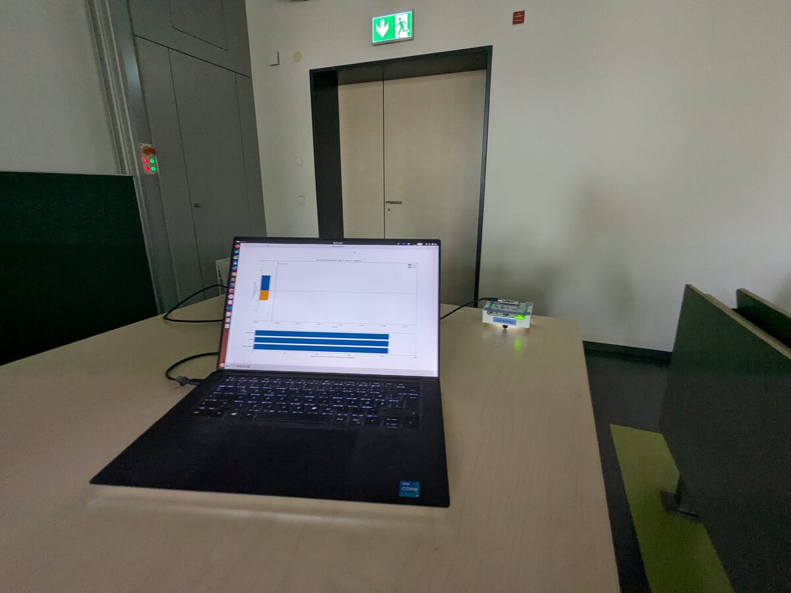
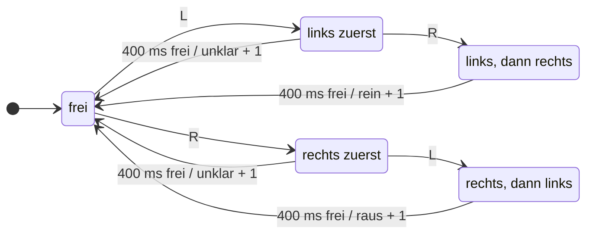
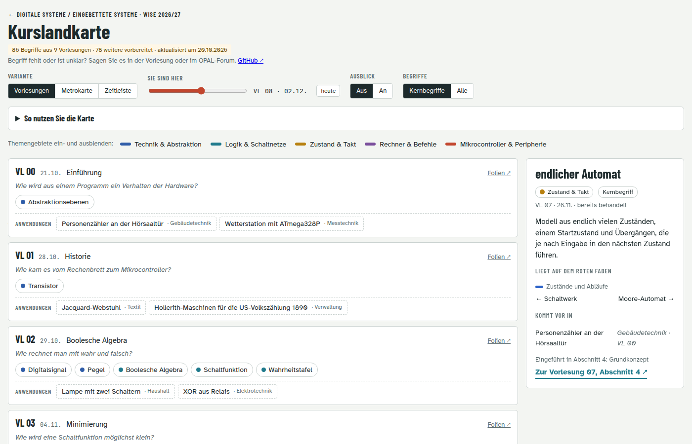
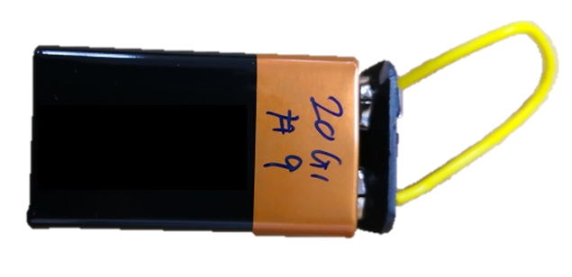

<!--

author:   Sebastian Zug, André Dietrich & `fjangfaragesh`, `FnHm`, `gjaeger`, `ShyFlyGuy`, `Lalelele` & Claude Code (Opus 5.5)
email:    sebastian.zug@informatik.tu-freiberg.de & andre.dietrich@informatik.tu-freiberg.de & fabian.baer@student.tu-freiberg.de
version:  0.6.8
language: de
narrator: Deutsch Female

import:   https://raw.githubusercontent.com/liascript-templates/plantUML/master/README.md
          https://raw.githubusercontent.com/liaTemplates/AVR8js/main/README.md
          https://raw.githubusercontent.com/LiaTemplates/DigiSim/master/README.md
          https://raw.githubusercontent.com/liaScript/mermaid_template/master/README.md
          https://raw.githubusercontent.com/TUBAF-IfI-LiaScript/VL_EingebetteteSysteme/master/config.md

@style
.ebenen {
  float: right;
  width: 250px;
  margin: 0 0 12px 24px;
  padding: 6px 0;
  border: 1px solid rgba(128, 128, 128, .35);
  border-radius: 6px;
  font-size: 14px;
  line-height: 1.35;
}
.ebenen .e { padding: 2px 10px; opacity: .45; border-left: 4px solid transparent; }
.ebenen .e4 { text-decoration: line-through; }
.ebenen[data-hier~="6"] .e6, .ebenen[data-hier~="5"] .e5, .ebenen[data-hier~="3"] .e3,
.ebenen[data-hier~="2"] .e2, .ebenen[data-hier~="1"] .e1, .ebenen[data-hier~="0"] .e0 {
  opacity: 1;
  font-weight: bold;
  border-left-color: #1f7a8c;
  background: rgba(31, 122, 140, .15);
}
*:has(> .ebenen) { display: flow-root; }
*:has(> .ebenen) > .lia-code, *:has(> .ebenen) > .lia-table-responsive, *:has(> .ebenen) > table { clear: right; }
*:has(> .ebenen) > .lia-quote { display: flow-root; }
@media (max-width: 800px) {
  .ebenen { float: none; width: auto; margin: 0 0 12px 0; }
}
@end

@ebenen
<div class="ebenen" data-hier="@0" role="img" aria-label="Abstraktionsebenen, hervorgehoben: Ebene @0">
<div class="e e6">6 · Problemorientierte Sprache</div>
<div class="e e5">5 · Assemblersprache</div>
<div class="e e4">4 · Betriebssystem</div>
<div class="e e3">3 · Instruktionsset</div>
<div class="e e2">2 · Mikroarchitektur</div>
<div class="e e1">1 · Digitale Logik</div>
<div class="e e0">0 · E-Technik, Physik</div>
</div>
@end

-->

# Einführung

    --{{0}}--
Herzlich willkommen zu Digitale Systeme und Eingebettete Systeme! Heute geht es noch nicht um Details, sondern um Einordnung und Motivation: Worum geht es in diesem Semester, und warum lohnt es sich für Sie? Haben Sie schon einmal darüber nachgedacht, wie aus einem Hochsprachen-Programm ein tatsächliches Verhalten eines Computers wird? Die Idee liegt darin, die Komplexität dieser Frage in handhabbare Schichten zu unterteilen. Wie diese Schichten genau aussehen, werden wir in dieser Vorlesung systematisch erarbeiten.

[](https://liascript.github.io/course/?https://raw.githubusercontent.com/TUBAF-IfI-LiaScript/VL_EingebetteteSysteme/master/00_Einfuehrung.md#1)

**Herzlich willkommen zu Digitale Systeme / Eingebettete Systeme!**

| Parameter                | Kursinformationen                                                                                        |
| ------------------------ | -------------------------------------------------------------------------------------------------------- |
| **Veranstaltung:**       | @config.lecture                                                                                          |
| **Semester:**            | @config.semester                                                                                         |
| **Hochschule:**          | `Technische Universität Freiberg`                                                                        |
| **Inhalte:**             | `Motivation der Vorlesung "Eingebettete Systeme" und Beschreibung der Organisation der Veranstaltung`   |
| **Link auf GitHub:**     | https://github.com/TUBAF-IfI-LiaScript/VL_EingebetteteSysteme/blob/master/00_Einfuehrung.md             |
| **Autoren:**             | @author                                                                                                  |

---------------------------------------------------------------------

**Lernziele:** Nach dieser Vorlesung können Sie

+ erklären, was ein eingebettetes System ist und worin es sich von einem herkömmlichen Computer unterscheidet,
+ die Abstraktionsebenen zwischen einem Programm im Arduino-Framework und der Hardware benennen und Beispiele einer Ebene zuordnen,
+ an Geräten Ihres Alltags und an Ihrem Studiengang begründen, wozu Sie dieses Wissen brauchen – auch im Zeitalter von KI,
+ den Ablauf der Veranstaltung mit Vorlesung, Übung und Prüfung wiedergeben.

<!-- kurslandkarte:knopf-start -->

<a href="https://tubaf-ifi-liascript.github.io/VL_EingebetteteSysteme/kurslandkarte/#termin=0" style="display: inline-block; padding: 0.5em 1.1em; background-color: #00718A; color: #ffffff; text-decoration: none; font-family: 'IBM Plex Sans', 'Segoe UI', system-ui, sans-serif; font-weight: 600;">🗺️ Diese Vorlesung in der Kurslandkarte →</a>

<!-- kurslandkarte:knopf-ende -->

---------------------------------------------------------------------

## Worum geht es in dieser Vorlesung?

    --{{0}}--
Zur Beantwortung dieser Frage beginnen nicht mit Theorie, sondern mit einem kleinen Programm für den Mikrocontroller ATmega328P (Microchip, 8-Bit-AVR). Es ist mit dem Arduino-Framework geschrieben und läuft hier im Browser auf einem simulierten Controller mit der Pinbelegung des Boards Arduino UNO R3. Starten Sie die Simulation und beobachten Sie die vier LEDs, die Ausgabe der seriellen Schnittstelle und das Diagramm darunter, das die Pegel an den Pins über die Zeit aufzeichnet.

<div id="example1">
<wokwi-led color="red"   pin="13" label="13"></wokwi-led>
<wokwi-led color="green" pin="12" label="12"></wokwi-led>
<wokwi-led color="blue"  pin="11" label="11"></wokwi-led>
<wokwi-led color="blue"  pin="10" label="10"></wokwi-led>
<span id="simulation-time"></span>
<avr-chart signals="D13, D12, D11, D10" window="2s" title="Pegel an den Pins 13 bis 10"></avr-chart>
</div>

```cpp BlinkLEDs.ino
byte leds[] = {13, 12, 11, 10};

void setup() {
  Serial.begin(115200);
  for (byte i = 0; i < sizeof(leds); i++) {
    pinMode(leds[i], OUTPUT);
  }
}

int i = 0;
void loop() {
  Serial.print("LED: ");
  Serial.println(i);
  digitalWrite(leds[i], HIGH);
  delay(250);
  digitalWrite(leds[i], LOW);
  i = (i + 1) % sizeof(leds);
}
```
@AVR8js.sketch(example1)

> **Frage:** Welche Funktion hat der Code? Lesen Sie die Antwort im Diagramm ab, bevor Sie weiterklicken.

    --{{1}}--
Der Code schaltet nacheinander vier LEDs an den Pins 13 bis 10 ein und aus, jede für 250 Millisekunden. Das Diagramm darunter zeigt dasselbe wie ein Logikanalysator: Zu jedem Zeitpunkt ist höchstens ein Pin auf HIGH. Hinter diesen knapp zwanzig Zeilen steckt viel mehr, als man sieht – Bibliothekscode des Arduino-Frameworks, ein Compiler und am Ende Transistoren, die schalten. Die verwendeten Funktionen wie pinMode oder digitalWrite können Sie in der Sprachreferenz auf der Webseite arduino.cc nachschlagen.

      {{2}}
> **Frage:** Was ist notwendig, damit dieses Programm auf einem Mikrocontroller ausgeführt werden kann?

    --{{2}}--
Der Code muss übersetzt werden. Der Compiler macht aus dem C++-Code Assemblerbefehle für die AVR-Architektur, der Assembler daraus Maschinencode – Zahlen, die der Mikrocontroller direkt ausführen kann. Der Linker fügt die benötigten Teile der Arduino-Bibliothek hinzu und legt fest, wo im Speicher alles steht. Das Ergebnis wird als Hex-Datei auf den Controller übertragen.

      {{3}}
******************************************************

Keine Sorge: Diese Zahlen müssen Sie heute nicht lesen können – es geht nur darum, wohin die Reise geht.

```hex
:100000000C945D000C9485000C9485000C94850084
:100010000C9485000C9485000C9485000C9485004C
:100020000C9485000C9485000C9485000C9485003C
:100030000C9485000C9485000C9485000C9485002C
:100040000C9412020C9485000C9482020C945C02B5
:100050000C9485000C9485000C9485000C9485000C
:100060000C9485000C9485000000000024002700FB
:100070002A0000000000250028002B0004040404CE
:100080000404040402020202020203030303030342
:10009000010204081020408001020408102001021F
...
```

Jede Zeile hat dasselbe Format: `:` · Anzahl der Datenbytes (`10` = 16) · Adresse im Programmspeicher (`0000`) · Typ (`00` = Daten) · die Datenbytes · eine Prüfsumme.

> **Am Ende des Semesters können Sie jeden Schritt dieser Transformation erklären.**

******************************************************

    --{{3}}--
Lesen Sie die erste Zeile nach dem Schema unter dem Kasten: Auf Doppelpunkt, Länge, Adresse und Typ folgen die Datenbytes. Die ersten vier davon – null C, neun vier, fünf D, null null – bilden einen einzigen Maschinenbefehl, einen Sprungbefehl mit dem Kürzel jmp. Als Ziel steht darin die Wortadresse fünf D hexadezimal, also 93; weil jedes Befehlswort zwei Bytes lang ist, entspricht das der Byteadresse 186. Der Befehl steht an Adresse null, dort beginnt der Controller nach einem Reset. Von dort springt er zum Startcode, der das Programm vorbereitet und schließlich setup und loop aufruft. Die Grundprinzipien, die wir an diesem kleinen Controller lernen, gelten für jeden Rechner.

### Die Reise: 16 Vorlesungen zum Verständnis

    --{{0}}--
Die Tabelle zeigt den Weg durch das Semester von oben nach unten: von der Booleschen Algebra über Schaltnetze, Speicher und Rechenwerk bis zum realen Controller. Die letzte Spalte schlägt bei jeder Vorlesung die Brücke zum ATmega328P – dort finden Sie Begriffe aus dem Programm vom Anfang wieder, etwa das Register DDRB oder die Funktion analogRead. Die Vorlesungen 12, 14 und 15 verteilen sich auf je zwei Termine; die Terminspalte zeigt, wann welcher Foliensatz an der Reihe ist.

<!-- data-type="none" -->
| Vorlesung                                           | Termin | Was lernen Sie hier?          | Wo steckt das im ATmega328P?                       |
| --------------------------------------------------- | ---- | ----------------------------- | -------------------------------------------------- |
| [00 Einführung](00_Einfuehrung.md)                  | Mi 21.10. | Die große Vision              | vom Sketch zur Hex-Datei                           |
| [01 Historie](01_HistorischerUeberblick.md)         | Mi 28.10. | Von Leibniz zum Mikrocontroller | warum der Chip so aussieht, wie er aussieht        |
| [02 Boolesche Algebra](02_BoolscheAlgebra.md)       | Do 29.10. | 0 und 1 verstehen             | `if (a && b)`, Bitmasken                           |
| [03 Minimierung](03_Minimierung.md)                 | Mi 04.11. | Effizienz in Logik            | weniger Gatter für dieselbe Funktion               |
| [04 Schaltnetze](04_Schaltnetze.md)                 | Mi 11.11. | Logik wird Hardware           | die Logik im Chip, inklusive ihrer Laufzeiten      |
| [05 Standardschaltnetze](05_Standardschaltnetze.md) | Do 12.11. | Decoder & Multiplexer         | Registerauswahl, Kanalwahl beim `analogRead`       |
| [06 FlipFlops](06_FlipFlops.md)                     | Mi 25.11. | Speicher entsteht             | das Bit in `DDRB`, das sich „Ausgang“ merkt        |
| [07 Schaltwerke](07_Schaltwerke.md)                 | Do 26.11. | Zustandsmaschinen             | Steuerungen mit Zuständen, z. B. eine Ampel        |
| [08 Standardschaltwerke](08_StandardSchaltwerke.md) | Mi 02.12. | Counter & Register            | der Zähler hinter `millis()`                       |
| [09 Rechnerarithmetik](09_Rechnerarithmetik.md)     | Mi 09.12. | Addition in Hardware          | `int`, Überlauf, `float`                           |
| [10 CPU-Basis](10_CPU_Basis.md)                     | Do 10.12. | Der erste Prozessor           | Rechenwerk, Steuerwerk, Speicher                   |
| [11 Modell-CPU](11_Modell_CPU.md)                   | Mi 16.12. | Befehl für Befehl             | was mit `0C 94 5D 00` passiert                     |
| [12 AVR-CPU](12_AVR_CPU.md)                         | Mi 06.01. + Mi 13.01. | **Ihr Controller: ATmega328P** | ATmega328P, Toolchain, Register                    |
| [13 ADC](13_ADC.md)                                 | Do 14.01. | Analog trifft Digital         | `analogRead`                                       |
| [14 Timer & Interrupts](14_TimerUndInterrupts.md)   | Mi 20.01. + Mi 27.01. | Unterprogramme, Stack, Timing | `attachInterrupt`, `delay`, `analogWrite`, Echtzeit |
| [15 Aktoren](15_Aktoren.md)                         | Do 28.01. + Mi 03.02. | Hardware bewegen, Ausblick    | Servo, Schrittmotor, Echtzeit, Energiesparen – und die Hex-Datei vom Anfang komplett lesen |

> Für 16 Vorlesungen haben wir 21 Termine: Die Vorlesungen 12, 14 und 15 erstrecken sich über zwei Termine (Teil I und Teil II). Am Mi 10.02. wiederholen wir den Stoff und besprechen die Probeklausur, Do 11.02. ist ein Puffer. Am Mi 18.11. (Buß- und Bettag) ist keine Vorlesung.

### Was steht am Ende?

    --{{0}}--
Diese Fragen klingen heute vielleicht noch rätselhaft. Sie greifen Zeilen aus dem Beispielprogramm und der Hex-Datei vom Anfang auf; die kursive Zeile unter jeder Frage nennt das Thema, aus dem die Antwort kommt. Am Ende des Semesters sollten Sie jede davon in wenigen Sätzen beantworten können – und genau solche Fragen finden Sie in der Klausur wieder.

**Sie können diese Fragen fundiert beantworten:**

1. **„Wie wird `pinMode(13, OUTPUT)` zu einer Hardware-Konfiguration?“**  
   *Von der Funktion des Arduino-Frameworks über Assembler zum Bit im Register `DDRB` und zur Tri-State-Logik am Pin*

2. **„Was bedeutet `Serial.begin(115200)`?“**  
   *Die serielle Schnittstelle (UART) überträgt Bit für Bit ohne gemeinsamen Takt – deshalb vereinbaren beide Seiten zu Beginn die „Sprechgeschwindigkeit“.*

3. **„Ist ein `delay(1000)` tatsächlich genau 16.000.000 Taktzyklen lang?“**  
   *Taktfrequenz, Befehlszyklen und Timer-Hardware verstehen*

4. **„Was passiert im ATmega328P während `analogRead(A0)`?“**  
   *ADC-Wandlung, Abtastung, Quantisierung und Speicherung*

5. **„Wie führt die CPU den Maschinenbefehl `0C 94 5D 00` aus?“**  
   *Befehl holen, dekodieren, ausführen; Register und Programmzähler*

6. **„Wie sähe `if (digitalRead(2) && digitalRead(3))` als Schaltung aus – und was wäre daran anders als im Programm?“**  
   *Boolesche Algebra, Gatter, Grenze zwischen Hardware und Software*

7. **„Wie kann ein 8-bit-Mikrocontroller 16-bit-Zahlen addieren?“**  
   *Rechnen in mehreren Schritten, Carry-Flag, Aufbau der ALU*

8. **„Woher weiß der Controller nach einem Interrupt, wo er weitermachen muss?“**  
   *Unterprogramme, Rücksprungadresse und Stack*


## Der Unterschied zu einem "Arduino-Kurs"

    --{{0}}--
Nach einem typischen Einsteigerkurs mit dem Arduino-Framework können Sie LEDs blinken lassen. Nach diesem Kurs können Sie erklären, welche Register dabei beschrieben werden, warum digitalWrite deutlich mehr Befehle braucht als ein direkter Registerzugriff und wie aus dem Bit im Register ein Pegel am Pin wird. Das ist der Unterschied zwischen „es funktioniert“ und „ich verstehe, warum es funktioniert“.

**Arduino-Kurs:** "Drücke diesen Button, LEDs blinken" ✨ *Magie!*

**Unser Kurs:** "Was passiert unterhalb der Anwendungsebene?"

!?[Arduino Projekte 2025](https://www.youtube.com/watch?v=Z1EyY-ZJibU)

### Was ist ein eingebettetes System?

    --{{0}}--
Die Vorlesung heißt „Eingebettete Systeme“ – also klären wir den Begriff, bevor wir losgehen. Die vier Merkmale auf der Folie sind keine strenge Definition, sondern typische Eigenschaften; nicht jedes eingebettete System zeigt alle. Unser Lauflicht von eben ist ein Miniaturbeispiel: Der ATmega328P erfüllt eine feste Aufgabe und arbeitet mit LEDs statt mit Bildschirm und Tastatur. Prüfen Sie die Merkmale anschließend an den Geräten in der Frage.

Ein **eingebettetes System** ist ein Rechner, der fest in ein technisches Gerät eingebaut ist und dort eine bestimmte Aufgabe erfüllt – meist ohne dass man ihn als Rechner wahrnimmt. Typisch sind:

+ eine **feste Aufgabe** statt beliebiger Programme (Waschmaschine, Motorsteuerung, Wetterstation),
+ **Sensoren und Aktoren** statt Tastatur und Bildschirm,
+ **knappe Ressourcen**: wenig Speicher, wenig Rechenleistung, wenig Energie, geringe Kosten,
+ oft **Echtzeitanforderungen**: Die Reaktion muss nicht nur richtig, sondern auch rechtzeitig kommen – ein Airbag, der eine Sekunde zu spät auslöst, ist nutzlos.

### Unsere Bottom-Up-Reise

    --{{0}}--
Lesen Sie das Bild von oben nach unten: Jede Ebene beschreibt denselben Rechner, nur mit anderen Begriffen, und jede wird von der Ebene darunter umgesetzt. Die meisten Programmiererinnen und Programmierer arbeiten auf Ebene 6, nur wenige schauen auf Ebene 5 hinunter. Ebene 4 können wir überspringen, weil auf dem ATmega328P kein Betriebssystem läuft – Ihr Programm läuft direkt auf der Hardware. Wir steigen bis auf Ebene 1 hinab und arbeiten uns von dort systematisch nach oben.

<!--
style="width: 80%; min-width: 420px; max-width: 720px;"
-->
```ascii

                Abstraktionsebenen

           +----------------------------+ -.
  Ebene 6  | Problemorientierte Sprache |  |
           +----------------------------+  |
                                           ⎬ Anwendungssoftware
           +----------------------------+  |
  Ebene 5  | Assemblersprache           |  |
           +----------------------------+ -.

           +----------------------------+
  Ebene 4  | Betriebssystem             |     Systemsoftware (fehlt beim ATmega328P)
           +----------------------------+

           +----------------------------+
  Ebene 3  | Instruktionsset            |     Maschinensprache
           +----------------------------+

           +----------------------------+  -.
  Ebene 2  | Mikroarchitektur           |   |
           +----------------------------+   |
                                            ⎬ Automaten, Speicher, Logik
           +----------------------------+   |       ╔══════════════════╗
  Ebene 1  | Digitale Logik             |   |    ◀══║ HIER STARTEN WIR!║
           +----------------------------+  -.       ╚══════════════════╝

           +----------------------------+
  Ebene 0  | E-Technik, Physik          |     Analoge Phänomene
           +----------------------------+                                      .
```

### Quer über alle Ebenen

                   {{0-1}}
*****************************************************

    --{{0}}--
Wir verfolgen jetzt eine einzige Programmzeile durch die Abstraktionsebenen – so lange, bis wir beim Transistor ankommen, der die eigentliche Arbeit macht.

**Wir bauen von den Grundlagen nach oben!** Jede Ebene erklärt die nächste, bis Sie verstehen, wie Ihr `pinMode()` am Ende einen Transistor schaltet.

**Schauen wir uns konkret an, was auf den einzelnen Ebenen passiert:**

> [!NOTE] Keine Sorge
> **Sie müssen heute noch nicht alles verstehen.** Begriffe wie Interrupt, Register oder Flip-Flop sind heute nur Wegmarken – jeder davon bekommt im Semester seine eigene Vorlesung (Hinweise in Klammern).

*****************************************************


                   {{1-2}}
*****************************************************

@ebenen(6)

**Ebene 6 – Ihr Programm (Arduino-Framework):**

    --{{1}}--
Ebene sechs sieht harmlos aus. Pin 13 ist übrigens kein Zufall – an ihm hängt die eingebaute LED des Boards Arduino UNO R3. Die 13 ist allerdings nur die Beschriftung auf dem Board; am ATmega328P heißt dieser Anschluss PB5, Port B, Bit 5.

```cpp
pinMode(13, OUTPUT);  // Pin 13 als Ausgang konfigurieren
```

*****************************************************

                   {{2-3}}
*****************************************************

@ebenen(6)

**Ebene 6 – darunter: die Arduino-Bibliothek (C, gekürzt aus `wiring_digital.c`):**

    --{{2}}--
Auch die Arduino-Bibliothek ist in C geschrieben, also noch Ebene sechs. Sie übersetzt die Pin-Nummer in ein Register und ein Bit. Bevor sie das Register ändert, schaltet sie Interrupts kurz ab: Eine Interrupt-Routine könnte sonst zwischen Lesen und Zurückschreiben dasselbe Register verändern. Das nennt man eine Race Condition.

```c
void pinMode(uint8_t pin, uint8_t mode) {
  uint8_t bit  = digitalPinToBitMask(pin);           // Pin 13 → Bit 5
  uint8_t port = digitalPinToPort(pin);              // Pin 13 → Port B
  volatile uint8_t *reg = portModeRegister(port);    // → &DDRB
  ...
  if (mode == OUTPUT) {
    uint8_t oldSREG = SREG;   // Statusregister sichern
    cli();                    // Interrupts aus
    *reg |= bit;              // DDRB |= (1 << 5)
    SREG = oldSREG;           // alten Zustand wiederherstellen
  }
}
```

Den Code müssen Sie nur überfliegen. Interrupts und Race Conditions behandeln wir in Vorlesung 14.

Kern des Ganzen ist eine einzige Zeile: `DDRB |= (1 << 5);` – setze Bit 5 im Register `DDRB`. Dabei schiebt `1 << 5` eine Eins um fünf Stellen nach links (`0000 0001` → `0010 0000`), und `|=` verknüpft das Register bitweise mit ODER: Bit 5 wird 1, alle anderen Bits bleiben, wie sie waren.

> [!NOTE] Mehr dazu
> Sie hören „Algorithmen und Datenstrukturen“ nicht parallel? Die Bitoperatoren von C erklärt zum Beispiel das [Wikibook C-Programmierung](https://de.wikibooks.org/wiki/C-Programmierung:_Ausdr%C3%BCcke_und_Operatoren).

*****************************************************

                   {{3-4}}
*****************************************************

@ebenen(5)

**Ebene 5 – Assembler:**

> [!WARNING] Typische Fehlvorstellung
> „`pinMode(13, OUTPUT)` ist ein einzelner Befehl.“ Nur die Kernzeile `DDRB |= (1 << 5);` wird zu einem einzigen Befehl. Die ganze Funktion `pinMode` – mit Tabellen, Sichern des Statusregisters und Interrupt-Sperre – übersetzt der Compiler in deutlich mehr Befehle.

    --{{3}}--
Schreiben wir nur die Kernzeile – setze Bit 5 im Register DDRB – direkt hin, macht der Compiler daraus einen einzigen Assemblerbefehl: sbi, kurz für „set bit in I/O register“, also „setze ein Bit im Ein-/Ausgaberegister“. Die Vier im Befehl ist die Adresse von DDRB im Ein-/Ausgabebereich des Controllers, die Fünf die Bitnummer. Das Programm darunter können Sie direkt ausführen: Es schaltet Pin 13 als Ausgang, kehrt dann in einer Schleife den Pegel des Pins um und wartet dazwischen mit drei verschachtelten Zählschleifen etwa eine halbe Sekunde.

<div id="asm-example">
<wokwi-led color="red" pin="13" label="13"></wokwi-led>
<span id="simulation-time"></span>
</div>

```asm
; Pin 13 (Port B, Bit 5) als Ausgang, dann blinken
#include <avr/io.h>

.global main
main:
  sbi   _SFR_IO_ADDR(DDRB), 5   ; DDRB |= (1 << 5)  →  sbi 0x04, 5

loop:
  sbi   _SFR_IO_ADDR(PINB), 5   ; eine 1 in PINB schaltet PORTB5 um
  rcall wait
  rjmp  loop

; 41 * 256 * 256 * 3 Takte ≈ 8.000.000 Takte = 0,5 s bei 16 MHz
wait:
  ldi   r20, 41
wait_outer:
  ldi   r19, 0                  ; 0 heißt hier: 256 Durchläufe (dec 0 → 255)
wait_middle:
  ldi   r18, 0
wait_inner:
  dec   r18
  brne  wait_inner
  dec   r19
  brne  wait_middle
  dec   r20
  brne  wait_outer
  ret
```
@AVR8js.asm(asm-example)

*****************************************************

                   {{4-5}}
*****************************************************

@ebenen(3 2)

**Ebene 3 – Instruktionsset (Maschinencode):**

    --{{4}}--
Der Assembler übersetzt den Befehl sbi mit Adresse vier und Bit fünf in ein einziges 16-Bit-Wort, hexadezimal neun A zwei fünf. Im Speicher steht das niederwertige Byte zuerst, deshalb lesen Sie dort zwei fünf, neun A. Die Tabelle zerlegt das Wort: Die ersten acht Bits kennzeichnen den Befehl, die nächsten fünf die Adresse, die letzten drei die Bitnummer. Bytes dieser Art – wenn auch nicht genau diese – stehen in der Hex-Datei vom Anfang. Wie das Steuerwerk auf Ebene 2 aus diesen Bits erkennt, was zu tun ist, bauen wir in Vorlesung 10 und 11 nach.

| Assembler     | Maschinencode im Speicher | Bedeutung der Bits                                 |
| ------------- | ------------------------- | -------------------------------------------------- |
| `sbi 0x04, 5` | `25 9A`                   | `1001 1010` = sbi · `00100` = Adresse 4 · `101` = Bit 5 |

Der Befehl ist das 16-Bit-Wort `0x9A25`; im Speicher steht das niederwertige Byte zuerst.

**Ebene 2 – Mikroarchitektur:** Das Steuerwerk erkennt am Bitmuster `1001 1010` den Befehl `sbi`, leitet die Adresse 4 an den Ein-/Ausgabebereich weiter und setzt dort Bit 5. Wie ein Steuerwerk das macht, bauen wir in Vorlesung 10 und 11 selbst nach.
*****************************************************

                   {{5-6}}
*****************************************************

@ebenen(1 0)

**Ebene 1 – Digitale Logik (Hardware-Konfiguration):**

    --{{5}}--
Am Ziel: echte Hardware. Das Register DDRB besteht aus acht Flip-Flops, jedes gehört zu einem Pin. Ist Bit 5 gesetzt, wird der Ausgangstreiber von Pin 13 freigeschaltet: Ein Transistor kann den Pin mit der Versorgungsspannung verbinden, ein anderer mit Masse – das ist genau genommen schon Ebene 0. Das ist der Moment, in dem Software zu Physik wird.

, in der Mitte PORTxn (Ausgabewert), unten der Eingang PINxn; Microchip, ATmega328P Datenblatt, General Digital I/O")<!-- width="70%" -->

Für Pin 13 ist im Bild x = B und n = 5: Das Flip-Flop DDxn ist also DDB5, Bit 5 im Register `DDRB`. Der Ausgangstreiber ist der dreieckige Verstärker in der Mitte, der den Pin Pxn treibt; der Transistor oben links gehört zum Pull-up-Widerstand.

**HIGH und LOW sind Spannungen:** Beim ATmega328P mit 5 V Versorgung liegt HIGH nahe der Versorgungsspannung, LOW nahe 0 V, der Masse. Laut Datenblatt erkennt ein Eingang sicher LOW unter 1,5 V und sicher HIGH über 3,0 V.

Das `DDRB`-Register steuert direkt die **Tri-State-Logik** des I/O-Pins:

- **DDRB[5] = 1**: Ausgangstreiber wird aktiviert → Pin kann HIGH/LOW ausgeben
- **DDRB[5] = 0**: Hochohmig → Pin kann Eingangssignale lesen; ist zusätzlich `PORTB[5] = 1` (das macht `INPUT_PULLUP`), zieht der Pull-up-Widerstand den Pin auf HIGH, solange ihn nichts auf LOW zieht

„Tri-State“ heißt: Ein Ausgang kennt drei Zustände – HIGH, LOW und „abgeschaltet“. Abgeschaltet (hochohmig) beeinflusst der Pin die angeschlossene Leitung praktisch nicht und kann so als Eingang dienen. Mehr dazu in Vorlesung 05 und 12.

*****************************************************

                   {{6}}
*****************************************************

> [!IMPORTANT] Merke
> Zwischen `pinMode(13, OUTPUT)` und dem Pegel an Pin 13 liegen sechs Ebenen: Hochsprache, Assembler, Maschinencode, Mikroarchitektur, digitale Logik und Physik. Jede Ebene beschreibt denselben Vorgang mit eigenen Begriffen und wird von der Ebene darunter umgesetzt.

**Ordnen Sie zu:** Auf welcher Ebene liegt die jeweilige Darstellung?

[[Ebene 6] [Ebene 5] [Ebene 3] [Ebene 1]]
[    (X)       ( )       ( )       ( )    ]  `pinMode(13, OUTPUT);`
[    (X)       ( )       ( )       ( )    ]  `DDRB |= (1 << 5);`
[    ( )       (X)       ( )       ( )    ]  `sbi 0x04, 5`
[    ( )       ( )       (X)       ( )    ]  `25 9A`
[    ( )       ( )       ( )       (X)    ]  das Flip-Flop für Bit 5 in `DDRB`

*****************************************************

## Was können Sie damit bauen?

    --{{0}}--
Mit diesem Verständnis können Sie Systeme gezielt verbessern, statt nur Bibliotheken zu benutzen. Sie wissen, warum der Analog-Digital-Wandler manchmal „rauscht“, wie Sie Timer-Interrupts für präzises Timing einsetzen und warum manche Sensoren fünf Volt brauchen und andere mit 3,3 Volt auskommen. Das obere Bild zeigt eine kleine Wetterstation mit mehreren Sensoren, das untere den Verlauf ihrer Messwerte über die Zeit.

**Von einfachen LEDs zu echten Projekten:**

<!-- width="70%" -->

Nach diesem Kurs wissen Sie nicht nur, wie man Sensordaten ausliest, sondern **warum** der 10-Bit-Analog-Digital-Wandler höchstens 1023 liefert und wie Timer-Interrupts die Abtastung steuern.

<!-- width="70%" -->

In diesem Aufbau bedeuten hohe Werte Dunkelheit und niedrige Werte Helligkeit – das liegt an der Beschaltung des Lichtsensors, nicht am Wandler. Sie verstehen, warum die Messwerte so aussehen, und können die Referenzspannung des Wandlers für präzisere Messungen wählen.

### Heute an der Tür

    --{{0}}--
Als Sie vorhin hereingekommen sind, stand ein kleiner Roboter an der Hörsaaltür. Er zählt, wer hereinkommt und wer hinausgeht. Wie er gebaut ist, spielt heute keine Rolle; uns interessiert die Idee dahinter, denn die steckt in fast jedem eingebetteten System. Ein Abstandssensor schaut quer durch die Tür auf die Wand gegenüber und misst etwa fünfzehnmal pro Sekunde, in mehreren Zonen nebeneinander. Der Auszug stammt aus einem Probelauf in diesem Hörsaal: Erst wird die linke Zone kürzer, dann alle drei, dann nur noch die rechte. Jemand ist von links nach rechts durch die Tür gegangen. Gezählt wird aber erst, als eine knappe halbe Sekunde lang alles frei ist.

<!-- style="max-height: 40vh;" -->

Ein kleiner Roboter an der Hörsaaltür zählt, wer hereinkommt und wer hinausgeht – auch heute, während Sie hereingekommen sind. Ein Abstandssensor misst quer durch die Tür, in drei Zonen nebeneinander, etwa 15-mal pro Sekunde. Auszug aus einem Probelauf im Hörsaal FOR-0270 (Abstände in mm, Zeit nach der Uhr des Roboters):

<!-- data-type="none" -->
| Zeit in ms | links | Mitte | rechts | Was ist passiert?                         |
| ---------: | ----: | ----: | -----: | ----------------------------------------- |
|          0 |  2069 |  2083 |   2098 | alle Zonen sehen die Wand                 |
|         52 |  1136 |  1611 |   2086 | links und Mitte belegt: jemand kommt      |
|        466 |  1206 |  1206 |   1207 | alle Zonen belegt                         |
|        519 |  2048 |  1639 |   1230 | links wieder frei                         |
|        779 |  2074 |  2075 |   2076 | alle frei – jetzt 400 ms abwarten         |
|       1195 |  2072 |  2080 |   2089 | seit 416 ms frei → **„rein“**             |

                {{1}}
*****************************************************

    --{{1}}--
Zerlegt man das Zählen in Schritte, findet man die Themen dieses Semesters wieder. Der Sensor liefert im festen Takt eine Zahl. Ein Vergleich mit einer Schwelle macht daraus ein einziges Bit: Ist die Zone belegt oder frei? Das Diagramm zeigt den Automaten, der aus der Reihenfolge dieser Bits die Richtung bestimmt. Er startet im Zustand frei. Wird zuerst die linke Zone belegt, merkt er sich das; wird danach auch die rechte belegt, merkt er sich auch das. Erst wenn eine knappe halbe Sekunde lang alles frei ist, ist der Durchgang vorbei: Links, dann rechts zählt als Eintritt, rechts, dann links als Austritt. War nur eine Seite belegt, zählt der Durchgang als unklar. Jeden dieser Bausteine bauen wir im Laufe des Semesters aus Gattern und Flip-Flops nach.

**Die Idee in vier Schritten – als Automat:**



1. **Takt:** Neue Messungen kommen im Raster von 52 ms; weil ab und zu eine ausfällt, sind es im Mittel etwa 15 pro Sekunde. Mit jeder Messung prüft der Automat, ob er den Zustand wechselt. Jede Messung bringt die Uhrzeit des Roboters mit, daran misst der Zähler auch die 400 ms (Abtastung und Timer, Vorlesung 13 und 14).
2. **Schwelle:** Ein Vergleich macht aus jedem Abstand ein Bit: L = 1 heißt „links näher als 80 % der Wand“, R = 1 dasselbe rechts. Wie weit die Wand weg ist, lernt der Zähler selbst aus den freien Messungen (Komparator, Vorlesung 05).
3. **Automat:** Die Zustände merken sich, welche Seite zuerst belegt war und ob die andere danach auch belegt wurde. „Frei“ heißt: alle Zonen 400 ms lang frei – eine Lücke zwischen zwei Beinen zählt also nicht doppelt (Schaltwerke, Vorlesung 07).
4. **Zähler:** Beim Rückweg nach „frei“ zählt „rein“, „raus“ oder „unklar“ um eins hoch (Vorlesung 08).

Nicht im Bild: Die mittlere Zone hält einen Durchgang offen, entscheidet aber nicht über die Richtung. Werden links und rechts in derselben Messung belegt, zählt das als „unklar“. Steht etwas länger als 6 s im Weg, lernt der Zähler die neue Entfernung als Wand und zählt nichts.

> **Und heute?** Am Ende der Vorlesung schauen wir auf die Zählung von heute: Wann sind Sie gekommen – und wo hat sich der Roboter verzählt?

*****************************************************

### Wozu brauche ich das in meinem Studiengang?

    --{{0}}--
Die Vorlesung hören Studierende aus sehr unterschiedlichen Richtungen. Jede Gruppe nimmt etwas anderes mit – aber alle profitieren davon, eine Schicht tiefer schauen zu können als bisher.

+ **Robotik**: Jeder Roboter ist ein eingebettetes System – Sensoren lesen, Motoren ansteuern, rechtzeitig reagieren.
+ **Angewandte Informatik**: Sie verstehen, was Ihr Programm auf der Hardware tatsächlich tut, und warum manches langsam oder speicherhungrig ist.
+ **Smart Systems Engineering**: Ein „smartes“ System misst, entscheidet und handelt selbst – im Kern sitzt fast immer ein Mikrocontroller zwischen Sensor und Aktor. Hier sehen Sie, wie er Sensorwerte erfasst, verarbeitet und Aktoren ansteuert (Vorlesung 12–15).
+ **Mathematik**: Boolesche Algebra und Automaten werden hier zu Schaltungen – mit Laufzeiten, Takten und Grenzen der Physik.
+ **Ingenieurwissenschaften**: Messen, Steuern und Regeln laufen heute fast immer auf einem Mikrocontroller. Abtastung, Quantisierung und Pulsweitenmodulation kennen Sie vielleicht aus der Messtechnik – hier sehen Sie, wie der Controller sie umsetzt (Vorlesung 13–15), bis hin zu Servo und Schrittmotor; in Vorlesung 12 wird auch ein Simulink-Modell zu Code für den Controller.

### Und was ist mit KI?

    --{{0}}--
Ein KI-Assistent schreibt Ihnen in Sekunden einen Sketch für den Controller. Brauchen Sie diese Vorlesung dann noch? Ja, denn Sie müssen sagen können, was Sie wollen, und prüfen können, ob das Ergebnis stimmt. Auf einem Mikrocontroller ist das schwieriger als auf dem Laptop: Es gibt keine Fehlermeldung, wenn ein Zähler doppelt zählt oder ein Pin überlastet wird. Der Personenzähler von vorhin ist ein gutes Beispiel. Ein erster Entwurf, der schon bei der ersten freien Messung zählt, läuft ohne jeden Fehler und zählt trotzdem jede Person zweimal, wenn zwischen den Beinen eine Lücke ist. Das merkt nur, wer den Automaten dahinter versteht. Dazu kommt: Auch KI läuft auf Hardware. Ein Sprachmodell braucht Gigabytes an Speicher, der ATmega328P hat zwei Kilobyte. Was davon auf einen Controller passt, entscheidet, wer die Hardware kennt. Und in der Klausur sind nur Unterlagen auf Papier erlaubt.

> **Wer die Begriffe nicht kennt, kann auch die Hilfe einer KI nicht nutzen.**

<!-- data-type="none" -->
|                     | Ohne Begriffe                                    | Mit Begriffen                                                                                                   |
| :------------------ | :----------------------------------------------- | :-------------------------------------------------------------------------------------------------------------- |
| **Frage an die KI** | „Mein Sensorwert zappelt, mach das besser.“      | „Der ADC misst 10 Bit gegen 5 V, mein Signal bleibt unter 1 V: Nimm die interne 1,1-V-Referenz.“                 |
| **Antwort prüfen**  | „Der Sketch lässt sich hochladen, also stimmt er.“ | „Ist die Variable, die der Interrupt ändert, `volatile`? Wie lange dauert der Interrupt? Verträgt der Pin den Strom?“ |

+ **Ein Controller meldet keine Fehler.** Der Personenzähler von vorhin läuft auch dann ohne Fehlermeldung, wenn er bei der ersten freien Messung zählt – und zählt dann jede Person doppelt, die mit einer Lücke zwischen den Beinen durch die Tür geht.
+ **Auch KI läuft auf Hardware.** Ein Sprachmodell braucht Gigabytes, der ATmega328P hat 2 KB Arbeitsspeicher. Was auf einen Controller passt, entscheidet, wer Rechenwerk, Speicher und Takt kennt.
+ **In der Klausur** sind nur Unterlagen auf Papier erlaubt.

## Organisation

    --{{0}}--
Die Vorlesung und die theoretischen Übungsblätter betreut Sebastian Zug; wer die praktischen Übungen ab Januar leitet, geben wir noch bekannt. Alle organisatorischen Informationen, Ankündigungen und Übungsblätter laufen über OPAL, die Lernplattform der sächsischen Hochschulen. Melden Sie sich dort bitte heute noch für die Veranstaltung an – im OPAL heißt sie kurz „Digitale Systeme“.

| Name                    | Email                                   | Aufgabe                                  |
| :---------------------- | :-------------------------------------- | :--------------------------------------- |
| Prof. Dr. Sebastian Zug | sebastian.zug@informatik.tu-freiberg.de | Vorlesung, theoretische Übungsblätter    |
| N.N.                    |                                         | praktische Übungen ab Januar             |

> Bitte melden Sie sich im OPAL unter [Digitale Systeme](https://bildungsportal.sachsen.de/opal/auth/RepositoryEntry/37204033543) für die Veranstaltung an – dort heißt sie kurz „Digitale Systeme“. Dort finden Sie auch die aktuellen Informationen zur Veranstaltung.

### Ihre Vorkenntnisse

    --{{0}}--
Die Vorlesung hören Studierende mit sehr unterschiedlichen Vorkenntnissen. Ihre Antworten helfen uns, Beispiele und Übungen passend zu wählen. Die Abfrage ist anonym; wir sammeln die Antworten im Hörsaal über das LiaScript-Klassenzimmer.

> Den Link zum LiaScript-Klassenzimmer zeigen wir Ihnen im Hörsaal. Treten Sie bei, bevor Sie antworten – sonst bleiben Ihre Antworten nur in Ihrem eigenen Browser.

**Aus welchem Studiengang kommen Sie?**

[(informatik)] Angewandte Informatik
[(robotik)] Robotik
[(mathe)] Mathematik
[(ingenieur)] ein Ingenieurstudiengang
[(anderer)] ein anderer Studiengang

**Welche Erfahrung haben Sie mit Arduino oder anderen Mikrocontrollern?**

[(keine)] keine Vorerfahrung
[(kurz)] kurz ausprobiert, Praktikum oder Ähnliches
[(basteln)] umfangreiche „Basteleien“
[(beruf)] Berufserfahrung mit Mikrocontrollern

**Können Sie in C programmieren?**

[(parallel)] ich lerne C in diesem Semester (Algorithmen und Datenstrukturen)
[(ja)] ja, schon vorher
[(nein)] nein, und ich höre auch keine C-Vorlesung

### Zeitplan

    --{{0}}--
Die Vorlesung findet jeden Mittwoch statt, am Donnerstag nur in geraden Kalenderwochen; welcher Foliensatz an welchem Termin dran ist, zeigt die Tabelle auf der Folie „Die Reise“. Die beiden Übungsgruppen am Montag- und Donnerstagabend beginnen erst Ende November, wenn genug Stoff für die ersten Übungsblätter vorhanden ist. Wie die Gruppen eingeteilt werden, erfahren Sie bis Mitte November im OPAL.

Die Veranstaltung wird sowohl für die Vorlesung als auch die Übung in Präsenz durchgeführt.

<!-- data-type="none" -->
| Veranstaltungen | Tag        | Zeitslot      | Ort      | Bemerkung                    |
| --------------- | ---------- | ------------- | -------- | ---------------------------- |
| Vorlesung I     | Mittwoch   | 16:15 - 17:45 | FOR-0270 | wöchentlich                  |
| Vorlesung II    | Donnerstag | 11:30 - 13:00 | FOR-0270 | gerade Kalenderwochen        |
| Übung, Gruppe 1 | Montag     | 18:00 - 19:30 | KKB-2097 | ab Ende November              |
| Übung, Gruppe 2 | Donnerstag | 18:00 - 19:30 | KKB-2097 | ab Ende November             |

Am **Mittwoch, 18.11.** (Buß- und Bettag), entfällt die Vorlesung.

> Die Übungen starten Ende November mit theoretischen Übungsblättern. Ab Januar vertiefen Sie Ihre Kenntnisse in praktischen Übungen an Mikrocontrollerschaltungen. Datum, Rhythmus und Gruppeneinteilung geben wir bis Mitte November im OPAL bekannt.

### Prüfungsmodalitäten

    --{{0}}--
Die Klausur ist eine Open-Book-Klausur: Sie dürfen alle schriftlichen Unterlagen mitbringen, solange sie nicht digital sind. Es lohnt sich deshalb, die PDF-Fassungen der Vorlesungen auszudrucken und im Laufe des Semesters mit eigenen Notizen zu ergänzen – auch diese Sprechertexte stehen darin. Ein offenes Buch ersetzt aber kein Verständnis: Die Aufgaben verlangen Erklärungen und eigene Lösungswege, die Sie in der verfügbaren Zeit selbst entwickeln müssen.

> *Prüfungsform:* Die Veranstaltung wird mit einer schriftlichen Prüfung abgeschlossen. Diese wird als __Open Book Klausur__ entworfen. Sie dürfen dazu alle schriftlichen, nicht-digitalen Materialien verwenden.

**Ein offenes Buch ersetzt aber kein Verständnis.** Notenverteilung des letzten Wintersemesters (25 Teilnehmende):

<lia-chart
option='{
  "tooltip": {"trigger": "axis", "formatter": "Note {b}: {c} Studierende"},
  "grid": {"left": 48, "right": 16, "top": 40, "bottom": 72},
  "xAxis": {
    "type": "category",
    "name": "Note",
    "nameLocation": "middle",
    "nameGap": 52,
    "axisTick": {"show": false},
    "axisLabel": {"interval": 0},
    "data": ["1,0","1,3","1,7","2,0","2,3","2,7","3,0","3,3","3,7","4,0","5,0\nnicht bestanden"]
  },
  "yAxis": {
    "type": "value",
    "name": "Anzahl",
    "minInterval": 1,
    "splitLine": {"lineStyle": {"opacity": 0.3}}
  },
  "series": [{
    "type": "bar",
    "barWidth": "60%",
    "itemStyle": {"color": "#2a78d6", "borderRadius": [4, 4, 0, 0]},
    "data": [1, 1, 1, 2, 4, 2, 1, 3, 3, 2,
             {"value": 5, "itemStyle": {"color": "#d03b3b", "borderRadius": [4, 4, 0, 0]}}]
  }]
}'></lia-chart>

Ein Fünftel hat trotz offener Unterlagen nicht bestanden, der Median lag bei 3,3. Wer im Semester mitarbeitet, braucht in der Klausur keine Zeit zum Nachlesen – deshalb gibt es zu jeder Vorlesung eine Hausaufgabe mit Selbstkontrolle und Ende Januar eine Probeklausur.

Im Laufe der Übungen werden wir "alte" Übungsaufgaben durchspielen, die Ihnen einen Eindruck von der Prüfung vermitteln sollen. Ende Januar stellen wir eine Probeklausur bereit, die wir in der letzten Vorlesung am 10.02. besprechen.

### Literaturempfehlungen

    --{{0}}--
Die Bücher ergänzen die Vorlesungsunterlagen, wenn Sie ein Thema ausführlicher oder aus einem anderen Blickwinkel erklärt haben möchten. Patterson und Hennessy beschreiben vor allem den Aufbau von Prozessoren, die beiden deutschsprachigen Lehrbücher decken die Grundlagen von der Booleschen Algebra bis zum Rechner ab. Das Video gibt in wenigen Minuten einen anschaulichen Überblick, wie ein Prozessor Befehle abarbeitet.

1. Umfassende Lehrbücher

   + David A. Patterson, John L. Hennessy: Computer Organization & Design
   + B. Becker, R. Drechsler, P. Molitor: Technische Informatik - Eine Einführung, Pearson Studium, 2005
   + Hoffmann, D. W.: Grundlagen der technischen Informatik, Hanser Verlag

2. Videos

   + Youtube – „How a CPU Works“ [Link](https://www.youtube.com/watch?v=cNN_tTXABUA)

Bei den jeweiligen Vorlesungsinhalten werden zusätzliche Materialien angegeben.

## Engagement und Motivation

    --{{0}}--
Sechs Leistungspunkte entsprechen 180 Stunden Arbeit. Nur ein Viertel davon verbringen Sie in Vorlesung und Übung; auf jede Stunde Präsenz kommen im Mittel drei Stunden eigene Arbeit. Planen Sie diese Zeit von Anfang an ein, denn der Stoff baut Woche für Woche aufeinander auf.

> *Credit-Points:* 6

> *Arbeitsaufwand:* Der Zeitaufwand beträgt 180 h. Davon sind rund **45 h Präsenzzeit** – pro Woche im Mittel 1,5 × 90 Minuten Vorlesung und 0,5 × 90 Minuten Übung – und rund **135 h Selbststudium**. Das Selbststudium umfasst die Vor- und Nachbereitung der Lehrveranstaltung, die eigenständige Lösung von Übungsaufgaben sowie die Prüfungsvorbereitung.

### Open Educational Resources

    --{{0}}--
Open Educational Resources, kurz OER, sind offene Bildungsmaterialien: Jede und jeder darf sie lesen, weitergeben und verbessern. Alle Folien dieser Vorlesung liegen als Textdateien auf GitHub; wenn Sie einen Fehler finden, können Sie ihn dort selbst korrigieren.

Die Lehrmaterialien sind offen verfügbar und liegen auf GitHub:

[https://github.com/TUBAF-IfI-LiaScript/VL_EingebetteteSysteme](https://github.com/TUBAF-IfI-LiaScript/VL_EingebetteteSysteme)

Die Folien sind in [LiaScript](https://liascript.github.io/course/?https://raw.githubusercontent.com/liaScript/docs/master/README.md#1) geschrieben, einer Erweiterung von Markdown.

### Die Kurslandkarte

    --{{0}}--
Dieser Kurs baut Schicht für Schicht auf: Jeder neue Begriff stützt sich auf frühere, vom Gatter bis zum Prozessor. Die Kurslandkarte hält diesen Zusammenhang fest. Für kommende Vorlesungen stehen nur Termin und Leitfrage; ihre Begriffe kommen erst nach der Vorlesung dazu, mit Ihren Vorschlägen. Das Bild zeigt, wie die Karte nach Vorlesung 08 aussehen könnte: Beim Begriff endlicher Automat steht unter „Kommt vor in“ der Personenzähler von der Hörsaaltür. Neben der Liste gibt es eine Metrokarte, deren Linien rote Fäden durch das Semester sind, zum Beispiel „Vom Gatter zum Prozessor“, und eine Zeitleiste mit allen Begriffen nach Themengebiet.

> **Wo stehen wir – und worauf baut auf, was heute dazukommt?**

Die [Kurslandkarte](https://tubaf-ifi-liascript.github.io/VL_EingebetteteSysteme/kurslandkarte/) zeigt für jede Vorlesung die neuen Begriffe, und zu jedem Begriff

* eine Erklärung in einem Satz,
* die typische Fehlvorstellung, mit der viele am Anfang danebenliegen,
* worauf er aufbaut und wohin er führt,
* Anwendungen, in denen er vorkommt,
* einen Link direkt zur passenden Folie.

<!-- style="max-height: 45vh;" -->

> Am Ende jeder Vorlesung fragen wir Sie nach den Begriffen des Tages. Nach der Vorlesung werden sie in der Karte freigeschaltet.

### Zwei Simulatoren begleiten Sie durchs Semester

    --{{0}}--
Zwei Werkzeuge werden Sie das ganze Semester über begleiten. Mit dem Schaltungssimulator bauen Sie Gatter, Flip-Flops und Zähler. Mit dem Mikrocontroller-Simulator lassen Sie Programme auf einem simulierten ATmega328P mit der Pinbelegung des Arduino UNO R3 laufen – inzwischen mit Tastern, Potentiometern, Servos und einem Blick in das Innere des Controllers.

**Schaltungen mit DigiSim** (ab Vorlesung 04): Klicken Sie auf die beiden Taster `a` und `b`. Wann leuchtet die Lampe?

``` json @DigiSim.evalJson
{"devices":{"a":{"label":"a","type":"Button","propagation":0,"position":{"x":0,"y":0}},"b":{"label":"b","type":"Button","propagation":0,"position":{"x":0,"y":60}},"and1":{"label":"UND","type":"And","propagation":0,"bits":1,"position":{"x":150,"y":25}},"y":{"label":"Lampe","type":"Lamp","propagation":0,"position":{"x":300,"y":30}}},"connectors":[{"from":{"id":"a","port":"out"},"to":{"id":"and1","port":"in1"}},{"from":{"id":"b","port":"out"},"to":{"id":"and1","port":"in2"}},{"from":{"id":"and1","port":"out"},"to":{"id":"y","port":"in"}}],"subcircuits":{}}
```

**Mikrocontroller mit AVR8js** (ab Vorlesung 12): Starten Sie das Programm, drücken Sie den Taster und drehen Sie am Potentiometer. Der Logikanalysator darunter zeigt die Pegel an Pin 2 und 13 und die Spannung am Analogeingang A0.

<div id="sim-tour">
<wokwi-pushbutton color="green" pin="2"></wokwi-pushbutton>
<wokwi-led color="red" pin="13" label="13"></wokwi-led>
<wokwi-potentiometer pin="A0" value="512"></wokwi-potentiometer>
<wokwi-servo pin="9"></wokwi-servo>
<avr-chart signals="D2, D13, ADC0" window="2s" title="Taster, LED und Analogeingang"></avr-chart>
</div>

```cpp Rundgang.ino
#include <Servo.h>

Servo servo;

void setup() {
  pinMode(2, INPUT_PULLUP);   // Taster gedrückt = LOW
  pinMode(13, OUTPUT);
  servo.attach(9);
}

void loop() {
  digitalWrite(13, digitalRead(2) == LOW);  // gedrückt: LED an
  servo.write(map(analogRead(A0), 0, 1023, 0, 180));  // Poti stellt den Servo
  delay(20);
}
```
@AVR8js.sketch(sim-tour)

Was hier passiert, verstehen Sie im Laufe des Semesters Schicht für Schicht: den Pull-up am Taster und die Pegel (Vorlesung 02 und 12), den Analog-Digital-Wandler hinter `analogRead` (Vorlesung 13) und die Pulsweitenmodulation, mit der der Servo gestellt wird (Vorlesung 14 und 15).

### Trotz Simulation und Virtuellem ...

    --{{0}}--
Ein Simulator rechnet mit idealen Bauteilen: Ein Taster schaltet sauber, ein Kurzschluss zerstört nichts. Echte Schaltungen verhalten sich anders, und gerade diese Unterschiede lernt man am besten mit eigenen Händen. Deshalb kommen ab Januar echte Mikrocontrollerschaltungen in die Übung.

... braucht es aber auch immer etwas zum Anfassen. Der Simulator zeigt viel – aber er verzeiht auch Dinge, die echte Hardware nicht verzeiht: falsche Verdrahtung, zu hohe Ströme, prellende Taster. Ab Januar arbeiten Sie deshalb in der Übung mit echten Mikrocontrollerschaltungen.

<!-- style="width: 50%; max-width: 500px" -->

> [!CAUTION] Vorsicht, Hardware
> Verbinden Sie die Pole einer Batterie oder eines Netzteils nie direkt miteinander. Und belasten Sie einen Pin des ATmega328P im Betrieb mit höchstens 20 mA – 40 mA sind laut Datenblatt die absolute Grenze, darüber kann der Ausgangstreiber dauerhaft beschädigt werden. Eine LED schließen Sie deshalb immer mit Vorwiderstand an.

### Und wenn Sie dann immer noch programmieren wollen ...

    --{{0}}--
Das racetech-Team der TU Bergakademie Freiberg baut Rennwagen für die Formula Student, einen internationalen Konstruktionswettbewerb für Studierende, und entwickelt dort auch ein autonom fahrendes Fahrzeug. In einem solchen Fahrzeug arbeiten zahlreiche eingebettete Systeme zusammen – von der Sensorauswertung bis zur Motorsteuerung. Dort können Sie anwenden, was Sie hier lernen.

Dann wartet das __racetech__ Team auf Sie ... autonomes Fahren im Formula Student Kontext.

<!--
style="width: 80%; display: block; margin-left: auto; margin-right: auto;" -->

### Schauen Sie im RoboLab vorbei!

    --{{0}}--
Im RoboLab arbeiten Studierende an Robotern und eingebetteten Systemen. Schauen Sie vorbei und fragen Sie, woran gerade gearbeitet wird – gerade im ersten Semester ist das eine gute Gelegenheit, Kommilitoninnen und Kommilitonen aus höheren Semestern kennenzulernen.

Im RoboLab arbeiten Studierende an eigenen Robotik-Projekten – kommen Sie vorbei und machen Sie mit!


## Was Sie heute mitnehmen

    --{{0}}--
Fassen wir zusammen: Wir haben den Begriff des eingebetteten Systems geklärt und eine einzige Programmzeile von der Hochsprache bis zum Flip-Flop im Controller verfolgt. Diese Ebenen sind das Gerüst für das ganze Semester; jede Vorlesung füllt eine davon aus. Wenn Sie später den Überblick verlieren, fragen Sie sich: Auf welcher Ebene bin ich gerade, und was liegt darunter?

+ Ein **eingebettetes System** ist ein Rechner mit fester Aufgabe in einem Gerät – mit Sensoren, Aktoren, knappen Ressourcen und oft Echtzeitanforderungen.
+ Zwischen `pinMode(13, OUTPUT)` und dem Pegel an Pin 13 liegen **Abstraktionsebenen**: Hochsprache, Assembler, Maschinencode, Mikroarchitektur, digitale Logik, Physik.
+ Am Ende steht eine einfache Bitoperation – `sbi 0x04, 5` setzt ein Flip-Flop in `DDRB` –, und die Hex-Datei besteht aus solchen Befehlen – und aus Tabellen: Ab Adresse 0x90 steht `01 02 04 08 10 20 40 80`, die Bitmasken, in denen `pinMode` das Bit eines Pins nachschlägt.
+ Wir gehen **von unten nach oben**: Nächste Woche beginnen wir mit der Geschichte und der Logik, im Januar sind wir beim Controller angekommen.

> **Zurück zur Tür:** Die Live-Anzeige zeigt, wann Sie heute gekommen sind. Wo hat der Roboter „unklar“ notiert oder sich verzählt – und an welchem der vier Schritte (Takt, Schwelle, Automat, Zähler) liegt das?

**Prüfen Sie sich:**

+ Was ist ein eingebettetes System, und worin unterscheidet es sich von einem herkömmlichen Computer?
+ Welche Abstraktionsebenen liegen zwischen einem Programm im Arduino-Framework und der Hardware? Auf welcher Ebene steht `pinMode(13, OUTPUT)`, auf welcher `sbi 0x04, 5`?
+ Welche Rolle spielen Mikrocontroller wie der ATmega328P in den Geräten Ihres Alltags?
+ Warum lohnt sich dieses Wissen für Informatik, Robotik, Mathematik und Ingenieurwesen – auch im Zeitalter von KI?
+ Wie ist die Veranstaltung aufgebaut, und wie wird geprüft?

## Ihre Begriffe für die Kurslandkarte

Die [Kurslandkarte](https://tubaf-ifi-liascript.github.io/VL_EingebetteteSysteme/kurslandkarte/) wächst mit dem Semester, und Sie bestimmen mit, was hineinkommt. Ihre Antworten sammeln wir im Hörsaal gemeinsam über das LiaScript-Klassenzimmer; nach der Vorlesung werden die Begriffe dieser Woche in der Karte freigeschaltet. Den Link zum Klassenzimmer zeigen wir Ihnen im Hörsaal.

**Welche Begriffe aus der heutigen Vorlesung gehören für Sie in die Kurslandkarte?**

[[___ ___ ___]]

**Wo begegnet Ihnen das, was heute dran war – in Ihrem Studiengang oder in Geräten Ihres Alltags?**

[[___ ___ ___]]

## Hausaufgabe

Planen Sie etwa 30 Minuten ein. Die Quizfragen prüfen Sie direkt hier, offene Fragen besprechen wir zu Beginn der nächsten Vorlesung.

+ Legen Sie sich einen GitHub-Account an ... und finden Sie als Erste oder Erster einen Tippfehler in den Unterlagen, den Sie als Contributor korrigieren :-)

+ Lassen Sie die Vorlesung noch mal anhand eines konkreten Beispiels Revue passieren: Was macht der Compiler aus einer einzigen Zeile C? Wie viele Befehle braucht der AVR für die Addition in `addiere32` (ohne `ret`)? Warum braucht der AVR für 32 Bit viermal so viele Befehle wie für 8 Bit? Warum braucht der x86-64-Prozessor Ihres Laptops für beide Funktionen nur einen Befehl?

 mit AVR gcc 14.3 und x86-64 gcc 14.2, Optimierung -O2")<!-- style="width: 100%" -->

[Beispiel im Compiler Explorer öffnen](https://godbolt.org/clientstate/eyJzZXNzaW9ucyI6IFt7ImlkIjogMSwgImxhbmd1YWdlIjogImMiLCAic291cmNlIjogIiNpbmNsdWRlIDxzdGRpbnQuaD5cblxudWludDhfdCBhZGRpZXJlOCh1aW50OF90IGEsIHVpbnQ4X3QgYikge1xuICAgIHJldHVybiBhICsgYjtcbn1cblxudWludDMyX3QgYWRkaWVyZTMyKHVpbnQzMl90IGEsIHVpbnQzMl90IGIpIHtcbiAgICByZXR1cm4gYSArIGI7XG59XG4iLCAiY29tcGlsZXJzIjogW3siaWQiOiAiY2F2cmcxNDMwIiwgIm9wdGlvbnMiOiAiLU8yIn0sIHsiaWQiOiAiY2cxNDIiLCAib3B0aW9ucyI6ICItTzIifV19XX0%3D) – dort können Sie den Code ändern und über „Add… → Compiler“ weitere Prozessoren hinzufügen. Die Zeilen mit `__SP_H__` oder `.L__stack_usage` beim AVR sind nur Hilfsangaben, keine Befehle. Und wundern Sie sich nicht über `lea`: Eigentlich berechnet der Befehl Adressen; der Compiler nutzt ihn hier als Addierer, weil er das Ergebnis gleich in das richtige Register schreibt.

**Wie viele Befehle braucht der AVR für die Addition in `addiere32` (ohne `ret`)?**

[[4]]
***************************************************************

`add r22,r18` addiert die niederwertigsten Bytes, dreimal `adc` („add with carry“) die drei weiteren Bytes und nimmt dabei jeweils den Übertrag aus dem vorherigen Byte mit.

***************************************************************

**Warum braucht der AVR für 32 Bit viermal so viele Befehle wie für 8 Bit?**

[( )] Der AVR kennt keinen Additionsbefehl und setzt die Addition aus anderen Befehlen zusammen.
[(X)] Seine Register sind 8 Bit breit. Eine 32-Bit-Zahl belegt vier Register, die er Byte für Byte addiert; `adc` reicht den Übertrag weiter.
[( )] Der Compiler hat nicht optimiert; mit stärkerer Optimierung wäre es ein Befehl.
***************************************************************

Ein 8-Bit-Controller rechnet mit 8 Bit in einem Schritt, alles Breitere zerlegt er in Bytes. Wie ein Addierer mit Übertrag aufgebaut ist, sehen Sie in Vorlesung 09.

***************************************************************

**Warum braucht der x86-64-Prozessor Ihres Laptops für beide Funktionen nur einen Befehl?**

[( )] Er rechnet intern immer mit 8 Bit, nur besonders schnell.
[(X)] Seine Register sind 64 Bit breit. 8 und 32 Bit passen beide hinein und werden in einem Schritt addiert.
[( )] Der Compiler hat die Addition weggelassen, weil das Ergebnis nicht gebraucht wird.
***************************************************************

Die Breite der Register heißt Wortbreite. Was in ein Register passt, addiert ein Prozessor in einem Schritt: der AVR 8 Bit, Ihr Laptop 64 Bit. Im Bild steht `eax` – das ist die untere 32-Bit-Hälfte des 64-Bit-Registers `rax`; für 8 und 32 Bit reicht sie. Alles Breitere muss er in Stücke zerlegen und den Übertrag weiterreichen – genau das tut der AVR bei 32 Bit.

***************************************************************

## Nächste Woche

    --{{0}}--
Nächste Woche schauen wir zuerst zurück: Die Geschichte der Rechentechnik erklärt, warum heutige Rechner so aufgebaut sind, wie wir es heute gesehen haben. Danach beginnen wir ganz unten auf Ebene 1 mit der Booleschen Algebra, der Mathematik von null und eins.

Am **Mittwoch, 28.10.**, reisen wir durch 400 Jahre Rechentechnik – von Zahnrädern über Relais und Röhren bis zum Mikroprozessor –, am **Donnerstag, 29.10.**, beginnt mit der Booleschen Algebra die Digitaltechnik.

