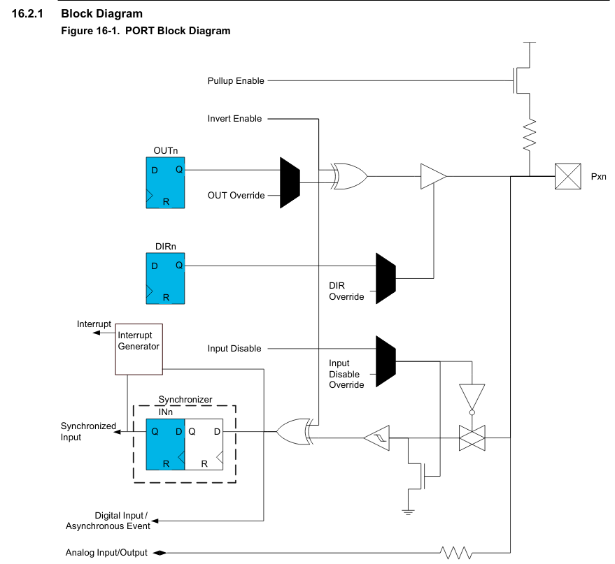

<!--

author:   Sebastian Zug, André Dietrich & `fjangfaragesh`, `FnHm`, `gjaeger`, `ShyFlyGuy`, `Lalelele`
email:    sebastian.zug@informatik.tu-freiberg.de & andre.dietrich@informatik.tu-freiberg.de & fabian.baer@student.tu-freiberg.de
version:  0.6.0
language: de
narrator: Deutsch Female

import:   https://raw.githubusercontent.com/liascript-templates/plantUML/master/README.md
          https://raw.githubusercontent.com/liaTemplates/AVR8js/main/README.md
          https://raw.githubusercontent.com/TUBAF-IfI-LiaScript/VL_EingebetteteSysteme/master/config.md

-->

# Einführung

    --{{0}}--
Bevor wir starten: Haben Sie schon einmal darüber nachgedacht, wie aus einem Hochsprachen-Programm ein tatsächliches Verhalten eines Computers wird? Die Idee liegt darin, die Komplexität dieser Frage in handhabbare Schichten zu unterteilen. Wie diese Schichten genau aussehen, werden wir in dieser Vorlesung systematisch erarbeiten.

[](https://liascript.github.io/course/?https://raw.githubusercontent.com/TUBAF-IfI-LiaScript/VL_EingebetteteSysteme/master/00_Einfuehrung.md#1)

| Parameter                | Kursinformationen                                                                                        |
| ------------------------ | -------------------------------------------------------------------------------------------------------- |
| **Veranstaltung:**       | @config.lecture                                                                                          |
| **Semester:**            | @config.semester                                                                                         |
| **Hochschule:**          | `Technische Universität Freiberg`                                                                        |
| **Inhalte:**             | `Motivation der Vorlesung "Eingebettete Systeme" und Beschreibung der Organisation der Veranstaltung`   |
| **Link auf GitHub:**     | https://github.com/TUBAF-IfI-LiaScript/VL_EingebetteteSysteme/blob/master/00_Einfuehrung.md             |
| **Autoren:**             | @author                                                                                                  |

---------------------------------------------------------------------

**Fragen an die Veranstaltung**

+ Welche Abstraktionsebenen durchlaufen wir vom Arduino-Code bis zur Hardware-Ebene?
+ Warum lohnt sich das Verständnis eingebetteter Systeme für Informatik, Robotik und Ingenieurwesen?
+ Welche Rolle spielen Mikrocontroller in modernen digitalen Systemen?
+ Wie unterscheiden sich eingebettete Systeme von herkömmlichen Computersystemen?
+ Welche praktischen Anwendungsgebiete finden Sie für eingebettete Systeme in Ihrem Alltag?
+ Was bedeutet „Echtzeit“ im Kontext eingebetteter Systeme?
+ Wie wirken sich Ressourcenbeschränkungen (Speicher, Rechenzeit, Energie) auf die Programmierung aus?

---------------------------------------------------------------------

## Worum geht es in dieser Vorlesung?

> Starten wir mit etwas Code ...

<div id="example1">
<wokwi-led color="red"   pin="13" label="13"></wokwi-led>
<wokwi-led color="green" pin="12" label="12"></wokwi-led>
<wokwi-led color="blue"  pin="11" label="11"></wokwi-led>
<wokwi-led color="blue"  pin="10" label="10"></wokwi-led>
<span id="simulation-time"></span>
<avr-chart signals="D13, D12, D11, D10" window="2s" title="Pegel an den Pins 13 bis 10"></avr-chart>
</div>

```cpp BlinkLEDs.ino
byte leds[] = {13, 12, 11, 10};

void setup() {
  Serial.begin(115200);
  for (byte i = 0; i < sizeof(leds); i++) {
    pinMode(leds[i], OUTPUT);
  }
}

int i = 0;
void loop() {
  Serial.print("LED: ");
  Serial.println(i);
  digitalWrite(leds[i], HIGH);
  delay(250);
  digitalWrite(leds[i], LOW);
  i = (i + 1) % sizeof(leds);
}
```
@AVR8js.sketch(example1)

      {{1}}
> **Frage:** Welche Funktion hat der Code? Lesen Sie die Antwort im Diagramm ab, bevor Sie weiterklicken.

    --{{1}}--
Der Code schaltet nacheinander vier LEDs an den Pins 10 bis 13 ein und aus, jede für 250 Millisekunden. Das Diagramm darunter zeigt dasselbe wie ein Logikanalysator: Zu jedem Zeitpunkt ist genau ein Pin auf HIGH. Hinter diesen zwanzig Zeilen steckt viel mehr, als man sieht – Bibliothekscode der Arduino-Umgebung, ein Compiler und am Ende Transistoren, die schalten. Die Befehle können Sie unter https://www.arduino.cc/reference/en/ nachschlagen.

      {{2}}
> **Frage:** Was ist notwendig, damit dieses Programm auf einem Mikrocontroller ausgeführt werden kann?

    --{{2}}--
Der Code muss übersetzt werden. Der Compiler macht aus dem C++-Code Assemblerbefehle für die AVR-Architektur, der Assembler daraus Maschinencode – Zahlen, die der Mikrocontroller direkt ausführen kann. Diese Zahlen werden als Hex-Datei auf den Controller übertragen.

      {{3}}
******************************************************

```hex
:100000000C945D000C9485000C9485000C94850084
:100010000C9485000C9485000C9485000C9485004C
:100020000C9485000C9485000C9485000C9485003C
:100030000C9485000C9485000C9485000C9485002C
:100040000C9412020C9485000C9482020C945C02B5
:100050000C9485000C9485000C9485000C9485000C
:100060000C9485000C9485000000000024002700FB
:100070002A0000000000250028002B0004040404CE
:100080000404040402020202020203030303030342
:10009000010204081020408001020408102001021F
...
```

Jede Zeile hat dasselbe Format: `:` · Anzahl der Datenbytes (`10` = 16) · Adresse im Programmspeicher (`0000`) · Typ (`00` = Daten) · die Datenbytes · eine Prüfsumme.

> **Am Ende des Semesters können Sie jeden Schritt dieser Transformation erklären.**

******************************************************

    --{{3}}--
Schauen Sie auf die ersten vier Datenbytes: 0C 94 5D 00. Das ist ein einziger Maschinenbefehl, ein Sprungbefehl – jmp 0xBA. Er steht an Adresse 0, dort beginnt der Controller nach einem Reset. Von dort springt er zum Startcode, der das Programm vorbereitet und schließlich setup und loop aufruft. Die Grundprinzipien, die wir an diesem kleinen Controller lernen, gelten für jeden Rechner.

### Die Reise: 16 Vorlesungen zum Verständnis

<!-- data-type="none" -->
| Vorlesung                                           | Was lernen Sie hier?          | Wo steckt das im Arduino?                          |
| --------------------------------------------------- | ----------------------------- | -------------------------------------------------- |
| [00 Einführung](00_Einfuehrung.md)                  | Die große Vision              | vom Sketch zur Hex-Datei                           |
| [01 Historie](01_HistorischerUeberblick.md)         | Von Leibniz zu Arduino        | warum der Chip so aussieht, wie er aussieht        |
| [02 Boolesche Algebra](02_BoolscheAlgebra.md)       | 0 und 1 verstehen             | `if (a && b)`, Bitmasken                           |
| [03 Minimierung](03_Minimierung.md)                 | Effizienz in Logik            | weniger Gatter für dieselbe Funktion               |
| [04 Schaltnetze](04_Schaltnetze.md)                 | Logik wird Hardware           | die Logik im Chip, inklusive ihrer Laufzeiten      |
| [05 Standardschaltnetze](05_Standardschaltnetze.md) | Decoder & Multiplexer         | Registerauswahl, Kanalwahl beim `analogRead`       |
| [06 FlipFlops](06_FlipFlops.md)                     | Speicher entsteht             | das Bit in `DDRB`, das sich „Ausgang“ merkt        |
| [07 Schaltwerke](07_Schaltwerke.md)                 | Zustandsmaschinen             | Steuerungen mit Zuständen, z. B. eine Ampel        |
| [08 Standardschaltwerke](08_StandardSchaltwerke.md) | Counter & Register            | der Zähler hinter `millis()`                       |
| [09 Rechnerarithmetik](09_Rechnerarithmetik.md)     | Addition in Hardware          | `int`, Überlauf, `float`                           |
| [10 CPU-Basis](10_CPU_Basis.md)                     | Der erste Prozessor           | Rechenwerk, Steuerwerk, Speicher                   |
| [11 Modell-CPU](11_Modell_CPU.md)                   | Befehl für Befehl             | was mit `0C 94 5D 00` passiert                     |
| [12 AVR-CPU](12_AVR_CPU.md)                         | **Ihr Arduino-Chip!**         | ATmega328P, Toolchain, Register                    |
| [13 ADC](13_ADC.md)                                 | Analog trifft Digital         | `analogRead`                                       |
| [14 Timer & Interrupts](14_TimerUndInterrupts.md)   | Unterprogramme, Stack, Timing | `attachInterrupt`, `delay`, `analogWrite`          |
| [15 Aktoren](15_Aktoren.md)                         | Hardware bewegen, Ausblick    | Servo, Schrittmotor, Energiesparen                 |

> Für 16 Vorlesungen haben wir 21 Termine: Einige Themen bekommen zwei Termine, am Ende bleiben Zeit für Wiederholung und ein Puffer.

### Was steht am Ende?

    --{{0}}--
Diese Fragen klingen heute noch nach Zauberei. Am Ende des Semesters sollten Sie jede davon in wenigen Sätzen beantworten können – und genau solche Fragen finden Sie in der Klausur wieder.

**Sie können diese Fragen fundiert beantworten:**

1. **„Wie wird `pinMode(13, OUTPUT)` zu einer Hardware-Konfiguration?“**  
   *Von der Arduino-Funktion über Assembler zum Bit im Register `DDRB` und zur Tri-State-Logik am Pin*

2. **„Was bedeutet `Serial.begin(9600)`?“**  
   *Die serielle Schnittstelle (UART) überträgt Bit für Bit ohne gemeinsamen Takt – deshalb vereinbaren beide Seiten zu Beginn die „Sprechgeschwindigkeit“.*

3. **„Ist ein `delay(1000)` tatsächlich genau 16.000.000 Taktzyklen lang?“**  
   *Taktfrequenz, Befehlszyklen und Timer-Hardware verstehen*

4. **„Was passiert im ATmega328P während `analogRead(A0)`?“**  
   *ADC-Wandlung, Abtastung, Quantisierung und Speicherung*

5. **„Wie führt die CPU den Maschinenbefehl `0C 94 5D 00` aus?“**  
   *Befehl holen, dekodieren, ausführen; Register und Programmzähler*

6. **„Wie sähe `if (digitalRead(2) && digitalRead(3))` als Schaltung aus – und was wäre daran anders als im Programm?“**  
   *Boolesche Algebra, Gatter, Grenze zwischen Hardware und Software*

7. **„Wie kann ein 8-bit-Mikrocontroller 16-bit-Zahlen addieren?“**  
   *Rechnen in mehreren Schritten, Carry-Flag, Aufbau der ALU*

8. **„Woher weiß der Controller nach einem Interrupt, wo er weitermachen muss?“**  
   *Unterprogramme, Rücksprungadresse und Stack*


## Der Unterschied zu einem "Arduino-Kurs"

    --{{0}}--
Nach einem typischen Arduino-Workshop können Sie LEDs blinken lassen. Nach diesem Kurs können Sie erklären, welche Register dabei beschrieben werden, warum digitalWrite deutlich mehr Befehle braucht als ein direkter Registerzugriff und wie aus dem Bit im Register ein Pegel am Pin wird. Das ist der Unterschied zwischen „es funktioniert“ und „ich verstehe, warum es funktioniert“.

**Arduino-Kurs:** "Drücke diesen Button, LEDs blinken" ✨ *Magie!*

**Unser Kurs:** "Warum passiert das und wie funktioniert es bis hinunter zum Transistor?"

### Unsere Bottom-Up-Reise

    --{{0}}--
Schauen Sie sich diese Abstraktionsebenen an: Die meisten Programmierer arbeiten nur auf Ebene 6 und 5. Wir steigen bis auf Ebene 1 hinab und arbeiten uns systematisch nach oben.

<!--
style="width: 80%; min-width: 420px; max-width: 720px;"
-->
```ascii

                Abstraktionsebenen

           +----------------------------+ -.
  Ebene 6  | Problemorientierte Sprache |  |
           +----------------------------+  |
                                           ⎬ Anwendungssoftware
           +----------------------------+  |
  Ebene 5  | Assemblersprache           |  |
           +----------------------------+ -.

           +----------------------------+
  Ebene 4  | Betriebssystem             |     Systemsoftware (brauchen wir nicht :-) )
           +----------------------------+

           +----------------------------+
  Ebene 3  | Instruktionsset            |     Maschinensprache
           +----------------------------+

           +----------------------------+  -.
  Ebene 2  | Mikroarchitektur           |   |
           +----------------------------+   |
                                            ⎬ Automaten, Speicher, Logik
           +----------------------------+   |       ╔══════════════════╗
  Ebene 1  | Digitale Logik             |   |    ◀══║ HIER STARTEN WIR!║
           +----------------------------+  -.       ╚══════════════════╝

           +----------------------------+
  Ebene 0  | E-Technik, Physik          |     Analoge Phänomene
           +----------------------------+                                      .
```


### Beispiel 1: Mikroarchitektur

> Ein Rechner ist eine ziemlich komplizierte Maschine. Moderne CPUs oder GPUs umfassen Milliarden von Transistoren! Wir brauchen ein methodisches Verständnis und mehrere Abstraktionsebenen, um das zu verstehen.

```text @plantUML.png
@startditaa
               +------------------+
               |c88F              |
               |     Speicher     |
               |                  |
               +---------+-+------+
                       ^ | ^
                       | | |
+----------+  Adresse  | | |               +-----+-----+
|cF88      +-----------+ | |               |  A  |  B  |
|          |             | |        Daten  +-----+-----+
|          |   Befehl    | +-------------->+cFF4       |
|  Steuer- |<------------+                 |           |
|   werk   |                     Kontrolle |    ALU    |
|          +------------------------------>+           |
|          |                               |           |
|          |                       Status  |           |
|          |<------------------------------+           |
|          |                               |           |
|          | Kontrolle                     |           |
|          +-------------+         Daten   |           |
|          |             | +-------------->|           |
|          |  Status     | |               |           |
|          |<----------+ | |               |           |
+----------+           | | |               +-----------+
                       | | |
                       | V V
               +-------+-----------+
               |c8F8               |
               |    Ein/Ausgabe    |
               |                   |
               +-------------------+
@endditaa
```

    --{{0}}--
Die Aufteilung in Steuerwerk, Rechenwerk, Speicher und Ein-/Ausgabe hat John von Neumann 1945 beschrieben, sie gilt bis heute – vom Mobiltelefon bis zum Arduino. Der ATmega328P auf dem Arduino weicht in einem Punkt ab: Programm und Daten liegen in getrennten Speichern. Man nennt das Harvard-Architektur; mehr dazu in Vorlesung 10 und 12.


### Beispiel 2: Quer über alle Ebenen

                   {{0-1}}
*****************************************************

    --{{0}}--
Wir verfolgen jetzt eine einzige Arduino-Zeile durch die Abstraktionsebenen – so lange, bis wir beim Transistor ankommen, der die eigentliche Arbeit macht.

**Wir bauen von den Grundlagen nach oben!** Jede Ebene erklärt die nächste, bis Sie verstehen, wie Ihr `pinMode()` am Ende einen Transistor schaltet.

**Schauen wir uns konkret an, was auf den einzelnen Ebenen passiert:**

*****************************************************


                   {{1-2}}
*****************************************************

**Ebene 6 – Ihr Arduino-Code:**

    --{{1}}--
Ebene sechs sieht harmlos aus. Pin 13 ist übrigens kein Zufall – an ihm hängt die eingebaute LED der meisten Arduino-Boards.

```cpp
pinMode(13, OUTPUT);  // Pin 13 als Ausgang konfigurieren
```

*****************************************************

                   {{2-3}}
*****************************************************

**Ebene 6 – darunter: die Arduino-Bibliothek (C, gekürzt aus `wiring_digital.c`):**

    --{{2}}--
Auch die Arduino-Bibliothek ist in C geschrieben, also noch Ebene sechs. Sie übersetzt die Pin-Nummer in ein Register und ein Bit. Bevor sie das Register ändert, schaltet sie Interrupts kurz ab: Eine Interrupt-Routine könnte sonst zwischen Lesen und Zurückschreiben dasselbe Register verändern. Das nennt man eine Race Condition.

```c
void pinMode(uint8_t pin, uint8_t mode) {
  uint8_t bit  = digitalPinToBitMask(pin);           // Pin 13 → Bit 5
  uint8_t port = digitalPinToPort(pin);              // Pin 13 → Port B
  volatile uint8_t *reg = portModeRegister(port);    // → &DDRB
  ...
  if (mode == OUTPUT) {
    uint8_t oldSREG = SREG;   // Statusregister sichern
    cli();                    // Interrupts aus
    *reg |= bit;              // DDRB |= (1 << 5)
    SREG = oldSREG;           // alten Zustand wiederherstellen
  }
}
```

Kern des Ganzen ist eine einzige Zeile: `DDRB |= (1 << 5);` – setze Bit 5 im Register `DDRB`.

*****************************************************

                   {{3-4}}
*****************************************************

**Ebene 5 – Assembler:**

    --{{3}}--
Schreiben wir die Kernzeile DDRB oder-gleich eins geschoben um fünf direkt, macht der Compiler daraus einen einzigen Assemblerbefehl: sbi, set bit in I/O register. 0x04 ist die Adresse von DDRB im Ein-/Ausgabebereich des Controllers. Dieses Programm können Sie direkt ausführen – es lässt die LED an Pin 13 blinken.

<div id="asm-example">
<wokwi-led color="red" pin="13" label="13"></wokwi-led>
<span id="simulation-time"></span>
</div>

```asm
; Pin 13 (Port B, Bit 5) als Ausgang, dann blinken
#include <avr/io.h>

.global main
main:
  sbi   _SFR_IO_ADDR(DDRB), 5   ; DDRB |= (1 << 5)  →  sbi 0x04, 5

loop:
  sbi   _SFR_IO_ADDR(PINB), 5   ; eine 1 in PINB schaltet PORTB5 um
  rcall wait
  rjmp  loop

; 41 * 256 * 256 * 3 Takte ≈ 8.000.000 Takte = 0,5 s bei 16 MHz
wait:
  ldi   r20, 41
wait_outer:
  ldi   r19, 0
wait_middle:
  ldi   r18, 0
wait_inner:
  dec   r18
  brne  wait_inner
  dec   r19
  brne  wait_middle
  dec   r20
  brne  wait_outer
  ret
```
@AVR8js.asm(asm-example)

*****************************************************

                   {{4-5}}
*****************************************************

**Ebene 3 – Maschinencode:**

    --{{4}}--
Der Assembler übersetzt sbi 0x04, 5 in genau zwei Bytes: 25 und 9A. Genau solche Bytes stehen in der Hex-Datei vom Anfang. Wie das Steuerwerk aus diesen Bits erkennt, was zu tun ist, sehen wir in Vorlesung 11.

| Assembler     | Maschinencode im Speicher | Bedeutung der Bits                                 |
| ------------- | ------------------------- | -------------------------------------------------- |
| `sbi 0x04, 5` | `25 9A`                   | `1001 1010` = sbi · `00100` = Adresse 4 · `101` = Bit 5 |

Der Befehl ist das 16-Bit-Wort `0x9A25`; im Speicher steht das niederwertige Byte zuerst.

*****************************************************

                   {{5-6}}
*****************************************************

**Ebene 1 – Hardware-Konfiguration:**

    --{{5}}--
Am Ziel: echte Hardware. Das Register DDRB besteht aus acht Flip-Flops, jedes gehört zu einem Pin. Ist Bit 5 gesetzt, wird der Ausgangstreiber von Pin 13 freigeschaltet: Ein Transistor kann den Pin mit der Versorgungsspannung verbinden, ein anderer mit Masse. Das ist der Moment, in dem Software zu Physik wird.

<!-- width="60%" -->

Das `DDRB`-Register steuert direkt die **Tri-State-Logik** des I/O-Pins:

- **DDRB[5] = 1**: Ausgangstreiber wird aktiviert → Pin kann HIGH/LOW ausgeben
- **DDRB[5] = 0**: Hochohmig → Pin kann Eingangssignale lesen

*****************************************************

                   {{6}}
*****************************************************

**Ordnen Sie zu:** Auf welcher Ebene liegt die jeweilige Darstellung?

[[Ebene 6] [Ebene 5] [Ebene 3] [Ebene 1]]
[    (X)       ( )       ( )       ( )    ]  `pinMode(13, OUTPUT);`
[    (X)       ( )       ( )       ( )    ]  `DDRB |= (1 << 5);`
[    ( )       (X)       ( )       ( )    ]  `sbi 0x04, 5`
[    ( )       ( )       (X)       ( )    ]  `25 9A`
[    ( )       ( )       ( )       (X)    ]  das Flip-Flop für Bit 5 in `DDRB`

*****************************************************

## Was können Sie damit bauen?

    --{{0}}--
Mit diesem Verständnis können Sie Systeme gezielt verbessern, statt nur Bibliotheken zu benutzen. Sie wissen, warum der Analog-Digital-Wandler manchmal „rauscht“, wie Sie Timer-Interrupts für präzises Timing einsetzen und warum manche Sensoren 5 V brauchen und andere mit 3,3 V auskommen.

**Von einfachen LEDs zu echten Projekten:**

<!-- width="70%" -->

Nach diesem Kurs wissen Sie nicht nur, wie man Sensordaten ausliest, sondern **warum** der 10-Bit-Analog-Digital-Wandler höchstens 1023 liefert und wie Timer-Interrupts die Abtastung steuern.

<!-- width="70%" -->

In diesem Aufbau bedeuten hohe Werte Dunkelheit und niedrige Werte Helligkeit – das liegt an der Beschaltung des Lichtsensors, nicht am Wandler. Sie verstehen, warum die Messwerte so aussehen, und können die Referenzspannung des Wandlers für präzisere Messungen wählen.

### Wozu brauche ich das in meinem Studiengang?

    --{{0}}--
Die Vorlesung hören Studierende aus sehr unterschiedlichen Richtungen. Jede Gruppe nimmt etwas anderes mit – aber alle profitieren davon, eine Schicht tiefer schauen zu können als bisher.

+ **Robotik**: Jeder Roboter ist ein eingebettetes System – Sensoren lesen, Motoren ansteuern, rechtzeitig reagieren.
+ **Angewandte Informatik**: Sie verstehen, was Ihr Programm auf der Hardware tatsächlich tut, und warum manches langsam oder speicherhungrig ist.
+ **Mathematik**: Boolesche Algebra und Automaten werden hier zu Schaltungen – mit Laufzeiten, Takten und Grenzen der Physik.
+ **Ingenieurwissenschaften**: Messen, Steuern und Regeln laufen heute fast immer auf einem Mikrocontroller.

## Organisation

| Name                    | Email                                   | Aufgabe                                  |
| :---------------------- | :-------------------------------------- | :--------------------------------------- |
| Prof. Dr. Sebastian Zug | sebastian.zug@informatik.tu-freiberg.de | Vorlesung, theoretische Übungsblätter    |
| N.N.                    |                                         | praktische Übungen ab Januar             |

> Bitte melden Sie sich im OPAL unter [Digitale Systeme](https://bildungsportal.sachsen.de/opal/auth/RepositoryEntry/37204033543) für die Veranstaltung an. Dort finden Sie auch die aktuellen Informationen zur Veranstaltung.

### Zeitplan

Die Veranstaltung wird sowohl für die Vorlesung als auch die Übung in Präsenz durchgeführt.

<!-- data-type="none" -->
| Veranstaltungen | Tag        | Zeitslot      | Ort      | Bemerkung                    |
| --------------- | ---------- | ------------- | -------- | ---------------------------- |
| Vorlesung I     | Mittwoch   | 16:15 - 17:45 | FOR-0270 | wöchentlich                  |
| Vorlesung II    | Donnerstag | 11:30 - 13:00 | FOR-0270 | gerade Kalenderwochen        |
| Übung, Gruppe 1 | Montag     | 18:00 - 19:30 | KKB-2097 | wöchentlich ab Ende November |
| Übung, Gruppe 2 | Donnerstag | 18:00 - 19:30 | KKB-2097 | wöchentlich ab Ende November |

> Die Übungen starten Ende November mit theoretischen Übungsblättern und werden wöchentlich durchgeführt. Ab Januar vertiefen Sie Ihre Kenntnisse in praktischen Übungen an Mikrocontrollerschaltungen.

> Ergänzend stehen Remote-Labore bereit, um einzelne Aspekte der Lehrveranstaltung zu vertiefen.

### Prüfungsmodalitäten

> *Prüfungsform:* Die Veranstaltung wird mit einer schriftlichen Prüfung abgeschlossen. Diese wird als __Open Book Klausur__ entworfen. Sie dürfen dazu alle schriftlichen, nicht-digitalen Materialien verwenden.

Im Laufe der Übungen werden wir "alte" Übungsaufgaben durchspielen, die Ihnen einen Eindruck von der Prüfung vermitteln sollen.

### Literaturempfehlungen

1. Umfassende Lehrbücher

   + David A. Patterson, John L. Hennessy: Computer Organization & Design
   + B. Becker, R. Drechsler, P. Molitor: Technische Informatik - Eine Einführung, Pearson Studium, 2005
   + Hoffmann, D. W.: Grundlagen der technischen Informatik, Hanser Verlag

2. Videos

   + Youtube – „How a CPU Works“ [Link](https://www.youtube.com/watch?v=cNN_tTXABUA)

Bei den jeweiligen Vorlesungsinhalten werden zusätzliche Materialien angegeben.

### Ihre Vorkenntnisse

    --{{0}}--
Die Vorlesung hören Studierende mit sehr unterschiedlichen Vorkenntnissen. Ihre Antworten helfen uns, Beispiele und Übungen passend zu wählen. Die Abfrage ist anonym.

**Aus welchem Studiengang kommen Sie?**

[(informatik)] Angewandte Informatik
[(robotik)] Robotik
[(mathe)] Mathematik
[(ingenieur)] ein Ingenieurstudiengang
[(anderer)] ein anderer Studiengang

**Welche Erfahrung haben Sie mit Arduino oder anderen Mikrocontrollern?**

[(keine)] keine Vorerfahrung
[(kurz)] kurz ausprobiert, Praktikum oder Ähnliches
[(basteln)] umfangreiche „Basteleien“
[(beruf)] Berufserfahrung mit Mikrocontrollern

**Können Sie in C programmieren?**

[(parallel)] ich lerne C in diesem Semester (Algorithmen und Datenstrukturen)
[(ja)] ja, schon vorher
[(nein)] nein, und ich höre auch keine C-Vorlesung

**Haben Sie Zugriff auf einen Arduino Uno, Nano oder einen anderen ATmega-Mikrocontroller?**

[(ja)] ja, ein Controller ist vorhanden
[(nein)] nein

## Engagement und Motivation

> *Credit-Points:* 6

> *Arbeitsaufwand:* Der Zeitaufwand beträgt 180h und setzt sich zusammen aus **60h Präsenzzeit** und **120h Selbststudium**. Letzteres umfasst die Vor- und Nachbereitung der Lehrveranstaltung, die eigenständige Lösung von Übungsaufgaben sowie die Prüfungsvorbereitung.

### Open Educational Resources

Die Lehrmaterialien sind offen verfügbar und liegen auf GitHub:

[https://github.com/TUBAF-IfI-LiaScript/VL_EingebetteteSysteme](https://github.com/TUBAF-IfI-LiaScript/VL_EingebetteteSysteme)

Sie sind in LiaScript geschrieben, einer Erweiterung von Markdown. Markdown beschreibt Texte mit wenigen, gut lesbaren Zeichen – `# Überschrift`, `*kursiv*`, `**fett**`, `+ Aufzählung`. LiaScript ergänzt, was in der Lehre fehlt: ausführbaren Code, Simulationen, Quizze und Animationen. Den Simulator haben Sie oben schon benutzt.

Zum Weiterlesen: [Markdown Guide](https://www.markdownguide.org/getting-started/) · [LiaScript-Dokumentation](https://liascript.github.io/course/?https://raw.githubusercontent.com/liaScript/docs/master/README.md#1) · [Einführungsvideos](https://www.youtube.com/channel/UCyiTe2GkW_u05HSdvUblGYg)

Eine Übersicht über alle Begriffe und roten Fäden der Vorlesung bietet die [Kurslandkarte](https://tubaf-ifi-liascript.github.io/VL_EingebetteteSysteme/kurslandkarte/).

### Trotz Simulation und Virtuellem ...

... braucht es aber auch immer etwas zum Anfassen. Der Simulator zeigt viel – aber er verzeiht auch Dinge, die echte Hardware nicht verzeiht: falsche Verdrahtung, zu hohe Ströme, prellende Taster. Ab Januar arbeiten Sie deshalb in der Übung mit echten Mikrocontrollerschaltungen.

### Generelles Engagement

* Stellen Sie Fragen, seien Sie kommunikativ!

* Organisieren Sie sich in Arbeitsgruppen!

* Bringen Sie sich mit Implementierungen als Vortragende in die Veranstaltung ein.

### Und wenn Sie dann immer noch programmieren wollen ...

Dann wartet das __racetech__ Team auf Sie ... autonomes Fahren im Formula Student Kontext.

<!--
style="width: 80%; display: block; margin-left: auto; margin-right: auto;" -->

### Schauen Sie im RoboLab vorbei!

Lion und Caio warten auf Sie ...


## Hausaufgabe

+ Legen Sie sich einen GitHub-Account an ... und finden Sie als Erste oder Erster einen Tippfehler in den Unterlagen, den Sie als Contributor korrigieren :-)
+ Organisieren Sie sich in einer gemeinsamen Chatgruppe! Bevor Sie heute den Raum verlassen, sollten Sie dort Mitglied sein.
+ Ändern Sie im Assembler-Beispiel die Wartezeit so, dass die LED doppelt so schnell blinkt. Welche Zahl müssen Sie ändern – und warum genau diese?
