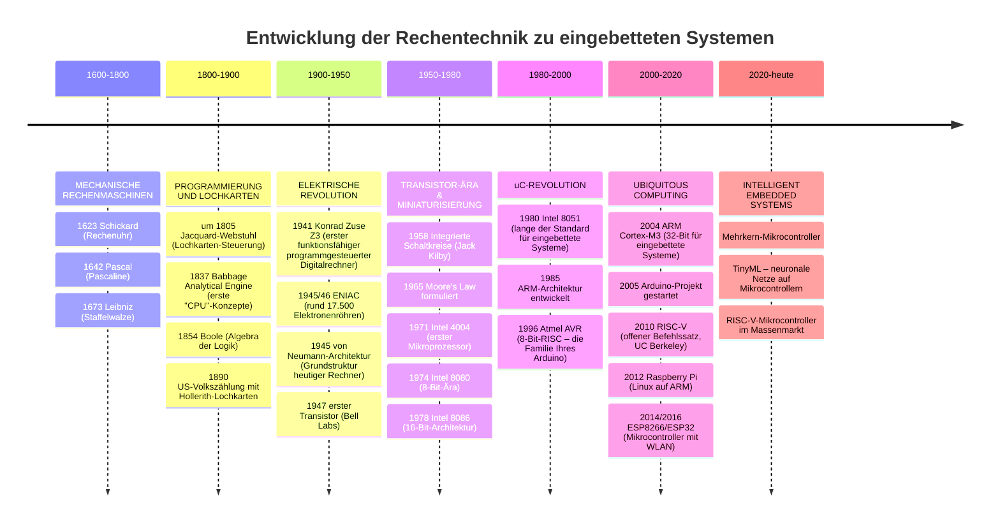

<!--

author:   Sebastian Zug, André Dietrich, Fabian Bär & GitHub Copilot Teaching-Agent
email:    sebastian.zug@informatik.tu-freiberg.de & andre.dietrich@informatik.tu-freiberg.de & fabian.baer@student.tu-freiberg.de
version:  0.7.0
language: de
narrator: Deutsch Female

import:   https://raw.githubusercontent.com/liaScript/mermaid_template/master/README.md
          https://raw.githubusercontent.com/TUBAF-IfI-LiaScript/VL_EingebetteteSysteme/master/config.md

-->

[](https://liascript.github.io/course/?https://raw.githubusercontent.com/TUBAF-IfI-LiaScript/VL_EingebetteteSysteme/master/01_HistorischerUeberblick.md#1)

# Historischer Überblick

| Parameter                | Kursinformationen                                                                                                                                                                          |
| ------------------------ | ------------------------------------------------------------------------------------------------------------------------------------------------------------------------------------------ |
| **Veranstaltung:**       | @config.lecture                                                                                          |
| **Semester:**            | @config.semester                                                                                         |
| **Hochschule:**          | `Technische Universität Freiberg`                                                                        |
| **Inhalte:**             | `Übersicht der historischen Entwicklung von Rechentechnik`                                              |
| **Link auf GitHub:**     | https://github.com/TUBAF-IfI-LiaScript/VL_EingebetteteSysteme/blob/master/01_HistorischerUeberblick.md |
| **Autoren:**             | @author                                                                                                  |


---------------------------------------------------------------------

**Fragen an die Veranstaltung**

+ Worin lag der „große Wurf“ des Intel 4004?
+ Was bedeutet die Angabe 8 Bit, 16 Bit usw.?
+ Erklären Sie die Schichten der Rechnerstruktur.
+ Worin unterschieden sich ENIAC und die Z3?
+ Welche technologischen Durchbrüche ermöglichten die Miniaturisierung von Computern?
+ Worin unterscheiden sich von-Neumann- und Harvard-Architektur – und welche nutzt der ATmega328P?
+ Welche Rolle spielte die Erfindung des Transistors für die Computerentwicklung?

---------------------------------------------------------------------

**Weiterführende Literaturhinweise**

+ Dirk W. Hoffmann, Grundlagen der Technischen Informatik, Hanser-Verlag, 2007
+ Raúl Rojas, Konrad Zuse's Legacy: The Architecture of the Z1 and Z3, IEEE Annals of the History of Computing 19(2), 1997
+ Webseiten zur Rechnergeschichte

   + http://www.horst-zuse.homepage.t-online.de/z1.html
   + http://www.computerhistory.org/babbage/adalovelace

---------------------------------------------------------------------

## Rückblick, Fragen und Diskussionen

    --{{0}}--
In der letzten Vorlesung sind wir mit einer einzigen Zeile Arduino-Code durch die Abstraktionsebenen gestiegen. Bevor wir in die Geschichte gehen, eine kurze Kontrolle, ob das noch sitzt.

**Erinnern Sie sich?** Die Kernzeile von `pinMode(13, OUTPUT)`, nämlich `DDRB |= (1 << 5);`, wird zu einem einzigen Maschinenbefehl. Welche Aussage stimmt?

[( )] Der Befehl `sbi 0x04, 5` steht als Text in der Hex-Datei.
[(X)] Der Befehl `sbi 0x04, 5` steht als zwei Bytes `25 9A` im Programmspeicher.
[( )] Auch die ganze Funktion `pinMode` wird zu genau diesem einen Befehl.
***************************************************************

Der Assembler übersetzt `sbi 0x04, 5` in das 16-Bit-Wort `0x9A25`; im Speicher steht das niederwertige Byte zuerst: `25 9A`. Übersetzt wird einmal vorher, auf Ihrem Rechner – der Controller führt nur noch die Bytes aus. Die ganze Funktion `pinMode` wird dagegen zu deutlich mehr Befehlen: Sie schlägt Port und Bit in Tabellen nach und sperrt kurz die Interrupts.

***************************************************************

**Auflösung der Hausaufgabe:** Die Wartezeit hängt an drei Schleifen. Setzen Sie den mittleren Zähler `r19` statt auf 0 (= 256 Durchläufe) auf 128, halbiert sich die Wartezeit fast genau; `r20` von 41 auf 20 oder 21 trifft die Hälfte nur ungefähr. Exakt verdoppelt keiner der Wege die Frequenz, denn die Befehle außerhalb der innersten Schleife – `ldi`, `rcall`, `ret` und der Sprung zurück – kosten feste Takte, die sich nicht mithalbieren.


## Von Rechenmaschinen zum µC: 400 Jahre Rechentechnik

    --{{0}}--
Erinnern Sie sich an den Arduino-Code aus der letzten Vorlesung? pinMode, digitalWrite, delay – diese einfachen Befehle sind das Ergebnis einer langen Entwicklung. Heute reisen wir durch die Zeit: von mechanischen Zahnrädern bis zum Mikrocontroller auf Ihrem Arduino.

    --{{1}}--
Viele Grundideen, die Charles Babbage 1837 für seine Analytical Engine entwarf – Rechenwerk, Speicher, Steuerung über ein Programm –, finden Sie heute im ATmega328P wieder. Nur sind sie unvorstellbar viel kleiner und schneller geworden.

> **Mission dieser Vorlesung:** Verstehen Sie, warum Ihr Arduino so funktioniert, wie er funktioniert – durch die Brille der Geschichte!

---------------------------------------------------------------------

<!--
style="width: 80%; min-width: 420px; max-width: 720px;"
-->
```ascii

                Abstraktionsebenen

           +----------------------------+ -.
  Ebene 6  | Problemorientierte Sprache |  |
           +----------------------------+  |
                                           ⎬ Anwendungssoftware
           +----------------------------+  |
  Ebene 5  | Assemblersprache           |  |
           +----------------------------+ -.

           +----------------------------+
  Ebene 4  | Betriebssystem             |     Systemsoftware
           +----------------------------+

           +----------------------------+
  Ebene 3  | Instruktionsset            |     Maschinensprache
           +----------------------------+

           +----------------------------+  -.
  Ebene 2  | Mikroarchitektur           |   |
           +----------------------------+   |
                                            ⎬ Automaten, Speicher, Logik
           +----------------------------+   |
  Ebene 1  | Digitale Logik             |   |
           +----------------------------+  -.

           +----------------------------+
  Ebene 0  | E-Technik, Physik          |     Analoge Phänomene
           +----------------------------+                                      .
```

Jede Ebene beschreibt den Rechner in ihrer eigenen Sprache und stützt sich auf die Ebene darunter:

<!-- data-type="none" -->
| Ebene | Was wird beschrieben?                                   | Beispiel aus VL 00                         |
| ----- | ------------------------------------------------------- | ------------------------------------------ |
| 6     | das Problem, in einer Hochsprache wie C                 | `pinMode(13, OUTPUT);`                     |
| 5     | dieselben Befehle als lesbare Kürzel                    | `sbi 0x04, 5`                              |
| 4     | Verwaltung von Programmen und Geräten (fehlt beim Arduino) | –                                       |
| 3     | die Befehle als Bitmuster, die der Prozessor versteht   | `25 9A`                                    |
| 2     | wie Rechenwerk, Steuerwerk und Register zusammenarbeiten | das Steuerwerk dekodiert `25 9A`          |
| 1     | Gatter und Flip-Flops                                   | das Flip-Flop für Bit 5 in `DDRB`          |
| 0     | Transistoren, Spannungen, Ströme                        | der Ausgangstreiber an Pin 13              |

Die Geschichte der Rechentechnik lässt sich an diesen Ebenen entlang erzählen. **Auf welcher Ebene liegt die jeweilige Erfindung?**

[[Ebene 0] [Ebene 1] [Ebene 2] [Ebene 3] [Ebene 6]]
[    (X)       ( )       ( )       ( )       ( )    ]  der Transistor (1947)
[    ( )       (X)       ( )       ( )       ( )    ]  Booles Algebra der Logik (1854), angewandt auf Schaltungen
[    ( )       ( )       (X)       ( )       ( )    ]  die Mikroprogrammierung der Z3 (1941)
[    ( )       ( )       ( )       (X)       ( )    ]  die 46 Befehle des Intel 4004 (1971)
[    ( )       ( )       ( )       ( )       (X)    ]  ein Arduino-Sketch (2005)

---------------------------------------------------------------------

## Begrifflichkeiten

    --{{0}}--
Bevor wir in die Geschichte eintauchen, klären wir die Grundbegriffe. Ihr Arduino passt zu allen drei Definitionen: Er löst Probleme, etwa eine LED-Steuerung, verarbeitet Daten, etwa Sensormessungen, und besteht aus zusammenarbeitenden Baueinheiten – Prozessorkern, Arbeitsspeicher, Flash-Speicher.

_Ein Computer oder Digitalrechner ist eine Maschine, die Probleme für den Menschen lösen kann, indem sie die ihr gegebenen Befehle ausführt._ (Tanenbaum, Computerarchitektur)

_Ein Computer oder Rechner ist ein Gerät, das mittels programmierbarer Rechenvorschriften Daten verarbeitet._ (Wikipedia)

_Rechenanlage (Computer) ...  Die Gesamtheit der Baueinheiten, aus denen ein Datenverarbeitungssystem aufgebaut ist._ (DIN 44300)

    --{{1}}--
Die drei Definitionen stammen aus einem Lehrbuch, einem Online-Lexikon und einer Norm. Sie betonen Unterschiedliches: die Befehle, die Daten, die Baueinheiten.

> Welche Gemeinsamkeiten und Unterschiede sehen Sie in diesen Definitionen?

## Zeitstrahl: Von Zahnrädern zu Mikrocontrollern

Bevor wir in die Details eintauchen, verschaffen wir uns einen Überblick über die wichtigsten Meilensteine – von mechanischen Rechenmaschinen bis zu Ihrem Arduino.



    --{{0}}--
Der Zeitstrahl zeigt, wie sich die Rechentechnik entwickelt hat: von mechanischen Rechenmaschinen über Babbages Konzepte und die ersten elektrischen Rechner bis zum Transistor und zum Mikrocontroller. Der AVR-Kern Ihres Arduino stammt aus den 1990er Jahren – und kämpft heute mit ARM- und RISC-V-Controllern um denselben Markt.

## Rechenmaschinen

{{0-1}}
Ausgangspunkt für die Vereinfachung des Rechnens ist das Konzept des Stellenwertsystems. In einer positionsunabhängigen Darstellung bedarf es immer neuer Symbole, um größere Zahlen auszudrücken. Im römischen Zahlensystem, das überwiegend additiv arbeitet, sind dies die bekannten Formate `MDCCLXV`. Können Sie den Zahlenwert rekonstruieren? Es ist das Gründungsjahr der Bergakademie.

    --{{0}}--
Antwort: M D C C L X V – das sind 1000 plus 500 plus 200 plus 50 plus 10 plus 5, also 1765, das Gründungsjahr der Bergakademie Freiberg. Solche Zahlensysteme sind für maschinelle Verarbeitung ungeeignet: Meist wird addiert, in Ausnahmen wie IV aber abgezogen, und für große Zahlen braucht es immer neue Symbole.

{{1-2}}
> Die Idee, den Wert einer Ziffer von ihrer Position abhängig zu machen, kannten schon die Babylonier (zur Basis 60). Das dezimale Stellenwertsystem mit der Ziffer Null, das wir heute nutzen, stammt aus dem indischen Kulturkreis und kam über arabische Gelehrte nach Europa. Die Null ist dabei der Platzhalter für eine leere Stelle: Ohne sie ließe sich 105 nicht von 15 unterscheiden.

    --{{1}}--
Das Stellenwertsystem ist die Grundlage aller Rechner. Ihr Arduino arbeitet intern mit Binärzahlen, also Basis 2. Aus pinMode dreizehn, OUTPUT wird DDRB oder-gleich eins geschoben um fünf – binär 0010 0000. Das Prinzip ist dasselbe wie im Dezimalsystem, nur mit zwei statt zehn Ziffern; auch hier braucht man die Null als Ziffer.


{{2-3}}
Der Abakus greift diesen Ansatz auf und strukturiert den Rechenprozess. Dabei unterscheidet man verschiedene Systeme. Es existieren Vorgehensmuster für die Umsetzung der Grundrechenarten und des Wurzelziehens.

    --{{2}}--
Der Abakus ist eines der ältesten Rechenhilfsmittel, seine Wurzeln reichen Jahrtausende zurück. Er nutzt das Stellenwertsystem: Perlen auf Stäben stellen die Ziffern dar. Ein Vergleich mit Ihrem Controller: Die Perlen halten Zwischenergebnisse wie Register, die Rechenregeln entsprechen dem Programm – und die Person am Abakus übernimmt die Rolle des Steuerwerks.

{{2-3}}
<!-- width="60%" -->

{{3-4}}
Eine weitreichendere Unterstützung beim eigentlichen Rechenprozess bieten die Napierschen Rechenstäbe (John Napier 1550 - 1617), die insbesondere die Multiplikation einer Ziffer mit einer beliebig großen Zahl unterstützen.

    --{{3}}--
Napiers Rechenstäbe arbeiten mit vorberechneten Tabellen: Statt zu rechnen, schlägt man nach. Dieses Prinzip nutzen auch viele Mikrocontroller-Programme – vorberechnete Werte stehen als Tabelle im Flash-Speicher, weil Nachschlagen schneller ist als Rechnen.

{{3-4}}
!?[Napiersche Rechenstäbe](https://www.youtube.com/watch?v=P_dKOtHjc3o)

{{4-5}}
Die notwendige manuelle Addition bei größeren Faktoren löste die Rechenmaschine von Wilhelm Schickard (1623). Die Automatisierung der Addition ist mechanisch gelöst und zum Beispiel unter [Link](https://www.rechenwerkzeug.de/schickar.htm) beschrieben.

{{4-5}}
") <!-- width="60%" -->

{{4-5}}
!?[Wilhelm Schickards Rechenmaschine](https://www.youtube.com/watch?v=N_uiwO8lT5c)


{{4-5}}
Blaise Pascal (1642), Gottfried Wilhelm Leibniz (1673) und andere entwickelten weiter, erweiterten die Stellensysteme und integrierten weitere Rechenarten, hatten aber insgesamt mit den mechanischen Herausforderungen und fehlender Fertigungsgenauigkeit zu kämpfen.

{{4-5}}
> _Es ist unwürdig, die Zeit von hervorragenden Leuten mit knechtischen Rechenarbeiten zu verschwenden, weil bei Einsatz einer Maschine auch der Einfältigste die Ergebnisse sicher hinschreiben kann._ (Gottfried Wilhelm Leibniz)

## Abstraktere Konzepte

Bisher stand die Berechnung von einzelnen Ergebnissen auf der Basis einer Sequenz von Eingaben im Vordergrund. Im 19. Jahrhundert entwarfen Visionäre neue Konzepte, die allgemeingültige Lösungen integrierten.

Diesen Aspekt kann man auf technischer und theoretischer Ebene betrachten.

Die Grundlagen moderner Rechner legten die Arbeiten von George Boole (1815 - 1864). Er beschrieb das logische Schließen mit einer Algebra: Aussagen sind wahr oder falsch, verknüpft werden sie mit UND, ODER und NICHT – und für diese Verknüpfungen gelten Rechenregeln wie für Zahlen. Die heutige axiomatische Form dieser „booleschen Algebra“ entstand erst Anfang des 20. Jahrhunderts.

    --{{0}}--
Booles Algebra der Logik erschien 1854. Den Schritt zur Technik machte 1937 Claude Shannon: Er zeigte, dass sich Relaisschaltungen mit Boolescher Algebra beschreiben und vereinfachen lassen. Seitdem ist sie das Handwerkszeug für jede digitale Schaltung – auch für die Register Ihres Arduino, die mit Oder und Und bitweise verändert werden.

<!-- width="30%" -->

$$
f(a,b,c) = (a \land b) \lor (\neg c) \\
f(a,b,c) = (a \cdot b) + (\overline{c})
$$

      {{1-2}}
**Praktisches Beispiel:** Im Arduino-Code entspricht diese Formel der Bedingung `if ((sensor_A && sensor_B) || !sensor_C)`. Logisch ist das dieselbe Funktion; wie der Compiler sie in Befehle übersetzt, sehen wir später.

Im Rahmen dieser Vorlesung werden wir die boolesche Algebra als Grundlage für die digitale Logik verwenden.

    --{{1}}--
Warum ist das so wichtig? Boole schuf die mathematische Grundlage, mit der wir heute jede digitale Schaltung beschreiben, vereinfachen und prüfen – genau das machen wir in den nächsten Vorlesungen.

### Joseph-Marie Jacquard (1752 - 1834) - Automatischer Webstuhl

Jacquards "Musterwebstuhl" realisierte die Ansteuerung der Webmechanik durch eine Lochkartensteuerung. Um 1805 wurde das Verfahren erstmals vorgestellt. Dadurch konnten endlose Muster von beliebiger Komplexität mechanisch hergestellt werden.

")<!-- width="60%" -->

Auf den Karten waren Informationen über das in einem Schritt zu webende Muster enthalten. Ein Loch bedeutete Fadenhebung, kein Loch eine Fadensenkung. Dabei konnten die Lochkarten in einer Endlosschleife gekoppelt werden, um wiederkehrende Strukturen umzusetzen.

### Charles Babbage (1791 - 1871) - Analytical Engine

Ausgangspunkt war die Konstruktion einer Rechenmaschine für die Lösung polynomialer Funktionen. Dabei entstand die Vision einer universellen Rechenapparatur, die auf der Basis eines programmierbaren Systems Berechnungen löst. Die erste Beschreibung wurde 1837 veröffentlicht.

+ Energiebereitstellung über eine Dampfmaschine
+ Eingabe der Daten und Befehle über Lochkarten
+ getrennte Einheiten für das Rechnen („Mill“) und das Speichern („Store“)
+ Nutzerinterface: Drucker, ein Kurvenplotter und eine Glocke
+ Zahlendarstellung: dezimale Festkommazahlen, pro Stelle ein Zahnrad
+ Speicher für 1000 Zahlen mit je 40 Dezimalstellen (geplant)

_The result of my reflections has been that numbers containing more than thirty places of figures will not be required for a long time to come._

    --{{0}}--
Babbage blieb den dezimalen Zahlen treu, obwohl Leibniz das Binärsystem längst beschrieben hatte. Die mechanische Realisierung mit einem Zahnrad je Ziffer machte die Maschine extrem komplex.

    --{{1}}--
Eine Parallele zu heute: Babbage dachte, 30 Dezimalstellen würden „für lange Zeit“ ausreichen – und plante seinen Speicher trotzdem mit 40 Stellen, also mit Reserve. Ihr Arduino rechnet meist mit 16- oder 32-Bit-Zahlen – 32 Bit entsprechen knapp zehn Dezimalstellen.

Die Maschine wurde zu Lebzeiten von Babbage nicht realisiert; sein Sohn Henry baute Teile des Rechenwerks. Vollständig gebaut wurde bis heute nur die einfachere Differenzmaschine Nr. 2 – 1991 im Science Museum in London.

!?[Analytical Engine (Video 1)](https://www.youtube.com/watch?v=_fyUtU6LVNY&feature=emb_logo)

!?[Analytical Engine (Video 2)](https://www.youtube.com/watch?v=XSkGY6LchJs)

Eine der zentralen Persönlichkeiten, die die Möglichkeiten der Analytical Engine erkannte, war Ada Lovelace.

> _„[Die Analytical Engine] könnte auf andere Dinge als Zahlen angewandt werden, wenn man Objekte finden könnte, deren Wechselwirkungen durch die abstrakte Wissenschaft der Operationen dargestellt werden können und die sich für die Bearbeitung durch die Anweisungen und Mechanismen des Gerätes eignen.“_

Ada Lovelace übersetzte 1843 einen Artikel von Luigi Menabrea über die Analytical Engine und ergänzte ihn um ausführliche Anmerkungen („Notes“). Darin steht ein Plan zur Berechnung der Bernoulli-Zahlen in Tabellenform, der als das erste veröffentlichte Computerprogramm gelten kann.

## Es werde Licht ... elektrische Systeme

{{0-1}}
*******************************************************************************

Die Verfügbarkeit des elektrischen Stromes als Energiequelle löste einige der technischen Hürden bei den mechanischen Rechenmaschinen, eröffnete aber auch neue Möglichkeiten bei der Eingabe von Daten.

Herman Hollerith (1860 - 1929) interpretierte die Lochkarten als Medium neu. Sein Konzept für die Lösung/Auswertung von organisatorischen Problemstellungen sah diese als Basis für die Datenerfassung.

Das System für die Erfassung von Daten auf Lochkarten bestand aus der Tabelliermaschine, dem Lochkartensortierer, dem Lochkartenlocher und dem Lochkartenleser. Damit ließ sich die US-Volkszählung von 1890 deutlich schneller auswerten als die von 1880.

Aus Holleriths Firma ging 1924 die International Business Machines Corporation (IBM) hervor.

 at Computer History Museum, https://commons.wikimedia.org/wiki/File:HollerithMachine.CHM.jpg)")<!-- width="80%" -->

!?[Hollerith](https://www.youtube.com/watch?v=17On5ItcrBA)

*******************************************************************************

      {{1-2}}
*******************************************************************************

Nicht nur auf der Ebene der Datenerfassung, sondern auch für die Datenspeicherung eröffnete sich auf der Basis des elektrischen Stromes eine Revolution. Relais konnten Zustände nun speichern und logische Operationen abbilden. Ein Relais kennt nur zwei Zustände – angezogen oder abgefallen –, das legte die binäre Darstellung (1 und 0) nahe, auch wenn einige frühe Rechner wie der ENIAC noch dezimal rechneten.

<!-- width="60%" -->

Im ersten Bild schaltet der Strom durch die Spule einen Kontakt, solange er fließt – das Relais ist ein elektrisch gesteuerter Schalter. Im zweiten Bild hält sich das Relais über seinen eigenen Kontakt selbst: Ein kurzer Impuls genügt, und es bleibt angezogen. Diese **Selbsthaltung** speichert ein Bit – dieselbe Idee steckt im Flip-Flop, das wir in Vorlesung 06 kennenlernen.

<!-- width="60%" -->

*******************************************************************************

      {{2-3}}
*******************************************************************************
Bis in die 80er Jahre bildeten Analogrechner einen alternativen Ansatz. Anders als bei den diskret arbeitenden Digitalrechnern wurde hier im Werte- und Zeitverlauf kontinuierlich gearbeitet. Dabei wurde das Systemverhalten von komplexen Systemen mit elektrischen Schaltungen nachgebildet.

 angeschlossen als Hardware-in-the-Loop, mit Analogrechner EAI-8800, ca. 1985, https://commons.wikimedia.org/wiki/File:Analogrechner_HW-in-Loop_Ausschnitt.jpg)")<!-- width="80%" -->

*******************************************************************************

### Zuse Z3

Die Z3 war der erste funktionsfähige programmgesteuerte Digitalrechner weltweit und wurde 1941 von Konrad Zuse in Zusammenarbeit mit Helmut Schreyer in Berlin gebaut. Die Z3 wurde in elektromagnetischer Relaistechnik mit rund 600 Relais für das Rechenwerk und 1400 Relais für das Speicherwerk ausgeführt.

+ 5 bis 10 Hertz Taktfrequenz
+ rund 2000 Relais
+ 22-stellige Binärzahlen (im Gleitkomma-Format!)
+ dezimale Ein-/Ausgabe
+ Speicher mit 64 Worten
+ Programm auf gelochtem Filmstreifen
+ Steuereinheit mit Sequenzer
+ Addition in 3 Takten, Multiplikation in 16 Takten
+ keine bedingten Sprünge!

!?[ZuseZ3 Deutsches Museum](https://www.youtube.com/watch?v=aUXnhVrT4CI)

Die Z3 nahm bereits Kernelemente moderner Architekturen vorweg:

+ Gleitkommaformat
+ Mikroprogrammierung
+ Pipeline (Holen des nächsten Befehls überlappt mit der Ausführung)

### ENIAC

Fast zur selben Zeit entstand in den USA der ENIAC (Electronic Numerical Integrator and Computer), 1945 fertiggestellt und 1946 der Öffentlichkeit vorgestellt.

+ rund 17.500 Elektronenröhren, etwa 30 Tonnen
+ rechnete dezimal, nicht binär
+ 20 Akkumulatoren, 1 Multiplizierer, 3 Funktionstabellen
+ programmiert durch Kabel-Verbindungen und Schalter
+ E/A mittels Lochkarten
+ gebaut für ballistische Berechnungen

 and Betty Snyder (foreground) program the ENIAC in building 328 at the Ballistic Research Laboratory , https://commons.wikimedia.org/wiki/File:Eniac.jpg)")<!-- width="60%" -->

Ein großes Problem bei der Entwicklung des ENIAC war die Fehleranfälligkeit der Elektronenröhren. Wenn nur eine der rund 17.500 Röhren ausfiel, rechnete die gesamte Maschine fehlerhaft.

<!-- data-type="none" -->
|                  | Z3 (1941)                    | ENIAC (1945/46)                    |
| ---------------- | ---------------------------- | ---------------------------------- |
| Bauelemente      | Relais                       | Elektronenröhren                   |
| Zahlendarstellung | binär, Gleitkomma            | dezimal                            |
| Programm         | Lochstreifen (Filmstreifen)  | Kabelverbindungen und Schalter     |
| Takt             | 5–10 Hz                      | 100 kHz                            |
| eine Addition    | etwa 0,8 s                   | etwa 5000 pro Sekunde              |

**Typische Fehlvorstellung:** Welche Aussage stimmt?

[( )] Der ENIAC war der erste Binärrechner.
[(X)] Die Z3 rechnete binär, der ENIAC dezimal.
[( )] Beide rechneten dezimal, binär wurde erst mit dem Transistor üblich.
***************************************************************

Die Z3 arbeitete mit binären Gleitkommazahlen, nur Ein- und Ausgabe waren dezimal. Der ENIAC rechnete intern dezimal – mit Zählringen aus Röhren für jede Ziffer.

***************************************************************

### Konzeptionelle Entwürfe

In seinem Papier _First Draft of a Report on the EDVAC_ beschreibt John von Neumann 1945 die Basiskomponenten eines Rechners:

+ ALU (Arithmetic Logic Unit) – Rechenwerk für die Durchführung mathematischer/logischer Operationen
+ Control Unit – Steuerwerk für die Interpretation der Anweisungen eines Programmes
+ Memory – Speicherwerk sowohl für Programme als auch für Daten
+ Ein-/Ausgabe – Nutzerinterface

Heutige Lehrbücher ergänzen dieses Modell um ein **Bussystem** (Steuer-, Adress- und Datenbus), über das die Komponenten verbunden sind – im Papier von 1945 kommt es so noch nicht vor.

")<!-- width="60%" -->

Programm und Daten im selben Speicher – das ist der Kern der von-Neumann-Architektur. Die Alternative heißt **Harvard-Architektur**, benannt nach dem Rechner Harvard Mark I (1944), der seine Befehle von einem Lochstreifen getrennt von den Daten las. Ihr ATmega328P ist ein Harvard-Rechner: Das Programm liegt im Flash-Speicher, die Daten im Arbeitsspeicher (SRAM), und beide haben eigene Busse.

## Die Transistor-Ära

Ende 1947 bauten John Bardeen und Walter Brattain an den Bell Labs den ersten funktionierenden Transistor, 1948 wurde er vorgestellt; William Shockley entwickelte kurz darauf den Flächentransistor. Dafür erhielten die drei 1956 den Nobelpreis für Physik. Der Transistor verdrängt langsam die Röhre als Verstärker und Schalter: Er ist kleiner, braucht weniger Energie und fällt seltener aus. 1958 baute Jack Kilby die erste integrierte Schaltung – mehrere Bauelemente auf einem einzigen Stück Halbleiter. Seitdem wächst die Zahl der Transistoren pro Chip rasant (Moore's Law, siehe unten); das ist der Kern der Miniaturisierung.

!?[NPN Transistor](https://www.youtube.com/watch?v=5wIRJN3DN_8)

Und wie wird daraus nun ein Rechner? Die intelligente Verschaltung mehrerer Transistoren ermöglicht die Umsetzung von logischen Schaltungen wie AND, OR usw.

<!-- width="30%" -->

[^ANDTransistor]: EBatlleP, diagram of a transistor AND gate. Reference: http://hyperphysics.phy-astr.gsu.edu/hbase/electronic/and.html#c1, https://commons.wikimedia.org/wiki/File:TransistorANDgate.png

Diese wiederum fassen wir nun in entsprechenden ICs zusammen. Wir haben die elektrische Ebene verlassen und sind endgültig auf der logischen Ebene angekommen.

")<!-- width="100%" -->


### Intel 4004

Beispiel: Intel 4004-Architektur (1971)

")<!-- style="width: 80%; display: block; margin-left: auto; margin-right: auto;"-->

+ Anzahl Transistoren: 2300
+ Taktfrequenz: 500 bis 740 kHz
+ Taktzyklen pro Instruktion: 8
+ Datenspeicher: bis zu 5120 Bit (640 Byte) in externen RAM-Bausteinen 4002, Programm getrennt in ROM-Bausteinen (Harvard-Architektur)
+ Anzahl Befehle: 46
+ Bauform: 16 Pin (DIP)

**Was bedeutet 4 Bit, 8 Bit, 16 Bit?** Die Angabe nennt die Wortbreite: wie viele Bits der Prozessor in einem Schritt verarbeitet. Der 4004 rechnet mit 4-Bit-Zahlen (0 bis 15) – genug für eine Dezimalziffer, denn er war für einen Tischrechner gebaut. Der ATmega328P Ihres Arduino ist ein 8-Bit-Prozessor; größere Zahlen setzt er aus mehreren Bytes zusammen.

    --{{0}}--
Vergleichen wir das mit Ihrem Arduino: Der Takt ist gut zwanzigmal so hoch. Weil der ATmega die meisten Befehle in einem einzigen Takt ausführt, der 4004 aber acht Takte braucht, schafft der ATmega rund 170-mal so viele Befehle pro Sekunde – und jeder Befehl verarbeitet 8 statt 4 Bit.

**Intel 4004 (1971) vs. ATmega328P:**

| Eigenschaft  | Intel 4004        | ATmega328P            | Faktor |
| ------------ | ----------------- | --------------------- | ------ |
| Transistoren | 2.300             | vom Hersteller nicht veröffentlicht | –      |
| Taktfrequenz | 740 kHz           | 16 MHz (Arduino Uno)  | 22x    |
| Takte pro Befehl | 8             | meist 1               | –      |
| Befehle pro Sekunde | rund 92.500 | bis 16 Millionen      | ~170x  |
| Befehle      | 46                | 131                   | 3x     |
| Wortbreite   | 4 Bit             | 8 Bit                 | 2x     |
| Datenspeicher | bis 640 Byte (extern) | 2048 Byte SRAM (auf dem Chip) | 3x     |

> Was sagt die Befehlsanzahl aus?

    --{{1}}--
Das Steuerwerk des ATmega ist deutlich komplexer und kann mehr verschiedene Befehle verarbeiten. Dem Intel 4004 fehlen viele der heute üblichen Operationen, etwa die Multiplikation, Schlafmodi oder ein Watchdog-Reset. Programme für den 4004 sind deshalb länger und brauchen zusätzlich zur geringen Taktrate mehr Schritte.

Unterstützung für die Interpretation liefert das Nutzerhandbuch, das den Befehlssatz beschreibt:

")<!-- width="100%" -->

### Weitere Entwicklung

Parallel zu den Mikrocontrollern (siehe Zeitstrahl) entwickelten sich die Prozessoren für PCs und Grafikkarten. Die Tabelle zeigt einige Meilensteine – zum Einordnen, nicht zum Auswendiglernen:

| Jahr | Entwicklung                                     | Beschreibung                                                                                     |
| ---- | ----------------------------------------------- | ------------------------------------------------------------------------------------------------ |
| 1971 | Intel 4004                                      | Erste kommerzielle CPU auf einem einzigen Chip (4-Bit).                                          |
| 1978 | Intel 8086                                      | 16-Bit-Architektur und Grundlage für die x86-Architektur.                                        |
| 1979 | Motorola 68000                                  | 32-Bit interne Architektur.                                                                      |
| 1985 | ARM1                                            | Einer der ersten kommerziellen RISC-Prozessoren (Reduced Instruction Set Computer).              |
| 1993 | Intel Pentium                                   | Superskalare Ausführung: mehrere Befehle pro Takt bei x86-Prozessoren.                           |
| 1999 | Nvidia GeForce 256                              | Erste „GPU“ zur Hardware-Beschleunigung von 3D-Grafikberechnungen.                               |
| 2003 | AMD Athlon 64                                   | Erste 64-Bit-Desktop-CPU der x86-Familie.                                                        |
| 2005/06 | Mehrkernprozessoren (AMD Athlon 64 X2, Intel Core) | Mehrere Prozessorkerne auf einem Chip für parallele Verarbeitung.                         |
| 2010 | Nvidia Fermi-Architektur                        | GPUs für allgemeine Parallelberechnungen (GPGPU) mit CUDA.                                       |
| 2011 | Intel Sandy Bridge                              | Einführung der integrierten Grafik mit CPU und GPU auf demselben Chip für höhere Effizienz.      |
| 2015 | AMD HBM (High Bandwidth Memory)                 | Einführung von HBM für schnelle und effiziente Speichernutzung bei GPUs.                         |
| 2016 | Nvidia Pascal-Architektur und Deep Learning     | GPUs mit optimierter Leistung für KI und Deep Learning (Tesla P100).                             |
| 2020 | Apple M1 SoC                                    | Erster ARM-basierter Desktop-Prozessor von Apple                                                 |
| 2022 | Nvidia Ada Lovelace-Architektur                 | Fortschrittliche Architektur für Raytracing und KI-Beschleunigung mit DLSS 3-Technologie.        |


")<!--
style="width: 80%; display: block; margin-left: auto; margin-right: auto;"-->

## Warum ist das alles für Ihr Verständnis wichtig?

    --{{0}}--
Weil ein solides Hardwarewissen Ihnen hilft, Software besser zu verstehen ... und falsche Aussagen zu erkennen!

> Die historische Entwicklung zeigt Muster auf, die sich wiederholen – auch bei den Fehlprognosen:

> _I think there is a world market for about five computers._ (Thomas J. Watson, IBM, 1943 – zugeschrieben, nicht belegt)
>
> _Where a calculator like the ENIAC today is equipped with 18,000 vacuum tubes and weighs 30 tons, computers in the future may have only 1,000 vacuum tubes and perhaps weigh only 1 1/2 tons._ (Popular Mechanics, 1949)
>
> _There is no reason anyone would want a computer in their home._ (Ken Olsen, Gründer der Digital Equipment Corporation, 1977)
>
> _The Internet will catastrophically collapse in 1996._ (Robert Metcalfe, Erfinder des Ethernet, 1995)
>
> _Two years from now, spam will be solved._ (Bill Gates, Microsoft, 2004)
>
> _There's no chance that the iPhone is going to get any significant market share._ (Steve Ballmer, Microsoft, 2007)
>
> _No one will ever need more than 640 kB of memory for a personal computer._ (Bill Gates, 1981 – zugeschrieben, von ihm bestritten)


## Ihre Begriffe für die Kurslandkarte

Die [Kurslandkarte](https://tubaf-ifi-liascript.github.io/VL_EingebetteteSysteme/kurslandkarte/) wächst mit dem Semester, und Sie bestimmen mit, was hineinkommt. Ihre Antworten sammeln wir im Hörsaal gemeinsam über das LiaScript-Klassenzimmer; nach der Vorlesung werden die Begriffe dieser Woche in der Karte freigeschaltet.

**Welche Begriffe aus der heutigen Vorlesung gehören für Sie in die Kurslandkarte?**

[[___ ___ ___]]

**Wo begegnet Ihnen das, was heute dran war – in Ihrem Studiengang oder in Geräten Ihres Alltags?**

[[___ ___ ___]]

## Hausaufgabe

+ Setzen Sie sich mit den Unterschieden zwischen der Z1 (Zuses rein mechanischer Vorgänger der Z3, 1938) und der Z3 auseinander.

+ Woher stammt der Begriff "Bug" in Bezug auf die Programmierung?
