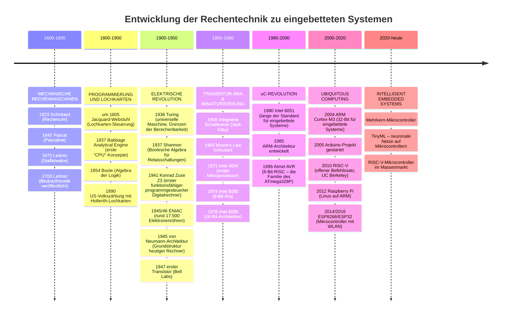
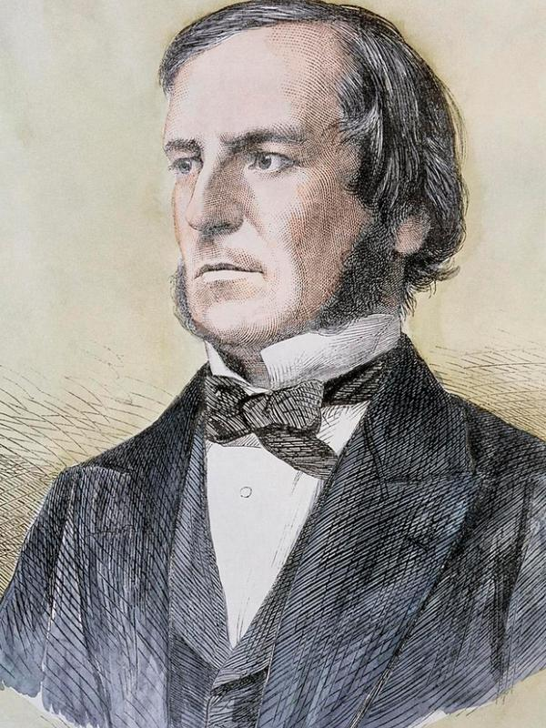
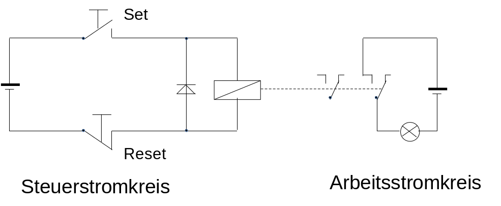
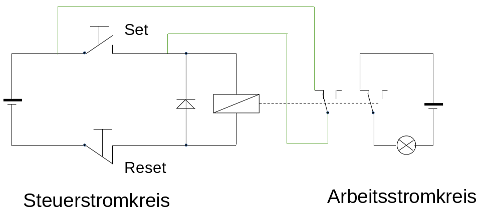
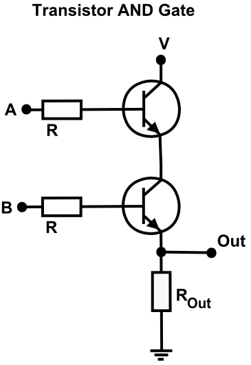

<!--

author:   Sebastian Zug, André Dietrich, Fabian Bär & GitHub Copilot Teaching-Agent & Claude Code (Opus 5.5)
email:    sebastian.zug@informatik.tu-freiberg.de & andre.dietrich@informatik.tu-freiberg.de & fabian.baer@student.tu-freiberg.de
version:  0.7.6
language: de
narrator: Deutsch Female

import:   https://raw.githubusercontent.com/liaScript/mermaid_template/master/README.md
          https://raw.githubusercontent.com/LiaTemplates/Wikimedia/refs/tags/0.0.2/README.md
          https://raw.githubusercontent.com/TUBAF-IfI-LiaScript/VL_EingebetteteSysteme/master/config.md

@Turing.sim
<lia-keep>
<turing-machine tape="@0">@1</turing-machine>
</lia-keep>
@end

@onload
if (!customElements.get('turing-machine')) {
  const BLANK = '␣'
  const CSS = `
    :host { display: block; margin: 1em 0; }
    .tape { display: flex; gap: 2px; overflow-x: auto; padding: 1.6em 2px 4px; }
    .cell { position: relative; flex: 0 0 2.2em; height: 2.2em; line-height: 2.2em; text-align: center;
            border: 1px solid currentColor; font-family: monospace; font-size: 1.1em; }
    .cell.blank { opacity: .4; }
    .cell.note { font-weight: bold; font-style: italic; background: rgba(128, 128, 128, .2); }
    .cell.head { outline: 3px solid rgb(var(--color-highlight, 0, 106, 163)); outline-offset: -1px; opacity: 1; }
    .cell.head::before { content: '▼'; position: absolute; left: 0; right: 0; top: -1.7em; line-height: 1.6em;
                         font-style: normal; color: rgb(var(--color-highlight, 0, 106, 163)); }
    .info { margin: .5em 0; min-height: 4.5em; }
    .info b { display: inline-block; min-width: 7em; }
    button { font: inherit; color: inherit; background: transparent; cursor: pointer;
             border: 1px solid currentColor; border-radius: 4px; padding: .25em .7em; margin: 0 .3em .3em 0; }
    button:disabled { opacity: .4; cursor: default; }
  `

  customElements.define('turing-machine', class extends HTMLElement {
    connectedCallback() {
      if (this.shadowRoot) return
      this.rules = this.parse(this.textContent)
      this.input = this.getAttribute('tape')
      this.attachShadow({ mode: 'open' }).innerHTML = `
        <style>${CSS}</style>
        <div class="tape" role="img"></div>
        <div class="info" aria-live="polite"></div>
        <div role="group" aria-label="Steuerung der Turingmaschine">
          <button data-do="back">Zurück</button>
          <button data-do="step">Schritt</button>
          <button data-do="change">Bis zur nächsten Änderung</button>
          <button data-do="play">Abspielen</button>
          <button data-do="reset">Neustart</button>
        </div>`
      const $ = selector => this.shadowRoot.querySelector(selector)
      this.$tape = $('.tape')
      this.$info = $('.info')
      this.$play = $('[data-do=play]')
      $('[data-do=back]').onclick = () => { this.pause(); this.back() }
      $('[data-do=step]').onclick = () => { this.pause(); this.step(); this.render() }
      $('[data-do=change]').onclick = () => { this.pause(); this.toNextChange() }
      $('[data-do=reset]').onclick = () => { this.pause(); this.reset() }
      this.$play.onclick = () => this.timer ? this.pause() : this.play()
      this.reset()
    }

    disconnectedCallback() {
      this.pause()
    }

    // Zeilenformat: Zustand | gelesene Zeichen | schreibt | Kopf | neuer Zustand ("=" heißt: unverändert)
    parse(text) {
      const rules = new Map()
      this.start = null
      for (const line of text.split('\n')) {
        const fields = line.split('|').map(field => field.trim())
        if (fields.length !== 5) continue
        const [state, reads, write, move, next] = fields
        this.start = this.start || state
        for (const symbol of reads.split(/\s+/)) {
          rules.set(state + '|' + symbol, {
            write: write === '=' ? symbol : write,
            move: move === '→' ? 1 : -1,
            arrow: move,
            next: next === '=' ? state : next
          })
        }
      }
      return rules
    }

    reset() {
      this.tape = new Map([...this.input].map((symbol, position) => [position, symbol]))
      this.head = 0
      this.state = this.start
      this.history = []
      this.render()
    }

    read() {
      return this.tape.get(this.head) || BLANK
    }

    rule() {
      return this.rules.get(this.state + '|' + this.read())
    }

    step() {
      const rule = this.rule()
      if (!rule) return false
      const old = this.read()
      this.history.push({ head: this.head, state: this.state, old })
      this.tape.set(this.head, rule.write)
      this.head += rule.move
      this.state = rule.next
      return rule.write !== old
    }

    back() {
      const last = this.history.pop()
      if (!last) return
      this.tape.set(last.head, last.old)
      this.head = last.head
      this.state = last.state
      this.render()
    }

    toNextChange() {
      while (this.rule() && !this.step());
      this.render()
    }

    play() {
      this.$play.textContent = 'Pause'
      this.$info.setAttribute('aria-live', 'off')
      this.timer = setInterval(() => {
        this.step()
        this.render()
        if (!this.rule()) this.pause()
      }, 250)
    }

    pause() {
      clearInterval(this.timer)
      this.timer = null
      if (!this.$play) return
      this.$play.textContent = 'Abspielen'
      this.$info.setAttribute('aria-live', 'polite')
    }

    content() {
      const positions = [...this.tape.keys()].filter(position => this.tape.get(position) !== BLANK)
      const from = Math.min(...positions), to = Math.max(...positions)
      let text = ''
      for (let position = from; position <= to; position++) text += this.tape.get(position) || BLANK
      return text
    }

    render() {
      const positions = [...this.tape.keys()]
      const from = Math.min(-2, this.head - 1, ...positions)
      const to = Math.max(this.input.length + 1, this.head + 1, ...positions)
      this.$tape.textContent = ''
      for (let position = from; position <= to; position++) {
        const symbol = this.tape.get(position) || BLANK
        const cell = document.createElement('span')
        cell.className = 'cell'
          + (position === this.head ? ' head' : '')
          + (symbol === BLANK ? ' blank' : '')
          + ('01'.includes(symbol) || symbol === BLANK ? '' : ' note')
        cell.textContent = symbol
        this.$tape.append(cell)
      }
      this.$tape.setAttribute('aria-label', 'Band: ' + this.content() + ', Kopf liest ' + this.read())

      const rule = this.rule()
      const steps = 'Schritt: ' + this.history.length
      if (rule) {
        const write = rule.write === this.read() ? 'lässt ' + rule.write + ' stehen' : 'schreibt ' + rule.write
        const next = rule.next === this.state ? 'bleibt im Zustand' : 'neuer Zustand ' + rule.next
        this.$info.innerHTML = `<b>Zustand:</b> ${this.state}<br><b>Liest:</b> ${this.read()}<br>`
          + `<b>Nächste Regel:</b> ${write}, Kopf ${rule.arrow}, ${next}<br>${steps}`
      } else {
        const result = this.content()
        const value = /^[01]+$/.test(result) ? ' (dezimal ' + parseInt(result, 2) + ')' : ''
        this.$info.innerHTML = `<b>Zustand:</b> ${this.state}<br><b>Ergebnis:</b> ${result}${value}<br>${steps}`
      }
      for (const button of this.shadowRoot.querySelectorAll('[data-do=step], [data-do=change], [data-do=play]')) {
        button.disabled = !rule
      }
      this.shadowRoot.querySelector('[data-do=back]').disabled = !this.history.length
    }
  })
}
@end

-->

[](https://liascript.github.io/course/?https://raw.githubusercontent.com/TUBAF-IfI-LiaScript/VL_EingebetteteSysteme/master/01_HistorischerUeberblick.md#1)

# Historischer Überblick

| Parameter                | Kursinformationen                                                                                                                                                                          |
| ------------------------ | ------------------------------------------------------------------------------------------------------------------------------------------------------------------------------------------ |
| **Veranstaltung:**       | @config.lecture                                                                                          |
| **Semester:**            | @config.semester                                                                                         |
| **Hochschule:**          | `Technische Universität Freiberg`                                                                        |
| **Inhalte:**             | `Übersicht der historischen Entwicklung von Rechentechnik`                                              |
| **Link auf GitHub:**     | https://github.com/TUBAF-IfI-LiaScript/VL_EingebetteteSysteme/blob/master/01_HistorischerUeberblick.md |
| **Autoren:**             | @author                                                                                                  |


    --{{0}}--
Heute geht es um die Frage, wie aus Zahnrädern, Relais und Röhren der Mikrocontroller wurde, mit dem Sie im Januar arbeiten. Die Fragen unten sind Ihr Prüfstein: Wenn Sie sie am Ende der Vorlesung beantworten können, haben Sie das Wesentliche verstanden. Für die Klausur müssen Sie keine Jahreszahlen auswendig lernen, wohl aber erklären können, welche Idee wann hinzukam.

---------------------------------------------------------------------

**Lernziele:** Nach dieser Vorlesung können Sie

+ die Grundideen der Rechentechnik – Stellenwertsystem und Binärdarstellung, Programmsteuerung, Boolesche Algebra, Berechenbarkeit – erklären und ihren Urhebern zuordnen,
+ Meilensteine wie Z3, ENIAC, Transistor und Intel 4004 einordnen, vergleichen und den Abstraktionsebenen zuordnen,
+ Von-Neumann- und Harvard-Architektur unterscheiden und dem ATmega328P zuordnen,
+ erklären, was die Wortbreite eines Prozessors (4, 8, 16, 64 Bit) angibt.

<!-- kurslandkarte:knopf-start -->

<a href="https://tubaf-ifi-liascript.github.io/VL_EingebetteteSysteme/kurslandkarte/#termin=1" style="display: inline-block; padding: 0.5em 1.1em; background-color: #00718A; color: #ffffff; text-decoration: none; font-family: 'IBM Plex Sans', 'Segoe UI', system-ui, sans-serif; font-weight: 600;">🗺️ Diese Vorlesung in der Kurslandkarte →</a>

<!-- kurslandkarte:knopf-ende -->

---------------------------------------------------------------------

## Rückblick, Fragen und Diskussionen

    --{{0}}--
In der letzten Vorlesung sind wir mit einer einzigen Zeile Code für das Arduino-Framework durch die Abstraktionsebenen gestiegen. Bevor wir in die Geschichte gehen, schauen wir auf die Hausaufgabe: Der Compiler Explorer hat gezeigt, dass derselbe C-Code auf verschiedenen Prozessoren unterschiedlich viele Befehle braucht – je nachdem, wie breit ihre Register sind. Genau diese Breite ordnen wir heute historisch ein.

**Hausaufgabe aus Vorlesung 00:** Was macht der Compiler aus `return a + b;` – einmal mit 8 Bit, einmal mit 32 Bit, für den ATmega328P (Mitte) und für Ihren Laptop (rechts)?

 mit AVR gcc 14.3 und x86-64 gcc 14.2, Optimierung -O2")<!-- style="width: 100%" -->

[Beispiel im Compiler Explorer öffnen](https://godbolt.org/clientstate/eyJzZXNzaW9ucyI6IFt7ImlkIjogMSwgImxhbmd1YWdlIjogImMiLCAic291cmNlIjogIiNpbmNsdWRlIDxzdGRpbnQuaD5cblxudWludDhfdCBhZGRpZXJlOCh1aW50OF90IGEsIHVpbnQ4X3QgYikge1xuICAgIHJldHVybiBhICsgYjtcbn1cblxudWludDMyX3QgYWRkaWVyZTMyKHVpbnQzMl90IGEsIHVpbnQzMl90IGIpIHtcbiAgICByZXR1cm4gYSArIGI7XG59XG4iLCAiY29tcGlsZXJzIjogW3siaWQiOiAiY2F2cmcxNDMwIiwgIm9wdGlvbnMiOiAiLU8yIn0sIHsiaWQiOiAiY2cxNDIiLCAib3B0aW9ucyI6ICItTzIifV19XX0%3D)

**Auflösung der Hausaufgabe:** Für `addiere8` braucht der AVR einen Befehl (`add`), für `addiere32` vier – `add` und dreimal `adc`. Seine Register sind 8 Bit breit, eine 32-Bit-Zahl belegt vier davon, und `adc` („add with carry“) reicht den Übertrag von Byte zu Byte weiter. Ihr Laptop (x86-64) erledigt beides mit einem Befehl, weil seine Register 64 Bit breit sind. Diese Breite heißt **Wortbreite** – heute sehen Sie, wie sie gewachsen ist: vom 4-Bit-Prozessor Intel 4004 über den 8-Bit-ATmega328P bis zu den 64 Bit Ihres Laptops. Wie ein Addierer mit Übertrag aufgebaut ist, bauen wir in Vorlesung 09 nach.


## Von Rechenmaschinen zum µC: 400 Jahre Rechentechnik

    --{{0}}--
Erinnern Sie sich an das Programm aus der letzten Vorlesung? pinMode, digitalWrite, delay – diese einfachen Funktionen des Arduino-Frameworks sind das Ergebnis einer langen Entwicklung. Heute reisen wir durch die Zeit: von mechanischen Zahnrädern bis zum Mikrocontroller ATmega328P.

    --{{1}}--
Viele Grundideen, die Charles Babbage 1837 für seine Analytical Engine entwarf – Rechenwerk, Speicher, Steuerung über ein Programm –, finden Sie heute im ATmega328P wieder. Nur sind sie unvorstellbar viel kleiner und schneller geworden.

    --{{2}}--
Das Bild der Abstraktionsebenen begleitet uns durch das ganze Semester. Jede Ebene beschreibt denselben Rechner in einer eigenen Sprache: oben das Programm in C, darunter die Assemblerbefehle, dann die Bitmuster im Speicher, bis hinunter zu Gattern und Transistoren. Ein Betriebssystem, also Ebene vier, hat der ATmega328P nicht; Ihr Programm läuft direkt auf der Hardware. Ordnen Sie im Quiz die Erfindungen den Ebenen zu – so sehen Sie, dass die Geschichte die Ebenen nicht von oben nach unten, sondern ziemlich durcheinander gefüllt hat.

> **Mission dieser Vorlesung:** Verstehen Sie, warum der ATmega328P so funktioniert, wie er funktioniert – durch die Brille der Geschichte.

---------------------------------------------------------------------

<!--
style="width: 80%; min-width: 420px; max-width: 720px;"
-->
```ascii

                Abstraktionsebenen

           +----------------------------+ -.
  Ebene 6  | Problemorientierte Sprache |  |
           +----------------------------+  |
                                           ⎬ Anwendungssoftware
           +----------------------------+  |
  Ebene 5  | Assemblersprache           |  |
           +----------------------------+ -.

           +----------------------------+
  Ebene 4  | Betriebssystem             |     Systemsoftware (fehlt beim ATmega328P)
           +----------------------------+

           +----------------------------+
  Ebene 3  | Instruktionsset            |     Maschinensprache
           +----------------------------+

           +----------------------------+  -.
  Ebene 2  | Mikroarchitektur           |   |
           +----------------------------+   |
                                            ⎬ Automaten, Speicher, Logik
           +----------------------------+   |
  Ebene 1  | Digitale Logik             |   |
           +----------------------------+  -.

           +----------------------------+
  Ebene 0  | E-Technik, Physik          |     Analoge Phänomene
           +----------------------------+                                      .
```

Jede Ebene beschreibt den Rechner in ihrer eigenen Sprache und stützt sich auf die Ebene darunter:

<!-- data-type="none" -->
| Ebene | Was wird beschrieben?                                   | Beispiel aus VL 00                         |
| ----- | ------------------------------------------------------- | ------------------------------------------ |
| 6     | das Problem, in einer Hochsprache wie C                 | `pinMode(13, OUTPUT);`                     |
| 5     | dieselben Befehle als lesbare Kürzel                    | `sbi 0x04, 5`                              |
| 4     | Verwaltung von Programmen und Geräten (fehlt beim ATmega328P) | –                                    |
| 3     | die Befehle als Bitmuster, die der Prozessor versteht   | `25 9A`                                    |
| 2     | wie Rechenwerk, Steuerwerk und Register zusammenarbeiten | das Steuerwerk dekodiert `25 9A`          |
| 1     | Gatter und Flip-Flops                                   | das Flip-Flop für Bit 5 in `DDRB`          |
| 0     | Transistoren, Spannungen, Ströme                        | der Ausgangstreiber an Pin 13              |

Die Geschichte der Rechentechnik lässt sich an diesen Ebenen entlang erzählen. **Auf welcher Ebene liegt die jeweilige Erfindung?**

[[Ebene 0] [Ebene 1] [Ebene 2] [Ebene 3] [Ebene 6]]
[    (X)       ( )       ( )       ( )       ( )    ]  der Transistor (1947)
[    ( )       (X)       ( )       ( )       ( )    ]  Booles Algebra der Logik (1854), angewandt auf Schaltungen
[    ( )       ( )       (X)       ( )       ( )    ]  die Mikroprogrammierung der Z3 (1941)
[    ( )       ( )       ( )       (X)       ( )    ]  die 46 Befehle des Intel 4004 (1971)
[    ( )       ( )       ( )       ( )       (X)    ]  ein Programm für das Arduino-Framework (2005)

---------------------------------------------------------------------

## Begrifflichkeiten

    --{{0}}--
Bevor wir in die Geschichte eintauchen, klären wir die Grundbegriffe. Der ATmega328P passt zu allen drei Definitionen: Er löst Probleme, etwa eine LED-Steuerung, verarbeitet Daten, etwa Sensormessungen, und besteht aus zusammenarbeitenden Baueinheiten – Prozessorkern, Arbeitsspeicher, Flash-Speicher.

_Ein Computer oder Digitalrechner ist eine Maschine, die Probleme für den Menschen lösen kann, indem sie die ihr gegebenen Befehle ausführt._ (Tanenbaum, Computerarchitektur)

_Ein Computer oder Rechner ist ein Gerät, das mittels programmierbarer Rechenvorschriften Daten verarbeitet._ (Wikipedia)

_Rechenanlage (Computer) ...  Die Gesamtheit der Baueinheiten, aus denen ein Datenverarbeitungssystem aufgebaut ist._ (DIN 44300)

    --{{1}}--
Die drei Definitionen stammen aus einem Lehrbuch, einem Online-Lexikon und einer Norm. Sie betonen Unterschiedliches: die Befehle, die Daten, die Baueinheiten.

> Welche Gemeinsamkeiten und Unterschiede sehen Sie in diesen Definitionen?

## Zeitstrahl: Von Zahnrädern zu Mikrocontrollern

Bevor wir in die Details eintauchen, verschaffen wir uns einen Überblick über die wichtigsten Meilensteine – von mechanischen Rechenmaschinen bis zum ATmega328P.



    --{{0}}--
Der Zeitstrahl zeigt, wie sich die Rechentechnik entwickelt hat: von mechanischen Rechenmaschinen über Babbages Konzepte und die ersten elektrischen Rechner bis zum Transistor und zum Mikrocontroller. Der AVR-Kern des ATmega328P stammt aus den 1990er Jahren – und konkurriert heute mit Controllern auf Basis von ARM und RISC-V um dieselben Anwendungen.

## Rechenmaschinen

                {{0-1}}
****************************************************************

Ausgangspunkt für die Vereinfachung des Rechnens ist das Konzept des Stellenwertsystems. In einer positionsunabhängigen Darstellung bedarf es immer neuer Symbole, um größere Zahlen auszudrücken. Im römischen Zahlensystem, das überwiegend additiv arbeitet, sind dies die bekannten Formate `MDCCLXV`. Können Sie den Zahlenwert rekonstruieren? Es ist das Gründungsjahr der Bergakademie.

@Wikimedia.embed(File:Year 1575 in Arabic and Roman numbers.jpg)

****************************************************************

    --{{0}}--
Die Hausinschrift im Bild trägt dieselbe Jahreszahl zweimal: oben 1575 im Stellenwertsystem, darunter M D L X X V. Gehen wir bei unserer Zahl die Zeichen von links nach rechts durch: M, D, zweimal C, L, X und V – das sind 1000 plus 500 plus 200 plus 50 plus 10 plus 5, also 1765, das Gründungsjahr der Bergakademie Freiberg. Solche Zahlensysteme sind für maschinelle Verarbeitung ungeeignet: Meist wird addiert, in Ausnahmen wie IV aber abgezogen, und für große Zahlen braucht es immer neue Symbole.

                {{1-2}}
****************************************************************

Im **Stellenwertsystem** hängt der Wert einer Ziffer von ihrer Position ab: Jede Stelle steht für eine Potenz der Basis. Ein fester Vorrat an Ziffern genügt für beliebig große Zahlen.

| Darstellung | Basis | So wird gerechnet                                                 | Wert |
| ----------- | ----- | ----------------------------------------------------------------- | ---- |
| `MDCCLXV`   | –     | $1000 + 500 + 100 + 100 + 50 + 10 + 5$                            | 1765 |
| `1765`      | 10    | $1 \cdot 10^3 + 7 \cdot 10^2 + 6 \cdot 10^1 + 5 \cdot 10^0$       | 1765 |
| `00100000`  | 2     | $1 \cdot 2^5$ (alle anderen Stellen 0)                            | 32   |

Weil jede Stelle gleich behandelt wird, lässt sich Stelle für Stelle mit Übertrag rechnen – genau das macht später ein Addierer in Hardware.

> [!NOTE] Mehr dazu
> Die Idee kannten schon die Babylonier (zur Basis 60). Das dezimale Stellenwertsystem mit der Ziffer Null, das wir heute nutzen, stammt aus dem indischen Kulturkreis und kam über arabische Gelehrte nach Europa. Die Null ist dabei der Platzhalter für eine leere Stelle: Ohne sie ließe sich 105 nicht von 15 unterscheiden.

****************************************************************

    --{{1}}--
Das Stellenwertsystem ist die Grundlage aller Rechner. Der ATmega328P arbeitet intern mit Binärzahlen, also zur Basis zwei. Wenn Sie Pin dreizehn als Ausgang einstellen, wird im Register D D R B das Bit an der Stelle fünf gesetzt; das zugehörige Byte hat genau an dieser Stelle eine Eins und sonst nur Nullen und hat den Wert zweiunddreißig. Das Prinzip ist dasselbe wie im Dezimalsystem, nur mit zwei statt zehn Ziffern; auch hier braucht man die Null als Ziffer.


{{2-3}}
Der Abakus greift diesen Ansatz auf und strukturiert den Rechenprozess. Dabei unterscheidet man verschiedene Systeme. Es existieren Vorgehensmuster für die Umsetzung der Grundrechenarten und des Wurzelziehens.

{{2-3}}
Warum hat jede Zeile im Bild zehn Kugeln, obwohl neun für die Ziffern 0 bis 9 genügen würden?

    --{{2}}--
Der Abakus ist eines der ältesten Rechenhilfsmittel, seine Wurzeln reichen Jahrtausende zurück. Er nutzt das Stellenwertsystem: Perlen auf Stäben stellen die Ziffern dar. Ein Vergleich mit Ihrem Controller: Die Perlen halten Zwischenergebnisse wie Register, die Rechenregeln entsprechen dem Programm – und die Person am Abakus übernimmt die Rolle des Steuerwerks. Neun Kugeln würden für die Ziffern 0 bis 9 genügen. Die zehnte erlaubt, den Übertrag aufzuschieben: Eine volle Zeile mit zehn Kugeln ist ein Zwischenzustand, erst danach tauscht man sie gegen eine Kugel in der nächsten Zeile. Damit gibt es für dieselbe Zahl zwei Darstellungen. Der japanische Soroban kommt mit genau den Werten 0 bis 9 aus, der chinesische Suanpan erlaubt bis 15 pro Stelle, um Zwischenergebnisse abzulegen. Dasselbe Problem begegnet uns in Vorlesung 09 wieder: Der Übertrag durch alle Stellen macht einen Addierer langsam.

{{2-3}}
<!-- width="60%" -->

{{3-4}}
Eine weitreichendere Unterstützung beim eigentlichen Rechenprozess bieten die Napierschen Rechenstäbe (John Napier 1550 - 1617), die insbesondere die Multiplikation einer Ziffer mit einer beliebig großen Zahl unterstützen.

    --{{3}}--
Napiers Rechenstäbe arbeiten mit vorberechneten Tabellen: Statt zu rechnen, schlägt man nach. Dieses Prinzip nutzen auch viele Mikrocontroller-Programme – vorberechnete Werte stehen als Tabelle im Flash-Speicher, weil Nachschlagen schneller ist als Rechnen.

{{3-4}}
!?[Napiersche Rechenstäbe](https://www.youtube.com/watch?v=P_dKOtHjc3o)

{{4-5}}
Die notwendige manuelle Addition bei größeren Faktoren löste die Rechenmaschine von Wilhelm Schickard (1623). Die Automatisierung der Addition ist mechanisch gelöst und zum Beispiel unter [Link](https://www.rechenwerkzeug.de/schickar.htm) beschrieben.

{{4-5}}
") <!-- width="60%" -->

{{4-5}}
!?[Wilhelm Schickards Rechenmaschine](https://www.youtube.com/watch?v=N_uiwO8lT5c)


{{4-5}}
Blaise Pascal (1642), Gottfried Wilhelm Leibniz (1673) und andere entwickelten weiter, erweiterten die Stellensysteme und integrierten weitere Rechenarten, hatten aber insgesamt mit den mechanischen Herausforderungen und fehlender Fertigungsgenauigkeit zu kämpfen.

{{4-5}}
> _Es ist unwürdig, die Zeit von hervorragenden Leuten mit knechtischen Rechenarbeiten zu verschwenden, weil bei Einsatz einer Maschine auch der Einfältigste die Ergebnisse sicher hinschreiben kann._ (Gottfried Wilhelm Leibniz)

    --{{4}}--
Schickards Rechenuhr von 1623 löste das schwierigste Teilproblem der Addition mechanisch: den Übertrag. Dreht ein Zahnrad von neun auf null, nimmt es das Rad der nächsten Stelle um eins mit – genau diesen Übertrag werden Sie später als Carry-Bit im Addierer und im Statusregister des ATmega328P wiederfinden. Pascal und Leibniz bauten die Idee aus; Leibniz' Staffelwalze konnte auch multiplizieren. Gescheitert sind viele dieser Maschinen weniger an der Idee als an der Feinmechanik ihrer Zeit.

## Abstraktere Konzepte

Die Maschinen von Schickard, Pascal und Leibniz führen jeweils eine Rechenoperation aus, die ein Mensch anstößt – im heutigen Prozessor ist das die Aufgabe des Rechenwerks, der **ALU**. Zwischen dem späten 17. Jahrhundert und den 1930er Jahren kamen zwei Schritte hinzu:

1. **Architektur:** Ein Programm steuert die Maschine, Zwischenergebnisse liegen in einem Speicher (Jacquard, Babbage).
2. **Theorie:** Zahlen lassen sich mit zwei Ziffern darstellen (Leibniz), logisches Schließen wird zur Rechnung mit zwei Werten (Boole), und es lässt sich genau sagen, was überhaupt berechenbar ist (Turing).

    --{{0}}--
Bisher haben wir Maschinen gesehen, die genau eine Rechnung ausführen; welche, entscheidet der Mensch an der Kurbel. Das entspricht dem Rechenwerk, also der ALU in Ihrem ATmega328P. Ein Rechner wird daraus erst, wenn etwas anderes die Abfolge der Rechnungen steuert und Zwischenergebnisse aufbewahrt. Genau daran arbeiteten Jacquard und Babbage. Auf der theoretischen Seite zeigte Leibniz, dass zwei Ziffern zum Rechnen genügen, George Boole schuf die Mathematik, mit der wir später die Schaltungen selbst beschreiben, und Alan Turing klärte, was eine Maschine überhaupt berechnen kann. Beginnen wir mit Leibniz.

                {{1}}
****************************************************************

Leibniz baute nicht nur dezimale Rechenmaschinen, er arbeitete auch die **Binärarithmetik** vollständig aus – Zählen und Rechnen mit nur zwei Ziffern, 0 und 1. Veröffentlicht hat er sie 1703.

@Wikimedia.embed(`File:Leibniz binary system 1697 (cropped).jpg`)

****************************************************************

    --{{1}}--
Das Blatt stammt aus Leibniz' Manuskript „De Dyadicis“, aufbewahrt in der Leibniz-Bibliothek in Hannover. Leibniz notiert hier die Zweierpotenzen: links in Binärschreibweise eins, eins-null, eins-null-null und so weiter, in der Mitte dieselben Werte dezimal, 1, 2, 4 bis 1024, und rechts als Potenzen 2 hoch 0 bis 2 hoch 10. Jede weitere Null verdoppelt den Wert, so wie im Dezimalsystem jede Null den Wert verzehnfacht. Die Zeile eins mit fünf Nullen ist die 32 – genau das Byte aus unserer Tabelle, mit dem Pin dreizehn zum Ausgang wird. Leibniz hat das Binärsystem nicht als Erster benutzt, aber als Erster vollständig beschrieben, mit Regeln für Addition und Multiplikation. Schon 1679 skizzierte er dazu eine Rechenmaschine, in der Kugeln durch geöffnete Löcher fallen: offen steht für eins, geschlossen für null. Gebaut hat er sie nicht. Eine Maschine, die tatsächlich binär rechnet, entstand erst 1941 mit der Z3.

### Joseph-Marie Jacquard (1752 - 1834) - Automatischer Webstuhl

Jacquards "Musterwebstuhl" realisierte die Ansteuerung der Webmechanik durch eine Lochkartensteuerung. Um 1805 wurde das Verfahren erstmals vorgestellt. Dadurch konnten endlose Muster von beliebiger Komplexität mechanisch hergestellt werden.

")<!-- width="60%" -->

Auf den Karten waren Informationen über das in einem Schritt zu webende Muster enthalten. Ein Loch bedeutete Fadenhebung, kein Loch eine Fadensenkung. Dabei konnten die Lochkarten in einer Endlosschleife gekoppelt werden, um wiederkehrende Strukturen umzusetzen.

    --{{0}}--
Jacquards Webstuhl rechnet nicht, aber er trennt erstmals die Maschine von ihrem Programm: Wer ein anderes Muster will, wechselt die Karten, nicht die Mechanik. Jede Karte ist eine Reihe von Ja-Nein-Entscheidungen, also im Grunde ein Binärwort. Und die zur Schleife verbundenen Karten sind nichts anderes als die Endlosschleife, in der auch Ihr Blinkprogramm auf dem ATmega328P läuft.

### Charles Babbage (1791 - 1871) - Analytical Engine

Ausgangspunkt war die Konstruktion einer Rechenmaschine für die Lösung polynomialer Funktionen. Dabei entstand die Vision einer universellen Rechenapparatur, die auf der Basis eines programmierbaren Systems Berechnungen löst. Die erste Beschreibung wurde 1837 veröffentlicht.

+ Energiebereitstellung über eine Dampfmaschine
+ Eingabe der Daten und Befehle über Lochkarten
+ getrennte Einheiten für das Rechnen („Mill“, heute: Rechenwerk/ALU) und das Speichern („Store“, heute: Speicher)
+ Nutzerinterface: Drucker, ein Kurvenplotter und eine Glocke
+ Zahlendarstellung: dezimale Festkommazahlen, pro Stelle ein Zahnrad
+ Speicher für 1000 Zahlen mit je 40 Dezimalstellen (geplant)

_The result of my reflections has been that numbers containing more than thirty places of figures will not be required for a long time to come._

    --{{0}}--
Babbage blieb den dezimalen Zahlen treu, obwohl Leibniz das Binärsystem längst beschrieben hatte. Die mechanische Realisierung mit einem Zahnrad je Ziffer machte die Maschine extrem komplex.

    --{{1}}--
Eine Parallele zu heute: Babbage dachte, 30 Dezimalstellen würden „für lange Zeit“ ausreichen – und plante seinen Speicher vorsorglich mit 40 Stellen, also mit Reserve. Programme für den ATmega328P rechnen meist mit Zahlen aus 16 oder 32 Bit; 32 Bit entsprechen knapp zehn Dezimalstellen. Die Wahl der Stellenzahl ist bis heute eine Abwägung zwischen Genauigkeit und Aufwand.

Die Maschine wurde zu Lebzeiten von Babbage nicht realisiert; sein Sohn Henry baute Teile des Rechenwerks. Vollständig gebaut wurde bis heute nur die einfachere Differenzmaschine Nr. 2 – 1991 im Science Museum in London.

!?[Analytical Engine (Video 1)](https://www.youtube.com/watch?v=_fyUtU6LVNY&feature=emb_logo)

!?[Analytical Engine (Video 2)](https://www.youtube.com/watch?v=XSkGY6LchJs)

Eine der zentralen Persönlichkeiten, die die Möglichkeiten der Analytical Engine erkannte, war Ada Lovelace.

> _„[Die Analytical Engine] könnte auf andere Dinge als Zahlen angewandt werden, wenn man Objekte finden könnte, deren Wechselwirkungen durch die abstrakte Wissenschaft der Operationen dargestellt werden können und die sich für die Bearbeitung durch die Anweisungen und Mechanismen des Gerätes eignen.“_

Ada Lovelace übersetzte 1843 einen Artikel von Luigi Menabrea über die Analytical Engine und ergänzte ihn um ausführliche Anmerkungen („Notes“). Darin steht ein Plan zur Berechnung der Bernoulli-Zahlen in Tabellenform, der als das erste veröffentlichte Computerprogramm gelten kann.

    --{{2}}--
Ada Lovelace sah weiter als Babbage selbst: Die Maschine verarbeitet Symbole nach Regeln, und Zahlen sind nur ein möglicher Fall – ebenso könnten es Buchstaben oder Töne sein. Genau das tut jeder heutige Rechner; auch für den ATmega328P ist ein Byte nur ein Bitmuster, das erst das Programm als Zahl, Zeichen oder Pinzustand deutet. Ihr Plan für die Bernoulli-Zahlen enthielt bereits eine Schleife, also die wiederholte Ausführung derselben Befehlsfolge.

### George Boole (1815 - 1864) - Algebra der Logik

Ada Lovelace sah, dass eine Maschine Symbole verarbeiten kann, nicht nur Zahlen. George Boole lieferte dazu die Regeln für die einfachsten Symbole überhaupt: wahr und falsch.

George Boole beschrieb das logische Schließen mit einer Algebra: Aussagen sind wahr oder falsch, verknüpft werden sie mit UND, ODER und NICHT – und für diese Verknüpfungen gelten Rechenregeln wie für Zahlen. Die heutige axiomatische Form dieser „booleschen Algebra“ entstand erst Anfang des 20. Jahrhunderts.

    --{{0}}--
Booles Algebra der Logik erschien 1854. Den Schritt zur Technik machte 1937 Claude Shannon: Er zeigte, dass sich Relaisschaltungen mit Boolescher Algebra beschreiben und vereinfachen lassen. Seitdem ist sie das Handwerkszeug für jede digitale Schaltung – auch für die Register des ATmega328P, die mit Oder und Und bitweise verändert werden. Die Formel auf der Folie liest man so: f ist wahr, wenn a und b wahr sind oder wenn c falsch ist; die beiden Zeilen zeigen dieselbe Funktion in zwei üblichen Schreibweisen.

<!-- width="30%" -->

$$
f(a,b,c) = (a \land b) \lor (\neg c) \\
f(a,b,c) = (a \cdot b) + (\overline{c})
$$

      {{1-2}}
**Praktisches Beispiel:** In einem C-Programm für den ATmega328P entspricht diese Formel der Bedingung `if ((sensor_A && sensor_B) || !sensor_C)`. Logisch ist das dieselbe Funktion; wie der Compiler sie in Befehle übersetzt, sehen wir später.

Im Rahmen dieser Vorlesung werden wir die boolesche Algebra als Grundlage für die digitale Logik verwenden.

    --{{1}}--
Warum ist das so wichtig? Boole schuf die mathematische Grundlage, mit der wir heute jede digitale Schaltung beschreiben, vereinfachen und prüfen – genau das machen wir in den nächsten Vorlesungen.

### Alan Turing (1912 - 1954) - Universelle Maschine

1936 beantwortete Alan Turing eine Frage, die keine der bisherigen Maschinen stellen konnte: **Was lässt sich überhaupt berechnen?** Dazu entwarf er eine gedachte Maschine, so einfach wie möglich:

<!--
style="width: 70%; min-width: 360px; max-width: 640px;"
-->
```ascii
  ... | 1 | 1 | 0 | B | + | 0 | 1 | 1 | x | ...   Band (unbegrenzt lang)
                                        ^
                                        |  Kopf: lesen, schreiben, bewegen
                              +--------------+      +-----------------------+
                              | Zustand:     |      | Regeltabelle          |
                              | „rechts      | ---> | (Zustand, Zeichen) -> |
                              |  holen, Ü 0“ |      | schreiben, bewegen,   |
                              +--------------+      | neuer Zustand         |
                                                    +-----------------------+
```

+ Ein Band mit Feldern, auf denen Zeichen stehen – der Speicher.
+ Ein Kopf liest ein Feld, schreibt ein Zeichen, rückt ein Feld nach links oder rechts.
+ Der Zustand ist alles, was sich die Maschine merkt, ohne es aufzuschreiben – etwa, was sie gerade tut, und den Übertrag.
+ Eine Regeltabelle legt abhängig vom Zustand und vom gelesenen Zeichen fest, was als Nächstes passiert – das Programm.

    --{{0}}--
Die Maschine kann fast nichts: ein Zeichen lesen, ein Zeichen schreiben, einen Schritt nach links oder rechts gehen. Welcher dieser Schritte als Nächstes kommt, hängt nur vom aktuellen Zustand und vom gelesenen Zeichen ab. Wie man damit trotzdem rechnet, sehen wir gleich an einer Addition.

                {{1-2}}
****************************************************************

**Beispiel: Addition** $1101_2 + 0110_2$ (13 + 6). Auf dem Band stehen zwei Arten von Zeichen. Turing nennt die Ziffern des eigentlichen Ergebnisses _symbols of the first kind_ (figures). Alles andere sind _symbols of the second kind_ – Markierungen und Notizen, die sich die Maschine während der Rechnung macht. Hier sind das `x` (Ziffer der zweiten Zahl schon verbraucht) sowie `A` und `B` (fertige Ergebnisstelle 0 bzw. 1, als erledigt markiert).

Ein Ausschnitt der Regeltabelle – die Regeln, die tatsächlich rechnen (Ü = Übertrag):

<!-- data-type="none" -->
| Zustand            | liest | schreibt | Kopf | neuer Zustand      |
| ------------------ | ----- | -------- | ---- | ------------------ |
| rechts holen, Ü 0  | `0`   | `x`      | ←    | zum +, +0, Ü 0     |
| rechts holen, Ü 0  | `1`   | `x`      | ←    | zum +, +1, Ü 0     |
| links +1, Ü 0      | `0`   | `B`      | →    | zum Ende, Ü 0      |
| links +1, Ü 0      | `1`   | `A`      | →    | zum Ende, Ü 1      |

Weitere Zustände lassen den Kopf hinweglaufen, bis er die richtige Ziffer erreicht: „zum +“ läuft über die Ziffern der zweiten Zahl nach links, „links“ über `A` und `B`, „zum Ende“ an das rechte Ende, „rechts holen“ von dort über `x` zurück.

****************************************************************

    --{{1}}--
Die Maschine addiert Spalte für Spalte, genau wie Sie schriftlich addieren – nur dass sie zwischen den beiden Zahlen hin- und herlaufen muss, weil sie immer nur ein Feld sieht. Damit sie nicht durcheinanderkommt, macht sie sich Notizen auf dem Band: Ein x heißt „diese Ziffer der zweiten Zahl habe ich schon verarbeitet“, ein A oder B heißt „diese Stelle des Ergebnisses ist fertig, und sie ist 0 beziehungsweise 1“. Das sind Turings Symbole der zweiten Art. Erst beim Aufräumen werden aus A und B wieder echte Ziffern, die Symbole der ersten Art. Und wo steht der Übertrag? Nicht auf dem Band, sondern im Zustand der Maschine: „trage 0“ und „trage 1“ sind zwei verschiedene Zustände der Regeltabelle. Genau so merkt sich auch der ATmega328P den Übertrag – nicht im Speicher, sondern im Carry-Flag seines Statusregisters.

                {{2-3}}
****************************************************************

**Simulation:** $1101_2 + 0110_2$ Schritt für Schritt. Der Pfeil zeigt die Kopfposition, die Notizen `x`, `A`, `B` und `+` sind fett und kursiv.

``` text @Turing.sim(1101+0110)
zum Ende, Ü 0     | 0 1 + A B x | = | → | =
zum Ende, Ü 0     | ␣           | = | ← | rechts holen, Ü 0
zum Ende, Ü 1     | 0 1 + A B x | = | → | =
zum Ende, Ü 1     | ␣           | = | ← | rechts holen, Ü 1
rechts holen, Ü 0 | x           | = | ← | =
rechts holen, Ü 0 | 0           | x | ← | zum +, +0, Ü 0
rechts holen, Ü 0 | 1           | x | ← | zum +, +1, Ü 0
rechts holen, Ü 0 | +           | = | ← | zum Anfang
rechts holen, Ü 1 | x           | = | ← | =
rechts holen, Ü 1 | 0           | x | ← | zum +, +0, Ü 1
rechts holen, Ü 1 | 1           | x | ← | zum +, +1, Ü 1
rechts holen, Ü 1 | +           | = | ← | Rest, Ü 1
zum +, +0, Ü 0    | 0 1         | = | ← | =
zum +, +0, Ü 0    | +           | = | ← | links +0, Ü 0
zum +, +1, Ü 0    | 0 1         | = | ← | =
zum +, +1, Ü 0    | +           | = | ← | links +1, Ü 0
zum +, +0, Ü 1    | 0 1         | = | ← | =
zum +, +0, Ü 1    | +           | = | ← | links +0, Ü 1
zum +, +1, Ü 1    | 0 1         | = | ← | =
zum +, +1, Ü 1    | +           | = | ← | links +1, Ü 1
links +0, Ü 0     | A B         | = | ← | =
links +0, Ü 0     | 0 ␣         | A | → | zum Ende, Ü 0
links +0, Ü 0     | 1           | B | → | zum Ende, Ü 0
links +1, Ü 0     | A B         | = | ← | =
links +1, Ü 0     | 0 ␣         | B | → | zum Ende, Ü 0
links +1, Ü 0     | 1           | A | → | zum Ende, Ü 1
links +0, Ü 1     | A B         | = | ← | =
links +0, Ü 1     | 0 ␣         | B | → | zum Ende, Ü 0
links +0, Ü 1     | 1           | A | → | zum Ende, Ü 1
links +1, Ü 1     | A B         | = | ← | =
links +1, Ü 1     | 0 ␣         | A | → | zum Ende, Ü 1
links +1, Ü 1     | 1           | B | → | zum Ende, Ü 1
Rest, Ü 1         | A B         | = | ← | =
Rest, Ü 1         | 1           | A | ← | =
Rest, Ü 1         | 0 ␣         | B | ← | zum Anfang
zum Anfang        | 0 1 A B     | = | ← | =
zum Anfang        | ␣           | = | → | aufräumen
aufräumen         | 0 1         | = | → | =
aufräumen         | A           | 0 | → | =
aufräumen         | B           | 1 | → | =
aufräumen         | +           | ␣ | → | löschen
löschen           | x           | ␣ | → | =
löschen           | ␣           | = | ← | Halt
```

****************************************************************

    --{{2}}--
Hier können Sie der Maschine zusehen. Jeder Klick auf Schritt führt genau eine Regel aus, darüber steht, welche Regel als Nächstes greift. Sie werden sehen, dass die meisten Schritte reines Hin- und Herlaufen sind; mit „Bis zur nächsten Änderung“ springen Sie direkt zur nächsten Stelle, an der die Maschine etwas auf das Band schreibt. Achten Sie auf den Zustand: Dort steht der Übertrag, nicht auf dem Band.

                {{3}}
****************************************************************

Turing zeigte zweierlei: Es gibt eine **universelle Maschine**, die jede andere nachahmt, wenn man ihr deren Regeltabelle auf das Band schreibt – das Programm wird zu Daten. Und es gibt Fragen, die **keine** Maschine entscheiden kann, etwa ob ein beliebiges Programm irgendwann anhält.

> [!WARNING] Typische Fehlvorstellung
> „Turing hat mit seinem Computer die Enigma geknackt.“ – Die **Bombe** (Turing, Welchman, 1940) war eine elektromechanische Spezialmaschine ohne Programm, die Schlüsselstellungen durchprobierte. Der elektronische **Colossus** (Tommy Flowers, 1944) richtete sich gegen eine andere Maschine, die Lorenz-Schlüsselmaschine. Turings universelle Maschine blieb ein Gedankenmodell.

****************************************************************

    --{{3}}--
Turings Maschine wurde nie gebaut, sie ist ein Gedankenmodell. Aber sie zieht die Grenze dessen, was Rechner können – bis heute. Ihr ATmega328P ist im Prinzip universell: Mit genug Speicher und Zeit könnte er alles berechnen, was Ihr Laptop berechnet. Systeme, die jede Turingmaschine nachahmen können, nennt man Turing-vollständig – der Befehlssatz des ATmega328P gehört dazu, nur sein Speicher ist endlich. Die beiden unterscheiden sich also nicht darin, was sie berechnen können, sondern wie schnell. Genauer behandelt das die Theoretische Informatik. Babbage hatte die universelle Maschine mit Zahnrädern geplant, Turing hat bewiesen, dass es sie gibt und wo ihre Grenzen liegen. Und die Idee, das Programm wie Daten auf demselben Band abzulegen, taucht 1945 bei von Neumann wieder auf. Turing selbst arbeitete im Zweiten Weltkrieg in Bletchley Park an der Entschlüsselung der deutschen Enigma. Die Maschine, die er dafür mitentwickelte, die Bombe, war aber kein Computer im Sinne seines eigenen Modells: Sie konnte nur eines, nämlich Schlüsselstellungen durchprobieren, gebaut aus rotierenden Walzen und Relais – dieselben Relais, aus denen Zuse zur gleichen Zeit die Z3 baute. Wie man solche Maschinen tatsächlich aus Schaltern baut, zeigte 1937 Claude Shannon – damit beginnt der nächste Abschnitt und morgen die Boolesche Algebra.

## Es werde Licht ... elektrische Systeme

{{0-1}}
*******************************************************************************

Die Verfügbarkeit des elektrischen Stromes als Energiequelle löste einige der technischen Hürden bei den mechanischen Rechenmaschinen, eröffnete aber auch neue Möglichkeiten bei der Eingabe von Daten.

Herman Hollerith (1860 - 1929) interpretierte die Lochkarten als Medium neu. Sein Konzept für die Lösung/Auswertung von organisatorischen Problemstellungen sah diese als Basis für die Datenerfassung.

Das System für die Erfassung von Daten auf Lochkarten bestand aus der Tabelliermaschine, dem Lochkartensortierer, dem Lochkartenlocher und dem Lochkartenleser. Damit ließ sich die US-Volkszählung von 1890 deutlich schneller auswerten als die von 1880.

Aus Holleriths Firma ging 1924 die International Business Machines Corporation (IBM) hervor.

 at Computer History Museum, https://commons.wikimedia.org/wiki/File:HollerithMachine.CHM.jpg)")<!-- width="80%" -->

!?[Hollerith](https://www.youtube.com/watch?v=17On5ItcrBA)

*******************************************************************************

    --{{0}}--
Bei Jacquard steuerten die Löcher eine Maschine, bei Hollerith stehen sie für Daten: Jede Karte ist ein Datensatz, etwa eine Person mit Alter, Geschlecht und Wohnort. Elektrisch wird gelesen, indem Kontaktstifte durch die Löcher greifen und einen Stromkreis schließen, der dann einen Zähler weiterschaltet. Die Volkszählung von 1890 war damit in wenigen Jahren statt in fast einem Jahrzehnt ausgewertet – und das Geschäftsmodell der Datenverarbeitung war geboren.

      {{1-2}}
*******************************************************************************

Nicht nur auf der Ebene der Datenerfassung, sondern auch für die Datenspeicherung eröffnete sich auf der Basis des elektrischen Stromes eine Revolution. Relais konnten Zustände nun speichern und logische Operationen abbilden. Ein Relais kennt nur zwei Zustände – angezogen oder abgefallen –, das legte die binäre Darstellung (1 und 0) nahe, auch wenn einige frühe Rechner wie der ENIAC noch dezimal rechneten.

<!-- width="60%" -->

Im ersten Bild schaltet der Strom durch die Spule einen Kontakt, solange er fließt – das Relais ist ein elektrisch gesteuerter Schalter. Im zweiten Bild hält sich das Relais über seinen eigenen Kontakt selbst: Ein kurzer Impuls genügt, und es bleibt angezogen. Diese **Selbsthaltung** speichert ein Bit – dieselbe Idee steckt im Flip-Flop, das wir in Vorlesung 06 kennenlernen.

<!-- width="60%" -->

*******************************************************************************

    --{{1}}--
Das Relais ist der erste elektrische Schalter, mit dem man rechnen kann: Ein kleiner Strom in der Spule schaltet einen anderen Stromkreis. Schaltet man zwei Kontakte hintereinander, fließt nur Strom, wenn beide geschlossen sind – das ist eine Und-Verknüpfung; nebeneinander geschaltet ergibt sich ein Oder. Mit der Selbsthaltung kommt das Gedächtnis hinzu. Logik und Speicher aus demselben Bauelement: Das ist der Grundbaukasten, den wir in den kommenden Vorlesungen mit Gattern und ab Vorlesung sechs mit Flip-Flops nachbauen.

      {{2-3}}
*******************************************************************************
Bis in die 80er Jahre bildeten Analogrechner einen alternativen Ansatz. Anders als bei den diskret arbeitenden Digitalrechnern wurde hier im Werte- und Zeitverlauf kontinuierlich gearbeitet. Dabei wurde das Systemverhalten von komplexen Systemen mit elektrischen Schaltungen nachgebildet.

 angeschlossen als Hardware-in-the-Loop, mit Analogrechner EAI-8800, ca. 1985, https://commons.wikimedia.org/wiki/File:Analogrechner_HW-in-Loop_Ausschnitt.jpg)")<!-- width="80%" -->

*******************************************************************************

    --{{2}}--
Ein Analogrechner stellt eine Größe direkt als Spannung dar: Eine Geschwindigkeit von zehn Metern pro Sekunde wird etwa zu einem Volt, und Verstärkerschaltungen addieren, multiplizieren oder integrieren diese Spannungen ohne Zeitverzug. Das ist schnell, aber ungenau, denn jedes Bauteil rauscht und driftet. Das Bild zeigt eine typische Anwendung: Der Analogrechner spielt die Regelstrecke, ein angeschlossener Mikrocontroller den Regler. Die Brücke zwischen beiden Welten schlägt später der Analog-Digital-Wandler, den Sie in Vorlesung dreizehn am ATmega328P kennenlernen.

### Zuse Z3

Die Z3 war der erste funktionsfähige programmgesteuerte Digitalrechner weltweit und wurde 1941 von Konrad Zuse in Zusammenarbeit mit Helmut Schreyer in Berlin gebaut. Die Z3 wurde in elektromagnetischer Relaistechnik mit rund 600 Relais für das Rechenwerk und 1400 Relais für das Speicherwerk ausgeführt.

    --{{0}}--
Zuse führte die Z3 im Mai 1941 in Berlin vor; das Original wurde 1943 bei einem Bombenangriff zerstört, im Deutschen Museum steht ein Nachbau. Der Takt von gut fünf Hertz bedeutet: Eine Addition dauert etwa sechs Zehntelsekunden, eine Multiplikation etwa drei Sekunden. Zum Vergleich: Der ATmega328P auf dem Arduino UNO R3 taktet mit sechzehn Megahertz, also rund drei Millionen Mal schneller. Bemerkenswert ist das Fehlen bedingter Sprünge: Die Z3 konnte nicht abhängig von einem Zwischenergebnis verzweigen, jedes Programm lief stur von vorn nach hinten. Entscheidungen traf deshalb der Bediener, und Schleifen entstanden, indem man den Filmstreifen zu einem Ring klebte – wie bei Jacquards Karten. Raúl Rojas hat 1998 gezeigt, dass die Z3 im Sinne Turings trotzdem universell ist, wenn man beide Wege einer Verzweigung ausrechnet und das passende Ergebnis arithmetisch auswählt – praktisch wäre das hoffnungslos langsam gewesen.

+ Taktfrequenz etwa 5,3 Hertz[^Z3Rojas]
+ rund 2000 Relais
+ 22-stellige Binärzahlen (im Gleitkomma-Format!)
+ dezimale Ein-/Ausgabe
+ Speicher mit 64 Worten
+ Programm auf gelochtem Filmstreifen
+ Steuereinheit mit Sequenzer
+ Addition in 3 Takten (etwa 0,6 s), Multiplikation in 16 Takten (etwa 3 s)
+ keine bedingten Sprünge![^Z3Universal]

[^Z3Rojas]: Raúl Rojas, Sixty Years of Computation – The Machines of Konrad Zuse, ZIB-Report SC-96-09, 1996, Abschnitt „Number of cycles“: Addition 3 Takte, Multiplikation 16 Takte; Zuse nannte 3 s je Multiplikation, daraus folgt ein Takt von 16/3 ≈ 5,3 Hz. https://opus4.kobv.de/opus4-zib/files/220/SC-96-09.pdf

[^Z3Universal]: Raúl Rojas, How to Make Zuse's Z3 a Universal Computer, IEEE Annals of the History of Computing 20(3), 1998.

!?[ZuseZ3 Deutsches Museum](https://www.youtube.com/watch?v=aUXnhVrT4CI)

Die Z3 nahm bereits Kernelemente moderner Architekturen vorweg:

    --{{1}}--
Drei Ideen der Z3 finden Sie in heutigen Prozessoren wieder. Gleitkommazahlen speichern Mantisse und Exponent getrennt und decken so sehr kleine und sehr große Werte ab. Bei der Mikroprogrammierung zerlegt das Steuerwerk jeden Befehl in eine feste Folge elementarer Schritte. Und die Pipeline holt schon den nächsten Befehl, während der aktuelle noch ausgeführt wird – das macht auch der ATmega328P mit seiner zweistufigen Pipeline.

+ Gleitkommaformat
+ Mikroprogrammierung
+ Pipeline (Holen des nächsten Befehls überlappt mit der Ausführung)

### ENIAC

Fast zur selben Zeit entstand in den USA der ENIAC (Electronic Numerical Integrator and Computer), 1945 fertiggestellt und 1946 der Öffentlichkeit vorgestellt.

+ rund 17.500 Elektronenröhren, etwa 30 Tonnen
+ rechnete dezimal, nicht binär
+ 20 Akkumulatoren, 1 Multiplizierer, 3 Funktionstabellen
+ programmiert durch Kabel-Verbindungen und Schalter
+ E/A mittels Lochkarten
+ gebaut für ballistische Berechnungen

 and Betty Snyder (foreground) program the ENIAC in building 328 at the Ballistic Research Laboratory , https://commons.wikimedia.org/wiki/File:Eniac.jpg)")<!-- width="60%" -->

Ein großes Problem bei der Entwicklung des ENIAC war die Fehleranfälligkeit der Elektronenröhren. Wenn nur eine der rund 17.500 Röhren ausfiel, rechnete die gesamte Maschine fehlerhaft.

<!-- data-type="none" -->
|                  | Z3 (1941)                    | ENIAC (1945/46)                    |
| ---------------- | ---------------------------- | ---------------------------------- |
| Bauelemente      | Relais                       | Elektronenröhren                   |
| Zahlendarstellung | binär, Gleitkomma            | dezimal                            |
| Programm         | Lochstreifen (Filmstreifen)  | Kabelverbindungen und Schalter     |
| Takt             | etwa 5,3 Hz                  | 100 kHz                            |
| eine Addition    | etwa 0,6 s (3 Takte)         | etwa 5000 pro Sekunde              |

    --{{0}}--
Der ENIAC zeigt den nächsten Technologiesprung: Elektronenröhren schalten ohne bewegte Teile und damit viel schneller als Relais. Statt knapp zwei Additionen pro Sekunde wie die Z3 schaffte er etwa fünftausend, also rund dreitausendmal so viele. Dafür war er nicht binär, sondern rechnete mit Dezimalziffern, und ein neues Programm hieß: Kabel umstecken und Schalter umlegen, oft tagelang. Die Tabelle stellt beide Rechner gegenüber; prüfen Sie im Quiz, ob Sie den wichtigsten Unterschied sicher benennen können.

**Typische Fehlvorstellung:** Welche Aussage stimmt?

[( )] Der ENIAC war der erste Binärrechner.
[(X)] Die Z3 rechnete binär, der ENIAC dezimal.
[( )] Beide rechneten dezimal, binär wurde erst mit dem Transistor üblich.
***************************************************************

Die Z3 arbeitete mit binären Gleitkommazahlen, nur Ein- und Ausgabe waren dezimal. Der ENIAC rechnete intern dezimal – mit Zählringen aus Röhren für jede Ziffer.

***************************************************************

### Konzeptionelle Entwürfe

In seinem Papier _First Draft of a Report on the EDVAC_ beschreibt John von Neumann 1945 die Basiskomponenten eines Rechners:

+ ALU (Arithmetic Logic Unit) – Rechenwerk für die Durchführung mathematischer/logischer Operationen
+ Control Unit – Steuerwerk für die Interpretation der Anweisungen eines Programmes
+ Memory – Speicherwerk sowohl für Programme als auch für Daten
+ Ein-/Ausgabe – Nutzerinterface

Heutige Lehrbücher ergänzen dieses Modell um ein **Bussystem** (Steuer-, Adress- und Datenbus), über das die Komponenten verbunden sind – im Papier von 1945 kommt es so noch nicht vor.

")<!-- width="60%" -->

Programm und Daten im selben Speicher – das ist der Kern der von-Neumann-Architektur. Die Alternative heißt **Harvard-Architektur**, benannt nach dem Rechner Harvard Mark I (1944), der seine Befehle von einem Lochstreifen getrennt von den Daten las.

> [!NOTE] Und im ATmega328P?
> Ihr ATmega328P ist ein Harvard-Rechner: Das Programm liegt im Flash-Speicher, die Daten im Arbeitsspeicher (SRAM), und beide haben eigene Busse.

    --{{0}}--
Von Neumanns Entwurf von 1945 legt die vier Bausteine fest, die Sie in jedem Rechner wiederfinden: Rechenwerk, Steuerwerk, Speicher sowie Ein- und Ausgabe. Neu war vor allem die Idee, das Programm wie Daten im Speicher abzulegen – so lässt es sich ohne Umstecken austauschen, anders als beim ENIAC. Der Preis: Befehle und Daten teilen sich einen Weg zum Speicher und müssen nacheinander geholt werden. Die Harvard-Architektur des ATmega328P umgeht diesen Engpass mit getrennten Speichern und Bussen; deshalb kann er den nächsten Befehl holen, während der aktuelle noch auf Daten zugreift.

## Die Transistor-Ära

Ende 1947 bauten John Bardeen und Walter Brattain an den Bell Labs den ersten funktionierenden Transistor, 1948 wurde er vorgestellt; William Shockley entwickelte kurz darauf den Flächentransistor. Dafür erhielten die drei 1956 den Nobelpreis für Physik. Der Transistor verdrängt langsam die Röhre als Verstärker und Schalter: Er ist kleiner, braucht weniger Energie und fällt seltener aus. 1958 baute Jack Kilby die erste integrierte Schaltung – mehrere Bauelemente auf einem einzigen Stück Halbleiter. Seitdem wächst die Zahl der Transistoren pro Chip rasant (Moore's Law, siehe unten); das ist der Kern der Miniaturisierung.

    --{{0}}--
Der Transistor erfüllt dieselbe Aufgabe wie Relais und Röhre: Ein kleines Steuersignal schaltet einen größeren Strom. Er braucht aber keine Spule und keine Heizung, ist winzig und hält praktisch unbegrenzt. Entscheidend wurde die integrierte Schaltung: Wenn sich viele Transistoren samt Verbindungen auf einem Stück Silizium fertigen lassen, kostet ein zusätzlicher Transistor fast nichts mehr. Im ATmega328P stecken Transistoren in jedem Gatter, jedem Speicherbit und jedem Ausgangstreiber.


!?[NPN Transistor](https://www.youtube.com/watch?v=5wIRJN3DN_8)

Und wie wird daraus nun ein Rechner? Die intelligente Verschaltung mehrerer Transistoren ermöglicht die Umsetzung von logischen Schaltungen wie AND, OR usw.

<!-- width="30%" -->

[^ANDTransistor]: EBatlleP, diagram of a transistor AND gate. Reference: http://hyperphysics.phy-astr.gsu.edu/hbase/electronic/and.html#c1, https://commons.wikimedia.org/wiki/File:TransistorANDgate.png

Diese wiederum fassen wir nun in entsprechenden ICs zusammen. Wir haben die elektrische Ebene verlassen und sind endgültig auf der logischen Ebene angekommen.

")<!-- width="100%" -->

    --{{1}}--
Die Transistorschaltung oben zeigt zwei Transistoren hintereinander: Nur wenn an beiden Eingängen eine Spannung anliegt, leiten beide, und am Ausgang erscheint ein hoher Pegel – das ist eine Und-Verknüpfung, dieselbe Idee wie bei den hintereinandergeschalteten Relais. Der Baustein DM7408 aus dem Datenblattauszug enthält vier solcher Und-Gatter mit je zwei Eingängen. Von hier an denken wir nicht mehr in Spannungen und Strömen, sondern in Nullen, Einsen und Gattern.


### Intel 4004

Beispiel: Intel 4004-Architektur (1971)

")<!-- style="width: 80%; display: block; margin-left: auto; margin-right: auto;"-->

+ Anzahl Transistoren: 2300
+ Taktfrequenz: 500 bis 740 kHz
+ Taktzyklen pro Instruktion: 8
+ Datenspeicher: bis zu 5120 Bit (640 Byte) in externen RAM-Bausteinen 4002, Programm getrennt in ROM-Bausteinen (Harvard-Architektur)
+ Anzahl Befehle: 46
+ Bauform: 16 Pin (DIP)

> [!IMPORTANT] Merke
> **Was bedeutet 4 Bit, 8 Bit, 16 Bit?** Die Angabe nennt die **Wortbreite**: wie viele Bits der Prozessor in einem Schritt verarbeitet. Der 4004 rechnet mit 4-Bit-Zahlen (0 bis 15) – genug für eine Dezimalziffer, denn er war für einen Tischrechner gebaut. Der ATmega328P ist ein 8-Bit-Prozessor; größere Zahlen setzt er aus mehreren Bytes zusammen.

    --{{0}}--
Der Intel 4004 entstand 1971 im Auftrag der japanischen Firma Busicom für einen Tischrechner. Der große Wurf: Erstmals saß der komplette Prozessor mit Rechenwerk, Steuerwerk und Registern auf einem einzigen Chip – statt auf vielen Bausteinen verteilt. Vergleichen wir das mit dem ATmega328P auf dem Board Arduino UNO R3: Der Takt ist gut zwanzigmal so hoch. Weil der ATmega328P die meisten Befehle in einem einzigen Takt ausführt, der 4004 aber acht Takte braucht, schafft der ATmega328P rund 170-mal so viele Befehle pro Sekunde – und jeder Befehl verarbeitet acht statt vier Bit.

**Intel 4004 (1971) vs. ATmega328P:**

| Eigenschaft  | Intel 4004        | ATmega328P            | Faktor |
| ------------ | ----------------- | --------------------- | ------ |
| Transistoren | 2.300             | nicht veröffentlicht, geschätzt rund 0,5 Mio., überwiegend Speicher[^AVRTransistoren] | ~200x  |
| Taktfrequenz | 740 kHz           | 16 MHz (Arduino UNO R3) | 22x    |
| Takte pro Befehl | 8             | meist 1               | –      |
| Befehle pro Sekunde | rund 92.500 | bis 16 Millionen      | ~170x  |
| Befehle      | 46                | 131                   | 3x     |
| Wortbreite   | 4 Bit             | 8 Bit                 | 2x     |
| Datenspeicher | bis 640 Byte (extern) | 2048 Byte SRAM (auf dem Chip) | 3x     |

[^AVRTransistoren]: Eigene Abschätzung, Microchip nennt keine Zahl. Flash 32 KB ≈ 262.000 Bit mit etwa einem Transistor je Bit, SRAM 2 KB ≈ 16.400 Bit mit sechs Transistoren je Bit (≈ 100.000), EEPROM 1 KB ≈ 8.200 Bit mit etwa zwei Transistoren je Bit; dazu jeweils einige 10.000 für Speicheransteuerung, CPU-Kern und Peripherie. Ergebnis: grob 400.000 bis 700.000 Transistoren – mehr als die Hälfte davon im Speicher.

> Was sagt die Befehlsanzahl aus?

    --{{1}}--
Das Steuerwerk des ATmega328P ist deutlich komplexer und kann mehr verschiedene Befehle verarbeiten. Dem Intel 4004 fehlen viele heute übliche Befehle, etwa die Multiplikation oder Befehle für einen Stromsparmodus. Programme für den 4004 sind deshalb länger und brauchen zusätzlich zur geringen Taktrate mehr Schritte.

Unterstützung für die Interpretation liefert das Nutzerhandbuch, das den Befehlssatz beschreibt:

")<!-- width="100%" -->

### Weitere Entwicklung

Parallel zu den Mikrocontrollern (siehe Zeitstrahl) entwickelten sich die Prozessoren für PCs und Grafikkarten – zum Einordnen, nicht zum Auswendiglernen:

| Jahr    | Entwicklung                 | Was kam hinzu?                                                              |
| ------- | --------------------------- | --------------------------------------------------------------------------- |
| 1978    | Intel 8086                  | 16 Bit; Grundlage der x86-Familie in Ihrem Laptop                           |
| 1985    | ARM1                        | einer der ersten kommerziellen RISC-Prozessoren                             |
| 1993    | Intel Pentium               | mehrere Befehle pro Takt (superskalar)                                      |
| 2003    | AMD Athlon 64               | 64 Bit in der x86-Familie                                                   |
| 2005/06 | Athlon 64 X2, Intel Core    | mehrere Prozessorkerne auf einem Chip                                       |
| 2010    | Nvidia Fermi (CUDA)         | Grafikprozessoren für allgemeine Berechnungen                               |
| 2020    | Apple M1                    | ARM-Prozessor im Desktop, CPU, GPU und KI-Einheit auf einem Chip            |
| 2024    | Nvidia Blackwell B200       | 208 Milliarden Transistoren auf zwei Chips in einem Gehäuse, gebaut für KI |

")<!--
style="width: 80%; display: block; margin-left: auto; margin-right: auto;"-->

**Und heute?** Die Transistorzahl pro Produkt wächst weiter – Blackwell B200 (2024) hat 208 Milliarden, der Wafer-große Chip Cerebras WSE-3 (2024) rund 4 Billionen. Die Dichte pro Fläche wächst aber langsamer als früher, der Takt stagniert seit etwa 2005, und neue Fertigungsprozesse machen den einzelnen Transistor kaum noch billiger. Zuwachs kommt heute aus mehreren Chips in einem Gehäuse (Chiplets), aus gestapelten Chips und aus spezialisierten Rechenwerken für Grafik und KI.

> [!NOTE] Und im ATmega328P?
> Mikrocontroller brauchen die neuesten Fertigungsprozesse nicht. Sie werden in älteren, billigen Prozessen gefertigt – Flash-Speicher, analoge Bausteine wie der Analog-Digital-Wandler und ein niedriger Preis zählen hier mehr als die Transistordichte.

    --{{0}}--
Die Tabelle zeigt, wohin sich die großen Prozessoren entwickelt haben: breitere Wortbreiten, mehrere Befehle pro Takt, mehrere Kerne und schließlich Grafikprozessoren mit Tausenden einfacher Rechenwerke. Möglich wurde das durch die Entwicklung, die Gordon Moore 1965 beschrieb: Die Zahl der Transistoren pro Chip verdoppelt sich etwa alle zwei Jahre. Beachten Sie die logarithmische Achse im Diagramm – eine Gerade bedeutet dort exponentielles Wachstum, von gut zweitausend Transistoren beim 4004 bis zu vielen Milliarden heute. Seit einigen Jahren wächst die Dichte auf dem einzelnen Chip langsamer; Hersteller wie Intel und TSMC peilen trotzdem rund eine Billion Transistoren pro Gehäuse um 2030 an – durch mehrere gestapelte und nebeneinander verbundene Chips. Mikrocontroller wie der ATmega328P nutzen diesen Fortschritt anders: nicht für mehr Rechenleistung, sondern für einen kompletten Rechner auf einem billigen, sparsamen Chip.

## Warum ist das alles für Ihr Verständnis wichtig?

    --{{0}}--
Weil ein solides Hardwarewissen Ihnen hilft, Software besser zu verstehen und falsche Aussagen zu erkennen. Die Zitate zeigen, wie oft selbst Fachleute die Entwicklung falsch eingeschätzt haben – meist, weil sie die Technik ihrer Zeit einfach hochgerechnet haben, wie die Zeitschrift, die für die Zukunft leichtere Röhrenrechner vorhersagte. Auch ein Turing- und Nobelpreisträger wie Geoffrey Hinton ist davor nicht sicher: Radiologen werden heute mehr gesucht als 2016. Und Vorsicht mit Zitaten selbst: Viele berühmte Sätze aus der Computergeschichte sind gar nicht belegt, und Ken Olsen meinte nach eigener Aussage Computer, die das ganze Haus steuern, nicht den PC. Deshalb stehen hier zu jedem Zitat die Quellen. Prüfen Sie Aussagen über Technik immer an der Quelle, ob in einem Forum, einem Datenblatt oder in der Antwort eines Sprachmodells.

Die historische Entwicklung zeigt Muster, die sich wiederholen – auch bei den Fehlprognosen:

<!-- data-type="none" -->
| Jahr | Wer                                | Prognose                                                                                                                                                              | Was wurde daraus?                                                                     |
| ---- | ---------------------------------- | --------------------------------------------------------------------------------------------------------------------------------------------------------------------- | ------------------------------------------------------------------------------------- |
| 1949 | Popular Mechanics[^PopMech]        | _Where a calculator like the ENIAC today is equipped with 18,000 vacuum tubes and weighs 30 tons, computers in the future may have only 1,000 vacuum tubes and perhaps weigh only 1 1/2 tons._ | Ihr ATmega328P wiegt wenige Gramm – die Röhrentechnik wurde einfach hochgerechnet. |
| 1977 | Ken Olsen, DEC[^Olsen]             | _There is no reason for any individual to have a computer in his home._                                                                                               | PCs in fast jedem Haushalt; Olsen meinte nach eigener Aussage Computer, die das Haus steuern. |
| 1995 | Robert Metcalfe, Ethernet[^Metcalfe] | _I predict the Internet will soon go spectacularly supernova and in 1996 catastrophically collapse._                                                                 | Kein Zusammenbruch; Metcalfe aß 1997 seine Kolumne.                                   |
| 2007 | Steve Ballmer, Microsoft[^Ballmer] | _There's no chance that the iPhone is going to get any significant market share._                                                                                     | iPhone und Android beherrschen heute den Smartphone-Markt.                            |
| 2016 | Geoffrey Hinton[^Hinton]           | _People should stop training radiologists now. It's just completely obvious that within five years deep learning is going to do better than radiologists._          | Radiologen werden heute mehr gesucht als 2016.                                        |

[^PopMech]: Popular Mechanics, März 1949, Artikel „Brains That Click“; der Wortlaut variiert in den Wiedergaben leicht. https://www.computinghistory.org.uk/pages/3974/Computers-in-the-future-may-weigh-no-more-than-1-5-tons-/

[^Olsen]: Angeblich 1977 auf einem Treffen der World Future Society in Boston; ein zeitgenössischer Beleg fehlt. Olsen erklärte später, er habe Computer gemeint, die den Haushalt steuern. https://www.snopes.com/quotes/kenolsen.asp

[^Metcalfe]: InfoWorld, Kolumne „From the Ether“, 4.12.1995. Metcalfe aß 1997 auf einer Konferenz einen im Mixer zerkleinerten Ausdruck der Kolumne. https://quoteinvestigator.com/2020/03/09/collapse/

[^Ballmer]: Interview mit USA Today, 29.4.2007. https://macrumors.com/2007/04/30/ballmer-on-iphone-marketshare

[^Hinton]: Konferenz „Machine Learning and the Market for Intelligence“, Toronto, 24.11.2016. https://joshuagans.substack.com/p/radiologists-are-the-canaries-in

                {{1}}
****************************************************************

**Noch offen – prüfen Sie selbst:** Auch heute gibt es kühne Prognosen, gerade zu Ihrem Fach.

<!-- data-type="none" -->
| Jahr | Wer                        | Prognose                                                                                                                       | Ihre Einschätzung? |
| ---- | -------------------------- | ------------------------------------------------------------------------------------------------------------------------------ | ------------------ |
| 2024 | Jensen Huang, Nvidia[^Huang] | _It is our job to create computing technology such that nobody has to program._                                              |                    |
| 2025 | Dario Amodei, Anthropic[^Amodei] | In three to six months AI writes 90 % of the code – and: _In 12 months, we may be in a world where AI is writing essentially all of the code._ |                    |

Was davon ist eingetreten, wenn Sie Ihr Studium abschließen?

[[___]]

****************************************************************

[^Huang]: World Government Summit, Dubai, Februar 2024. Einen Monat später auf der Nvidia GTC: „if somebody wants to learn to do so, please do – because we're hiring programmers“. https://www.tomshardware.com/tech-industry/artificial-intelligence/jensen-huang-advises-against-learning-to-code-leave-it-up-to-ai

[^Amodei]: Council on Foreign Relations, März 2025. https://fortune.com/2025/03/13/ai-transforming-software-development-jobs-meta-ibm-anthropic/ – Im Oktober 2025 sagte Amodei, für Anthropic treffe das zu, aber „nicht einheitlich“; ob es allgemein eingetreten ist, ist umstritten.

    --{{1}}--
Zum Schluss zwei Prognosen, die noch nicht entschieden sind und Sie direkt betreffen. Jensen Huang hat 2024 gesagt, es sei die Aufgabe seiner Branche, dass niemand mehr programmieren muss – einen Monat später hat er ergänzt, dass Nvidia Programmierer einstellt. Dario Amodei hat 2025 vorhergesagt, dass KI binnen Monaten fast allen Code schreibt. Notieren Sie Ihre Einschätzung – spätestens bei Ihrem Abschluss wissen Sie, wer recht hatte. Die Muster von eben helfen beim Einordnen: Wer rechnet hier eine Technik einfach hoch, und was fehlt in der Rechnung?

## Was Sie heute mitnehmen

    --{{0}}--
Diese vier Punkte fassen die Vorlesung zusammen. Wenn Sie sie mit eigenen Worten erklären können, sind Sie gut auf die nächsten Wochen vorbereitet. Die Fragen darunter gehören zu den Lernzielen vom Anfang, etwa: Worin unterschieden sich Z3 und ENIAC, und warum ist der ATmega328P ein Harvard-Rechner?

+ Die Grundideen des Rechners sind älter als die Elektronik: das **Stellenwertsystem** und die **Binärdarstellung** (Leibniz, 1703), die Steuerung durch ein Programm auf Lochkarten (Jacquard, Babbage), **Booles Algebra der Logik** (1854) und Turings Antwort auf die Frage, was überhaupt **berechenbar** ist (1936).
+ Die Bauelemente wechselten – Zahnrad, Relais, Röhre, Transistor –, die Struktur aus Rechenwerk, Steuerwerk, Speicher und Ein-/Ausgabe blieb (**von Neumann**, 1945). Der ATmega328P trennt Programm- und Datenspeicher (**Harvard-Architektur**).
+ Die **Z3** (1941) rechnete bereits binär mit Gleitkommazahlen, der ENIAC noch dezimal. Durchgesetzt hat sich die binäre Darstellung, weil Relais und Transistoren als Schalter genau zwei Zustände sicher unterscheiden.
+ Vom **Intel 4004** (1971: 4 Bit, 740 kHz, 8 Takte pro Befehl, Speicher in externen Bausteinen) zum **ATmega328P** (8 Bit, 16 MHz, meist 1 Takt pro Befehl, Flash und SRAM auf dem Chip): rund 170-mal so viele Befehle pro Sekunde – möglich durch die Miniaturisierung, die Moore's Law beschreibt.

**Prüfen Sie sich:**

+ Was hat Leibniz zur Binärdarstellung beigetragen, was Boole zur Logik und was Turing zur Frage, was berechenbar ist?
+ Erklären Sie die Schichten der Rechnerstruktur, und ordnen Sie Relais, Boolesche Algebra und den Befehlssatz des Intel 4004 einer Ebene zu.
+ Worin unterschieden sich ENIAC und die Z3?
+ Welche Rolle spielte die Erfindung des Transistors, und welche technologischen Durchbrüche ermöglichten die Miniaturisierung?
+ Worin lag der „große Wurf“ des Intel 4004?
+ Was bedeutet die Angabe 8 Bit, 16 Bit usw.?
+ Worin unterscheiden sich Von-Neumann- und Harvard-Architektur, und welche nutzt der ATmega328P?

## Ihre Begriffe für die Kurslandkarte

Die [Kurslandkarte](https://tubaf-ifi-liascript.github.io/VL_EingebetteteSysteme/kurslandkarte/) wächst mit dem Semester, und Sie bestimmen mit, was hineinkommt. Ihre Antworten sammeln wir im Hörsaal gemeinsam über das LiaScript-Klassenzimmer; nach der Vorlesung werden die Begriffe dieser Woche in der Karte freigeschaltet.

**Welche Begriffe aus der heutigen Vorlesung gehören für Sie in die Kurslandkarte?**

[[___ ___ ___]]

**Wo begegnet Ihnen das, was heute dran war – in Ihrem Studiengang oder in Geräten Ihres Alltags?**

[[___ ___ ___]]

## Hausaufgabe

+ Setzen Sie sich mit den Unterschieden zwischen der Z1 (Zuses rein mechanischer Vorgänger der Z3, 1938) und der Z3 auseinander.

+ Woher stammt der Begriff "Bug" in Bezug auf die Programmierung?

## Nächste Vorlesung

Am **Donnerstag, 29.10.**, beginnt mit der **Booleschen Algebra** die Digitaltechnik: Mit nur zwei Werten und drei Verknüpfungen lässt sich jede digitale Schaltung beschreiben und vereinfachen – vom einzelnen Gatter bis zu den Registern des ATmega328P.
