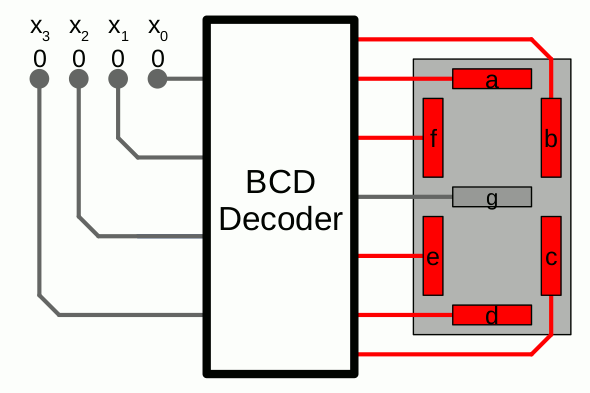
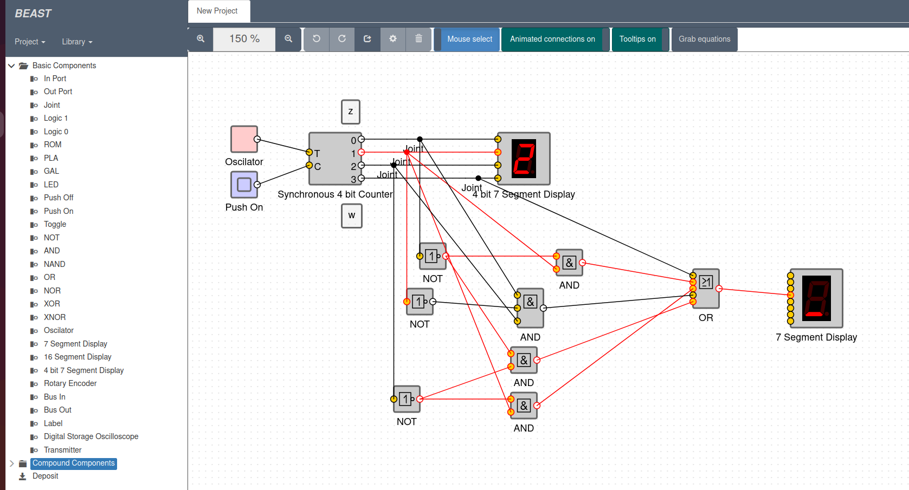
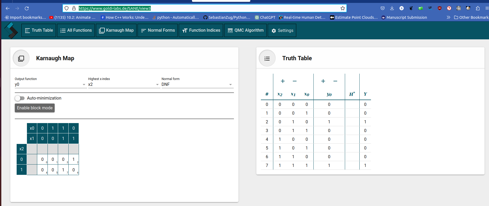

<!--

author:   Sebastian Zug & André Dietrich & Fabian Bär & Claude Code (Opus 5.5)
email:    sebastian.zug@informatik.tu-freiberg.de & andre.dietrich@informatik.tu-freiberg.de & fabian.baer@student.tu-freiberg.de
version:  0.1.0
language: de
narrator: Deutsch Female

import:   https://github.com/liascript/CodeRunner
          https://raw.githubusercontent.com/TUBAF-IfI-LiaScript/VL_EingebetteteSysteme/master/config.md
          https://raw.githubusercontent.com/LiaTemplates/KarnaughMap/0.1.0/README.md
-->

[](https://liascript.github.io/course/?https://raw.githubusercontent.com/TUBAF-IfI-LiaScript/VL_EingebetteteSysteme/master/03_Minimierung.md#1)

# Minimierung Boolescher Funktionen

| Parameter                | Kursinformationen                                                                                                                                                                          |
| ------------------------ | ------------------------------------------------------------------------------------------------------------------------------------------------------------------------------------------ |
| **Veranstaltung:**       | @config.lecture                                                                                          |
| **Semester:**            | @config.semester                                                                                         |
| **Hochschule:**          | `Technische Universität Freiberg`                                                                        |
| **Inhalte:**             | `Verfahren zur Minimierung Boolescher Funktionen, Karnaugh-Veitch-Diagramme`                           |
| **Link auf GitHub:**     | https://github.com/TUBAF-IfI-LiaScript/VL_EingebetteteSysteme/blob/master/03_Minimierung.md            |
| **Autoren:**             | @author                                                                                                  |


---------------------------------------------------------------------

**Lernziele:** Nach dieser Vorlesung können Sie

+ die Normalformen DNF und KNF sowie ihre kanonischen Formen KDNF und KKNF unterscheiden,
+ aus einer Wahrheitstafel die KDNF und die KKNF einer Schaltfunktion aufstellen,
+ Schaltfunktionen mit bis zu vier Variablen im Karnaugh-Veitch-Diagramm minimieren – über die Einsen zur DNF und über die Nullen zur KNF,
+ Don't-Care-Einträge nutzen, um größere Schleifen und damit einfachere Ausdrücke zu bilden.

<!-- kurslandkarte:knopf-start -->

<a href="https://tubaf-ifi-liascript.github.io/VL_EingebetteteSysteme/kurslandkarte/#termin=3" style="display: inline-block; padding: 0.5em 1.1em; background-color: #00718A; color: #ffffff; text-decoration: none; font-family: 'IBM Plex Sans', 'Segoe UI', system-ui, sans-serif; font-weight: 600;">🗺️ Diese Vorlesung in der Kurslandkarte →</a>

<!-- kurslandkarte:knopf-ende -->

---------------------------------------------------------------------


<!--
style="width: 80%; min-width: 420px; max-width: 720px;"
-->
```ascii

                Abstraktionsebenen

           +----------------------------+ -.
  Ebene 6  | Problemorientierte Sprache |  |
           +----------------------------+  |
                                           ⎬ Anwendungssoftware
           +----------------------------+  |
  Ebene 5  | Assemblersprache           |  |
           +----------------------------+ -.

           +----------------------------+
  Ebene 4  | Betriebssystem             |     Systemsoftware (fehlt beim ATmega328P)
           +----------------------------+

           +----------------------------+
  Ebene 3  | Instruktionsset            |     Maschinensprache
           +----------------------------+

           +----------------------------+  -.
  Ebene 2  | Mikroarchitektur           |   |
           +----------------------------+   |
                                            ⎬ Automaten, Speicher, Logik
           +----------------------------+   |       ╔═══════════════╗
  Ebene 1  | Digitale Logik             |   |    ◀══║ HIER SIND WIR!║
           +----------------------------+  -.       ╚═══════════════╝

           +----------------------------+
  Ebene 0  | E-Technik, Physik          |     Analoge Phänomene
           +----------------------------+                                      .
```

---------------------------------------------------------------------

## Rückblick: Hausaufgabe aus Vorlesung 02

    --{{0}}--
Beginnen wir mit Teil B der Hausaufgabe, dem Datenblatt des UND-Gatters. Die zweite Frage führt direkt zum heutigen Thema, denn die Kreuze in der Function Table meinen das, was wir heute Don't Care nennen.

Aufgabe 3 fragte nach dem [Datenblatt des UND-Gatters SN74LVC2G08](https://www.ti.com/lit/ds/symlink/sn74lvc2g08-ep.pdf):

+ **Maximale Verzögerung bei 3,3 V:** Bei $V_{CC} = 3{,}3\,\text{V} \pm 0{,}3\,\text{V}$ ist $t_{pd}$ höchstens 5,7 ns. Das klingt wenig, summiert sich aber: Zehn solcher Gatter hintereinander können bis zu 57 ns brauchen. Kürzere Wege durch eine Schaltung machen sie also auch schneller.
+ **Kreuze in der Function Table:** `X` steht für einen beliebigen Pegel. Liegt ein Eingang auf L, ist der andere egal, der Ausgang bleibt L. Dort sagt das `X`: Der **Eingang** spielt keine Rolle. Heute nutzen wir denselben Gedanken am **Ausgang**: Für manche Eingaben ist egal, was herauskommt.
+ **Negation mit dem UND-Gatter:** Nicht möglich. Laut Tabelle ist der Ausgang nur bei A = B = H auf H. Verbinden Sie beide Eingänge oder legen Sie einen fest auf H, folgt der Ausgang dem Eingang: $Y = A$. Der Ausgang geht also nie auf H, weil ein Eingang auf L geht. Dafür braucht es ein NICHT oder ein NAND.

## Ausgangspunkt

    --{{0}}--
In der letzten Vorlesung haben Sie Schaltfunktionen durch algebraische Umformungen vereinfacht. Das gelingt, aber Sie müssen die richtigen Gesetze in der richtigen Reihenfolge finden, und am Ende wissen Sie nicht, ob es noch kürzer geht.

**Rückblick: Algebraische Minimierung (Vorlesung 02)**

$$
\begin{aligned}
f(x_1, x_2, x_3) &= x_1 \cdot x_2 \cdot \overline{x_3} + x_1 \cdot x_2 \cdot x_3 + x_1 \cdot \overline{x_2} \cdot x_3 \\
&\text{... mehrere Umformungsschritte später ...} \\
&= x_1 \cdot x_2  + x_1 \cdot x_3
\end{aligned}
$$

Die algebraische Methode hat drei Schwächen: Es gibt kein festes Vorgehen, viele Schritte bedeuten viele Fehlerquellen, und das Ergebnis verrät nicht, ob es minimal ist.

    --{{1}}--
Das Ziel bleibt dasselbe wie in der letzten Vorlesung. Heute ändert sich der Weg: Wir ordnen die Wahrheitstafel so an, dass man zusammenfassbare Terme sehen kann. Das funktioniert bis zu vier Variablen. Für mehr Variablen kommt in der nächsten Vorlesung ein Algorithmus.

                         {{1}}
******************************************************

> **Das Ziel bleibt gleich:** Weniger Gatter bedeuten geringere Kosten, kürzere Laufzeiten und weniger Energiebedarf.
>
> **Der Weg ändert sich:** Statt nach passenden Gesetzen zu suchen, gehen wir nach einem festen Verfahren vor.

**Heute:** Normalformen als gemeinsamer Startpunkt und das Karnaugh-Veitch-Diagramm für bis zu vier Variablen. **Nächste Vorlesung:** das Verfahren von Quine-McCluskey für beliebig viele Variablen.

******************************************************


## Herausforderung

    --{{0}}--
Beginnen wir mit einem konkreten Beispiel. Die beiden Ausdrücke sehen verschieden aus. Beschreiben sie dieselbe Funktion?

                         {{0-3}}
******************************************************

> **Die Aufgabe:** Zeigen Sie, dass diese beiden Funktionen äquivalent sind!

$$
\begin{aligned}
f(x_1, x_2, x_3, x_4) &= x_3\overline{x}_1+ x_4\overline{x}_3\overline{x}_2 + \overline{x}_4x_3x_2\overline{x}_1 + x_4x_3\overline{x}_2x_1 \\
g(x_1, x_2, x_3, x_4) &= x_3\overline{x}_1 + x_4\overline{x}_2
\end{aligned}
$$

******************************************************

    --{{1}}--
Versuchen wir es zunächst mit algebraischen Umformungen wie in der letzten Vorlesung. Nach dem Absorptionsgesetz geht es scheinbar nicht weiter. Der Beweis gelingt zwar, aber nur mit einem Schritt, auf den man erst einmal kommen muss.


                         {{1-2}}
******************************************************

**Versuch 1: Algebraische Vereinfachung**

$$
\begin{aligned}
f(x_1, x_2, x_3, x_4) &= x_3\overline{x}_1+ x_4\overline{x}_3\overline{x}_2 + \overline{x}_4x_3x_2\overline{x}_1 + x_4x_3\overline{x}_2x_1 \\
&= x_3\overline{x}_1  + \overline{x}_4x_3x_2\overline{x}_1 + x_4x_3\overline{x}_2x_1   + x_4\overline{x}_3\overline{x}_2 & \text{(Kommutativgesetz)} \\
&= x_3\overline{x}_1 + x_4x_3\overline{x}_2x_1   + x_4\overline{x}_3\overline{x}_2 & \text{(Absorptionsgesetz)} \\
&= \text{... und jetzt?}
\end{aligned}
$$

> Der Beweis ist möglich, aber der nächste Schritt ist nicht offensichtlich: Das Distributivgesetz vereinfacht $x_3\overline{x}_1 + x_4x_3\overline{x}_2x_1$ zu $x_3\overline{x}_1 + x_4x_3\overline{x}_2$. Erst dann lässt sich $x_3$ gegen den letzten Term zusammenfassen. Nichts am Ausdruck verrät, dass man genau hier ansetzen muss.

******************************************************


    --{{2}}--
Alternativ prüfen wir die Äquivalenz über die Wahrheitstafel. Das ist mühsam, aber systematisch: Die Spalten $f$ und $g$ stimmen in jeder Zeile überein. Die rot markierten Zeilen deckt der kurze Term $x_4\overline{x}_2$ ab.

       {{2-3}}
********************************************************************************

**Versuch 2: Nachweis über die Wahrheitstafel**

<!-- data-type="none" style="table-layout: fixed; max-width:800px;"-->
| $x_4$                                 | $x_3$ | $x_2$                                 | $x_1$ | $f$ | $g$ |                                                           |
| ------------------------------------- | ----- | ------------------------------------- | ----- | --- | --- | --------------------------------------------------------- |
| 0                                     | 0     | 0                                     | 0     | 0   | 0   |                                                           |
| 0                                     | 0     | 0                                     | 1     | 0   | 0   |                                                           |
| 0                                     | 0     | 1                                     | 0     | 0   | 0   |                                                           |
| 0                                     | 0     | 1                                     | 1     | 0   | 0   |                                                           |
| 0                                     | 1     | 0                                     | 0     | 1   | 1   | $x_3\overline{x}_1$                                       |
| 0                                     | 1     | 0                                     | 1     | 0   | 0   |                                                           |
| 0                                     | 1     | 1                                     | 0     | 1   | 1   | $\overline{x}_4x_3x_2\overline{x}_1$, $x_3\overline{x}_1$ |
| 0                                     | 1     | 1                                     | 1     | 0   | 0   |                                                           |
| <span style="color: #ff0000">1</span> | 0     | <span style="color: #ff0000">0</span> | 0     | 1   | 1   | $x_4\overline{x}_3\overline{x}_2$                         |
| <span style="color: #ff0000">1</span> | 0     | <span style="color: #ff0000">0</span> | 1     | 1   | 1   | $x_4\overline{x}_3\overline{x}_2$                         |
| 1                                     | 0     | 1                                     | 0     | 0   | 0   |                                                           |
| 1                                     | 0     | 1                                     | 1     | 0   | 0   |                                                           |
| <span style="color: #ff0000">1</span> | 1     | <span style="color: #ff0000">0</span> | 0     | 1   | 1   | $x_3\overline{x}_1$                                       |
| <span style="color: #ff0000">1</span> | 1     | <span style="color: #ff0000">0</span> | 1     | 1   | 1   | $x_4x_3\overline{x}_2x_1$                                 |
| 1                                     | 1     | 1                                     | 0     | 1   | 1   | $x_3\overline{x}_1$                                       |
| 1                                     | 1     | 1                                     | 1     | 0   | 0   |                                                           |

> Die Spalten $f$ und $g$ stimmen in allen 16 Zeilen überein, damit ist die Äquivalenz gezeigt. Die Tafel verdoppelt sich aber mit jeder Variablen: 16 Zeilen bei vier, 32 bei fünf, 64 bei sechs Variablen.

********************************************************************************


    --{{3}}--
Was ist damit gewonnen? Rechnet man alles in Gatter mit zwei Eingängen um, schrumpft die Schaltung von zwölf auf drei Gatter. Negationen sind dabei nicht mitgezählt.

      {{3}}
********************************************************************************

**Was die Minimierung bringt** (umgerechnet in Gatter mit zwei Eingängen, ohne Negationen):

<!-- data-type="none" style="table-layout: fixed; max-width:500px;"-->
| Ausdruck | Terme mit Variablen | UND | ODER |
| -------- | ------------------- | --- | ---- |
| $f$      | 2, 3, 4 und 4       | 9   | 3    |
| $g$      | 2 und 2             | 2   | 1    |

> Beginnen wir mit dem, was jedes Verfahren braucht: einer einheitlichen Schreibweise, der Normalform.

********************************************************************************

## Aufstellen der Normalform


    --{{0}}--
Eine Wahrheitstafel beschreibt eine Funktion eindeutig. Ein Ausdruck tut das nicht, denn dieselbe Funktion lässt sich beliebig verschieden aufschreiben. Die kanonischen Normalformen stellen diese Eindeutigkeit wieder her.

       {{0-1}}
********************************************************************************

| Format                                          | Bedeutung   |
| ----------------------------------------------- | ----------- |
| Wahrheitstafel                                  | eindeutig   |
| Boolescher Ausdruck                             | uneindeutig |
| kanonische Normalform (KDNF, KKNF)              | eindeutig   |
| DNF oder KNF ohne kanonische Form               | uneindeutig |
| Schaltnetz                                      | uneindeutig |

********************************************************************************

    --{{1}}--
Vier Begriffe brauchen wir: Produktterm und Summenterm, und als deren vollständige Sonderfälle Minterm und Maxterm. Vollständig heißt, dass jede Variable genau einmal vorkommt.


       {{1-2}}
********************************************************************************

Für die Darstellung der Normalform benötigen wir zunächst weitere Begriffsdefinitionen.

**Produktterm**

+ Konjunktion (UND-Verknüpfung) von Variablen (ggf. negiert)
+ Beispiele: $x\cdot y$, $x\cdot \overline{y}$, $x\cdot y \cdot \overline{z}$

**Summenterm**

+ Disjunktion (ODER-Verknüpfung) von Variablen (ggf. negiert)
+ Beispiele: $x + y$, $x + \overline{y}$, $x + y + z$

**Minterm**

+ Produktterm, in dem jede Variable einer booleschen Funktion genau einmal vorkommt (einfach oder negiert)
+ Beispiel:  $x\cdot y \cdot \overline{z}$ ist ein Minterm der Funktion $f(x,y,z)$

**Maxterm**

+ Summenterm, in dem jede Variable einer booleschen Funktion genau einmal vorkommt (einfach oder negiert)
+ Beispiel: $x + y + z$ ist ein Maxterm der Funktion $f(x,y,z)$

********************************************************************************

    --{{2}}--
Aus diesen Termen setzen sich die Normalformen zusammen. Bei der DNF werden Produktterme mit ODER verknüpft, bei der KNF Summenterme mit UND. Die kanonischen Formen verwenden ausschließlich Minterme beziehungsweise Maxterme.

   {{2-3}}
********************************************************************************

Und nun in der Kombination ....

**Disjunktive Normalform (DNF, Summe von Produkttermen)**

+ Disjunktion von Produkttermen
+ Beispiel: $( x \cdot y ) + ( x \cdot y \cdot z )$

**Konjunktive Normalform (KNF, Produkt von Summentermen)**

+ Konjunktion von Summentermen
+ Beispiel: $w \cdot ( x + y ) \cdot ( x + y + z )$

**Kanonische Disjunktive Normalform (KDNF)**

+ eindeutige Darstellung einer booleschen Funktion f als Disjunktion von Mintermen
+ Beispiel: $( \overline{x} \cdot y \cdot z ) + ( x \cdot \overline{y} \cdot \overline{z} ) + ( \overline{x} \cdot y \cdot \overline{z} )$ ist KDNF von $f(x,y,z)$

**Kanonische Konjunktive Normalform (KKNF)**

+ eindeutige Darstellung einer booleschen Funktion f als Konjunktion von Maxtermen
+ Beispiel: $( x + \overline{y} ) \cdot ( \overline{x} + y ) \cdot ( \overline{x} + \overline{y} )$ ist KKNF von $f(x,y)$
********************************************************************************

    --{{3}}--
Die KDNF lesen Sie direkt aus der Wahrheitstafel ab: Jede Zeile mit einer Eins liefert einen Minterm.

       {{3-4}}
********************************************************************************

> "KDNF = Disjunktion von Mintermen"

>  Jede Boolesche Funktion lässt sich als genau eine KDNF darstellen!

Bildung der KDNF für n -stellige Boolesche Funktion $f$:

+ für jede Zeile der Wahrheitstabelle mit $f(x_1, x_2, ..., x_n) = 1$ wird ein Minterm aufgestellt
+ hierin wird jede Variable $x_i$ negiert, wenn in der entsprechenden Zeile der Wert der Variablen 0 ist

Am Beispiel der Aufgabe vom Beginn der Vorlesung ergibt sich daraus:

<!-- data-type="none" style="table-layout: fixed; max-width:700px;"-->
| $x_4$ | $x_3$ | $x_2$ | $x_1$ | $f$ | Minterme                                        |
| ----- | ----- | ----- | ----- | --- | ----------------------------------------------- |
| 0     | 0     | 0     | 0     | 0   |                                                 |
| 0     | 0     | 0     | 1     | 0   |                                                 |
| 0     | 0     | 1     | 0     | 0   |                                                 |
| 0     | 0     | 1     | 1     | 0   |                                                 |
| 0     | 1     | 0     | 0     | 1   | $\overline{x}_4x_3\overline{x}_2\overline{x}_1$ |
| 0     | 1     | 0     | 1     | 0   |                                                 |
| 0     | 1     | 1     | 0     | 1   | $\overline{x}_4x_3x_2\overline{x}_1$            |
| 0     | 1     | 1     | 1     | 0   |                                                 |
| 1     | 0     | 0     | 0     | 1   | $x_4\overline{x}_3\overline{x}_2\overline{x}_1$ |
| 1     | 0     | 0     | 1     | 1   | $x_4\overline{x}_3\overline{x}_2x_1$            |
| 1     | 0     | 1     | 0     | 0   |                                                 |
| 1     | 0     | 1     | 1     | 0   |                                                 |
| 1     | 1     | 0     | 0     | 1   | $x_4x_3\overline{x}_2\overline{x}_1$            |
| 1     | 1     | 0     | 1     | 1   | $x_4x_3\overline{x}_2x_1$                       |
| 1     | 1     | 1     | 0     | 1   | $x_4x_3x_2\overline{x}_1$                       |
| 1     | 1     | 1     | 1     | 0   |                                                 |

Damit ergibt sich die Kanonische Disjunktive Normalform obiger Wahrheitstafel zu

$$
\begin{aligned}
f(x_1, x_2, x_3, x_4) =& \overline{x}_4x_3\overline{x}_2\overline{x}_1 + \\
                       &\overline{x}_4x_3x_2\overline{x}_1 + \\
                       & x_4\overline{x}_3\overline{x}_2\overline{x}_1 + \\
                       & x_4\overline{x}_3\overline{x}_2x_1 + \\
                       & x_4x_3\overline{x}_2\overline{x}_1 + \\
                       & x_4x_3\overline{x}_2x_1 +\\
                       & x_4x_3x_2\overline{x}_1\\
\end{aligned}
$$

Vergleichen Sie die Darstellung mit dem Ausdruck $f$ aus der Aufgabe am Anfang!

> Die Darstellung als KDNF ist abgesehen von Reihenfolge eindeutig!

********************************************************************************

    --{{4}}--
Für die KKNF gehen Sie genauso vor, nur über die Nullen: Jede Zeile mit einer Null liefert einen Maxterm, und die Negation dreht sich um.

{{4-5}}
********************************************************************************

> "KKNF = Konjunktion von Maxtermen"

>  Jede Boolesche Funktion lässt sich als genau eine KKNF darstellen!

Bildung der KKNF für n -stellige Boolesche Funktion $f$:

+ für jede Zeile der Wahrheitstabelle mit $f(x_1, x_2, ..., x_n) = 0$ wird ein Maxterm aufgestellt
+ hierin wird jede Variable $x_i$ negiert, wenn in der entsprechenden Zeile der Wert der Variablen 1 ist

Am Beispiel der Aufgabe vom Beginn der Vorlesung ergibt sich daraus:

<!-- data-type="none"-->
| $x_4$ | $x_3$ | $x_2$ | $x_1$ | $f$ | Maxterme                                                      |
| ----- | ----- | ----- | ----- | --- | ------------------------------------------------------------- |
| 0     | 0     | 0     | 0     | 0   | $x_4+x_3+x_2+x_1$                                             |
| 0     | 0     | 0     | 1     | 0   | $x_4+x_3+x_2+\overline{x}_1$                                  |
| 0     | 0     | 1     | 0     | 0   | $x_4+x_3+\overline{x}_2+x_1$                                  |
| 0     | 0     | 1     | 1     | 0   | $x_4+x_3+\overline{x}_2+\overline{x}_1$                       |
| 0     | 1     | 0     | 0     | 1   |                                                               |
| 0     | 1     | 0     | 1     | 0   | $x_4+\overline{x}_3+x_2+\overline{x}_1$                       |
| 0     | 1     | 1     | 0     | 1   |                                                               |
| 0     | 1     | 1     | 1     | 0   | $x_4+\overline{x}_3+\overline{x}_2+\overline{x}_1$            |
| 1     | 0     | 0     | 0     | 1   |                                                               |
| 1     | 0     | 0     | 1     | 1   |                                                               |
| 1     | 0     | 1     | 0     | 0   | $\overline{x}_4+x_3+\overline{x}_2+x_1$                       |
| 1     | 0     | 1     | 1     | 0   | $\overline{x}_4+x_3+\overline{x}_2+\overline{x}_1$            |
| 1     | 1     | 0     | 0     | 1   |                                                               |
| 1     | 1     | 0     | 1     | 1   |                                                               |
| 1     | 1     | 1     | 0     | 1   |                                                               |
| 1     | 1     | 1     | 1     | 0   | $\overline{x}_4+\overline{x}_3+\overline{x}_2+\overline{x}_1$ |

Damit ergibt sich die Kanonische Konjunktive Normalform obiger Wahrheitstafel zu

$$
\begin{aligned}
f(x_1, x_2, x_3, x_4) =& (x_4+x_3+x_2+x_1) \cdot \\
                &(x_4+x_3+x_2+\overline{x}_1) \cdot \\
                & (x_4+x_3+\overline{x}_2+x_1) \cdot \\
                & (x_4+x_3+\overline{x}_2+\overline{x}_1) \cdot \\
                & (x_4+\overline{x}_3+x_2+\overline{x}_1) \cdot \\
                & (x_4+\overline{x}_3+\overline{x}_2+\overline{x}_1) \cdot \\
                & (\overline{x}_4+x_3+\overline{x}_2+x_1) \cdot \\
                & (\overline{x}_4+x_3+\overline{x}_2+\overline{x}_1) \cdot\\
                & (\overline{x}_4+\overline{x}_3+\overline{x}_2+\overline{x}_1)
\end{aligned}
$$

> Die Darstellung als KKNF ist abgesehen von Reihenfolge eindeutig!

********************************************************************************

    --{{5}}--
Welche der beiden Formen kürzer ist, hängt davon ab, ob die Wahrheitstafel mehr Einsen oder mehr Nullen enthält. Prüfen Sie danach mit den beiden Fragen, ob Sie die Begriffe sicher unterscheiden.

    {{5}}
********************************************************************************
> Satz:  Jede KDNF kann in eine KKNF umgewandelt, jede KKNF kann in eine KDNF umgewandelt werden.

>  Zwei Darstellungen Boolescher Funktionen sind äquivalent, wenn sie durch Umformungen gemäß den Sätzen der Booleschen Algebra auf die gleiche KDNF bzw. KKNF zurückgeführt werden können

Welche Form erweist sich in welcher Situation als günstiger?

Eine KDNF ist günstiger als eine KKNF, wenn nur für wenige Kombinationen der Eingabewerte $f(x_1, x_2, ..., x_n) = 1$ gilt. Umgekehrt, wenn nur für wenige Kombinationen der Eingabewerte $f(x_1, x_2, ..., x_n) = 0$ gilt, ist die KKNF vorzuziehen.

Für die `OR` Funktion bedeutet das (wenig überraschend):

<!-- data-type="none" style="table-layout: fixed; max-width:300px;"-->
| $x$ | $y$ | $f$ |
| --- | --- | --- |
| 0   | 0   | 0   |
| 0   | 1   | 1   |
| 1   | 0   | 1   |
| 1   | 1   | 1   |

KDNF: $f = \overline{x}\cdot y+ x\cdot\overline{y} + x \cdot y$

KKNF: $f =x+y$

**Eine Funktion von vier Variablen ist in 6 Zeilen der Wahrheitstafel gleich 1. Wie viele Maxterme hat ihre KKNF?**

[[10]]
***************************************************************

Die Wahrheitstafel hat 16 Zeilen. Jede der $16 - 6 = 10$ Zeilen mit $f = 0$ liefert einen Maxterm.

***************************************************************

**Welcher Ausdruck ist eine KDNF einer Funktion $f(x,y,z)$?**

[( )] $xy + \overline{x}z$
[(X)] $xyz + \overline{x}y\overline{z}$
[( )] $(x+y+z)(\overline{x}+y+z)$
[( )] $x + y + z$
***************************************************************

In einer KDNF ist jeder Term ein Minterm, enthält also alle drei Variablen. $xy + \overline{x}z$ ist eine DNF, aber keine kanonische. $(x+y+z)(\overline{x}+y+z)$ ist eine KKNF.

***************************************************************

********************************************************************************

## Minimierung von Schaltfunktionen mit dem KV-Diagramm

    --{{0}}--
Minimal kann Verschiedenes heißen, deshalb legen wir es fest: zuerst möglichst wenige Terme, dann möglichst wenige Literale. Das Grundprinzip aller Verfahren ist dasselbe: Zwei Terme, die sich nur in einer Variablen unterscheiden, lassen sich zu einem kürzeren zusammenfassen.

+ Wann heißt eine Darstellung minimal ?

   + kleinste Anzahl an Gattern ?
   + kleinste Anzahl an Verbindungsleitungen ?
   + kleinste Anzahl an Produkttermen bzw. Summentermen ?

> **Minimal heißt in dieser Vorlesung:** unter allen DNF (oder KNF) einer Funktion möglichst wenige Terme, bei Gleichstand möglichst wenige Literale. Ein **Literal** ist ein Vorkommen einer Variablen, negiert oder nicht: $x\overline{y} + xz$ hat 2 Terme und 4 Literale, aber nur 3 Variablen. Es kann mehrere gleich gute Minimalformen geben.

Lösungsmöglichkeiten:

1.  geeignetes Umformen mit Gesetzen der Booleschen Algebra
2.  Einsatz eines graphischen Verfahrens (z.B. ein Karnaugh-Veitch-Diagramm), nur möglich bei Schaltfunktionen mit wenigen Variablen
3. algorithmisches Minimieren (z.B. Verfahren nach Quine-McCluskey, nächste Vorlesung), geeignet auch für Schaltfunktionen mit vielen Variablen

Ausgangspunkt für die Minimierung von Booleschen Ausdrücken ist das neutrale
Element einer Operation. Für eine `ODER` Verknüpfung bewirkt eine falsche Aussage und für eine `UND` Operation eine wahre Aussage keine Veränderung des Gesamtausdruckes.

Dafür nutzen wir die **Resolutionsregel**:

| Disjunktive Normalform | Konjunktive Normalform |
|------------------------|------------------------|
| $\begin{aligned} f(x,y)&= x \cdot y + x \cdot \overline{y} \\ &=  x \cdot (y + \overline{y}) \\ &= x\cdot (1) \end{aligned}$  |   $\begin{aligned} f(x,y) &= (x + y) \cdot (x + \overline{y}) \\ &= x + (y \cdot \overline{y}) \\ &=x+(0)\end{aligned}$ |
| Wenn sich in einer disjunktiven Normalform zwei Produktterme nur in genau einer komplementären Variablen unterscheiden, so können beide durch ihren gemeinsamen Teil ersetzt werden! | Wenn sich in einer konjunktiven Normalform zwei Summenterme nur in genau einer komplementären Variablen unterscheiden, so können beide durch ihren gemeinsamen Teil ersetzt werden! |

### Karnaugh-Veitch-Diagramme - Konzept

    --{{0}}--
Die Idee: Wir schreiben die Wahrheitstafel als Rechteck. Dann liegen Terme, die sich zusammenfassen lassen, sichtbar nebeneinander.

       {{0-2}}
********************************************************************************

Jede zweistellige Boolesche Funktion lässt sich  mit den Kombinationen ihrer Variablen in einer tabellarischen Darstellung visualisieren:

$A= \overline{x} \cdot \overline{y} + \overline{x} \cdot y + x \cdot \overline{y} + x \cdot y$

<!-- data-type="none" style="table-layout: fixed; max-width:300px;"-->
|                | $\overline{x}$                    | $x$                    |
| -------------- | --------------------------------- | ---------------------- |
| $\overline{y}$ | $\overline{x} \cdot \overline{y}$ | $x \cdot \overline{y}$ |
| $y$            | $\overline{x} \cdot y$            | $x \cdot y$            |

Mit dieser umgeordneten Wahrheitstafel lässt sich eine Boolesche Funktion auf einen Blick erfassen.

Beispiel 1: $f= x \cdot \overline{y} + x \cdot y$

<!-- data-type="none" style="table-layout: fixed; max-width:300px;"-->
|                | $\overline{x}$ | $x$ |
| -------------- | -------------- | --- |
| $\overline{y}$ | 0              | 1   |
| $y$            | 0              | 1   |


Beispiel 2: $f= x \cdot \overline{y} + \overline{x} \cdot y$

<!-- data-type="none" style="table-layout: fixed; max-width:300px;"-->
|                | $\overline{x}$ | $x$ |
| -------------- | -------------- | --- |
| $\overline{y}$ | 0              | 1   |
| $y$            | 1              | 0   |


********************************************************************************

    --{{1}}--
Damit Nachbarschaft im Bild auch Nachbarschaft in der Logik bedeutet, folgen die Spalten und Zeilen nicht der Zählreihenfolge, sondern dem Gray-Code. Beachten Sie die Reihenfolge null null, null eins, eins eins, eins null. Auch die Ränder gehören zusammen, das Diagramm schließt sich wie ein Torus.

       {{1-2}}
********************************************************************************
Dieses Konzept lässt sich auf mehr Variablen übertragen, von Hand ist es aber nur bis zu vier Variablen übersichtlich.
Wichtig dabei ist, dass benachbarte Kombinationen von Variablen sich nur in **einer** Variable unterscheiden. (Siehe [Gray-Code](https://www.youtube.com/watch?v=4GZBNTiQYik))

> Der Gray-Code ist ein stetiger Code, bei dem sich benachbarte Codewörter nur in einer einzigen binären Ziffer unterscheiden.
>
><!-- data-type="none" -->
> | Dezimalzahl | Binärcode | Gray-Code |
> | ----------- | --------- | --------- |
> | 0           | 000       | 000       |
> | 1           | 001       | 001       |
> | 2           | 010       | 011       |
> | 3           | 011       | 010       |

<!-- data-type="none" style="table-layout: fixed; max-width:700px;"-->
|                | $\overline{x}\,\overline{y}$                      | $\overline{x}y$                        | $xy$ | $x\overline{y}$ |
| -------------- | ------------------------------------------------ | -------------------------------------- | ---- | --------------- |
| $\overline{z}$ | $\overline{x}\cdot\overline{y}\cdot\overline{z}$ | $\overline{x}\cdot y\cdot\overline{z}$ | $x\cdot y\cdot\overline{z}$     |    $x\cdot\overline{y}\cdot\overline{z}$             |
| $z$ | $\overline{x}\cdot\overline{y}\cdot z$ | $\overline{x}\cdot y\cdot z$ | $x\cdot y\cdot z$     |    $x\cdot\overline{y}\cdot z$             |

> Jeweils nur ein Wechsel von einer Variable pro Zeilen-/Spaltenübergang! Das Diagramm schließt sich dabei wie ein Torus: Linker und rechter Rand sowie oberer und unterer Rand grenzen aneinander!

********************************************************************************

    --{{2}}--
Nun das Verfahren in vier Schritten. Das rote Feldpaar unten unterscheidet sich nur in $z$, also fällt $z$ heraus.

       {{2-3}}
********************************************************************************

Vorgehen zur Minimierung der KDNF einer $n$-stelligen Funktion $f$:

1. Für jeden Minterm mit $f(x_1,...,x_n) = 1$ wird eine 1 ins Diagramm eingetragen.
2. Für jeden Maxterm mit $f(x_1,...,x_n) = 0$ wird eine 0 ins Diagramm eingetragen.
3. Möglichst wenige und möglichst große Rechtecke (Schleifen) aus Einsen werden markiert, wobei gegenüberliegende Ränder aneinandergrenzen und

   + jedes Rechteck aus $2^k$ Feldern (mit $0 \leq k \leq n$) besteht und
   + alle Einsen überdeckt werden müssen.

4. Jede Schleife wird nach der Resolutionsregel zu einem Produktterm: Variablen, die in der Schleife wechseln, fallen weg. Variablen, die konstant bleiben, stehen im Term, bei Wert 1 einfach, bei Wert 0 negiert. Die Produktterme werden summiert.

<!-- data-type="none" style="table-layout: fixed; max-width:300px;"-->
|                              | $\overline{w}\,\overline{x}$ | $\overline{w}x$                     | $wx$ | $w\overline{x}$ |
| ---------------------------- | ---------------------------- | ----------------------------------- | ---- | --------------- |
| $\overline{y}\,\overline{z}$ | 0                            | <!-- style="background: #ffb0b0" --> 1 | 0    | 0               |
| $\overline{y} z$             | 0                            | <!-- style="background: #ffb0b0" -->1  | 0    | 0               |
| $y z$                        | 0                            | 0                                   | 0    | 0               |
| $y \overline{z}$             | 0                            | 0                                   | 0    | 0               |

Welcher Ausdruck steht hinter dem markierten Bereich?

$$
\begin{aligned}
f &=\overline{w}x\overline{y}\,\overline{z} +  \overline{w}x\overline{y} z \\
  &=\overline{w}x\overline{y} (\overline{z} +  z) \\
  &=\overline{w}x\overline{y} \cdot 1 \\
  &=\overline{w}x\overline{y} \\
\end{aligned}
$$


********************************************************************************

    --{{3}}--
Je größer die Schleife, desto kürzer der Term: Vier Felder lassen zwei Variablen herausfallen, zwei Felder nur eine.

       {{3}}
********************************************************************************

Beispiel 1: $\overline{w}\,\overline{y}$

<!-- data-type="none" style="table-layout: fixed; max-width:300px;"-->
|                              | $\overline{w}\,\overline{x}$       | $\overline{w}x$                    | $wx$ | $w\overline{x}$ |
| ---------------------------- | ---------------------------------- | ---------------------------------- | ---- | --------------- |
| $\overline{y}\,\overline{z}$ | <!-- style="background: #ffb0b0" --> 1 | <!-- style="background: #ffb0b0" --> 1 | 0    | 0               |
| $\overline{y} z$             | <!-- style="background: #ffb0b0" --> 1 | <!-- style="background: #ffb0b0" --> 1 | 0    | 0               |
| $y z$                        | 0                                  | 0                                  | 1    | 0               |
| $y \overline{z}$             | 0                                  | 0                                  | 1    | 0               |


Beispiel 2: $wxy$

<!-- data-type="none" style="table-layout: fixed; max-width:300px;"-->
|                              | $\overline{w}\,\overline{x}$ | $\overline{w}x$ | $wx$                               | $w\overline{x}$ |
| ---------------------------- | ---------------------------- | --------------- | ---------------------------------- | --------------- |
| $\overline{y}\,\overline{z}$ | 1                            | 1               | 0                                  | 0               |
| $\overline{y} z$             | 1                            | 1               | 0                                  | 0               |
| $y z$                        | 0                            | 0               | <!-- style="background: #ffb0b0" --> 1 | 0               |
| $y \overline{z}$             | 0                            | 0               | <!-- style="background: #ffb0b0" --> 1 | 0               |

********************************************************************************

    --{{4}}--
Eine zu kleine Schleife ist kein logischer Fehler, die Funktion stimmt weiterhin. Sie ist nur nicht minimal. Schleifen dürfen sich dafür überlappen, und über den Rand hinweg gehen sie ebenfalls.

     {{4}}
********************************************************************************

Regeln zur Bildung der Schleifen:

+ Fangen Sie mit isolierten Zellen an. Die entsprechenden Minterme können nicht mehr vereinfacht werden.
+ Nehmen Sie dann Einsen, die nur in einer einzigen größtmöglichen Schleife liegen können. Diese Schleifen sind unverzichtbar.
+ Bilden Sie für die restlichen Einsen die größtmöglichen Schleifen, zuerst für die Einsen mit den wenigsten gleichwertigen Nachbarzellen. Eine Schleife umfasst $2^k$ Zellen.
+ Überlappungen führen nur dann zu kürzeren Ausdrücken, wenn dadurch größere Schleifen gebildet werden können.
+ Die minimale Funktion besteht aus möglichst wenigen Schleifen, die jede für sich möglichst groß sind.

Vermeiden Sie also "Einzelelemente":

Korrekt, aber nicht minimal - $f =\overline{w}\,\overline{y} + \overline{w}xyz$

<!-- data-type="none" style="table-layout: fixed; max-width:300px;"-->
|                             | $\overline{w}\,\overline{x}$ | $\overline{w}x$ | $wx$ | $w\overline{x}$ |
| --------------------------- | --------------------------- | --------------- | ---- | --------------- |
| $\overline{y}\,\overline{z}$ | <span style="background-color: #ff0000">1</span>                           | <span style="background-color: #ff0000">1</span>                 | 0    | 0               |
| $\overline{y} z$            | <span style="background-color: #ff0000">1</span>                            | <span style="background-color: #ff0000">1</span>                 | 0    | 0               |
| $y z$                       | 0                           | <span style="background-color: #0000ff">1</span>                | 0    | 0               |
| $y \overline{z}$            | 0                           | 0               | 0    | 0               |

Minimal - $f = \overline{w}\,\overline{y} + \overline{w}xz$ (die doppelte `1` zeigt ein Feld, das in beiden Schleifen liegt)

<!-- data-type="none" style="table-layout: fixed; max-width:300px;"-->
|                             | $\overline{w}\,\overline{x}$ | $\overline{w}x$ | $wx$ | $w\overline{x}$ |
| --------------------------- | --------------------------- | --------------- | ---- | --------------- |
| $\overline{y}\,\overline{z}$ | <span style="background-color: #ff0000">1</span>                          | <span style="background-color: #ff0000">1</span>               | 0    | 0               |
| $\overline{y} z$            | <span style="background-color: #ff0000">1</span>                           |   <span style="background-color: #ff0000">1</span>   <span style="background-color: #00ff00">1</span>          | 0    | 0               |
| $y z$                       | 0                           | <span style="background-color: #00ff00">1</span>                |0    | 0               |
| $y \overline{z}$            | 0                           | 0               | 0    | 0               |

Schleifen dürfen über den Rand reichen, weil gegenüberliegende Ränder aneinandergrenzen.

**Welche Felder dürfen im Diagramm mit vier Variablen zusammen eine Schleife bilden?**

[[X]] das oberste und das unterste Feld derselben Spalte
[[X]] die vier Eckfelder
[[ ]] drei nebeneinanderliegende Felder
[[ ]] zwei Felder, die sich nur diagonal berühren
[[ ]] vier Felder in L-Form
***************************************************************

Oben und unten sowie links und rechts grenzen die Ränder aneinander, deshalb gehen beide ersten Antworten. Die Eckfelder sind die Schleife $\overline{x}\,\overline{z}$. Drei Felder sind keine Zweierpotenz. Diagonale Felder unterscheiden sich in zwei Variablen, es fällt also nichts heraus. Eine L-Form ist kein Rechteck: Es bleiben nicht genau $k$ Variablen frei.

***************************************************************

********************************************************************************

### Beispiele

    --{{0}}--
Decken Sie die Formel gedanklich ab und lesen Sie jeden Term selbst aus dem Diagramm: Welche Variablen bleiben in der Schleife konstant?

     {{0-5}}
********************************************************************************

$f = \overline{w}x$

<!-- data-type="none" style="table-layout: fixed; max-width:300px;"-->
|                | $\overline{w}\,\overline{x}$ | $\overline{w}x$                    | $wx$ | $w\overline{x}$ |
| -------------- | ---------------------------- | ---------------------------------- | ---- | --------------- |
| $\overline{z}$ | 0                            | <!-- style="background: #ffb0b0" --> 1 | 0    | 0               |
| $z$            | 0                            | <!-- style="background: #ffb0b0" --> 1 | 0    | 0               |

********************************************************************************

     {{1-5}}
********************************************************************************

$f = z$

<!-- data-type="none" style="table-layout: fixed; max-width:300px;"-->
|                | $\overline{w}\,\overline{x}$            | $\overline{w}x$                     | $wx$                                | $w\overline{x}$                    |
| -------------- | --------------------------------------- | ----------------------------------- | ----------------------------------- | ---------------------------------- |
| $\overline{z}$ | 0                                       | 0                                   | 0                                   | 0                                  |
| $z$            | <!-- style="background: #ffb0b0" --> 1 | <!-- style="background: #ffb0b0" -->  1 | <!-- style="background: #ffb0b0" -->  1 |  <!-- style="background: #ffb0b0" --> 1 |

********************************************************************************

     {{2-5}}
********************************************************************************

$f = x\overline{z}$

<!-- data-type="none" style="table-layout: fixed; max-width:300px;"-->
|                             | $\overline{w}\,\overline{x}$ | $\overline{w}x$                                  | $wx$                                             | $w\overline{x}$ |
| --------------------------- | --------------------------- | ------------------------------------------------ | ------------------------------------------------ | --------------- |
| $\overline{y}\,\overline{z}$ | 0                           | <!-- style="background: #ffb0b0" -->  1 | <!-- style="background: #ffb0b0" -->  1 | 0               |
| $\overline{y} z$            | 0                           | 0                                                | 0                                                | 0               |
| $y z$                       | 0                           | 0                                                | 0                                                | 0               |
| $y \overline{z}$            | 0                           | <!-- style="background: #ffb0b0" -->  1 | <!-- style="background: #ffb0b0" -->  1 | 0               |

********************************************************************************

     {{3-5}}
********************************************************************************

$f = \overline{x}\,\overline{z}$

<!-- data-type="none" style="table-layout: fixed; max-width:300px;"-->
|                             | $\overline{w}\,\overline{x}$                      | $\overline{w}x$ | $wx$ | $w\overline{x}$ |
| --------------------------- | ------------------------------------------------ | --------------- | ---- | --------------- |
| $\overline{y}\,\overline{z}$ | <!-- style="background: #ffb0b0" -->  1|    0             | 0    | <!-- style="background: #ffb0b0" -->  1              |
| $\overline{y} z$            | 0                                                | 0               | 0    | 0               |
| $y z$                       | 0                                                | 0               | 0    | 0               |
| $y \overline{z}$            | <!-- style="background: #ffb0b0" -->  1| 0               | 0    | <!-- style="background: #ffb0b0" -->  1             |


********************************************************************************

      {{4-5}}
********************************************************************************

Lesen Sie diese Funktion selbst ab. Die Felder stehen schon im Diagramm, Sie bilden die Schleifen. Das Diagramm meldet, ob eine Auswahl eine gültige Schleife ist und ob Ihr Ergebnis minimal ist.

@Karnaugh.map(w x y z,0 2 5 8 9 10 11 13,-)

********************************************************************************

    --{{5}}--
Nun die ganze Kette: Tragen Sie die Wahrheitstafel unter Felder eintragen ein, wechseln Sie zu Schleifen bilden und lesen Sie das Ergebnis ab.

        {{5}}
********************************************************************************

Und jetzt Sie!

Tragen Sie die Wahrheitstafel unter „Felder eintragen“ ein, bilden Sie dann die Schleifen.

<!-- data-type="none" style="table-layout: fixed; max-width:300px;"-->
| A   | B   | C   | Y   |
| --- | --- | --- | --- |
| 0   | 0   | 0   | 1   |
| 0   | 0   | 1   | 1   |
| 0   | 1   | 0   | 1   |
| 0   | 1   | 1   | 0   |
| 1   | 0   | 0   | 1   |
| 1   | 0   | 1   | 0   |
| 1   | 1   | 0   | 0   |
| 1   | 1   | 1   | 0   |

@Karnaugh.map(A B C,-,-)

********************************************************************************

        {{6}}
********************************************************************************

<!-- data-type="none" style="table-layout: fixed; max-width:300px;"-->
|                | $\overline{A}\,\overline{B}$ | $\overline{A}B$ | $AB$ | $A\overline{B}$ |
| -------------- | ---------------------------- | --------------- | ---- | --------------- |
| $\overline{C}$ | 1                            | 1               | 0    | 1               |
| $C$            | 1                            | 0               | 0    | 0               |

$\overline{A}\,\overline{B} + \overline{A}\,\overline{C} + \overline{B}\,\overline{C}$

********************************************************************************

### Optimierungskriterien

    --{{0}}--
Schleifen dürfen sich überlappen, aber nicht jede Überlappung lohnt sich. Die drei Varianten überdecken alle dieselben Einsen, kosten aber unterschiedlich viele Operationen.

<!-- data-type="none" style="table-layout: fixed; max-width:300px;"-->
|                              | $\overline{w}\,\overline{x}$ | $\overline{w}x$                     | $wx$                                | $w\overline{x}$ |
| ---------------------------- | ---------------------------- | ----------------------------------- | ----------------------------------- | --------------- |
| $\overline{y}\,\overline{z}$ | 1                            | 1                                   | 0                                   | 1               |
| $\overline{y} z$             | 0                            | <!-- style="background: #ffb0b0" -->  1 | <!-- style="background: #ffb0b0" -->  1 | 1               |
| $y z$                        | 0                            | <!-- style="background: #ffb0b0" -->  1 | <!-- style="background: #ffb0b0" -->  1 | 0               |
| $y \overline{z}$             | 0                            | 0                                   | 0                                   | 0               |

Welche Möglichkeiten haben wir ausgehend von der ersten Gruppe?

Ein `_` zeigt in den Tabellen, dass ein Feld zu einer zweiten Schleife gehört.

Variante 1: $\color{red} xz + \color{green}\overline{x}\,\overline{y}\,\overline{z} + \color{blue}\overline{w}x\overline{y} + \color{magenta}w\overline{x}\,\overline{y}$ (10 Operationen)

<!-- data-type="none" style="table-layout: fixed; max-width:300px;"-->
|                              | $\overline{w}\,\overline{x}$                     | $\overline{w}x$                                                                       | $wx$                                | $w\overline{x}$                                                                                     |
| ---------------------------- | ------------------------------------------------ | ------------------------------------------------------------------------------------- | ----------------------------------- | --------------------------------------------------------------------------------------------------- |
| $\overline{y}\,\overline{z}$ | <span style="background-color: #00ff00">1</span> | <span style="background-color: #0000ff">1</span>                                      | 0                                   | <span style="background-color: #00ff00">1</span>   <span style="background-color: #ff00ff">_</span> |
| $\overline{y} z$             | 0                                                | <!-- style="background: #ffb0b0" -->  1  <span style="background-color: #0000ff">_</span> | <!-- style="background: #ffb0b0" -->  1 | <span style="background-color: #ff00ff">1</span>                                                    |
| $y z$                        | 0                                                | <!-- style="background: #ffb0b0" -->  1                                                   | <!-- style="background: #ffb0b0" -->  1 | 0                                                                                                   |
| $y \overline{z}$             | 0                                                | 0                                                                                     | 0                                   | 0                                                                                                   |

Variante 2: $\color{red} xz + \color{green}\overline{x}\,\overline{y}\,\overline{z} + \color{blue}\overline{w}x\overline{y} + \color{magenta}w\overline{y}z$ (10 Operationen)

<!-- data-type="none" style="table-layout: fixed; max-width:300px;"-->
|                              | $\overline{w}\,\overline{x}$                     | $\overline{w}x$                                                                     | $wx$                                                                                 | $w\overline{x}$                                  |
| ---------------------------- | ------------------------------------------------ | ----------------------------------------------------------------------------------- | ------------------------------------------------------------------------------------ | ------------------------------------------------ |
| $\overline{y}\,\overline{z}$ | <span style="background-color: #00ff00">1</span> | <span style="background-color: #0000ff">1</span>                                    | 0                                                                                    | <span style="background-color: #00ff00">1</span> |
| $\overline{y} z$             | 0                                                | <!-- style="background: #ffb0b0" -->  1<span style="background-color: #0000ff">_</span> | <!-- style="background: #ffb0b0" -->  1 <span style="background-color: #ff00ff">_</span> | <span style="background-color: #ff00ff">1</span> |
| $y z$                        | 0                                                | <!-- style="background: #ffb0b0" -->  1                                                 | <!-- style="background: #ffb0b0" -->  1                                                  | 0                                                |
| $y \overline{z}$             | 0                                                | 0                                                                                   | 0                                                                                    | 0                                                |

Variante 3: $\color{red} xz + \color{green}\overline{w}\,\overline{y}\,\overline{z} +  \color{magenta}w\overline{x}\,\overline{y}$ (7 Operationen)

<!-- data-type="none" style="table-layout: fixed; max-width:300px;"-->
|                              | $\overline{w}\,\overline{x}$                     | $\overline{w}x$                                  | $wx$                                | $w\overline{x}$                                  |
| ---------------------------- | ------------------------------------------------ | ------------------------------------------------ | ----------------------------------- | ------------------------------------------------ |
| $\overline{y}\,\overline{z}$ | <span style="background-color: #00ff00">1</span> | <span style="background-color: #00ff00">1</span> | 0                                   | <span style="background-color: #ff00ff">1</span> |
| $\overline{y} z$             | 0                                                | <!-- style="background: #ffb0b0" -->  1              | <!-- style="background: #ffb0b0" -->  1 | <span style="background-color: #ff00ff">1</span> |
| $y z$                        | 0                                                | <!-- style="background: #ffb0b0" -->  1              | <!-- style="background: #ffb0b0" -->  1 | 0                                                |
| $y \overline{z}$             | 0                                                | 0                                                | 0                                   | 0                                                |

> Überlappung lohnt sich nur, wenn dadurch größere Schleifen entstehen und zum Beispiel eine isolierte `1` vermieden wird.

Bilden Sie Variante 1 selbst nach und vergleichen Sie die Rückmeldung mit Variante 3. Ein × am Term entfernt die Schleife wieder.

@Karnaugh.map(w x y z,0 4 5 7 8 9 13 15,-)

### Karnaugh-Veitch für Maxterme

    --{{0}}--
Für die KNF zählen die Nullen. Sie bilden Schleifen um die Nullen und erhalten Summenterme, die mit UND verknüpft werden.

Das Karnaugh-Veitch-Diagramm lässt sich analog für Produkte von Summen aufstellen. Im Unterschied zur Minterm-Variante werden hier aber die Nullen erfasst - diese entsprechen ja auch den resultierenden Maxtermen.

Nehmen wir folgende Wahrheitstafel an:

<!-- data-type="none" style="table-layout: fixed; max-width:300px;"-->
| $w$ | $x$ | $y$ | $z$ | $A$ |
| --- | --- | --- | --- | --- |
| 0   | 0   | 0   | 0   | 1   |
| 0   | 0   | 0   | 1   | 0   |
| 0   | 0   | 1   | 0   | 1   |
| 0   | 0   | 1   | 1   | 0   |
| 0   | 1   | 0   | 0   | 0   |
| 0   | 1   | 0   | 1   | 1   |
| 0   | 1   | 1   | 0   | 0   |
| 0   | 1   | 1   | 1   | 1   |
| 1   | 0   | 0   | 0   | 1   |
| 1   | 0   | 0   | 1   | 1   |
| 1   | 0   | 1   | 0   | 0   |
| 1   | 0   | 1   | 1   | 0   |
| 1   | 1   | 0   | 0   | 0   |
| 1   | 1   | 0   | 1   | 1   |
| 1   | 1   | 1   | 0   | 0   |
| 1   | 1   | 1   | 1   | 1   |

Die Funktion hat 8 Einsen und 8 Nullen, also 8 Minterme und 8 Maxterme.


<!-- data-type="none" style="table-layout: fixed; max-width:300px;"-->
|                              | $\overline{w}\,\overline{x}$                     | $\overline{w}x$                                  | $wx$                                             | $w\overline{x}$                                  |
| ---------------------------- | ------------------------------------------------ | ------------------------------------------------ | ------------------------------------------------ | ------------------------------------------------ |
| $\overline{y}\,\overline{z}$ | 1                                                | <span style="background-color: #00ff00">0</span> | <span style="background-color: #00ff00">0</span> | 1                                                |
| $\overline{y} z$             | <span style="background-color: #ff0000">0</span> | 1                                                | 1                                                | 1                                                |
| $y z$                        | <span style="background-color: #ff0000">0</span> | 1                                                | 1                                                | <span style="background-color: #0000ff">0</span> |
| $y \overline{z}$             | 1                                                | <span style="background-color: #00ff00">0</span> | <span style="background-color: #00ff00">0</span> | <span style="background-color: #0000ff">0</span> |


Am einfachsten lesen Sie die KNF über die Negation ab: Die Nullen von $A$ sind die Einsen von $\overline{A}$.

- Nullen als DNF von $\overline{A}$ zusammenfassen: $\overline{A} = \overline{w}\,\overline{x}z + x\overline{z} +  w\overline{x}y$
- De Morgan anwenden: $A_{KNF} = \overline{ \overline{w}\,\overline{x}\,z +  x\overline{z} +  w\overline{x}y} = (w+x+\overline{z})(\overline{x} + z)(\overline{w}+x+\overline{y})$

Direkt aus dem Diagramm heißt das: Jede Schleife liefert einen Summenterm aus den Variablen, die in ihr konstant bleiben, aber umgekehrt wie bei der DNF: Wert 1 erscheint negiert, Wert 0 einfach.

Prüfen Sie das hier: Mit „KNF (Nullen)“ bilden Sie die Schleifen um die Nullen, die Einsen dürfen dann nicht darin liegen.

@Karnaugh.map(w x y z,0 2 5 7 8 9 13 15,-)

> **Aufgabe:** Weisen Sie die Äquivalenz der Gleichungen für die KNF $A_{KNF} = (w+x+\overline{z})(\overline{x} + z)(\overline{w}+x+\overline{y})$  und die DNF $A_{DNF} = \overline{w}\,\overline{x}\,\overline{z}+xz+w\overline{x}\overline{y}$ nach.

## Don't-Care-Einträge in der Wahrheitstafel

    --{{0}}--
Am Anfang stand das Kreuz aus dem Datenblatt: Ein Wert, der keine Rolle spielt. Am Ausgang einer Funktion ist das ein Geschenk, denn Sie dürfen für diese Fälle wählen, was die Schaltung kleiner macht.

                               {{0-2}}
********************************************************************************

In einigen Fällen bildet die Wahrheitstafel Kombinationen der Eingangswerte ab,
die für die Ausgabe gar nicht relevant sind. In diesem Fall spricht man von sogenannten `don't care` Ausgaben. Letztendlich ist uns das Funktionsergebnis für diese Fälle egal. Aus den `don't care` Fällen können entsprechend weitere Minimierungen hergeleitet werden.

Ein sehr anschauliches Anwendungsbeispiel dafür sind Sieben-Segment-Anzeigen,
die aus 7 + 1 (Punkt) LEDs bestehen und insbesondere zur Darstellung von Zahlenwerten genutzt werden ([Datenblatt einer Anzeige](https://cdn-reichelt.de/documents/datenblatt/A500/SA52-11%23KIN.pdf)).

Acht Eingänge pro Element würden die Zahl der verfügbaren Pins eines Controllers recht schnell aufbrauchen und sind auch nicht nötig. Wir wollen ja nur die Zahlen von 0 bis 9 darstellen. Diese 10 Zustände können wir mit 4 Leitungen abbilden (BCD-Code: jede Ziffer als vierstellige Binärzahl). Ein Decoder-Baustein erzeugt daraus die Signale für die Segmente, und genau dessen Funktionen minimieren wir hier.

Von den 16 möglichen Kombinationen dieser 4 Leitungen werden also 6 nie vorkommen. Sie sind für unsere Ausgabe irrelevant.

<!-- width="50%" -->

********************************************************************************

    --{{1}}--
Das Segment d ist das untere waagerechte Segment. Es leuchtet bei allen Ziffern außer 1, 4 und 7.

                               {{1-3}}
********************************************************************************

Betrachten wir die Wahrheitstafel für das "d" Element.

<!-- data-type="none" style="table-layout: fixed; max-width:300px;"-->
| $w$ | $x$ | $y$ | $z$ | $d$                                   |
| --- | --- | --- | --- | ------------------------------------- |
| 0   | 0   | 0   | 0   | 1                                     |
| 0   | 0   | 0   | 1   | 0                                     |
| 0   | 0   | 1   | 0   | 1                                     |
| 0   | 0   | 1   | 1   | 1                                     |
| 0   | 1   | 0   | 0   | 0                                     |
| 0   | 1   | 0   | 1   | 1                                     |
| 0   | 1   | 1   | 0   | 1                                     |
| 0   | 1   | 1   | 1   | 0                                     |
| 1   | 0   | 0   | 0   | 1                                     |
| 1   | 0   | 0   | 1   | 1                                     |
| 1   | 0   | 1   | 0   | <span style="color: #ff0000">D</span> |
| 1   | 0   | 1   | 1   | <span style="color: #ff0000">D</span> |
| 1   | 1   | 0   | 0   | <span style="color: #ff0000">D</span> |
| 1   | 1   | 0   | 1   | <span style="color: #ff0000">D</span> |
| 1   | 1   | 1   | 0   | <span style="color: #ff0000">D</span> |
| 1   | 1   | 1   | 1   | <span style="color: #ff0000">D</span> |

********************************************************************************

    --{{2}}--
Für jedes D dürfen Sie selbst entscheiden: Hilft es, eine Schleife zu vergrößern, nehmen Sie es hinein. Sonst lassen Sie es liegen. Ein D muss nie überdeckt werden.

                               {{2-5}}
********************************************************************************

<!-- data-type="none" style="table-layout: fixed; max-width:300px;"-->
|                              | $\overline{w}\,\overline{x}$ | $\overline{w}x$ | $wx$ | $w\overline{x}$ |
| ---------------------------- | ---------------------------- | --------------- | ---- | --------------- |
| $\overline{y}\,\overline{z}$ | 1                            | 0               | D    | 1               |
| $\overline{y} z$             | 0                            | 1               | D    | 1               |
| $y z$                        | 1                            | 0               | D    | D               |
| $y \overline{z}$             | 1                            | 1               | D    | D               |

Welche Gleichung für `d` lesen Sie daraus ab? Bilden Sie die Schleifen selbst:

@Karnaugh.map(w x y z,0 2 3 5 6 8 9,10 11 12 13 14 15)

********************************************************************************

    --{{3}}--
Mit den Don't-Cares reicht zum Beispiel $w$ als Term, ganz ohne weitere Variablen. Vergleichen Sie im Diagramm: Löschen Sie die D-Einträge unter Felder eintragen, wird das Ergebnis deutlich länger. Und schalten Sie auf die KNF um: Hier lohnt sie sich, denn sie braucht nur drei Terme.

                               {{3-5}}
********************************************************************************

$d = w + y\overline{z} + \overline{x}y +  x\overline{y}z + \overline{x}\,\overline{z}$ (5 Terme, 10 Literale)

Ohne Don't-Cares bräuchte man ebenfalls 5 Terme, aber 16 Literale.

Die KNF lohnt sich hier sogar: $d = (\overline{x}+y+z)(w+x+y+\overline{z})(\overline{x}+\overline{y}+\overline{z})$ hat nur 3 Terme bei ebenfalls 10 Literalen. Prüfen Sie das oben mit „KNF (Nullen)“. Dort gilt ein D als 0, wenn es hilft.

**Was gilt für einen D-Eintrag im Diagramm?**

[( )] Er muss von einer Schleife überdeckt werden.
[(X)] Er darf in eine Schleife, muss aber nicht.
[( )] Er darf nur in Schleifen mit mindestens vier Feldern liegen.
[( )] Er zählt immer als 0.
***************************************************************

Ein D kommt in die Schleife, wenn es sie vergrößert, sonst nicht. Eine Schleife nur aus D-Einträgen bringt nichts.

***************************************************************

********************************************************************************

    --{{4}}--
So sieht Segment d als Schaltung aus: Aus jedem Produktterm wird ein UND-Gatter, ein ODER fasst alle zusammen. Diesen Aufbau machen Sie in der Hausaufgabe selbst.

                                {{4-5}}
********************************************************************************

**Die Gleichung als Schaltung:** Jeder Produktterm wird zu einem UND-Gatter, das ODER fasst sie zusammen, der Term $w$ geht direkt hinein. Im Bild erzeugt ein Zähler die Eingaben, die linke Anzeige zeigt die Ziffer und die rechte nur Segment `d`. In Aufgabe 5 bauen Sie das selbst auf.



********************************************************************************

## Minimierung mit Software

    --{{0}}--
Von Hand endet das Verfahren bei vier Variablen. Für mehr Variablen brauchen wir einen Algorithmus, und den schauen wir uns in der nächsten Vorlesung an. Ein Programm liefert die Lösung schon heute in wenigen Zeilen.

Für mehr als vier Variablen brauchen wir ein Verfahren, das ohne das Bild auskommt und sich automatisieren lässt. Das Verfahren von Quine-McCluskey folgt in der nächsten Vorlesung. Eine fertige Umsetzung einer solchen Minimierung bietet das Python-Paket SymPy:

```python Minimize.py
from sympy.logic import SOPform
from sympy import symbols
x3, x2, x1, x0 = symbols('x3 x2 x1 x0')

minterms = [[0, 1, 1, 0],   # jede Zeile der Liste: eine Zeile der Wahrheitstafel mit f = 1
[0, 1, 1, 1],
[1, 0, 0, 0],
[1, 0, 0, 1],
[1, 0, 1, 0],
[1, 0, 1, 1],
[1, 1, 0, 0],
[1, 1, 0, 1],
[1, 1, 1, 0]]
result = SOPform([x3, x2, x1, x0], minterms)
print("Minimized result:")
print(result)
```
@LIA.eval(`["main.py"]`, `none`, `python3 main.py`)

Die Dokumentation zum Sympy Paket von Python finden Sie unter https://docs.sympy.org/latest/modules/logic.html 
`SOPform` fasst dazu Terme paarweise zusammen, ähnlich wie das Verfahren von Quine-McCluskey aus der nächsten Vorlesung. Die Ausgabe nutzt die Python-Schreibweise: `&` für UND, `|` für ODER, `~` für NICHT.

## Und im ATmega328P?

    --{{0}}--
Hier zählen keine Gatter, sondern Bytes Programmspeicher. Lohnt sich das Minimieren trotzdem? Dieselbe Funktion für Segment d steht unten dreimal in C. Nachgemessen wurde mit dem Compiler avr-gcc, der auch hinter der Arduino-Umgebung steckt.

Auf dem ATmega328P wird eine Schaltfunktion zu einer C-Bedingung. Hier steht Segment `d` einmal als KDNF, einmal in der minimierten Form aus dem KV-Diagramm und einmal als Tabelle in einer Konstanten: Bit $n$ von `0b1101101101` ist der Wert für die Ziffer $n$, `>>` schiebt es nach ganz rechts, `& 1` schneidet es heraus. Alle drei bekommen die Ziffer als Zahl `n`.

```c Segment_d.c
bool d_kdnf(uint8_t n) {
  bool w = n & 8, x = n & 4, y = n & 2, z = n & 1;
  return (!w && !x && !y && !z) || (!w && !x && y && !z) || (!w && !x && y && z)
      || (!w && x && !y && z)   || (!w && x && y && !z)
      || (w && !x && !y && !z)  || (w && !x && !y && z);
}

bool d_min(uint8_t n) {
  bool w = n & 8, x = n & 4, y = n & 2, z = n & 1;
  return w || (y && !z) || (!x && y) || (x && !y && z) || (!x && !z);
}

bool d_tab(uint8_t n) {
  return (0b1101101101 >> n) & 1;
}
```

<!-- data-type="none" style="table-layout: fixed; max-width:500px;"-->
| Variante                  | Programmspeicher (`avr-gcc -Os`, optimiert auf Größe) |
| ------------------------- | ----------------------------------------------------- |
| KDNF                      | 60 Byte                                               |
| minimiert mit Don't-Cares | 48 Byte                                               |
| Tabelle                   | 22 Byte                                               |

+ **Minimierung spart auch hier**, wenn auch weniger als in Hardware, weil der Compiler den Ausdruck selbst vereinfacht. Die Don't-Cares kennt er allerdings nicht. Fest verdrahtet zählt jedes Gatter weiter, auch in der Logik im Inneren des ATmega328P selbst.
+ **Software hat mehr Möglichkeiten:** Die Tabelle ist die kleinste Variante und braucht keine Boolesche Formel. In der Praxis legt man für jede Ziffer ein Byte mit allen Segmenten ab. Das kostet Zeit: Der AVR schiebt nur um eine Stelle je Befehl, `d_tab` braucht deshalb eine Schleife, deren Dauer von `n` abhängt.
+ **Rechnet der Controller die Segmente selbst aus, belegt er sieben Ausgänge.** Nur mit einem externen Decoder kommt er mit vier Leitungen aus.
+ **Don't Care ist eine Annahme, die jemand garantieren muss.** Für die Eingaben 10 bis 15 liefert `d_min` den Wert 1, die beiden anderen 0. Prüft das Programm die Eingabe nicht, zeigt die Anzeige Unsinn.

## Was Sie heute mitnehmen

    --{{0}}--
Diese Punkte fassen die Vorlesung zusammen. Die Fragen darunter gehören zu den Lernzielen vom Anfang: Wenn Sie sie beantworten und ein Karnaugh-Veitch-Diagramm selbst ausfüllen und auswerten können, sind Sie gut auf das Verfahren von Quine-McCluskey in der nächsten Woche vorbereitet.

+ **Normalformen:** Eine DNF ist eine Disjunktion von Produkttermen, eine KNF eine Konjunktion von Summentermen. In der **KDNF** enthält jeder Term als **Minterm** alle Variablen, in der **KKNF** jeder Term als **Maxterm** – beide sind bis auf die Reihenfolge eindeutig.
+ **Aus der Wahrheitstafel:** Jede Zeile mit $f = 1$ liefert einen Minterm der KDNF, jede Zeile mit $f = 0$ einen Maxterm der KKNF. Die KDNF lohnt sich, wenn nur wenige Einsen vorkommen, die KKNF bei wenigen Nullen.
+ **Das Karnaugh-Veitch-Diagramm** ordnet die Zeilen der Wahrheitstafel so an, dass sich benachbarte Felder – auch über den Rand hinweg – nur in einer Variablen unterscheiden (Gray-Code). Zusammengefasste Felder fallen nach $x + \overline{x} = 1$ zu einem kürzeren Term zusammen.
+ **Schleifen** sind Rechtecke aus $2^k$ Feldern; gesucht sind möglichst wenige, möglichst große Schleifen, die alle Einsen überdecken. Fasst man stattdessen die Nullen zusammen, erhält man die KNF.
+ **Don't-Care-Einträge** markieren Eingangskombinationen, deren Ausgabe egal ist – etwa die sechs ungenutzten Codes bei der Ansteuerung einer Siebensegmentanzeige. Sie dürfen in Schleifen einbezogen werden, wo sie diese vergrößern.

**Prüfen Sie sich:**

+ Welcher Unterschied besteht zwischen der DNF und der KDNF?
+ Welcher Unterschied besteht zwischen der DNF und der KNF?
+ Wie stellen Sie aus einer Wahrheitstafel die KDNF und die KKNF auf, und wann ist welche Form günstiger?
+ Welchem Grundkonzept folgt die Anordnung der Felder im Karnaugh-Veitch-Diagramm?
+ Welche Bereiche dürfen im Diagramm zu einer Schleife zusammengefasst werden?
+ Was bedeutet „minimal“, und was zählt als Literal?
+ Worin unterscheidet sich das Vorgehen im Karnaugh-Veitch-Diagramm für Minterme und für Maxterme?
+ Was sind Don't-Care-Einträge, und wie nutzen Sie diese bei der Minimierung?

## Ihre Begriffe für die Kurslandkarte

Die [Kurslandkarte](https://tubaf-ifi-liascript.github.io/VL_EingebetteteSysteme/kurslandkarte/) wächst mit dem Semester, und Sie bestimmen mit, was hineinkommt. Ihre Antworten sammeln wir im Hörsaal gemeinsam über das LiaScript-Klassenzimmer; die Begriffe dieser Woche sind seit Beginn der Vorlesung in der Karte freigeschaltet, und Ihre Vorschläge ergänzen sie.

**Welche Begriffe aus der heutigen Vorlesung gehören für Sie in die Kurslandkarte?**

[[___ ___ ___]]

**Wo begegnet Ihnen das, was heute dran war – in Ihrem Studiengang oder in Geräten Ihres Alltags?**

[[___ ___ ___]]

## Hausaufgaben

Bis zum Beginn der Übungen Ende November ersetzt die Hausaufgabe die Übung. Planen Sie 60–75 Minuten ein. Teil A prüfen Sie direkt hier, Teil B besprechen wir zu Beginn der nächsten Vorlesung.

**Teil A – mit Selbstkontrolle**

**Aufgabe 1:** Lösen Sie das Minimierungsproblem der Einstiegsaufgabe mit dem Karnaugh-Veitch-Diagramm. Die Einsen von $f$ sind schon eingetragen.

@Karnaugh.map(x_4 x_3 x_2 x_1,4 6 8 9 12 13 14,-)

**Welche Zeile der Wahrheitstafel wird von beiden Schleifen überdeckt?**

[[12]]
***************************************************************

Das Minimum ist $x_3\overline{x}_1 + x_4\overline{x}_2$, also genau $g$ aus der Einstiegsaufgabe. Damit ist die Äquivalenz von $f$ und $g$ gezeigt. Die Schleifen umfassen die Zeilen 4, 6, 12, 14 und 8, 9, 12, 13, sie überlappen also nur in Zeile 12.

***************************************************************

**Aufgabe 2:** Minimieren Sie Segment `a`, das obere waagerechte Segment. Es leuchtet bei den Ziffern 0, 2, 3, 5, 6, 7, 8 und 9. Die Eingaben 10 bis 15 kommen nicht vor. Die Variablen sind wie oben die BCD-Bits $w$, $x$, $y$, $z$. Die kleine Zahl im Feld ist die Zeile der Wahrheitstafel, hier also die Ziffer. Tragen Sie die Felder 10 bis 15 als D ein.

@Karnaugh.map(w x y z,-,-)

**Welcher Ausdruck ist minimal?**

[(X)] $w + y + xz + \overline{x}\,\overline{z}$
[( )] $\overline{w}y + \overline{w}xz + w\overline{x}\,\overline{y} + \overline{w}\,\overline{x}\,\overline{z}$
[( )] $w + x + y + z$
[( )] $w + xz$
***************************************************************

Die Schleife für $w$ und die für $y$ nutzen die Don't-Cares. Der zweite Ausdruck beschreibt die Ziffern 0 bis 9 auch richtig, nutzt die Don't-Cares aber nicht und braucht deshalb 11 statt 6 Literale.

***************************************************************

**Aufgabe 3:** Bestimmen Sie die minimale KNF der Funktion $Y$ aus „Und jetzt Sie!“ im Abschnitt Beispiele ($Y = 1$ für die Zeilen 0, 1, 2 und 4). Schalten Sie das Diagramm dazu auf „KNF (Nullen)“.

@Karnaugh.map(A B C,0 1 2 4,-)

**Welcher Ausdruck ist die minimale KNF?**

[( )] $(A+B)(A+C)(B+C)$
[(X)] $(\overline{A}+\overline{B})(\overline{A}+\overline{C})(\overline{B}+\overline{C})$
[( )] $\overline{A}\,\overline{B} + \overline{A}\,\overline{C} + \overline{B}\,\overline{C}$
[( )] $A + B + C$
***************************************************************

Die Nullen liegen in den Zeilen 3, 5, 6 und 7. Sie bilden drei Zweierschleifen, die alle Zeile 7 enthalten. Der dritte Ausdruck ist dieselbe Funktion, aber als DNF.

***************************************************************

**Teil B – Besprechung in der nächsten Vorlesung**

**Aufgabe 4:** Ändern Sie `Minimize.py` so, dass es Segment `d` minimiert: Tragen Sie die Einsen in `minterms` ein und übergeben Sie die Eingaben 10 bis 15 als dritten Parameter von `SOPform`. Vergleichen Sie das Ergebnis mit dem Abschnitt zu den Don't-Cares. Weicht es ab, warum darf es das? Lassen Sie danach den dritten Parameter weg. Was ändert sich, und für welche Eingaben liefert die Funktion nun andere Werte?

**Aufgabe 5:** Bauen Sie Segment `d` selbst auf, im Simulator [BEAST](https://goldi-labs.net/BEAST.php), der ohne Installation im Browser läuft. Ziehen Sie aus „Basic Components“ vier `Toggle` für $w$, $x$, $y$, $z$, ein `4 bit 7 Segment Display` für die Ziffer, die Gatter `NOT`, `AND` und `OR` sowie eine `LED` für `d` auf die Arbeitsfläche und verdrahten Sie sie nach der Gleichung aus dem Abschnitt zu den Don't-Cares. Prüfen Sie die Ziffern 0 bis 9: Leuchtet die LED genau dann, wenn das untere Segment der Ziffer leuchtet? Was zeigen LED und Anzeige bei den Eingaben 10 bis 15?

> Zum weiteren Training können Sie die Werkzeuge der TU Ilmenau verwenden: https://goldi-labs.net/SANE/
>
> 

## Nächste Vorlesung

Am **Mittwoch, 11.11.**, geht es um Schaltnetze: Das Verfahren von Quine-McCluskey minimiert auch Funktionen mit mehr als vier Variablen.
