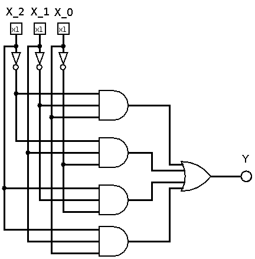
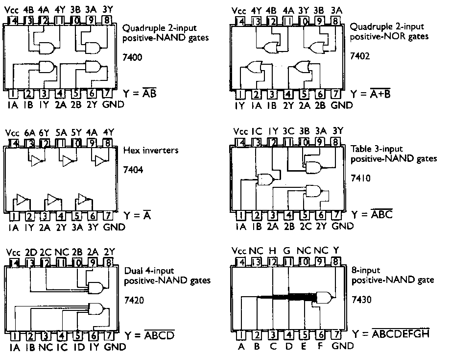
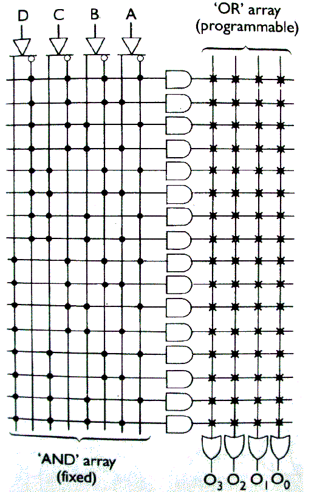
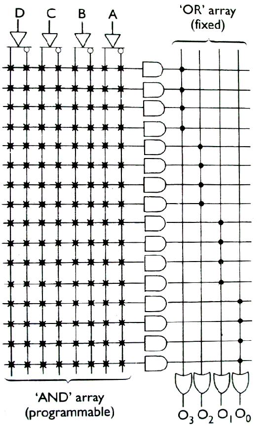
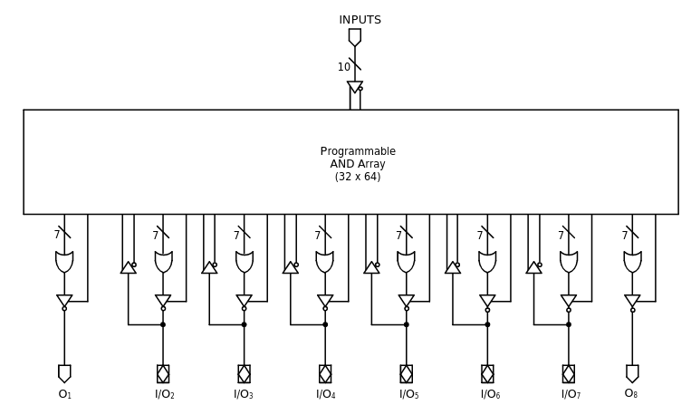
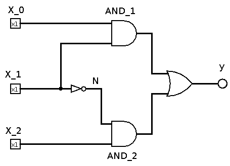
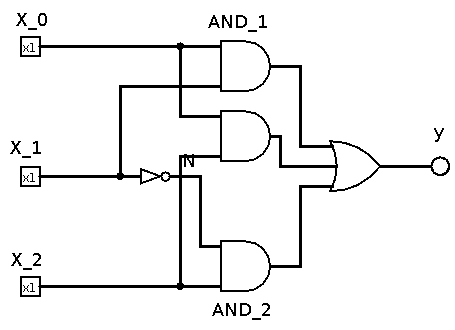
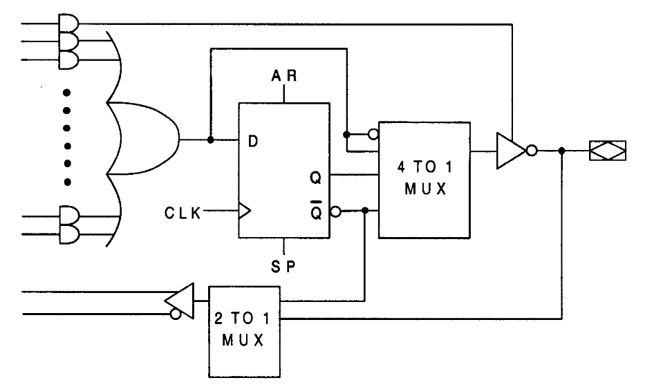

<!--

author:   Sebastian Zug & André Dietrich & Fabian Bär & Copilot & Claude Code (Opus 5.5)
email:    sebastian.zug@informatik.tu-freiberg.de & andre.dietrich@informatik.tu-freiberg.de & fabian.baer@student.tu-freiberg.de
version:  0.1.2
language: de
narrator: Deutsch Female

import:   https://raw.githubusercontent.com/LiaTemplates/DigiSim/master/README.md
          https://github.com/liascript/CodeRunner
          https://raw.githubusercontent.com/TUBAF-IfI-LiaScript/VL_EingebetteteSysteme/master/config.md
          https://raw.githubusercontent.com/LiaTemplates/KarnaughMap/0.1.0/README.md

mark: <span style="background-color: @0;
                           display: flex;
                           width: calc(100% + 32px);
                           margin: -16px;
                           padding: 6px 16px 6px 16px;
                           ">@1</span>

red:  @mark(#FF888888,@0)
blue: @mark(lightblue,@0)
gray: @mark(gray,@0)
grayterm: <span style="background-color: gray; display: flex; width: calc(100% + 32px); margin: -16px; padding: 6px 16px 6px 16px;">@0</span>
-->

[](https://liascript.github.io/course/?https://raw.githubusercontent.com/TUBAF-IfI-LiaScript/VL_EingebetteteSysteme/master/04_Schaltnetze.md#1)

# Schaltnetze

| Parameter                | Kursinformationen                                                                                                                                                                          |
| ------------------------ | ------------------------------------------------------------------------------------------------------------------------------------------------------------------------------------------ |
| **Veranstaltung:**       | @config.lecture                                                                                          |
| **Semester:**            | @config.semester                                                                                         |
| **Hochschule:**          | `Technische Universität Freiberg`                                                                        |
| **Inhalte:**             | `Verfahren von Quine-McCluskey, Realisierung von Schaltnetzen`                                          |
| **Link auf GitHub:**     | https://github.com/TUBAF-IfI-LiaScript/VL_EingebetteteSysteme/blob/master/04_Schaltnetze.md            |
| **Autoren:**             | @author                                                                                                  |


---------------------------------------------------------------------

**Lernziele:** Nach dieser Vorlesung können Sie

+ das Verfahren nach Quine-McCluskey anwenden: Primimplikanten bestimmen und mit der Primimplikantentafel eine minimale Überdeckung auswählen,
+ eine minimierte Schaltfunktion als zweistufiges Schaltnetz umsetzen – mit UND, ODER und NICHT oder nur mit NAND-Gattern,
+ erklären, wann PROM und PAL zur Umsetzung von Schaltnetzen eingesetzt werden,
+ Glitches als Folge unterschiedlicher Signallaufzeiten erkennen und mit einem zusätzlichen Term aus dem Karnaugh-Veitch-Diagramm vermeiden.

<!-- kurslandkarte:knopf-start -->

<a href="https://tubaf-ifi-liascript.github.io/VL_EingebetteteSysteme/kurslandkarte/#termin=4" style="display: inline-block; padding: 0.5em 1.1em; background-color: #00718A; color: #ffffff; text-decoration: none; font-family: 'IBM Plex Sans', 'Segoe UI', system-ui, sans-serif; font-weight: 600;">🗺️ Diese Vorlesung in der Kurslandkarte →</a>

<!-- kurslandkarte:knopf-ende -->

---------------------------------------------------------------------

<!--
style="width: 80%; min-width: 420px; max-width: 720px;"
-->
```ascii

                Abstraktionsebenen

           +----------------------------+ -.
  Ebene 6  | Problemorientierte Sprache |  |
           +----------------------------+  |
                                           ⎬ Anwendungssoftware
           +----------------------------+  |
  Ebene 5  | Assemblersprache           |  |
           +----------------------------+ -.

           +----------------------------+
  Ebene 4  | Betriebssystem             |     Systemsoftware (fehlt beim ATmega328P)
           +----------------------------+

           +----------------------------+
  Ebene 3  | Instruktionsset            |     Maschinensprache
           +----------------------------+

           +----------------------------+  -.
  Ebene 2  | Mikroarchitektur           |   |
           +----------------------------+   |
                                            ⎬ Automaten, Speicher, Logik
           +----------------------------+   |       ╔═══════════════╗
  Ebene 1  | Digitale Logik             |   |    ◀══║ HIER SIND WIR!║
           +----------------------------+  -.       ╚═══════════════╝

           +----------------------------+
  Ebene 0  | E-Technik, Physik          |     Analoge Phänomene
           +----------------------------+                                      .
```

---------------------------------------------------------------------

## Rückblick: Hausaufgabe aus Vorlesung 03

    --{{0}}--
Wir beginnen mit Teil B der Hausaufgabe aus der letzten Vorlesung. Beide Aufgaben drehen sich um Segment d der Siebensegmentanzeige und um die Frage, was Don't-Cares in der Praxis bedeuten.

> **Aufgabe 4 aus Vorlesung 03:** Ändern Sie `Minimize.py` so, dass es Segment `d` minimiert: Tragen Sie die Einsen in `minterms` ein und übergeben Sie die Eingaben 10 bis 15 als dritten Parameter von `SOPform`. Vergleichen Sie das Ergebnis mit dem Abschnitt zu den Don't-Cares. Weicht es ab, warum darf es das? Lassen Sie danach den dritten Parameter weg. Was ändert sich, und für welche Eingaben liefert die Funktion nun andere Werte?

       {{1}}
********************************************************************************

```python Segment_d.py
from sympy.logic import SOPform
from sympy import symbols
w, x, y, z = symbols('w x y z')

# jede Zeile: eine Zeile der Wahrheitstafel (w, x, y, z)
minterms  = [[0, 0, 0, 0], [0, 0, 1, 0], [0, 0, 1, 1], [0, 1, 0, 1],
             [0, 1, 1, 0], [1, 0, 0, 0], [1, 0, 0, 1]]
dontcares = [[1, 0, 1, 0], [1, 0, 1, 1], [1, 1, 0, 0],
             [1, 1, 0, 1], [1, 1, 1, 0], [1, 1, 1, 1]]

print("mit Don't-Cares: ", SOPform([w, x, y, z], minterms, dontcares))
print("ohne Don't-Cares:", SOPform([w, x, y, z], minterms))
```
@LIA.eval(`["main.py"]`, `none`, `python3 main.py`)

+ **Mit Don't-Cares** liefert SymPy dieselben fünf Terme wie das KV-Diagramm, $d = w + y\overline{z} + \overline{x}y + x\overline{y}z + \overline{x}\,\overline{z}$, also 10 Literale. Diese Minimalform ist eindeutig, eine Abweichung kann nur in der Reihenfolge der Terme liegen.
+ **Ohne Don't-Cares** sind es ebenfalls fünf Terme, aber 16 Literale: $d = w\overline{x}\,\overline{y} + \overline{w}\,\overline{x}y + \overline{w}y\overline{z} + \overline{w}\,\overline{x}\,\overline{z} + \overline{w}x\overline{y}z$. Hier gibt es eine zweite, gleich gute Form mit $\overline{x}\,\overline{y}\,\overline{z}$ statt $\overline{w}\,\overline{x}\,\overline{z}$. SymPy darf jede der beiden ausgeben.
+ **Für die Ziffern 0 bis 9** sind beide Formen gleich. Für die Eingaben 10 bis 15 liefert die Form mit Don't-Cares immer 1, weil schon der Term $w$ dort 1 ist. Die Form ohne Don't-Cares liefert dort immer 0.

********************************************************************************

> **Aufgabe 5 aus Vorlesung 03:** Bauen Sie Segment `d` selbst auf, im Simulator [BEAST](https://goldi-labs.net/BEAST.php), der ohne Installation im Browser läuft. Ziehen Sie aus „Basic Components“ vier `Toggle` für $w$, $x$, $y$, $z$, ein `4 bit 7 Segment Display` für die Ziffer, die Gatter `NOT`, `AND` und `OR` sowie eine `LED` für `d` auf die Arbeitsfläche und verdrahten Sie sie nach der Gleichung aus dem Abschnitt zu den Don't-Cares. Prüfen Sie die Ziffern 0 bis 9: Leuchtet die LED genau dann, wenn das untere Segment der Ziffer leuchtet? Was zeigen LED und Anzeige bei den Eingaben 10 bis 15?

       {{2}}
********************************************************************************

Für die Ziffern 0 bis 9 leuchtet die LED genau dann, wenn das untere Segment leuchtet, die Schaltung stimmt also. Für die Eingaben 10 bis 15 leuchtet die LED immer, denn der Term $w$ allein liefert dort schon 1. Die Anzeige zeigt dort keine Dezimalziffer mehr. Genau das meint der Satz aus der letzten Vorlesung: Ein Don't-Care ist eine Annahme. Kommen diese Eingaben doch vor, gibt die Schaltung einen Wert aus, den niemand geplant hat.

********************************************************************************

Das Video fasst das Vorgehen im KV-Diagramm mit vier Variablen noch einmal zusammen:

!?[](./exampleCode/03_Minimierung/KarnaughVeitch4Var.mp4)

## Beispielanwendung

    --{{0}}--
Heute begleitet uns eine Kaffeemaschine. Sie meldet über vier Leitungen ihren Zustand, und eine Fehler-LED soll in bestimmten Zuständen leuchten. Bevor wir rechnen, minimieren Sie die Funktion selbst im KV-Diagramm.

Nehmen wir an, dass wir die Logik einer Kaffeemaschine umsetzen wollen. Ihre
Steuerung wertet Sensoren an Heizplatte, Füllstand und Druck aus und meldet den
aktuellen Zustand als vierstellige Binärzahl $x_3x_2x_1x_0$, also als Nummer von 0 bis 15.

Die Variable $y$ gibt einen Fehlerzustand wieder und ist zum Beispiel mit einer
LED verknüpft. In den Zuständen 6 bis 14 soll diese leuchten.

 <!--style="width: 50%; max-width:700px"-->

<!-- data-type="none" style="table-layout: fixed; max-width:900px;"-->
| $x_3$ | $x_2$ | $x_1$ | $x_0$ | $y$ | Zustand                  |
| ----- | ----- | ----- | ----- | --- | ------------------------ |
| 0     | 0     | 0     | 0     | 0   | 0  - Initialisierung     |
| 0     | 0     | 0     | 1     | 0   | 1  - Heizplatte erwärmen |
| 0     | 0     | 1     | 0     | 0   | 2  - Wasserkocher an     |
| 0     | 0     | 1     | 1     | 0   | 3  -                     |
| 0     | 1     | 0     | 0     | 0   | 4  -                     |
| 0     | 1     | 0     | 1     | 0   | 5  -                     |
| 0     | 1     | 1     | 0     | 1   | 6  - Wasser fehlt        |
| 0     | 1     | 1     | 1     | 1   | 7  - Kaffeefach geöffnet |
| 1     | 0     | 0     | 0     | 1   | 8  - Druckabfall         |
| 1     | 0     | 0     | 1     | 1   | 9  - ...                 |
| 1     | 0     | 1     | 0     | 1   | 10  -                    |
| 1     | 0     | 1     | 1     | 1   | 11  -                    |
| 1     | 1     | 0     | 0     | 1   | 12  -                    |
| 1     | 1     | 0     | 1     | 1   | 13  -                    |
| 1     | 1     | 1     | 0     | 1   | 14  -  Wartung fällig    |
| 1     | 1     | 1     | 1     | 0   | 15  -  Kaffee fertig     |


**Zum Aufwärmen:** Minimieren Sie $y$ selbst im KV-Diagramm. Die Einsen sind schon eingetragen, die kleine Zahl im Feld ist die Zeile der Wahrheitstafel. Anders als in den Tabellen weiter unten stehen $x_3x_2$ hier in den Spalten.

@Karnaugh.map(x_3 x_2 x_1 x_0,6 7 8 9 10 11 12 13 14,-)

    --{{1}}--
Vier Schleifen genügen: drei Vierer-Schleifen mit x3 gleich 1 und eine Zweier-Schleife für die Zustände 6 und 7. Im Diagramm ging das schnell. Heute geht es um ein Verfahren, das ohne Bild auskommt und deshalb auch für zehn oder zwanzig Variablen funktioniert.

       {{1}}
********************************************************************************

**Lösung:** $y = \overline{x}_3x_2x_1 + x_3\overline{x}_2 + x_3\overline{x}_1 + x_3\overline{x}_0$, also 4 Terme mit 9 Literalen. Die drei Vierer-Schleifen liegen alle in den Spalten mit $x_3 = 1$, die Zweier-Schleife deckt die Zustände 6 und 7 ab.

> Im Diagramm ging das schnell. Mit fünf Variablen wird es unübersichtlich, ab sechs geht es kaum noch. Heute lernen Sie ein Verfahren, das ohne Bild auskommt und sich programmieren lässt: Quine-McCluskey.

********************************************************************************

Wie muss also die Schaltung für diese Aufgabe umgesetzt werden? Wir gehen in drei Schritten vor: Gleichungen aufstellen, vereinfachen, umsetzen.

### Schritt 1: Aufstellen der Gleichungen

    --{{0}}--
Stellen Sie die Terme zuerst selbst auf, wie in der letzten Vorlesung: Jede Zeile mit einer Eins liefert einen Minterm, jede Zeile mit einer Null einen Maxterm.

Aus Vorlesung 03 kennen Sie den Weg: Jede Zeile mit $y = 1$ liefert einen Minterm der KDNF, jede Zeile mit $y = 0$ einen Maxterm der KKNF.

{{0-1}}
<!-- data-type="none" style="table-layout: fixed; max-width:850px;"-->
| $x_3$ | $x_2$ | $x_1$ | $x_0$ | $y$ | Minterm | Maxterm |
| ----- | ----- | ----- | ----- | --- | ------- | ------- |
| 0     | 0     | 0     | 0     | 0   | ???     | ???     |
| 0     | 0     | 0     | 1     | 0   |         |         |
| 0     | 0     | 1     | 0     | 0   |         |         |
| 0     | 0     | 1     | 1     | 0   |         |         |
| 0     | 1     | 0     | 0     | 0   |         |         |
| 0     | 1     | 0     | 1     | 0   |         |         |
| 0     | 1     | 1     | 0     | 1   |         |         |
| 0     | 1     | 1     | 1     | 1   |         |         |
| 1     | 0     | 0     | 0     | 1   |         |         |
| 1     | 0     | 0     | 1     | 1   |         |         |
| 1     | 0     | 1     | 0     | 1   |         |         |
| 1     | 0     | 1     | 1     | 1   |         |         |
| 1     | 1     | 0     | 0     | 1   |         |         |
| 1     | 1     | 0     | 1     | 1   |         |         |
| 1     | 1     | 1     | 0     | 1   |         |         |
| 1     | 1     | 1     | 1     | 0   |         |         |

    --{{1}}--
Hier die Lösung. Neun Zeilen mit einer Eins ergeben neun Minterme, sieben Zeilen mit einer Null sieben Maxterme. Wir arbeiten mit der KDNF weiter.

{{1}}
<!-- data-type="none" -->
| $x_3$ | $x_2$ | $x_1$ | $x_0$ | $y$ | Minterme                                                             | Maxterme                                                            |
| ----- | ----- | ----- | ----- | --- | -------------------------------------------------------------------- | ------------------------------------------------------------------- |
| 0     | 0     | 0     | 0     | 0   |                                                                      | $x_3 + x_2 + x_1 + x_0$                                             |
| 0     | 0     | 0     | 1     | 0   |                                                                      | $x_3 + x_2 + x_1 + \overline{x_0}$                                  |
| 0     | 0     | 1     | 0     | 0   |                                                                      | $x_3 + x_2 + \overline{x_1} + x_0$                                  |
| 0     | 0     | 1     | 1     | 0   |                                                                      | $x_3 + x_2 + \overline{x_1} + \overline{x_0}$                       |
| 0     | 1     | 0     | 0     | 0   |                                                                      | $x_3 + \overline{x_2} + x_1 + x_0$                                  |
| 0     | 1     | 0     | 1     | 0   |                                                                      | $x_3 + \overline{x_2} + x_1 + \overline{x_0}$                       |
| 0     | 1     | 1     | 0     | 1   | $\overline{x_3} \cdot x_2 \cdot x_1 \cdot \overline{x_0}$            |                                                                     |
| 0     | 1     | 1     | 1     | 1   | $\overline{x_3} \cdot x_2 \cdot x_1 \cdot x_0$                       |                                                                     |
| 1     | 0     | 0     | 0     | 1   | $x_3 \cdot \overline{x_2} \cdot \overline{x_1} \cdot \overline{x_0}$ |                                                                     |
| 1     | 0     | 0     | 1     | 1   | $x_3 \cdot \overline{x_2} \cdot \overline{x_1} \cdot x_0$            |                                                                     |
| 1     | 0     | 1     | 0     | 1   | $x_3 \cdot \overline{x_2} \cdot x_1 \cdot \overline{x_0}$            |                                                                     |
| 1     | 0     | 1     | 1     | 1   | $x_3 \cdot \overline{x_2} \cdot x_1 \cdot x_0$                       |                                                                     |
| 1     | 1     | 0     | 0     | 1   | $x_3 \cdot x_2 \cdot \overline{x_1} \cdot \overline{x_0}$            |                                                                     |
| 1     | 1     | 0     | 1     | 1   | $x_3 \cdot x_2 \cdot \overline{x_1} \cdot x_0$                       |                                                                     |
| 1     | 1     | 1     | 0     | 1   | $x_3 \cdot x_2 \cdot x_1 \cdot \overline{x_0}$                       |                                                                     |
| 1     | 1     | 1     | 1     | 0   |                                                                      | $\overline{x_3} + \overline{x_2} + \overline{x_1} + \overline{x_0}$ |

### Schritt 2: Vereinfachen der Minterme - Analytische Lösung

    --{{0}}--
Zuerst vereinfachen wir von Hand, so wie in Vorlesung 02. Wir suchen Paare von Mintermen, die sich nur in einer Variablen unterscheiden.

{{0-1}}
$$
\begin{aligned}
y =&  \overline{x_3}   x_2   x_1   \overline{x_0} +  \overline{x_3}   x_2   x_1   x_0 +\\
  &   x_3   \overline{x_2 }\,\overline{x_1 }\,\overline{x_0} +  x_3   \overline{x_2 }\,\overline{x_1}   x_0 +\\
  &  x_3   \overline{x_2}   x_1   \overline{x_0} + x_3   \overline{x_2}   x_1   x_0 +\\
  & x_3   x_2   \overline{x_1 }\,\overline{x_0} +  x_3   x_2   \overline{x_1}   x_0 + \\
  &  x_3   x_2   x_1   \overline{x_0}
\end{aligned}
$$

{{0-1}}
Wie gehen Sie vor? Wir suchen Paare von Mintermen, die sich lediglich in einer Variablen unterscheiden, und fassen diese mit dem Distributivgesetz und $x + \overline{x} = 1$ zusammen.

{{0-1}}
$$
\begin{aligned}
\overline{x_3}   x_2   x_1   \overline{x_0} +  \overline{x_3}   x_2   x_1   x_0 &= \overline{x_3}   x_2   x_1   (\overline{x_0} + x_0) \\
                                                                                &= \overline{x_3}   x_2   x_1   (1) \\
                                                                                &= \overline{x_3}   x_2   x_1 \\
\end{aligned}
$$

    --{{1}}--
Ein Minterm passt zu zwei Partnern. Wir nehmen ihn deshalb zweimal auf, das erlaubt das Idempotenzgesetz.

       {{1-3}}
********************************************************************************
**Erste Stufe der Vereinfachung**

Zunächst nehmen wir einen der Minterme zweimal auf (Idempotenzgesetz: $a + a = a$), so dass sich jede Zeile zusammenfassen lässt.

$$
\begin{aligned}
y =&  \overline{x_3}   x_2   x_1   \overline{x_0} +  \overline{x_3}   x_2   x_1   x_0 +\\
  &   x_3   \overline{x_2 }\,\overline{x_1 }\,\overline{x_0} +  x_3   \overline{x_2 }\,\overline{x_1}   x_0 +\\
  &  \textcolor{red}{ x_3 \overline{x_2}   x_1   \overline{x_0}}+ x_3   \overline{x_2}   x_1   x_0 +\\
  & x_3   x_2   \overline{x_1 }\,\overline{x_0} +  x_3   x_2   \overline{x_1}   x_0 + \\
  & \textcolor{red}{ x_3 \overline{x_2}   x_1   \overline{x_0}} + x_3   x_2   x_1   \overline{x_0}
\end{aligned}
$$

Damit ergibt sich die Gleichung nach der ersten Vereinfachungsstufe zu

********************************************************************************


    --{{2}}--
Aus neun Mintermen sind fünf Terme mit je drei Variablen geworden.

{{2-3}}
$$
\begin{aligned}
y =& \overline{x}_3 x_2 x_1 + x_3 \overline{x}_2\, \overline{x}_1  + x_3 \overline{x}_2 x_1 + x_3 x_2\overline{x}_1 +  x_3 x_1\overline{x}_0
\end{aligned}
$$


    --{{3}}--
In der zweiten Stufe wiederholen wir dasselbe mit den neuen Termen.

      {{3-5}}
********************************************************************************

**Zweite Stufe der Vereinfachung**

$$
\begin{aligned}
y =& \overline{x}_3 x_2 x_1 + \\
   & x_3 \overline{x}_2\, \overline{x}_1  + \\
   & x_3 \overline{x}_2 x_1 + \\
   &x_3 x_2\overline{x}_1 + \\
   &x_3 x_1\overline{x}_0
\end{aligned}
$$

********************************************************************************

    --{{4}}--
Übrig bleiben vier Terme. Vergleichen Sie mit Ihrem KV-Diagramm vom Anfang: Der letzte Term hat eine Variable zu viel.

{{4}}
$$
\begin{aligned}
y = \overline{x}_3 x_2 x_1 +  x_3\,\overline{x}_2 +  x_3 \overline{x}_1 + x_3 x_1\overline{x}_0
\end{aligned}
$$

Dabei wird $x_3\overline{x}_2\overline{x}_1$ zweimal verwendet, einmal mit $x_3\overline{x}_2x_1$ zu $x_3\overline{x}_2$ und einmal mit $x_3x_2\overline{x}_1$ zu $x_3\overline{x}_1$. Das erlaubt wieder das Idempotenzgesetz.


    --{{5}}--
Die Gegenprobe mit SymPy bestätigt den Verdacht. Die Umformung von Hand hat eine Möglichkeit übersehen.

      {{5-6}}
********************************************************************************

**Gegenprobe I**


``` python Minimize.py
from sympy.logic import SOPform
from sympy import symbols
x3, x2, x1, x0 = symbols('x3 x2 x1 x0')

minterms = [[0, 1, 1, 0],
            [0, 1, 1, 1],
            [1, 0, 0, 0],
            [1, 0, 0, 1],
            [1, 0, 1, 0],
            [1, 0, 1, 1],
            [1, 1, 0, 0],
            [1, 1, 0, 1],
            [1, 1, 1, 0]]
result = SOPform([x3, x2, x1, x0], minterms)
print(result)
```
@LIA.eval(`["main.py"]`, `none`, `python3 main.py`)

SymPy findet eine kompaktere Form, nämlich genau die aus Ihrem KV-Diagramm vom Anfang.

Schauen wir uns die Funktion im Karnaugh-Diagramm an! Es ist dieselbe Funktion wie beim Aufwärmen. Mit „Lösung zeigen“ sehen Sie die Schleifen, die SymPy gefunden hat.

@Karnaugh.map(x_3 x_2 x_1 x_0,6 7 8 9 10 11 12 13 14,-)

$$
\begin{aligned}
y_{Karnaugh} &= \overline{x}_3 x_2 x_1 +  x_3\,\overline{x}_2 +  x_3 \overline{x}_1 + x_3 \overline{x}_0 \\
y_{Analytic} &= \overline{x}_3 x_2 x_1 +  x_3\,\overline{x}_2 +  x_3 \overline{x}_1 + x_3 x_1\overline{x}_0
\end{aligned}
$$

Warum "übersieht" unsere analytische Lösung die mögliche Minimierung im letzten Term?

> Weil wir uns in der Vereinfachung der ersten Stufe mit einem Teilergebnis zufriedengegeben haben, das uns in der zweiten Stufe für einen weiteren Zusammenfassungsschritt fehlt.

Welche Kombinationen sind zusätzlich möglich?

$$
\begin{aligned}
y =&  \overline{x_3}   x_2   x_1   \overline{x_0} +  \overline{x_3}   x_2   x_1   x_0 +\\
  &  \textcolor{green}{ x_3   \overline{x_2 }\,\overline{x_1 }\,\overline{x_0}} +  x_3   \overline{x_2 }\,\overline{x_1}   x_0 +\\
  &  x_3 \overline{x_2}   x_1   \overline{x_0} + x_3   \overline{x_2}   x_1   x_0 +\\
  &  \textcolor{green}{x_3   x_2   \overline{x_1 }\,\overline{x_0}} +  x_3   x_2   \overline{x_1}   x_0 + \\
  & x_3 \overline{x_2}   x_1   \overline{x_0} + x_3   x_2   x_1   \overline{x_0}
\end{aligned}
$$

$$
\begin{aligned}
y =& \overline{x}_3 x_2 x_1 + x_3 \overline{x}_2\, \overline{x}_1  + x_3 \overline{x}_2 x_1 + x_3 x_2\overline{x}_1 +  x_3 x_1\overline{x}_0 + \textcolor{green}{x_3 \overline{x}_1\,\overline{x}_0 }
\end{aligned}
$$

Daraus ergibt sich dann auf der zweiten Stufe die "zusätzliche" Minimierungsoption, die die beiden letzten Terme zusammenfasst.

$$
\begin{aligned}
y =& \overline{x}_3 x_2 x_1 + x_3 \overline{x}_2\, \overline{x}_1  + x_3 \overline{x}_2 x_1 + x_3 x_2\overline{x}_1 +  \underbrace{x_3 x_1\overline{x}_0 + \textcolor{green}{x_3 \overline{x}_1\,\overline{x}_0 }}_{x_3\overline{x}_0} \\
y =& \overline{x}_3 x_2 x_1 +  x_3\,\overline{x}_2 +  x_3 \overline{x}_1 + x_3 \overline{x}_0
\end{aligned}
$$

> Erkenntnisse:
>
> + Das Karnaugh-Veitch-Diagramm zeigt mögliche Minimierungspotentiale auf, hinsichtlich der Bildung der Schleifen können unterschiedliche Strategien zum Tragen kommen.
> + Offenkundig brauchen wir ein systematischeres Vorgehen bei der Vereinfachung, das alle Kombinationen möglicher Terme berücksichtigt.

********************************************************************************

## Verfahren nach Quine-McCluskey

    --{{0}}--
Quine-McCluskey macht dasselbe wie die Umformung von Hand, aber vollständig: Es probiert jedes Paar, das sich zusammenfassen lässt, und übersieht deshalb nichts. Damit eignet es sich für den Rechner.

Das Verfahren bezieht sich zunächst nur auf Funktionsdarstellungen in kanonischer disjunktiver Normalform (KDNF) und zielt darauf ab eine systematische Minimierung der Minterme durchzuführen.

### Ermittlung der Primimplikanten

    --{{0}}--
Wir sortieren die Minterme nach der Zahl ihrer Einsen. Nur Terme aus benachbarten Gruppen können sich in genau einer Stelle unterscheiden, das spart viele Vergleiche.

Die Minterme werden in tabellarischer Form entsprechend der Zahl der "1"en sortiert. Es gibt 1 Eintrag mit einer 1 ($m_8$) und jeweils 4 mit 2 oder 3 Einsen.

<table>
<tr>
<td>
<!-- data-type="none" style="table-layout: fixed; max-width:400px;"-->
|          | $x_3$ | $x_2$ | $x_1$ | $x_0$ | $y$ |
| -------- | ----- | ----- | ----- | ----- | --- |
|          | 0     | 0     | 0     | 0     | 0   |
|          | 0     | 0     | 0     | 1     | 0   |
|          | 0     | 0     | 1     | 0     | 0   |
|          | 0     | 0     | 1     | 1     | 0   |
|          | 0     | 1     | 0     | 0     | 0   |
|          | 0     | 1     | 0     | 1     | 0   |
| $m_6$    | 0     | 1     | 1     | 0     | 1   |
| $m_7$    | 0     | 1     | 1     | 1     | 1   |
| $m_8$    | 1     | 0     | 0     | 0     | 1   |
| $m_9$    | 1     | 0     | 0     | 1     | 1   |
| $m_{10}$ | 1     | 0     | 1     | 0     | 1   |
| $m_{11}$ | 1     | 0     | 1     | 1     | 1   |
| $m_{12}$ | 1     | 1     | 0     | 0     | 1   |
| $m_{13}$ | 1     | 1     | 0     | 1     | 1   |
| $m_{14}$ | 1     | 1     | 1     | 0     | 1   |
|          | 1     | 1     | 1     | 1     | 0   |
</td>
<td>

</td>
<td>
<!-- data-type="none" style="table-layout: fixed; max-width:500px;"-->
| $m_x$           | $x_3$      | $x_2$      | $x_1$      | $x_0$      | OK  |
| --------------- | ---------- | ---------- | ---------- | ---------- | --- |
| @blue($m_8$)    | @blue($1$) | @blue($0$) | @blue($0$) | @blue($0$) |.   |
| $m_6$           | $0$        | 1          | 1          | 0          |.   |
| $m_9$           | 1          | 0          | 0          | 1          |.   |
| $m_{10}$        | 1          | 0          | 1          | 0          |.   |
| $m_{12}$        | 1          | 1          | 0          | 0          |.   |
| @gray($m_7$)    | @gray($0$) | @gray($1$) | @gray($1$) | @gray($1$) |.   |
| @gray($m_{11}$) | @gray($1$) | @gray($0$) | @gray($1$) | @gray($1$) |.   |
| @gray($m_{13}$) | @gray($1$) | @gray($1$) | @gray($0$) | @gray($1$) |.   |
| @gray($m_{14}$) | @gray($1$) | @gray($1$) | @gray($1$) | @gray($0$) |.   |
</td>
</tr>
</table>

**Schreibweise:** $m_8, m_9$ bezeichnet den Term, der aus $m_8$ und $m_9$ entsteht. In der Tabelle steht er als `100-`, der Strich markiert die Variable, die wegfällt, hier also $x_3\overline{x}_2\overline{x}_1$. In der Spalte „OK“ bedeutet $*$: Dieser Term ist in einen größeren Term eingegangen. Was am Ende ohne $*$ übrig bleibt, nennen wir Primimplikant und kürzen es mit P ab.

In einem zweiten Schritt werden die sortierten Minterme evaluiert. Dabei können nur die Blöcke blau-weiß und weiß-grau potentiell zusammenfassbare Mintermpaare umfassen.

<!-- data-type="none" style="table-layout: fixed; max-width:850px;"-->
|                              | $x_3$      | $x_2$      | $x_1$      | $x_0$      | OK  |
| ---------------------------- | ---------- | ---------- | ---------- | ---------- | --- |
| $m_8, m_9$               | 1          | 0          | 0          | -          | .   |
| $m_8, m_{10}$            | 1          | 0          | -          | 0          | .   |
| $m_8, m_{12}$            | 1          | -          | 0          | 0          | .   |
| @grayterm(`$m_6, m_{7}$`)     | @gray($0$) | @gray($1$) | @gray($1$) | @gray($-$) | .   |
| @grayterm(`$m_6, m_{14}$`)    | @gray($-$) | @gray($1$) | @gray($1$) | @gray($0$) | .   |
| @grayterm(`$m_9, m_{11}$`)    | @gray($1$) | @gray($0$) | @gray($-$) | @gray($1$) | .   |
| @grayterm(`$m_9, m_{13}$`)    | @gray($1$) | @gray($-$) | @gray($0$) | @gray($1$) | .   |
| @grayterm(`$m_{10}, m_{11}$`) | @gray($1$) | @gray($0$) | @gray($1$) | @gray($-$) | .   |
| @grayterm(`$m_{10}, m_{14}$`) | @gray($1$) | @gray($-$) | @gray($1$) | @gray($0$) | .   |
| @grayterm(`$m_{12}, m_{13}$`) | @gray($1$) | @gray($1$) | @gray($0$) | @gray($-$) | .   |
| @grayterm(`$m_{12}, m_{14}$`) | @gray($1$) | @gray($1$) | @gray($-$) | @gray($0$) | .   |

```python Kombinations.py
import numpy as np
minterms = [[0, 1, 1, 0],
            [0, 1, 1, 1],
            [1, 0, 0, 0],
            [1, 0, 0, 1],
            [1, 0, 1, 0],
            [1, 0, 1, 1],
            [1, 1, 0, 0],
            [1, 1, 0, 1],
            [1, 1, 1, 0]]
distances = np.zeros([len(minterms),len(minterms)]).astype('float')
for i in range(0, len(minterms)):
    for k in range(0, i):
        diff = np.subtract(minterms[i], minterms[k])
        dist = np.sum(np.abs(diff))
        distances[i,k] = dist

print("Distanzen der Minterme")
for j in range(0, len(distances)):  # zeilenweise ausgeben
    print(distances[j])
print("Kombinationen mit Distanz 1: {}".format(np.count_nonzero(distances == 1)))
```
@LIA.eval(`["main.py"]`, `none`, `python3 main.py`)

Die 11 Paare mit Distanz 1 sind genau die 11 Zeilen der Tabelle oben.

Die zweite Stufe wiederholt die Vorgänge - Sortierung und Evaluation erneut.

<!-- data-type="none" -->
|                          | $x_3$      | $x_2$      | $x_1$      | $x_0$      | OK  |
| ------------------------ | ---------- | ---------- | ---------- | ---------- | --- |
| $m_8, m_9$           | 1          | 0          | 0          | -          | $*$ |
| $m_8, m_{10}$        | 1          | 0          | -          | 0          | $*$ |
| $m_8, m_{12}$        | 1          | -          | 0          | 0          | $*$ |
| @grayterm(`$m_6, m_{7}$`)     | @gray($0$) | @gray($1$) | @gray($1$) | @gray($-$) | P4  |
| @grayterm(`$m_6, m_{14}$`)    | @gray($-$) | @gray($1$) | @gray($1$) | @gray($0$) | P5  |
| @grayterm(`$m_9, m_{11}$`)    | @gray($1$) | @gray($0$) | @gray($-$) | @gray($1$) | $*$ |
| @grayterm(`$m_9, m_{13}$`)    | @gray($1$) | @gray($-$) | @gray($0$) | @gray($1$) | $*$ |
| @grayterm(`$m_{10}, m_{11}$`) | @gray($1$) | @gray($0$) | @gray($1$) | @gray($-$) | $*$ |
| @grayterm(`$m_{10}, m_{14}$`) | @gray($1$) | @gray($-$) | @gray($1$) | @gray($0$) | $*$ |
| @grayterm(`$m_{12}, m_{13}$`) | @gray($1$) | @gray($1$) | @gray($0$) | @gray($-$) | $*$ |
| @grayterm(`$m_{12}, m_{14}$`) | @gray($1$) | @gray($1$) | @gray($-$) | @gray($0$) | $*$ |

Es dürfen nur Zeilen zusammengefasst werden, die die "-" an den gleichen Positionen haben (!). Außerdem tauchen ab der zweiten Zusammenfassung Terme doppelt auf, welche aber nur einmal notiert werden.

<!-- data-type="none" -->
|                                             | $x_3$ | $x_2$ | $x_1$ | $x_0$ | OK  |
| ------------------------------------------- | ----- | ----- | ----- | ----- | --- |
| $m_8, m_9, m_{10}, m_{11}$    | 1     | 0     | -     | -     | .   |
| $m_8, m_9, m_{12}, m_{13}$    | 1     | -     | 0     | -     | .   |
| $m_8, m_{10}, m_{9}, m_{11}$  | 1     | 0     | -     | -     | .   |
| $m_8, m_{10}, m_{12}, m_{14}$ | 1     | -     | -     | 0     | .   |
| $m_8, m_{12}, m_{9}, m_{13}$  | 1     | -     | 0     | -     | .   |
| $m_8, m_{12}, m_{10}, m_{14}$ | 1     | -     | -     | 0     | .   |

Eine weitere Zusammenfassung ist nicht möglich. Zwei Terme der ersten Stufe, $m_6, m_7$ und $m_6, m_{14}$, ließen sich in der zweiten Stufe mit keinem anderen zusammenfassen.

<!-- data-type="none" -->
|                                             | $x_3$ | $x_2$ | $x_1$ | $x_0$ | OK           |
| ------------------------------------------- | ----- | ----- | ----- | ----- | ------------ |
| $m_8, m_9, m_{10}, m_{11}$    | 1     | 0     | -     | -     | P1           |
| $m_8, m_9, m_{12}, m_{13}$    | 1     | -     | 0     | -     | P2           |
| $m_8, m_{10}, m_{9}, m_{11}$  | 1     | 0     | -     | -     | identisch P1 |
| $m_8, m_{10}, m_{12}, m_{14}$ | 1     | -     | -     | 0     | P3           |
| $m_8, m_{12}, m_{9}, m_{13}$  | 1     | -     | 0     | -     | identisch P2 |
| $m_8, m_{12}, m_{10}, m_{14}$ | 1     | -     | -     | 0     | identisch P3 |

Mit diesen beiden Termen ergeben sich insgesamt 5 **Primimplikanten**.

> Ein **Implikant** von $f$ ist ein Produktterm $p$, für den gilt: Ist $p = 1$, dann ist auch $f = 1$. Ein **Primimplikant** ist ein Implikant, von dem man kein Literal streichen kann, ohne diese Eigenschaft zu verlieren. Im KV-Diagramm ist das eine Schleife, die sich nicht weiter vergrößern lässt.

$$
\begin{aligned}
P_1=& \{m_8, m_9, m_{10}, m_{11}\} = x_3\overline{x}_2 \\
P_2=& \{m_8, m_9, m_{12}, m_{13}\} = x_3\overline{x}_1 \\
P_3=& \{m_8, m_{10}, m_{12}, m_{14}\} = x_3\overline{x}_0 \\
P_4=& \{m_6, m_7\} = \overline{x}_3x_2x_1 \\
P_5=& \{m_6, m_{14}\} = x_2x_1\overline{x}_0 \\
\end{aligned}
$$

### Darstellung der Minterme im Karnaugh-Diagramm

    --{{0}}--
Im KV-Diagramm sieht man, was die fünf Primimplikanten sind: die größtmöglichen Schleifen. Manche Felder liegen in mehreren Schleifen, wir brauchen also nicht alle.

$$
\begin{aligned}
P_1=& \{m_8, m_9, m_{10}, m_{11}\} = x_3\overline{x}_2 \\
P_2=& \{m_8, m_9, m_{12}, m_{13}\} = x_3\overline{x}_1 \\
P_3=& \{m_8, m_{10}, m_{12}, m_{14}\} = x_3\overline{x}_0 \\
P_4=& \{m_6, m_7\} = \overline{x}_3x_2x_1 \\
P_5=& \{m_6, m_{14}\} = x_2x_1\overline{x}_0 \\
\end{aligned}
$$

<!-- data-type="none" -->
|                                  | $\overline{x}_1\,\overline{x}_0$ | $\overline{x}_1x_0$ | $x_1x_0$     | $x_1\overline{x}_0$ |
| -------------------------------- | -------------------------------- | ------------------- | ------------ | ------------------- |
| $\overline{x}_3\,\overline{x}_2$ | 0                                | 0                   | 0            | 0                   |
| $\overline{x}_3 x_2$             | 0                                | 0                   | 1 ($m_7$)    | 1 ($m_6$)           |
| $x_3 x_2$                        | 1 ($m_{12}$)                     | 1 ($m_{13}$)        | 0            | 1 ($m_{14}$)        |
| $x_3 \overline{x}_2$             | 1 ($m_{8}$)                      | 1  ($m_{9}$)        | 1 ($m_{11}$) | 1 ($m_{10}$)        |


Visualisierung der generierten Primimplikanten

<!-- data-type="none" -->
|                                  | $\overline{x}_1\,\overline{x}_0$ | $\overline{x}_1x_0$ | $x_1x_0$  | $x_1\overline{x}_0$ |
| -------------------------------- | -------------------------------- | ------------------- | --------- | ------------------- |
| $\overline{x}_3\,\overline{x}_2$ | 0                                | 0                   | 0         | 0                   |
| $\overline{x}_3 x_2$             | 0                                | 0                   | 1 ($P_4$) | 1    ($P_4$, $P_5$) |
| $x_3 x_2$                        | 1 ($P_2$, $P_3$)                 | 1 ($P_2$)           | 0         | 1 ($P_3$, $P_5$)    |
| $x_3 \overline{x}_2$             | 1 ($P_1$, $P_2$, $P_3$)          | 1  ($P_1$, $P_2$)   | 1 ($P_1$) | 1 ($P_1$, $P_3$)    |

Die meisten Minterme werden mehrfach abgedeckt, nur $m_7$, $m_{11}$ und $m_{13}$ von genau einem Primimplikanten. Wir müssen also nicht alle fünf verwenden.

Die **Primimplikantentafel**, auch zweite Quine'sche Tabelle genannt, zeigt, welcher Primimplikant welche Minterme abdeckt.

<!-- data-type="none" style="table-layout: fixed; max-width:600px;"-->
|       | $m_{14}$ | $m_{13}$ | $m_{12}$ | $m_{11}$ | $m_{10}$ | $m_{9}$ | $m_{8}$ | $m_{7}$ | $m_{6}$ |
| ----- | -------- | -------- | -------- | -------- | -------- | ------- | ------- | ------- | ------- |
| $P_1$ |          |          |          | x        | x        | x       | x       |         |         |
| $P_2$ |          | x        | x        |          |          | x       | x       |         |         |
| $P_3$ | x        |          | x        |          | x        |         | x       |         |         |
| $P_4$ |          |          |          |          |          |         |         | x       | x       |
| $P_5$ | x        |          |          |          |          |         |         |         | x       |


**Welche Primimplikanten müssen in jeder Lösung vorkommen?**

[[X]] $P_1$
[[X]] $P_2$
[[ ]] $P_3$
[[X]] $P_4$
[[ ]] $P_5$
***************************************************************

$m_{11}$ wird nur von $P_1$ abgedeckt, $m_{13}$ nur von $P_2$ und $m_7$ nur von $P_4$. Ohne diese drei Primimplikanten bliebe der jeweilige Minterm offen. $m_{14}$ dagegen wird von $P_3$ oder $P_5$ abgedeckt, hier gibt es eine Wahl.

***************************************************************

### Lösung der minimalen Überdeckung - intuitiv 

    --{{0}}--
Ein Primimplikant, der als einziger einen Minterm abdeckt, heißt essentiell. Er gehört in jede Lösung. Danach bleibt meist nur noch wenig zu entscheiden.

Die Minterme $m_{13}$, $m_{11}$ und $m_{7}$ kommen nun in jeweils einem Primimplikanten vor. Folglich sind $P_1$, $P_2$ und $P_4$ sogenannte **essentielle Primimplikanten**.

<!-- data-type="none" style="table-layout: fixed; max-width:600px;"-->
|       | $m_{14}$ | $m_{13}$ | $m_{12}$ | $m_{11}$ | $m_{10}$ | $m_{9}$  | $m_{8}$  | $m_{7}$ | $m_{6}$ |
| ----- | -------- | -------- | -------- | -------- | -------- | -------- | -------- | ------- | ------- |
| @blue($P_1$) |          |          |          | @gray(x) | x        | x        | x        |         |         |
| @blue($P_2$) |          | @gray(x) |        x |          |          | x        | x        |         |         |
| $P_3$ | x        |          |        x |          | x        |          | x        |         |         |
| @blue($P_4$) |          |          |          |          |          |          |          | @gray(x)| x       |
| $P_5$ | x        |          |          |          |          |          |          |         | x       |


<!-- data-type="none" -->
|                                  | $\overline{x}_1\,\overline{x}_0$ | $\overline{x}_1x_0$   | $x_1x_0$         | $x_1\overline{x}_0$ |
| -------------------------------- | -------------------------------- | -------------------   | ---------------- | ------------------- |
| $\overline{x}_3\,\overline{x}_2$ | 0                                | 0                     | 0                | 0                   |
| $\overline{x}_3 x_2$             | 0                                | 0                     | $m_7$ ($P_4$)    | $m_6$    ($P_4$, $P_5$) |
| $x_3 x_2$                        | $m_{12}$ ($P_2$, $P_3$)          | $m_{13}$ ($P_2$)      | 0                | $m_{14}$ ($P_3$, $P_5$)    |
| $x_3 \overline{x}_2$             | $m_{8}$ ($P_1$, $P_2$, $P_3$)  | $m_{9}$ ($P_1$, $P_2$)| $m_{11}$ ($P_1$) | $m_{10}$ ($P_1$, $P_3$)    |


> Aussage 1: $P_2$ ist essentiell, weil nur er $m_{13}$ abdeckt. Mit $P_2$ sind auch $m_{12}$, $m_{9}$ und $m_{8}$ abgedeckt, diese Spalten entfallen.

<!-- data-type="none" style="table-layout: fixed; max-width:500px;"-->
|              | $m_{14}$ | $m_{13}$ | $m_{11}$ | $m_{10}$ | $m_{7}$  | $m_{6}$ |
| ------------ | -------- | -------- | -------- | -------- | -------- | ------- |
| @blue($P_1$) |          |          | @gray(x) | x        |          |         |
| @blue($P_2$) |          | @gray(x) |          |          |          |         |
| $P_3$        | x        |          |          | x        |          |         |
| @blue($P_4$) |          |          |          |          | @gray(x) | x       |
| $P_5$        | x        |          |          |          |          | x       |


> Aussage 2: $P_1$ ist essentiell wegen $m_{11}$ und deckt auch $m_{10}$ ab.

> Aussage 3: $P_4$ ist essentiell wegen $m_7$ und deckt auch $m_6$ ab.

Nach den drei essentiellen Primimplikanten ist nur noch $m_{14}$ offen:

<!-- data-type="none" style="table-layout: fixed; max-width:200px;"-->
|       | $m_{14}$ |
| ----- | -------- |
| $P_3$ | x        |
| $P_5$ | x        |

$P_3$ und $P_5$ decken beide den noch offenen Minterm $m_{14}$ ab. Welcher sollte gewählt werden?

$$
\begin{aligned}
P_1=& \{m_8, m_9, m_{10}, m_{11}\} = x_3\overline{x}_2 \\
P_2=& \{m_8, m_9, m_{12}, m_{13}\} = x_3\overline{x}_1 \\
P_3=& \{m_8, m_{10}, m_{12}, m_{14}\} = x_3\overline{x}_0 \\
P_4=& \{m_6, m_7\} = \overline{x}_3x_2x_1 \\
P_5=& \{m_6, m_{14}\} = x_2x_1\overline{x}_0 \\
\end{aligned}
$$

> $P_3 = x_3\overline{x}_0$ hat zwei Literale, $P_5 = x_2x_1\overline{x}_0$ drei. Wir wählen $P_3$.

> Ergebnis: Unsere relevanten Primimplikanten sind $y = P_1 + P_2 + P_3 + P_4 = x_3\overline{x}_2 + x_3\overline{x}_1 + x_3\overline{x}_0 + \overline{x}_3x_2x_1$.


### Lösung der minimalen Überdeckung - algorithmisch 

    --{{0}}--
Bei großen Tafeln hilft ein festes Vorgehen. Die Spaltendominanz streicht Minterme, die automatisch mit abgedeckt werden.

                              {{0-1}}
*******************************************************************

**Spaltendominanzprüfung**

Bei der Spaltendominanzprüfung werden die Spalten der Primimplikantentafel paarweise miteinander verglichen. Jede Spalte repräsentiert einen **Minterm** und enthält Markierungen („x“), die angeben, **welche Primimplikanten** diesen Minterm abdecken.

Eine Spalte $m_i$ **dominiert** eine andere Spalte $m_j$, wenn alle „x“ in $m_i$ auch in $m_j$ vorkommen, also:

$$
m_i \subseteq m_j
$$

In diesem Fall kann die **größere** (also die von $m_i$ dominierte) Spalte $m_j$ gestrichen werden, denn sobald $m_i$ abgedeckt ist, ist $m_j$ automatisch ebenfalls abgedeckt. Die dominierte Spalte liefert keine zusätzliche Bedingung für die Auswahl der Primimplikanten.

|           | $m_1$     | $m_2$ | $m_3$ |
| --------- | --------- | ----- | ----- |
| $P_A$     | x         | x     |       |
| $P_B$     | x         |       | x     |
| Prüfung   | streichen |       |       |

Wir lesen die Spalten als Mengen der abdeckenden Primimplikanten: $m_1 = \{P_A, P_B\}$, $m_2 = \{P_A\}$ und $m_3 = \{P_B\}$. Da $m_2 \subset m_1$ gilt, wird $m_1$ gestrichen. Jede Abdeckung, die $m_2$ erfüllt, deckt automatisch auch $m_1$ ab.

**An der Kaffeemaschine:** $m_{13} = \{P_2\}$ ist Teilmenge von $m_8$, $m_9$ und $m_{12}$, außerdem gilt $m_{11} = \{P_1\} \subseteq m_{10}$ und $m_7 = \{P_4\} \subseteq m_6$. Die dominierten Spalten $m_6$, $m_8$, $m_9$, $m_{10}$ und $m_{12}$ entfallen. Übrig bleiben $m_7$, $m_{11}$, $m_{13}$ und $m_{14}$.

*******************************************************************

    --{{1}}--
Die Zeilendominanz streicht Primimplikanten, die ein anderer vollständig ersetzt. Danach wiederholt man beide Prüfungen, bis sich nichts mehr ändert.

                              {{1-2}}
*******************************************************************

**Zeilendominanzprüfung**

Bei der Zeilendominanzprüfung werden die **Zeilen** der Primimplikantentafel paarweise miteinander verglichen. Jede Zeile repräsentiert einen **Primimplikanten** und enthält Markierungen („x“), die angeben, **welche Minterme** dieser Primimplikant abdeckt.

Eine Zeile $P_i$ **dominiert** eine andere Zeile $P_j$, wenn alle „x“ in $P_j$ auch in $P_i$ vorkommen, also:

$$
P_j \subseteq P_i
$$

In diesem Fall kann die **kleinere** (also die von $P_i$ dominierte) Zeile $P_j$ gestrichen werden, denn $P_i$ deckt **alle** Minterme ab, die $P_j$ abdeckt – und eventuell noch mehr. Das gilt, sofern $P_i$ nicht mehr Literale hat als $P_j$; sonst wäre $P_i$ zwar vollständiger, aber teurer.

|         | $m_1$ | $m_2$ | $m_3$ | Prüfung   |
| ------- | ----- | ----- | ----- | --------- |
| $P_A$   | x     | x     |       | streichen |
| $P_B$   | x     | x     | x     |           |

Wir lesen die Zeilen als Mengen der abgedeckten Minterme: $P_A = \{m_1, m_2\}$ und $P_B = \{m_1, m_2, m_3\}$. Da $P_A \subset P_B$ gilt, wird $P_A$ gestrichen. $P_B$ deckt alle Minterme ab, die auch $P_A$ abdeckt, und zusätzlich noch $m_3$.

> **Merke:** Gestrichen wird immer das Dominierte. Bei Spalten dominiert die Teilmenge, gestrichen wird die größere Spalte. Bei Zeilen dominiert die Obermenge, gestrichen wird die kleinere Zeile.

**An der Kaffeemaschine:** In der Resttafel decken $P_3$ und $P_5$ beide nur noch $m_{14}$ ab, sie dominieren sich also gegenseitig. $P_3$ hat zwei Literale, $P_5$ drei, deshalb fällt $P_5$ weg. Jetzt ist jede Spalte genau einmal abgedeckt, und es bleiben $P_1$ bis $P_4$.

**Ablauf der Überdeckung:**

1. Essentielle Primimplikanten übernehmen und ihre Spalten streichen.
2. Spaltendominanz anwenden.
3. Zeilendominanz anwenden.
4. Schritte 1 bis 3 wiederholen, bis sich nichts mehr ändert.
5. Bleibt eine Tafel ohne essentielle Primimplikanten und ohne Dominanz übrig, heißt sie **zyklisch**. Dann wählt man probeweise einen Primimplikanten, rechnet weiter und vergleicht die Ergebnisse. Ein Beispiel dafür ist Aufgabe 1 der Hausaufgabe.

Die minimale Überdeckung ist allgemein ein schweres kombinatorisches Problem. Werkzeuge für große Schaltungen arbeiten deshalb mit Heuristiken, die eine gute, aber nicht immer die minimale Lösung finden.

> Für das Verfahren von Quine-McCluskey existieren webbasierte Werkzeuge. Vollziehen Sie den Ablauf zum Beispiel mit den Werkzeugen der TU Ilmenau nach: https://goldi-labs.net/SANE/

*******************************************************************

## Schaltungssynthese

    --{{0}}--
Jetzt wird aus der Formel eine Schaltung. Ein Schaltnetz besteht aus Gattern ohne Rückkopplung, und jede Schaltfunktion lässt sich in zwei Stufen umsetzen.

> **Schaltungssynthese** beschreibt die Umsetzung einer booleschen Funktion in eine Hardware-Schaltung. Grundlage sind Logikgatter, die als spezifische Schaltnetze industriell gefertigt werden.

Beispiel

<table>
<tr>
<td>

$y=f(x_0,x_1,x_2)$

Die Funktion evaluiert die Parität der Variablen. Für eine ungerade Zahl von Einsen wird eine "1" ausgegeben, sonst eine "0".

<!-- data-type="none" style="table-layout: fixed; max-width:350px;"-->
| $x_2$ | $x_1$ | $x_0$ | $y$ |
| ----- | ----- | ----- | --- |
| 0     | 0     | 0     | 0   |
| 0     | 0     | 1     | 1   |
| 0     | 1     | 0     | 1   |
| 0     | 1     | 1     | 0   |
| 1     | 0     | 0     | 1   |
| 1     | 0     | 1     | 0   |
| 1     | 1     | 0     | 0   |
| 1     | 1     | 1     | 1   |

</td>
<td>

</td>
<td>
 <!--style="width: 90%;"
-->

</td>
</tr>
</table>

> Ein Schaltnetz ist eine schaltungstechnische Realisierung einer Schaltfunktion $f:\{0,1\}^n \rightarrow \{0,1\}^m$ mit $n, m \geq 1$. $f$ ist zerlegbar in $m$ Boolesche Funktionen mit den gleichen n Eingangsvariablen: $f_1(x_1, x_2, ..., x_n), f_2(x_1, x_2, ..., x_n), ... , f_m(x_1, x_2, ..., x_n)$

Jedes Schaltnetz ist als gerichteter, azyklischer Graph darstellbar:

 + Gatter, Ein- und Ausgänge sind die Knoten
 + Verbindungsleitungen entsprechen den gerichteten Kanten
 + Zyklen (Rückkopplungen) sind nicht zulässig!

Aus der Darstellung als kanonische Normalform resultiert, dass jede Schaltfunktion durch ein zweistufiges Schaltnetz realisierbar ist, wenn

 + alle Eingangssignale sowohl einfach als auch negiert vorliegen
 + Gatter mit einer ausreichenden Größe (d.h. Anzahl an Eingängen)
zur Verfügung stehen

> __Merke:__
>
> + Jedes Schaltnetz lässt sich allein aus UND-, ODER- und NICHT-Gattern aufbauen.
>
> + Jedes Schaltnetz lässt sich allein aus NAND-Gattern aufbauen.
>
> + Jedes Schaltnetz lässt sich allein aus NOR-Gattern aufbauen.
>
> Wie das mit NAND geht, zeigen die drei Schaltungen darunter.


**NOT**

$\overline{a} = \overline{a \cdot a}$

``` json @DigiSim.evalJson
{"devices":{"a":{"label":"a","type":"Button","propagation":0,"position":{"x":0,"y":0}},"y":{"label":"not a","type":"Lamp","propagation":0,"position":{"x":305,"y":0}},"nand1":{"label":"NAND Gate","type":"Nand","propagation":0,"bits":1,"position":{"x":155,"y":-5}}},"connectors":[{"from":{"id":"a","port":"out"},"to":{"id":"nand1","port":"in1"}},{"from":{"id":"a","port":"out"},"to":{"id":"nand1","port":"in2"}},{"from":{"id":"nand1","port":"out"},"to":{"id":"y","port":"in"}}],"subcircuits":{}}
```

**AND**

$a \cdot b = \overline{\overline{a \cdot b}}$

``` json @DigiSim.evalJson
{"devices":{"a":{"label":"a","type":"Button","propagation":0,"position":{"x":0,"y":0}},"b":{"label":"b","type":"Button","propagation":0,"position":{"x":0,"y":50}},"y":{"label":"a and b","type":"Lamp","propagation":0,"position":{"x":465,"y":20}},"nand1":{"label":"NAND Gate","type":"Nand","propagation":0,"bits":1,"position":{"x":135,"y":15}},"nand2":{"label":"NAND Gate","type":"Nand","propagation":0,"bits":1,"position":{"x":290,"y":15}}},"connectors":[{"from":{"id":"a","port":"out"},"to":{"id":"nand1","port":"in1"}},{"from":{"id":"b","port":"out"},"to":{"id":"nand1","port":"in2"}},{"from":{"id":"nand1","port":"out"},"to":{"id":"nand2","port":"in1"}},{"from":{"id":"nand1","port":"out"},"to":{"id":"nand2","port":"in2"}},{"from":{"id":"nand2","port":"out"},"to":{"id":"y","port":"in"}}],"subcircuits":{}}
```

**OR**

$a + b = \overline{\overline{a} \cdot \overline{b}}$

``` json @DigiSim.evalJson
{"devices":{"a":{"label":"a","type":"Button","propagation":0,"position":{"x":0,"y":0}},"b":{"label":"b","type":"Button","propagation":0,"position":{"x":0,"y":50}},"y":{"label":"a or b","type":"Lamp","propagation":0,"position":{"x":480,"y":20}},"nand1":{"label":"NAND Gate","type":"Nand","propagation":0,"bits":1,"position":{"x":140,"y":55}},"nand2":{"label":"NAND Gate","type":"Nand","propagation":0,"bits":1,"position":{"x":310,"y":15}},"nand3":{"label":"NAND Gate","type":"Nand","propagation":0,"bits":1,"position":{"x":140,"y":-5}}},"connectors":[{"from":{"id":"a","port":"out"},"to":{"id":"nand3","port":"in1"}},{"from":{"id":"a","port":"out"},"to":{"id":"nand3","port":"in2"}},{"from":{"id":"b","port":"out"},"to":{"id":"nand1","port":"in1"}},{"from":{"id":"b","port":"out"},"to":{"id":"nand1","port":"in2"}},{"from":{"id":"nand3","port":"out"},"to":{"id":"nand2","port":"in1"}},{"from":{"id":"nand1","port":"out"},"to":{"id":"nand2","port":"in2"}},{"from":{"id":"nand2","port":"out"},"to":{"id":"y","port":"in"}}],"subcircuits":{}}
```


### Logikgatter als Grundlage der Schaltnetze

    --{{0}}--
Für dieselben Gatter gibt es zwei Zeichennormen. In deutschen Datenblättern finden Sie oft die eckigen IEC-Symbole, in englischsprachigen fast immer die runden amerikanischen.

Ein Logikgatter, auch nur Gatter ist die technische Realisierung einer booleschen Funktion, die binäre Eingangssignale zu einem binären Ausgangssignal verarbeitet. Die Eingangssignale werden durch Implementierung logischer Operatoren, wie der Konjunktion (Und-Gatter), der Disjunktion (Oder-Gatter), der Kontravalenz (Exklusiv-Oder-Gatter) oder der Negation (Nicht-Gatter) zu einem einzigen logischen Ergebnis umgewandelt und auf das Ausgangssignal abgebildet.

Gatterfunktionen können zudem einen negierten Ausgang abbilden: NAND-Gatter (Nicht-Und), NOR-Gatter (Nicht-Oder), XNOR-Gatter (Nicht-Exklusiv-Oder).

| Funktion                                                                                                           | IEC 60617-12 : 1997                                           | ANSI/IEEE Std 91/91a-1991                                        |
| ------------------------------------------------------------------------------------------------------------------ | ------------------------------------------------------------- | ---------------------------------------------------------------- |
| $\begin{aligned} UN&D \\ Y &= A\cdot B \\ Y&=A\wedge B\end{aligned}$                                               |   |  |
| $\begin{aligned} OR  & \\ Y &= A+ B \\ Y&=A\vee B\end{aligned}$                                                    |    |         |
| $\begin{aligned} NO&T \\ Y &= \overline{A} \\ Y&=\neg A\end{aligned}$                                                 |   |        |
| $\begin{aligned} NA&ND \\ Y &= \overline{A\cdot B} \\ Y&=A\overline{\wedge} B = \overline{A\wedge B}\end{aligned}$ |  |       |
| $\begin{aligned} NO&R \\ Y &= \overline{A + B} \\ Y&=A\overline{\vee} B = \overline{A\vee B} \end{aligned}$        |   |        |
| $\begin{aligned} XO&R \\ Y &= A \oplus B \\ Y&=A\underline{\vee} B\end{aligned}$                                   |   |        |
| $\begin{aligned} XN&OR \\ Y &= A \odot B \\ Y&=A\overline{\underline{\vee}} B =\overline{A\underline{\vee}B}\end{aligned}$                                                                 |   |        |

Im englischen Sprachraum waren und sind die amerikanischen Symbole (rechte Spalte) üblich. Die IEC-Symbole sind international auf beschränkte Akzeptanz gestoßen und werden in der amerikanischen Literatur (fast) durchgängig ignoriert. In der Automatisierungstechnik sind sie dagegen Standard: Der Funktionsplan (FUP) zur Programmierung von Steuerungen nach IEC 61131-3 verwendet die Kästchen mit `&` und `≥1`.

### Zweistufige Schaltungssynthese

    --{{0}}--
Zweistufig heißt: erst eine Ebene UND-Gatter, dann ein ODER-Gatter. Die Schaltung darunter setzt die KDNF des Beispiels genau so um.

Dazu werden für eine KDNF je Minterm ein UND-Gatter und ein ODER-Gatter zur Disjunktion aller Minterme benötigt. Für die KKNF sind es entsprechend je Maxterm ein ODER-Gatter und ein UND-Gatter zur Konjunktion aller Maxterme.

Die Anzahl der benötigten Gatter zur Realisierung der KDNF (bzw.
KKNF) einer n-stelligen Schaltfunktion:

+ je Boolescher Funktion max. $2^n$ UND-Gatter (bzw. ODER-Gatter) mit jeweils max. $n$ Eingängen
+ je Boolescher Funktion ein ODER-Gatter (bzw. UND-Gatter) mit max. $2^n$ Eingängen

Beispiel:

<!-- data-type="none" style="table-layout: fixed; max-width:200px;"-->
| A   | B   | C   | Y   |
| --- | --- | --- | --- |
| 0   | 0   | 0   | 1   |
| 0   | 0   | 1   | 0   |
| 0   | 1   | 0   | 0   |
| 0   | 1   | 1   | 1   |
| 1   | 0   | 0   | 1   |
| 1   | 0   | 1   | 0   |
| 1   | 1   | 0   | 0   |
| 1   | 1   | 1   | 0   |

Die Schaltung setzt die KDNF $Y = \overline{A}\,\overline{B}\,\overline{C} + \overline{A}BC + A\overline{B}\,\overline{C}$ um. Der Simulator kennt nur Gatter mit zwei Eingängen, deshalb besteht jedes UND mit drei Eingängen aus zwei Gattern. Minimiert wäre $Y = \overline{B}\,\overline{C} + \overline{A}BC$. Prüfen Sie das im Diagramm:

@Karnaugh.map(A B C,0 3 4,-)

``` json @DigiSim.evalJson
{"devices":{"a":{"label":"A","type":"Button","propagation":0,"position":{"x":15,"y":0}},"b":{"label":"B","type":"Button","propagation":0,"position":{"x":15,"y":80}},"c":{"label":"C","type":"Button","propagation":0,"position":{"x":15,"y":155}},"y":{"label":"Y","type":"Lamp","propagation":1,"position":{"x":610,"y":90}},"not1":{"label":"~A","type":"Not","propagation":1,"bits":1,"position":{"x":145,"y":15}},"not2":{"label":"~B","type":"Not","propagation":1,"bits":1,"position":{"x":145,"y":80}},"not3":{"label":"~C","type":"Not","propagation":1,"bits":1,"position":{"x":145,"y":160}},"and1":{"label":"~A and ~B","type":"And","propagation":1,"bits":1,"position":{"x":315,"y":40}},"and2":{"label":"(~A and ~B) and ~C","type":"And","propagation":1,"bits":1,"position":{"x":380,"y":105}},"and3":{"label":"~A and B","type":"And","propagation":1,"bits":1,"position":{"x":350,"y":200}},"and4":{"label":"(~A and B) and C","type":"And","propagation":1,"bits":1,"position":{"x":415,"y":260}},"and5":{"label":"A and ~B","type":"And","propagation":1,"bits":1,"position":{"x":330,"y":315}},"and6":{"label":"(A and ~B) and ~C","type":"And","propagation":1,"bits":1,"position":{"x":410,"y":365}},"or1":{"label":"~A~B~C or ~ABC","type":"Or","propagation":1,"bits":1,"position":{"x":525,"y":165}},"or2":{"label":"(~A~B~C or ~ABC) or (A~B~C)","type":"Or","propagation":1,"bits":1,"position":{"x":575,"y":255}}},"connectors":[{"from":{"id":"a","port":"out"},"to":{"id":"not1","port":"in"}},{"from":{"id":"b","port":"out"},"to":{"id":"not2","port":"in"}},{"from":{"id":"c","port":"out"},"to":{"id":"not3","port":"in"}},{"from":{"id":"not1","port":"out"},"to":{"id":"and1","port":"in1"}},{"from":{"id":"not2","port":"out"},"to":{"id":"and1","port":"in2"}},{"from":{"id":"and1","port":"out"},"to":{"id":"and2","port":"in1"}},{"from":{"id":"not3","port":"out"},"to":{"id":"and2","port":"in2"}},{"from":{"id":"not1","port":"out"},"to":{"id":"and3","port":"in1"}},{"from":{"id":"b","port":"out"},"to":{"id":"and3","port":"in2"},"vertices":[{"x":200,"y":135},{"x":220,"y":135},{"x":260,"y":210}]},{"from":{"id":"and3","port":"out"},"to":{"id":"and4","port":"in1"}},{"from":{"id":"c","port":"out"},"to":{"id":"and4","port":"in2"},"vertices":[{"x":100,"y":195}]},{"from":{"id":"a","port":"out"},"to":{"id":"and5","port":"in1"},"vertices":[{"x":150,"y":65},{"x":240,"y":65},{"x":295,"y":215}]},{"from":{"id":"not2","port":"out"},"to":{"id":"and5","port":"in2"},"vertices":[{"x":225,"y":135},{"x":265,"y":215}]},{"from":{"id":"and5","port":"out"},"to":{"id":"and6","port":"in1"}},{"from":{"id":"not3","port":"out"},"to":{"id":"and6","port":"in2"},"vertices":[{"x":225,"y":315}]},{"from":{"id":"and2","port":"out"},"to":{"id":"or1","port":"in1"}},{"from":{"id":"and4","port":"out"},"to":{"id":"or1","port":"in2"}},{"from":{"id":"and6","port":"out"},"to":{"id":"or2","port":"in2"}},{"from":{"id":"or1","port":"out"},"to":{"id":"or2","port":"in1"}},{"from":{"id":"or2","port":"out"},"to":{"id":"y","port":"in"}}],"subcircuits":{}}
```

### Zurück zum Beispiel - Schritt 3 Umsetzung

    --{{0}}--
Zurück zur Kaffeemaschine. Probieren Sie die Schaltung aus: Die Lampe leuchtet genau in den Zuständen 6 bis 14.

Für unser Kaffeemaschinenbeispiel kann eine Lösung also zum Beispiel folgendermaßen aussehen. Wir hatten ja folgende Funktion als minimale Darstellung identifiziert:

$$
y = \overline{x}_3 x_2 x_1 +  x_3\,\overline{x}_2 +  x_3 \overline{x}_1 + x_3 \overline{x}_0
$$

``` json @DigiSim.evalJson
{"devices":{"x3":{"label":"x3","type":"Button","propagation":0,"position":{"x":5,"y":-20}},"x2":{"label":"x2","type":"Button","propagation":0,"position":{"x":15,"y":65}},"x1":{"label":"x1","type":"Button","propagation":0,"position":{"x":15,"y":145}},"x0":{"label":"x0","type":"Button","propagation":0,"position":{"x":10,"y":230}},"y":{"label":"y","type":"Lamp","propagation":1,"position":{"x":560,"y":85}},"not1":{"label":"~x3","type":"Not","propagation":1,"bits":1,"position":{"x":135,"y":-40}},"not2":{"label":"~x2","type":"Not","propagation":1,"bits":1,"position":{"x":140,"y":60}},"not3":{"label":"~x1","type":"Not","propagation":1,"bits":1,"position":{"x":145,"y":140}},"not4":{"label":"~x0","type":"Not","propagation":1,"bits":1,"position":{"x":140,"y":225}},"and1":{"label":"~x3 and x2","type":"And","propagation":1,"bits":1,"position":{"x":300,"y":5}},"and2":{"label":"(~x3 and x2) and x1","type":"And","propagation":1,"bits":1,"position":{"x":350,"y":90}},"and3":{"label":"x3 and ~x2","type":"And","propagation":1,"bits":1,"position":{"x":365,"y":170}},"and4":{"label":"x3 and ~x1","type":"And","propagation":1,"bits":1,"position":{"x":360,"y":235}},"and5":{"label":"x3 and ~x0","type":"And","propagation":1,"bits":1,"position":{"x":365,"y":295}},"or1":{"label":"~x3*x2*x1 or x3*~x2","type":"Or","propagation":1,"bits":1,"position":{"x":470,"y":135}},"or2":{"label":"x3*~x1 or x3*~x0","type":"Or","propagation":1,"bits":1,"position":{"x":490,"y":260}},"or3":{"label":"","type":"Or","propagation":1,"bits":1,"position":{"x":530,"y":200}}},"connectors":[{"from":{"id":"not1","port":"out"},"to":{"id":"and1","port":"in1"}},{"from":{"id":"x3","port":"out"},"to":{"id":"not1","port":"in"}},{"from":{"id":"x2","port":"out"},"to":{"id":"not2","port":"in"}},{"from":{"id":"x2","port":"out"},"to":{"id":"and1","port":"in2"}},{"from":{"id":"x1","port":"out"},"to":{"id":"not3","port":"in"}},{"from":{"id":"x0","port":"out"},"to":{"id":"not4","port":"in"}},{"from":{"id":"x1","port":"out"},"to":{"id":"and2","port":"in2"}},{"from":{"id":"and1","port":"out"},"to":{"id":"and2","port":"in1"}},{"from":{"id":"x3","port":"out"},"to":{"id":"and3","port":"in1"},"vertices":[{"x":210,"y":15},{"x":310,"y":160}]},{"from":{"id":"not2","port":"out"},"to":{"id":"and3","port":"in2"},"vertices":[{"x":290,"y":160}]},{"from":{"id":"x3","port":"out"},"to":{"id":"and4","port":"in1"},"vertices":[{"x":110,"y":20},{"x":210,"y":20}]},{"from":{"id":"not3","port":"out"},"to":{"id":"and4","port":"in2"},"vertices":[{"x":275,"y":220}]},{"from":{"id":"not4","port":"out"},"to":{"id":"and5","port":"in2"}},{"from":{"id":"x3","port":"out"},"to":{"id":"and5","port":"in1"},"vertices":[{"x":80,"y":-5},{"x":210,"y":20},{"x":295,"y":100}]},{"from":{"id":"and2","port":"out"},"to":{"id":"or1","port":"in1"}},{"from":{"id":"and3","port":"out"},"to":{"id":"or1","port":"in2"}},{"from":{"id":"and4","port":"out"},"to":{"id":"or2","port":"in1"}},{"from":{"id":"and5","port":"out"},"to":{"id":"or2","port":"in2"}},{"from":{"id":"or2","port":"out"},"to":{"id":"or3","port":"in2"},"vertices":[{"x":545,"y":250}]},{"from":{"id":"or1","port":"out"},"to":{"id":"or3","port":"in1"}},{"from":{"id":"or3","port":"out"},"to":{"id":"y","port":"in"}}],"subcircuits":{}}
```

Für die Zustände 6 bis 14 soll ein Fehler ausgegeben werden:

<!-- data-type="none" style="table-layout: fixed; max-width:330px;"-->
| $x_3$ | $x_2$ | $x_1$ | $x_0$ | $y$ |
| ----- | ----- | ----- | ----- | --- |
| 0     | 0     | 0     | 0     | 0   |
| ...   | ...   | ...   | ...   | 0   |
| 0     | 1     | 0     | 1     | 0   |
| 0     | 1     | 1     | 0     | 1   |
| 0     | 1     | 1     | 1     | 1   |
| 1     | 0     | 0     | 0     | 1   |
| 1     | 0     | 0     | 1     | 1   |
| 1     | 0     | 1     | 0     | 1   |
| 1     | 0     | 1     | 1     | 1   |
| 1     | 1     | 0     | 0     | 1   |
| 1     | 1     | 0     | 1     | 1   |
| 1     | 1     | 1     | 0     | 1   |
| 1     | 1     | 1     | 1     | 0   |


> Worin unterscheidet sich unsere minimale Form von der technischen Umsetzung? Die Formel braucht ein ODER mit vier Eingängen. Der Simulator kennt nur Gatter mit zwei Eingängen, deshalb wird daraus ein Baum aus drei ODER-Gattern in zwei Stufen. Das Signal läuft also durch mehr Gatter, als die zweistufige Form vermuten lässt.

> Spielen Sie ein wenig mit der Simulation, um sich von der Wirksamkeit unserer Lösung zu überzeugen.

### Umsetzung

    --{{0}}--
Für einfache Schaltnetze gibt es fertige Gatterbausteine. Größere Schaltnetze baut man aus programmierbaren Bausteinen mit einer UND-Ebene und einer ODER-Ebene, also genau der zweistufigen Form. PROM und PAL unterscheiden sich darin, welche Ebene man programmiert. Das entscheidet, ob man minimieren muss.

Prinzipiell lassen sich alle logischen Verknüpfungen als Gatter realisieren. Die 74xx-Reihe umfasst dabei die Basisbausteine und darüber hinaus integrierte Schaltnetze, die höhere Funktionen bereitstellen (Addierwerk, Multiplexer, Decoder), siehe die [Liste der 74xx-Familie](https://de.wikipedia.org/wiki/Liste_von_integrierten_Schaltkreisen_der_74xx-Familie).

 <!--style="width: 80%;"
-->

Aufwändigere Schaltnetze baut man aus programmierbaren Bausteinen. Sie bestehen aus einer UND-Matrix und einer ODER-Matrix, also genau der zweistufigen Form von oben. Sie unterscheiden sich darin, welche der beiden Matrizen programmierbar ist.

<!-- data-type="none" -->
| PROM - „Programmable Read-Only Memory“                                                                   | PAL - „Programmable Array Logic“                                                                              |
| -------------------------------------------------------------------------------------------------------- | --------------------------------------------------------------------------------- |
| 16 Worte zu 4 Bit                                                                                        | 4 Ein- und Ausgänge und 4 Produktterme je Ausgang                                 |
|                                                                 |                                           |
| Adressdekoder entspricht einer festen UND-Matrix, Koppelelemente bilden eine programmierbare ODER-Matrix | programmierbare UND-Matrix,  Produktterme werden mit fester ODER-Matrix verknüpft |

**So lesen Sie die Bilder:** Ein Punkt ist eine feste Verbindung, ein Kreuz eine programmierbare. Jeder Eingang liegt einfach und, über den Kreis am Puffer, negiert vor. Die waagerechte Linie vor jedem UND-Gatter steht für alle seine Eingänge zugleich, ein UND-Gatter verknüpft also alle Signale, mit denen seine Linie verbunden ist.

**PROM:** Die UND-Matrix ist fest verdrahtet. Für die vier Eingänge $D, C, B, A$ erzeugt sie alle $2^4 = 16$ Minterme, jede Zeile im Bild ist ein Minterm. Programmiert wird nur die ODER-Matrix: An jedem Kreuz legt man fest, ob dieser Minterm in die Summe eines Ausgangs eingeht. Für jeden Ausgang trägt man also seine KDNF ein, und das ist nichts anderes als seine Spalte der Wahrheitstafel. Deshalb heißt der Baustein Speicher: Die Eingänge bilden die Adresse, die Ausgänge das gespeicherte Wort. Im Controller entspricht dem eine Wertetabelle im Programmspeicher, wie die Tabelle `d_tab` für Segment `d` aus Vorlesung 03.

> Ein PROM mit $2^n$ Worten zu je $m$ Bit realisiert jede Schaltfunktion $f:\{0,1\}^n \rightarrow \{0,1\}^m$, ganz ohne Minimierung.

Für die Kaffeemaschine legt man $x_3, x_2, x_1, x_0$ an die Eingänge $D, C, B, A$ und nutzt $O_0$ als $y$. In die Spalte $O_0$ kommen Kreuze in den Zeilen der Minterme 6 bis 14.

**PAL:** Hier ist es umgekehrt. Die UND-Matrix ist programmierbar, jedes UND-Gatter bildet einen frei wählbaren Produktterm aus den Eingängen und ihren Negationen. Die ODER-Matrix ist fest: Im Bild bekommt jeder Ausgang genau 4 Produktterme. Ein PAL realisiert also jede DNF, solange die Zahl der Terme je Ausgang reicht. Hier zählt die Minimierung.


**GAL** („Generic Array Logic“) ist ein PAL, das sich elektrisch löschen und neu programmieren lässt. Seine Ausgänge haben konfigurierbare Ausgangszellen, die weiter unten bei den Glitches noch eine Rolle spielen. Reale Bausteine haben deutlich mehr Eingänge und Terme als das Schema oben. Heute übernehmen CPLDs und FPGAs diese Rolle in größerem Maßstab.

 <!--style="width: 90%;"-->

[^1]: Datenblatt PAL16R8 Family, Advanced Micro Devices, [link](http://www.applelogic.org/files/PAL16R8.pdf), 1996

<!-- data-type="none" style="table-layout: fixed; max-width:800px;"-->
|                        | PROM                                                                 | PAL                                                                        |
| ---------------------- | -------------------------------------------------------------------- | -------------------------------------------------------------------------- |
| UND-Matrix             | fest, erzeugt alle Minterme                                          | programmierbar                                                             |
| ODER-Matrix            | programmierbar                                                       | fest, begrenzte Zahl von Termen je Ausgang                                 |
| Minimierung nötig?     | nein, man speichert die Wahrheitstafel                               | ja, wenn die Terme sonst nicht reichen                                     |
| günstig, wenn          | die Funktion kaum Struktur hat und minimiert immer noch viele Terme bräuchte; der Aufwand wächst mit $2^n$ | viele Variablen und relativ wenige Terme vorkommen, viele Eingangsbelegungen auf dieselbe Ausgangsbelegung führen |

**Die Kaffeemaschine soll in das PAL aus der Abbildung, mit 4 Produkttermen je Ausgang. Welche Form von $y$ passt?**

[( )] die KDNF mit 9 Mintermen
[(X)] die minimierte Form mit 4 Termen
[( )] beide
[( )] keine von beiden
***************************************************************

Jeder Ausgang hat genau 4 Produktterme. Die minimierte Form $y = \overline{x}_3x_2x_1 + x_3\overline{x}_2 + x_3\overline{x}_1 + x_3\overline{x}_0$ braucht genau 4, die KDNF 9. In ein PROM würde dagegen auch die KDNF passen.

***************************************************************

### Herausforderungen

    --{{0}}--
Bisher haben wir so getan, als schalteten Gatter sofort. In Wirklichkeit braucht jedes Gatter einige Nanosekunden, und die Zeiten sind nie ganz gleich. Dadurch kann der Ausgang kurz einen falschen Wert zeigen, obwohl die Formel stimmt.

Als **Glitch** bezeichnet man einen kurzzeitig falschen Wert am Ausgang einer logischen Schaltung. In der Literatur heißt das **Hazard**, ein kurzer Einbruch eines Ausgangs, der eigentlich auf 1 bleiben sollte, genauer **statischer 1-Hazard**. Er tritt auf, weil Signale auf verschiedenen Wegen unterschiedlich lange brauchen, im Beispiel unten wegen eines zusätzlichen Inverters auf einem der Wege.

**Ausgangspunkt**

Jedes Gatter braucht Zeit. Beim UND-Gatter aus der Hausaufgabe zu Vorlesung 02 sind es bei 3,3 V bis zu 5,7 ns ([Datenblatt SN74LVC2G08](https://www.ti.com/lit/ds/symlink/sn74lvc2g08-ep.pdf)).

**Konsequenz**

Schaltnetz für die Umsetzung der Schaltfunktion $y=x_0x_1 + \overline{x}_1x_2$

 <!--style="width: 40%;"
-->

Die Schaltung befindet sich zunächst in der Konfiguration $x_0=x_1=x_2=1$. Entsprechend liegt für $y$ ebenfalls eine $1$ vor.

Nun wechselt $x_1$ auf 0. Das UND-Gatter für $x_0x_1$ geht sofort auf 0. Der Inverter braucht aber eine gewisse Zeit, um seinen Ausgang $N$ von 0 auf 1 umzuschalten. Für kurze Zeit ist sowohl $x_1=0$ als auch $N=0$. Entsprechend schaltet auch „AND_2“ noch nicht durch, beide UND-Gatter liefern 0, und $y$ fällt kurz auf 0.

<!--
style="width: 80%; min-width: 420px; max-width: 720px;"
-->
```ascii
    ^
x_0 | -------------------------
    |
    |
x_1 | -----+
    |      |
    |      +--------------
x_2 | ------------------------
    |
    |
 N  |         +---------------
    |         |
    | --------+
 Y  | ------+  +---------------
    |       |  |
    |       +--+
    +------------------------------>                                           .
```

Bei einer Fehler-LED sieht niemand einen Einbruch von wenigen Nanosekunden. Gefährlich wird ein Glitch dort, wo ein kurzer Puls als Ereignis zählt: an einem Takt- oder Zähleingang, an einem Interrupt-Eingang eines Controllers oder an einem Reset.

**Analyse im Karnaugh-Veitch-Diagramm**

Das potentielle Auftreten eines Glitches wird im Karnaugh-Veitch Diagramm anhand nebeneinander liegender, nicht durch Überlappungen verbundener Schleifen deutlich.

<!-- data-type="none" -->
|                  | $\overline{x}_1\,\overline{x}_0$ | $\overline{x}_1x_0$ | $x_1x_0$ | $x_1\overline{x}_0$ |
| ---------------- | -------------------------------- | ------------------- | -------- | ------------------- |
| $\overline{x}_2$ | 0                                | 0                   | <span style="color: #0000ff">1</span>         | 0                   |
| $x_2$            | <span style="color: #ff0000">1</span>                                | <span style="color: #ff0000">1</span>                 | <span style="color: #0000ff">1</span>       | 0                   |

    --{{1}}--
Zwei Auswege gibt es. Entweder man fügt einen Term hinzu, der den Übergang überbrückt, auch wenn er die Formel länger macht. Oder man liest den Ausgang erst, wenn alle Signale eingeschwungen sind.

       {{1}}
********************************************************************************

**Lösungsansätze**

1. Integration glitchfreier Pfade, indem wir die Überlappung im Karnaugh-Veitch-Diagramm über den Minimierungsgedanken stellen. Der zusätzliche Term $x_0x_2$ hängt nicht von $x_1$ ab. Er hält $y$ auf 1, während $x_1$ wechselt. Algebraisch ist er der **Konsensterm** von $x_0x_1$ und $\overline{x}_1x_2$. Er hilft, wenn sich nur eine Eingangsvariable ändert. Das KV-Diagramm meldet ihn als „überflüssig“, für das Zeitverhalten ist er aber nötig.

$y=x_0x_1 + \overline{x}_1x_2 + x_0x_2$

Probieren Sie es aus: Bilden Sie im Diagramm zuerst die beiden Schleifen der minimalen Form, dann zusätzlich die Schleife für $x_0x_2$. Das Diagramm meldet sie als überflüssig. Für die Logik stimmt das, für das Zeitverhalten nicht.

@Karnaugh.map(x_2 x_1 x_0,3 4 5 7,-)

 <!--style="width: 50%;"
-->

2. Synchronisation gültiger Zustände: Das Bild zeigt eine Ausgangszelle eines GAL. Ein Multiplexer wählt, ob der Ausgang direkt aus dem ODER kommt oder über ein D-Flipflop. Das Flipflop übernimmt den Wert nur zur Taktflanke. Kommt die Flanke erst, wenn alle Signale eingeschwungen sind, ist der Glitch vorbei, bevor er weitergegeben wird. Das ist auch der einzige Ausweg, wenn sich mehrere Eingänge gleichzeitig ändern. Wechselt die Kaffeemaschine von Zustand 7 ($0111$) auf Zustand 8 ($1000$), ist $y$ vorher und nachher 1. Kippen die vier Bits aber nicht exakt gleichzeitig, kann kurz zum Beispiel $0000$ oder $1111$ anliegen, und dort ist $y = 0$. Kein zusätzlicher Term verhindert das. Flipflops lernen Sie in Vorlesung 06 kennen.

 <!--style="width: 50%;"
-->

********************************************************************************

## Und im ATmega328P?

    --{{0}}--
Der Mehrbit-Fall aus dem Glitch-Abschnitt tritt auch in Software auf. Liest ein Programm die vier Zustandsleitungen der Kaffeemaschine nacheinander, kann es einen Zustand sehen, den es nie gab. Die Lösung ist dieselbe wie in Hardware: alle Bits zum selben Zeitpunkt übernehmen.

Die vier Zustandsleitungen $x_3, x_2, x_1, x_0$ der Kaffeemaschine hängen an den Pins PD3 bis PD0 des ATmega328P. Zwei Arten, den Zustand zu lesen:

```c Zustand.c
#include <avr/io.h>
#include <stdint.h>

// Zustand x3..x0 der Kaffeemaschine an PD3..PD0
uint8_t zustand_einzeln(void) {
  uint8_t z = 0;
  if (PIND & (1 << PD3)) z |= 8;
  if (PIND & (1 << PD2)) z |= 4;
  if (PIND & (1 << PD1)) z |= 2;
  if (PIND & (1 << PD0)) z |= 1;
  return z;
}

uint8_t zustand_auf_einmal(void) {
  return PIND & 0x0F;
}
```

Nachgesehen im Maschinencode (`avr-gcc -Os`): `zustand_einzeln` greift viermal nacheinander auf das Eingangsregister `PIND` zu, `zustand_auf_einmal` liest es mit einem einzigen Befehl (`in r24, PIND`).

+ **Nacheinander lesen ist ein Glitch in Software.** Wechselt die Maschine zwischen dem ersten und den übrigen Zugriffen von Zustand 7 (`0111`) auf Zustand 8 (`1000`), liest `zustand_einzeln` Bit 3 noch als 0 und die übrigen Bits schon als 0. Das Ergebnis ist 0, ein Zustand, der nie anlag, und die Fehler-LED bliebe aus. Wie beim Mehrbit-Wechsel im Schaltnetz hilft keine geschicktere Formel.
+ **Auf einmal lesen ist die Synchronisation.** Ein einziger Lesebefehl liefert alle acht Bits des Ports, übernommen mit derselben Taktflanke. Das Ergebnis ist 7 oder 8, nichts dazwischen. Ganz sicher ist auch das nur, wenn die Leitungen beim Lesen stabil sind, denn ein kurzer Übergang kann auch einen einzelnen Lesebefehl treffen. Deshalb liest man in solchen Fällen zweimal und übernimmt den Wert erst, wenn beide Lesungen übereinstimmen.
+ **Der Controller synchronisiert jeden Pin selbst.** Laut Datenblatt bilden das Register `PINx` und ein vorgeschalteter Latch einen Synchronisierer. Er verhindert, dass ein Pin, der genau an der Taktflanke wechselt, einen unbestimmten Wert liefert, verzögert das Signal aber um ½ bis 1½ Taktperioden.[^ATmega] Davor sitzt ein Schmitt-Trigger, der verrauschte Flanken in saubere Pegelwechsel verwandelt. Latch und Flipflop lernen Sie in Vorlesung 06 kennen.
+ **Wo ein Glitch im Controller schadet:** an einem Interrupt-Eingang. Bei `INT0` und `INT1` lösen Pulse, die länger als eine Taktperiode dauern, sicher einen Interrupt aus, bei kürzeren ist das nicht sichergestellt.[^ATmega] Bei 16 MHz dauert eine Taktperiode 62,5 ns. Ein Glitch von wenigen Nanosekunden kann also einen Interrupt auslösen oder auch nicht, und genau solche Fehler sind schwer zu finden.

[^ATmega]: Microchip Technology: ATmega48A/PA/88A/PA/168A/PA/328/P megaAVR® Data Sheet, DS40002061B, 2020, Abschnitt 14.2.4 „Reading the Pin Value“, S. 86, und Beschreibung der Bits ISC01/ISC00 und ISC11/ISC10 im Register EICRA, S. 80, [Link](https://ww1.microchip.com/downloads/en/DeviceDoc/ATmega48A-PA-88A-PA-168A-PA-328-P-DS-DS40002061B.pdf)

## Was Sie heute mitnehmen

    --{{0}}--
Diese Punkte fassen die Vorlesung zusammen. Die Fragen darunter gehören zu den Lernzielen vom Anfang: Wenn Sie sie beantworten und das Verfahren von Quine-McCluskey an einem eigenen Beispiel durchrechnen können, sind Sie gut auf die Standardschaltnetze in der nächsten Vorlesung vorbereitet.

+ **Quine-McCluskey** minimiert eine KDNF algorithmisch: Minterme nach der Zahl ihrer Einsen sortieren, Terme, die sich in genau einer Variablen unterscheiden, stufenweise zusammenfassen – übrig bleiben die **Primimplikanten**.
+ **Die Primimplikantentafel** zeigt, welcher Primimplikant welche Minterme abdeckt. **Essentielle Primimplikanten** decken einen Minterm als einzige ab und gehören immer zur Lösung; den Rest reduzieren Spalten- und Zeilendominanz. Bleibt eine zyklische Tafel übrig, probiert man einen Primimplikanten aus.
+ **Ein Schaltnetz** setzt eine Schaltfunktion als Schaltung ohne Rückkopplung um. Jede Schaltfunktion lässt sich zweistufig realisieren – und jedes Schaltnetz allein aus NAND- oder allein aus NOR-Gattern aufbauen.
+ **PROM und PAL:** Ein PROM bildet die Wahrheitstafel unmittelbar ab und braucht keine Minimierung; ein PAL realisiert eine (minimierte) DNF über eine programmierbare UND-Matrix.
+ **Glitches** (Hazards) entstehen, weil Signale auf verschiedenen Wegen unterschiedlich lange brauchen. Im Karnaugh-Veitch-Diagramm erkennt man sie an benachbarten Schleifen ohne Überlappung; ein zusätzlicher, überlappender Term (Konsensterm) beseitigt sie, wenn sich nur eine Variable ändert, sonst hilft nur die Synchronisation gültiger Zustände.

**Prüfen Sie sich:**

+ Erläutern Sie das Verfahren von Quine-McCluskey. Was ist ein Primimplikant, und wann ist er essentiell?
+ Grenzen Sie die Begriffe Schaltnetz und Schaltfunktion voneinander ab.
+ Welche Gatterkombinationen sind geeignet, um beliebige Schaltfunktionen damit umzusetzen? Bilden Sie ein ODER nur aus NAND-Gattern.
+ Wann setzen Sie ein PROM, wann ein PAL ein?
+ Was ist ein Glitch, und welche Rolle spielt die Laufzeitverzögerung der Gatter dabei?
+ Wie können Sie Glitches in Schaltnetzen vermeiden?

## Ihre Begriffe für die Kurslandkarte

Die [Kurslandkarte](https://tubaf-ifi-liascript.github.io/VL_EingebetteteSysteme/kurslandkarte/) wächst mit dem Semester, und Sie bestimmen mit, was hineinkommt. Ihre Antworten sammeln wir im Hörsaal gemeinsam über das LiaScript-Klassenzimmer; die Begriffe dieser Woche sind seit Beginn der Vorlesung in der Karte freigeschaltet, und Ihre Vorschläge ergänzen sie.

**Welche Begriffe aus der heutigen Vorlesung gehören für Sie in die Kurslandkarte?**

[[___ ___ ___]]

**Wo begegnet Ihnen das, was heute dran war – in Ihrem Studiengang oder in Geräten Ihres Alltags?**

[[___ ___ ___]]

## Hausaufgaben

Bis zum Beginn der Übungen Ende November ersetzt die Hausaufgabe die Übung. Planen Sie 60–75 Minuten ein. Teil A prüfen Sie direkt hier, Teil B besprechen wir zu Beginn von Vorlesung 06 am Mittwoch, 25.11.

**Teil A – mit Selbstkontrolle**

**Aufgabe 1:** Bestimmen Sie mit dem Verfahren von Quine-McCluskey alle Primimplikanten von $f(a,b,c) = \sum m(0, 1, 2, 5, 6, 7)$, also $f = 1$ in den Zeilen 0, 1, 2, 5, 6 und 7 der Wahrheitstafel.

**Wie viele Primimplikanten hat $f$?**

[[6]]

**Wie viele davon sind essentiell?**

[[0]]
***************************************************************

Die Primimplikanten sind $\overline{a}\,\overline{b}$ (Zeilen 0, 1), $\overline{a}\,\overline{c}$ (0, 2), $\overline{b}c$ (1, 5), $b\overline{c}$ (2, 6), $ac$ (5, 7) und $ab$ (6, 7). Jeder Minterm liegt in genau zwei von ihnen, deshalb ist keiner essentiell, und auch Dominanz greift nicht: Die Tafel ist zyklisch. Es gibt zwei gleich gute Lösungen mit je drei Termen: $\overline{a}\,\overline{b} + b\overline{c} + ac$ und $\overline{a}\,\overline{c} + \overline{b}c + ab$. Prüfen Sie das im Diagramm darunter mit „Lösung zeigen“.

***************************************************************

@Karnaugh.map(a b c,0 1 2 5 6 7,-)

**Aufgabe 2:** Die Funktion $y = ab + cd$ soll nur aus NAND-Gattern mit zwei Eingängen aufgebaut werden. Die Eingänge liegen nur einfach vor, nicht negiert.

**Wie viele NAND-Gatter brauchen Sie mindestens?**

[[3]]
***************************************************************

Nach De Morgan ist $ab + cd = \overline{\overline{ab} \cdot \overline{cd}}$. Zwei NAND-Gatter bilden $\overline{ab}$ und $\overline{cd}$, ein drittes NAND verknüpft beide.

***************************************************************

**Aufgabe 3:** Ein Schaltnetz hat 6 Eingänge und 3 Ausgänge und soll als PROM umgesetzt werden.

**Wie viele Bit muss das PROM speichern?**

[[192]]
***************************************************************

6 Eingänge ergeben $2^6 = 64$ Adressen. An jeder Adresse steht ein Wort mit 3 Bit, also $64 \cdot 3 = 192$ Bit.

***************************************************************

**Aufgabe 4:** Die Funktion $f = a\overline{c} + bc$ wird zweistufig umgesetzt.

@Karnaugh.map(a b c,3 4 6 7,-)

**Welcher zusätzliche Term verhindert einen Glitch?**

[(X)] $ab$
[( )] $ac$
[( )] $b\overline{c}$
[( )] keiner, $f$ ist bereits glitchfrei
***************************************************************

Für $a = b = 1$ ist $f = 1$, egal welchen Wert $c$ hat. Wechselt $c$, übernimmt der eine Term vom anderen, und dazwischen kann der Ausgang kurz 0 werden. Der Term $ab$ hängt nicht von $c$ ab und hält $f$ in dieser Zeit auf 1. Im KV-Diagramm ist er die Schleife, die die beiden benachbarten Schleifen überbrückt.

***************************************************************

**Teil B – Besprechung in Vorlesung 06**

**Aufgabe 5:** Minimieren Sie $f(a,b,c,d) = \sum m(0, 1, 2, 5, 6, 7, 8, 9, 10, 14)$ von Hand mit dem Verfahren von Quine-McCluskey. Stellen Sie die Primimplikantentafel auf, bestimmen Sie die essentiellen Primimplikanten und eine minimale Überdeckung. Prüfen Sie Ihr Ergebnis mit dem KV-Diagramm und mit SymPy.

@Karnaugh.map(a b c d,0 1 2 5 6 7 8 9 10 14,-)

**Aufgabe 6:** Segment `d` aus Vorlesung 03 soll in das PAL aus der Abbildung, mit 4 Produkttermen je Ausgang. Passt die minimierte Form mit Don't-Cares in einen Ausgang? Viele PAL-Bausteine haben invertierende Ausgänge, dann realisiert man $\overline{d}$ statt $d$. Minimieren Sie $\overline{d}$, ebenfalls mit Don't-Cares. Passt es jetzt?

## Nächste Vorlesung

Am **Donnerstag, 19.11.**, geht es um Standardschaltnetze: Multiplexer, Dekoder, Kodierer und Komparatoren sind fertige Schaltnetze, aus denen sich größere Systeme bauen lassen.
