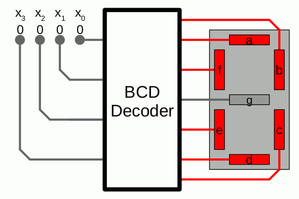
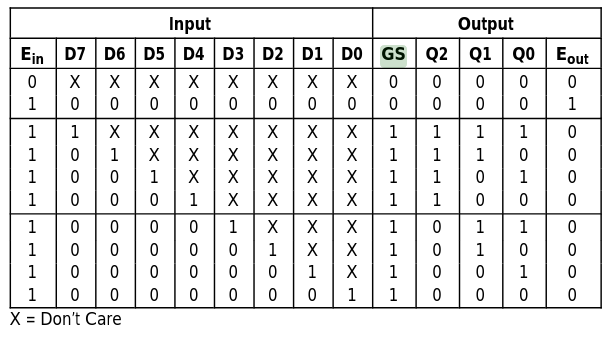
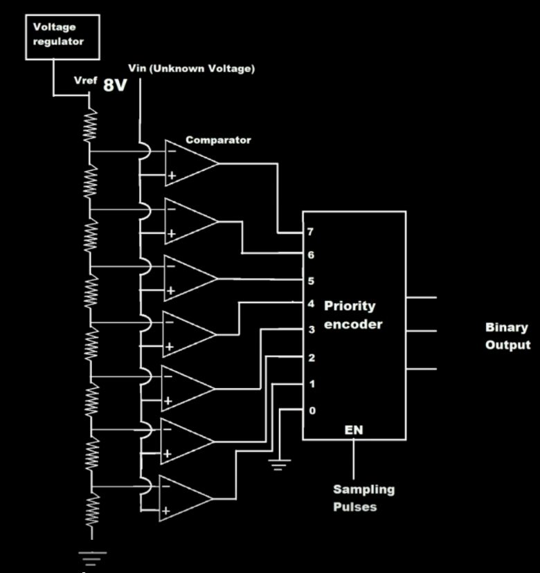
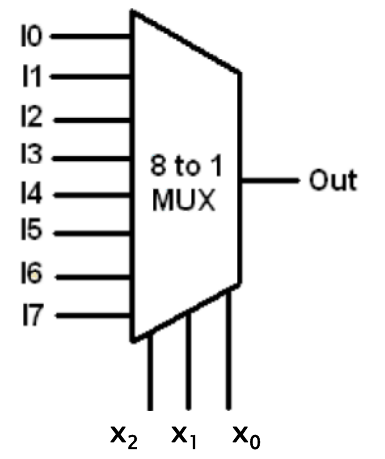
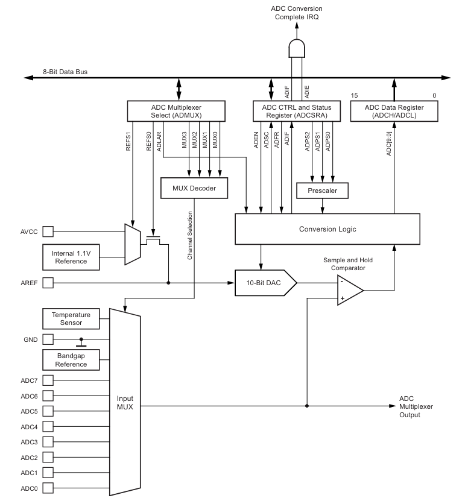

<!--

author:   Sebastian Zug & André Dietrich & Fabian Bär & Copilot & Claude Code (Opus 5.5)
email:    sebastian.zug@informatik.tu-freiberg.de & andre.dietrich@informatik.tu-freiberg.de & fabian.baer@student.tu-freiberg.de
version:  0.1.4
language: de
narrator: Deutsch Female

import:   https://raw.githubusercontent.com/liaTemplates/AVR8js/main/README.md
          https://raw.githubusercontent.com/LiaTemplates/DigiSim/master/README.md
          https://raw.githubusercontent.com/TUBAF-IfI-LiaScript/VL_EingebetteteSysteme/master/config.md
          https://raw.githubusercontent.com/LiaTemplates/KarnaughMap/0.1.0/README.md

mark: <span style="background-color: @0;
                           display: flex;
                           width: calc(100% + 32px);
                           margin: -16px;
                           padding: 6px 16px 6px 16px;
                           ">@1</span>

red:  @mark(#FF888888,@0)
blue: @mark(lightblue,@0)
gray: @mark(gray,@0)
-->

[](https://liascript.github.io/course/?https://raw.githubusercontent.com/TUBAF-IfI-LiaScript/VL_EingebetteteSysteme/master/05_Standardschaltnetze.md#1)

# Standardschaltnetze

| Parameter                | Kursinformationen                                                                                        |
| ------------------------ | -------------------------------------------------------------------------------------------------------- |
| **Veranstaltung:**       | @config.lecture                                                                                          |
| **Semester:**            | @config.semester                                                                                         |
| **Hochschule:**          | `Technische Universität Freiberg`                                                                        |
| **Inhalte:**             | `Dekodierer, Kodierer, Multiplexer, Demultiplexer, Komparatoren, Schieber`                                |
| **Link auf GitHub:**     | https://github.com/TUBAF-IfI-LiaScript/VL_EingebetteteSysteme/blob/master/05_Standardschaltnetze.md      |
| **Autoren:**             | @author                                                                                                  |


---------------------------------------------------------------------

**Lernziele:** Nach dieser Vorlesung können Sie

+ die Aufgaben von Dekodierer, Kodierer und Prioritätskodierer erklären und ihre Schaltfunktionen aus der Wahrheitstafel aufstellen,
+ einen Dekodierer als Adressdekoder einsetzen und aus kleineren Dekodern einen größeren zusammensetzen,
+ Multiplexer und Demultiplexer unterscheiden und ihre Schaltfunktionen angeben,
+ eine beliebige Wahrheitstafel mit einem Multiplexer umsetzen,
+ einen Komparator für mehrstellige Binärzahlen aus Ein-Bit-Komparatoren aufbauen,
+ einen Barrel-Shifter aus 2-zu-1-Multiplexern aufbauen und am Maschinencode erklären, warum der ATmega328P für variable Schiebeweiten eine Schleife braucht,
+ im Blockschaltbild des Analog-Digital-Wandlers im ATmega328P Multiplexer und Dekodierer wiederfinden.

<!-- kurslandkarte:knopf-start -->

<a href="https://tubaf-ifi-liascript.github.io/VL_EingebetteteSysteme/kurslandkarte/#termin=5" style="display: inline-block; padding: 0.5em 1.1em; background-color: #00718A; color: #ffffff; text-decoration: none; font-family: 'IBM Plex Sans', 'Segoe UI', system-ui, sans-serif; font-weight: 600;">🗺️ Diese Vorlesung in der Kurslandkarte →</a>

<!-- kurslandkarte:knopf-ende -->

---------------------------------------------------------------------

<!--
style="width: 80%; min-width: 420px; max-width: 720px;"
-->
```ascii

                Abstraktionsebenen

           +----------------------------+ -.
  Ebene 6  | Problemorientierte Sprache |  |
           +----------------------------+  |
                                           ⎬ Anwendungssoftware
           +----------------------------+  |
  Ebene 5  | Assemblersprache           |  |
           +----------------------------+ -.

           +----------------------------+
  Ebene 4  | Betriebssystem             |     Systemsoftware (fehlt beim ATmega328P)
           +----------------------------+

           +----------------------------+
  Ebene 3  | Instruktionsset            |     Maschinensprache
           +----------------------------+

           +----------------------------+  -.
  Ebene 2  | Mikroarchitektur           |   |
           +----------------------------+   |
                                            ⎬ Automaten, Speicher, Logik
           +----------------------------+   |       ╔═══════════════╗
  Ebene 1  | Digitale Logik             |   |    ◀══║ HIER SIND WIR!║
           +----------------------------+  -.       ╚═══════════════╝

           +----------------------------+
  Ebene 0  | E-Technik, Physik          |     Analoge Phänomene
           +----------------------------+                                      .
```

---------------------------------------------------------------------

## Aufwärmen

    --{{0}}--
In den letzten Vorlesungen haben wir Schaltfunktionen aufgestellt und minimiert. Heute geht es um Schaltnetze, die man so oft braucht, dass es sie als fertige Bausteine gibt. Zum Einstieg eine Frage, die direkt zum ersten Baustein führt.

Ein Mikrocontroller soll wahlweise einen von vier Speicherbausteinen ansprechen. Jeder Baustein hat einen Eingang „Chip Select“: Liegt dort eine 1, reagiert der Baustein, sonst ignoriert er den Bus.

**Wie viele Adressleitungen braucht man mindestens, um einen der vier Bausteine auszuwählen?**

[[2]]
***************************************************************

Mit 2 Bit lassen sich $2^2 = 4$ Bausteine durchnummerieren: 00, 01, 10 und 11. Die Bausteine brauchen aber 4 einzelne Chip-Select-Leitungen, von denen immer genau eine auf 1 steht. Das Schaltnetz, das aus 2 Bit diese 4 Leitungen macht, ist der erste Baustein heute: der **Dekodierer**.

***************************************************************

## Dekodierer und Kodierer

    --{{0}}--
Ein Dekodierer macht aus einer Binärzahl eine einzelne aktive Leitung. Ein Kodierer macht es umgekehrt. Beide begegnen uns im Mikrocontroller überall dort, wo aus einer Nummer eine Auswahl wird.

Ein **Dekodierer** (Decoder, genauer 1-aus-$k$-Dekodierer) ist ein Schaltnetz mit $n$ Eingängen und $k \le 2^n$ Ausgängen. Für jede gültige Eingangskombination ist genau ein Ausgang aktiv. Ein **Kodierer** (Encoder) arbeitet umgekehrt: Aus der einen aktiven von $k$ Eingangsleitungen bildet er deren Nummer als $n$-Bit-Binärzahl.

<!--
style="width: 80%; min-width: 420px; max-width: 720px;"
-->
```ascii
          Dekodierer                     Kodierer
               +                            +
              /|--------------------------->|\
             / |--------------------------->| \
            +  |--------------------------->|  +
       ---->|  |--------------------------->|  |---->
       ---->|  |--------------------------->|  |---->
       ---->|  |--------------------------->|  |---->
            +  |--------------------------->|  +
             \ |--------------------------->| /
              \|                            |/
               +                            +

     Zahl mit 3 Bit    8 Leitungen, genau        Zahl mit 3 Bit
                          eine aktiv
```

Der einfachste Dekodierer ist ein abgewandeltes NOT-Gatter mit einem Eingang $A$ und den zwei Ausgängen $\overline{A}$ und $A$: ein 1-zu-2-Dekodierer.

### Dekodierer

    --{{0}}--
Schauen Sie auf die Formeln: Jeder Ausgang ist genau ein Minterm der Eingänge. Ein Dekodierer erzeugt also alle Minterme auf einmal. Das kennen Sie schon, es ist die feste UND-Matrix im PROM aus der letzten Vorlesung.

**3-zu-8-Dekodierer**

<!-- data-type="none" style="table-layout: fixed; max-width:620px;"-->
| $A$ | $B$ | $C$ | $y_0$ | $y_1$ | $y_2$ | $y_3$ | $y_4$ | $y_5$ | $y_6$ | $y_7$ |
| --- | --- | --- | ----- | ----- | ----- | ----- | ----- | ----- | ----- | ----- |
| 0   | 0   | 0   | 1     | 0     | 0     | 0     | 0     | 0     | 0     | 0     |
| 0   | 0   | 1   | 0     | 1     | 0     | 0     | 0     | 0     | 0     | 0     |
| 0   | 1   | 0   | 0     | 0     | 1     | 0     | 0     | 0     | 0     | 0     |
| 0   | 1   | 1   | 0     | 0     | 0     | 1     | 0     | 0     | 0     | 0     |
| 1   | 0   | 0   | 0     | 0     | 0     | 0     | 1     | 0     | 0     | 0     |
| 1   | 0   | 1   | 0     | 0     | 0     | 0     | 0     | 1     | 0     | 0     |
| 1   | 1   | 0   | 0     | 0     | 0     | 0     | 0     | 0     | 1     | 0     |
| 1   | 1   | 1   | 0     | 0     | 0     | 0     | 0     | 0     | 0     | 1     |

Für jede Eingangskombination wird genau ein Ausgang aktiviert, $A$ ist dabei das höchstwertige Bit. Jeder Ausgang ist ein Minterm:

$$
\begin{aligned}
y_0 &= \overline{A} \cdot \overline{B} \cdot \overline{C} & y_4 &= A \cdot \overline{B} \cdot \overline{C} \\
y_1 &= \overline{A} \cdot \overline{B} \cdot C & y_5 &= A \cdot \overline{B} \cdot C \\
y_2 &= \overline{A} \cdot B \cdot \overline{C} & y_6 &= A \cdot B \cdot \overline{C} \\
y_3 &= \overline{A} \cdot B \cdot C & y_7 &= A \cdot B \cdot C
\end{aligned}
$$

Probieren Sie es aus: Schalten Sie $A$, $B$ und $C$ und beobachten Sie, welche Lampe leuchtet.

```json @DigiSim.evalJson
{"devices":{"a":{"label":"A","type":"Button","propagation":0,"position":{"x":-90,"y":65}},"b":{"label":"B","type":"Button","propagation":0,"position":{"x":-90,"y":115}},"c":{"label":"C","type":"Button","propagation":0,"position":{"x":-100,"y":210}},"y0":{"label":"y0","type":"Lamp","propagation":0,"position":{"x":590,"y":45}},"y1":{"label":"y1","type":"Lamp","propagation":0,"position":{"x":590,"y":105}},"y2":{"label":"y2","type":"Lamp","propagation":0,"position":{"x":595,"y":175}},"y3":{"label":"y3","type":"Lamp","propagation":0,"position":{"x":590,"y":230}},"y4":{"label":"y4","type":"Lamp","propagation":0,"position":{"x":595,"y":285}},"y5":{"label":"y5","type":"Lamp","propagation":0,"position":{"x":590,"y":345}},"y6":{"label":"y6","type":"Lamp","propagation":0,"position":{"x":595,"y":415}},"y7":{"label":"y7","type":"Lamp","propagation":0,"position":{"x":595,"y":480}},"notA":{"label":"NOT a","type":"Not","propagation":0,"bits":1,"position":{"x":55,"y":90}},"notB":{"label":"NOT b","type":"Not","propagation":0,"bits":1,"position":{"x":40,"y":165}},"notC":{"label":"NOT c","type":"Not","propagation":0,"bits":1,"position":{"x":35,"y":375}},"and1":{"label":"~A and ~B","type":"And","propagation":0,"bits":1,"position":{"x":230,"y":95}},"and2":{"label":"~A and B","type":"And","propagation":0,"bits":1,"position":{"x":230,"y":195}},"and3":{"label":"A and ~B","type":"And","propagation":0,"bits":1,"position":{"x":235,"y":290}},"and4":{"label":"A and B","type":"And","propagation":0,"bits":1,"position":{"x":230,"y":410}},"and5":{"label":"~A and ~B and ~C","type":"And","propagation":0,"bits":1,"position":{"x":420,"y":40}},"and6":{"label":"~A and ~B and C","type":"And","propagation":0,"bits":1,"position":{"x":430,"y":100}},"and7":{"label":"~A and B and ~C","type":"And","propagation":0,"bits":1,"position":{"x":435,"y":170}},"and8":{"label":"~A and B and C","type":"And","propagation":0,"bits":1,"position":{"x":440,"y":225}},"and9":{"label":"A and ~B and ~C","type":"And","propagation":0,"bits":1,"position":{"x":430,"y":280}},"and10":{"label":"A and ~B and C","type":"And","propagation":0,"bits":1,"position":{"x":430,"y":340}},"and11":{"label":"A and B and ~C","type":"And","propagation":0,"bits":1,"position":{"x":435,"y":410}},"and12":{"label":"A and B and C","type":"And","propagation":0,"bits":1,"position":{"x":445,"y":475}}},"connectors":[{"from":{"id":"a","port":"out"},"to":{"id":"notA","port":"in"}},{"from":{"id":"b","port":"out"},"to":{"id":"notB","port":"in"}},{"from":{"id":"c","port":"out"},"to":{"id":"notC","port":"in"}},{"from":{"id":"and1","port":"out"},"to":{"id":"and5","port":"in1"}},{"from":{"id":"and1","port":"out"},"to":{"id":"and6","port":"in1"}},{"from":{"id":"and2","port":"out"},"to":{"id":"and7","port":"in1"}},{"from":{"id":"and2","port":"out"},"to":{"id":"and8","port":"in1"}},{"from":{"id":"and3","port":"out"},"to":{"id":"and9","port":"in1"}},{"from":{"id":"and3","port":"out"},"to":{"id":"and10","port":"in1"}},{"from":{"id":"and4","port":"out"},"to":{"id":"and11","port":"in1"}},{"from":{"id":"and4","port":"out"},"to":{"id":"and12","port":"in1"}},{"from":{"id":"notA","port":"out"},"to":{"id":"and1","port":"in1"}},{"from":{"id":"notB","port":"out"},"to":{"id":"and1","port":"in2"}},{"from":{"id":"notA","port":"out"},"to":{"id":"and2","port":"in1"}},{"from":{"id":"b","port":"out"},"to":{"id":"and2","port":"in2"},"vertices":[{"x":130,"y":160}]},{"from":{"id":"a","port":"out"},"to":{"id":"and3","port":"in1"},"vertices":[{"x":10,"y":215}]},{"from":{"id":"notB","port":"out"},"to":{"id":"and3","port":"in2"}},{"from":{"id":"a","port":"out"},"to":{"id":"and4","port":"in1"},"vertices":[{"x":10,"y":225},{"x":155,"y":395}]},{"from":{"id":"b","port":"out"},"to":{"id":"and4","port":"in2"},"vertices":[{"x":130,"y":160}]},{"from":{"id":"c","port":"out"},"to":{"id":"and6","port":"in2"},"vertices":[{"x":295,"y":265}]},{"from":{"id":"notC","port":"out"},"to":{"id":"and5","port":"in2"},"vertices":[{"x":330,"y":335}]},{"from":{"id":"c","port":"out"},"to":{"id":"and8","port":"in2"},"vertices":[{"x":310,"y":275}]},{"from":{"id":"notC","port":"out"},"to":{"id":"and7","port":"in2"},"vertices":[{"x":330,"y":335},{"x":370,"y":295}]},{"from":{"id":"notC","port":"out"},"to":{"id":"and9","port":"in2"},"vertices":[{"x":335,"y":335}]},{"from":{"id":"notC","port":"out"},"to":{"id":"and11","port":"in2"},"vertices":[{"x":320,"y":345}]},{"from":{"id":"c","port":"out"},"to":{"id":"and10","port":"in2"}},{"from":{"id":"c","port":"out"},"to":{"id":"and12","port":"in2"},"vertices":[{"x":360,"y":370}]},{"from":{"id":"and5","port":"out"},"to":{"id":"y0","port":"in"}},{"from":{"id":"and6","port":"out"},"to":{"id":"y1","port":"in"}},{"from":{"id":"and7","port":"out"},"to":{"id":"y2","port":"in"}},{"from":{"id":"and8","port":"out"},"to":{"id":"y3","port":"in"}},{"from":{"id":"and9","port":"out"},"to":{"id":"y4","port":"in"}},{"from":{"id":"and10","port":"out"},"to":{"id":"y5","port":"in"}},{"from":{"id":"and11","port":"out"},"to":{"id":"y6","port":"in"}},{"from":{"id":"and12","port":"out"},"to":{"id":"y7","port":"in"}}],"subcircuits":{}}
```

**Vom Gatter zum Symbol**

    --{{0}}--
Wer einen Dekodierer einsetzt, will nicht jedes Mal zwanzig Gatter vor sich sehen. Wir packen die Schaltung von oben deshalb in einen Kasten, der nur noch Eingänge und Ausgänge zeigt. Innen arbeitet genau dieselbe Gatterschaltung. So entstehen Standardbausteine: Man versteht sie einmal aus Gattern und verwendet sie danach als Symbol.

Dieselbe Schaltung, verpackt in einen Kasten: Nach außen zeigt der Dekodierer nur noch die Eingänge $A$, $B$, $C$ und die Ausgänge $y_0$ bis $y_7$. Die Anzeige unten liest $ABC$ als Zahl, und es leuchtet immer die Lampe mit dieser Nummer.

```json @DigiSim.evalJson
{"devices":{"a":{"label":"A","type":"Button","propagation":0,"position":{"x":0,"y":40}},"b":{"label":"B","type":"Button","propagation":0,"position":{"x":0,"y":110}},"c":{"label":"C","type":"Button","propagation":0,"position":{"x":0,"y":180}},"dec":{"type":"Subcircuit","celltype":"3-zu-8-Dekodierer","propagation":0,"position":{"x":180,"y":40}},"g":{"type":"BusGroup","groups":[1,1,1],"propagation":0,"position":{"x":180,"y":330}},"zahl":{"type":"NumDisplay","bits":3,"label":"ABC als Zahl","numbase":"dec","propagation":0,"position":{"x":300,"y":330}},"y0":{"label":"y0","type":"Lamp","propagation":0,"position":{"x":440,"y":0}},"y1":{"label":"y1","type":"Lamp","propagation":0,"position":{"x":440,"y":50}},"y2":{"label":"y2","type":"Lamp","propagation":0,"position":{"x":440,"y":100}},"y3":{"label":"y3","type":"Lamp","propagation":0,"position":{"x":440,"y":150}},"y4":{"label":"y4","type":"Lamp","propagation":0,"position":{"x":440,"y":200}},"y5":{"label":"y5","type":"Lamp","propagation":0,"position":{"x":440,"y":250}},"y6":{"label":"y6","type":"Lamp","propagation":0,"position":{"x":440,"y":300}},"y7":{"label":"y7","type":"Lamp","propagation":0,"position":{"x":440,"y":350}}},"connectors":[{"from":{"id":"a","port":"out"},"to":{"id":"dec","port":"A"}},{"from":{"id":"b","port":"out"},"to":{"id":"dec","port":"B"}},{"from":{"id":"c","port":"out"},"to":{"id":"dec","port":"C"}},{"from":{"id":"c","port":"out"},"to":{"id":"g","port":"in0"}},{"from":{"id":"b","port":"out"},"to":{"id":"g","port":"in1"}},{"from":{"id":"a","port":"out"},"to":{"id":"g","port":"in2"}},{"from":{"id":"g","port":"out"},"to":{"id":"zahl","port":"in"}},{"from":{"id":"dec","port":"y0"},"to":{"id":"y0","port":"in"}},{"from":{"id":"dec","port":"y1"},"to":{"id":"y1","port":"in"}},{"from":{"id":"dec","port":"y2"},"to":{"id":"y2","port":"in"}},{"from":{"id":"dec","port":"y3"},"to":{"id":"y3","port":"in"}},{"from":{"id":"dec","port":"y4"},"to":{"id":"y4","port":"in"}},{"from":{"id":"dec","port":"y5"},"to":{"id":"y5","port":"in"}},{"from":{"id":"dec","port":"y6"},"to":{"id":"y6","port":"in"}},{"from":{"id":"dec","port":"y7"},"to":{"id":"y7","port":"in"}}],"subcircuits":{"3-zu-8-Dekodierer":{"devices":{"a":{"type":"Input","net":"A","bits":1,"label":"A","position":{"x":-90,"y":65}},"b":{"type":"Input","net":"B","bits":1,"label":"B","position":{"x":-90,"y":115}},"c":{"type":"Input","net":"C","bits":1,"label":"C","position":{"x":-100,"y":210}},"y0":{"type":"Output","net":"y0","bits":1,"label":"y0","position":{"x":590,"y":45}},"y1":{"type":"Output","net":"y1","bits":1,"label":"y1","position":{"x":590,"y":105}},"y2":{"type":"Output","net":"y2","bits":1,"label":"y2","position":{"x":595,"y":175}},"y3":{"type":"Output","net":"y3","bits":1,"label":"y3","position":{"x":590,"y":230}},"y4":{"type":"Output","net":"y4","bits":1,"label":"y4","position":{"x":595,"y":285}},"y5":{"type":"Output","net":"y5","bits":1,"label":"y5","position":{"x":590,"y":345}},"y6":{"type":"Output","net":"y6","bits":1,"label":"y6","position":{"x":595,"y":415}},"y7":{"type":"Output","net":"y7","bits":1,"label":"y7","position":{"x":595,"y":480}},"notA":{"label":"NOT a","type":"Not","propagation":0,"bits":1,"position":{"x":55,"y":90}},"notB":{"label":"NOT b","type":"Not","propagation":0,"bits":1,"position":{"x":40,"y":165}},"notC":{"label":"NOT c","type":"Not","propagation":0,"bits":1,"position":{"x":35,"y":375}},"and1":{"label":"~A and ~B","type":"And","propagation":0,"bits":1,"position":{"x":230,"y":95}},"and2":{"label":"~A and B","type":"And","propagation":0,"bits":1,"position":{"x":230,"y":195}},"and3":{"label":"A and ~B","type":"And","propagation":0,"bits":1,"position":{"x":235,"y":290}},"and4":{"label":"A and B","type":"And","propagation":0,"bits":1,"position":{"x":230,"y":410}},"and5":{"label":"~A and ~B and ~C","type":"And","propagation":0,"bits":1,"position":{"x":420,"y":40}},"and6":{"label":"~A and ~B and C","type":"And","propagation":0,"bits":1,"position":{"x":430,"y":100}},"and7":{"label":"~A and B and ~C","type":"And","propagation":0,"bits":1,"position":{"x":435,"y":170}},"and8":{"label":"~A and B and C","type":"And","propagation":0,"bits":1,"position":{"x":440,"y":225}},"and9":{"label":"A and ~B and ~C","type":"And","propagation":0,"bits":1,"position":{"x":430,"y":280}},"and10":{"label":"A and ~B and C","type":"And","propagation":0,"bits":1,"position":{"x":430,"y":340}},"and11":{"label":"A and B and ~C","type":"And","propagation":0,"bits":1,"position":{"x":435,"y":410}},"and12":{"label":"A and B and C","type":"And","propagation":0,"bits":1,"position":{"x":445,"y":475}}},"connectors":[{"from":{"id":"a","port":"out"},"to":{"id":"notA","port":"in"}},{"from":{"id":"b","port":"out"},"to":{"id":"notB","port":"in"}},{"from":{"id":"c","port":"out"},"to":{"id":"notC","port":"in"}},{"from":{"id":"and1","port":"out"},"to":{"id":"and5","port":"in1"}},{"from":{"id":"and1","port":"out"},"to":{"id":"and6","port":"in1"}},{"from":{"id":"and2","port":"out"},"to":{"id":"and7","port":"in1"}},{"from":{"id":"and2","port":"out"},"to":{"id":"and8","port":"in1"}},{"from":{"id":"and3","port":"out"},"to":{"id":"and9","port":"in1"}},{"from":{"id":"and3","port":"out"},"to":{"id":"and10","port":"in1"}},{"from":{"id":"and4","port":"out"},"to":{"id":"and11","port":"in1"}},{"from":{"id":"and4","port":"out"},"to":{"id":"and12","port":"in1"}},{"from":{"id":"notA","port":"out"},"to":{"id":"and1","port":"in1"}},{"from":{"id":"notB","port":"out"},"to":{"id":"and1","port":"in2"}},{"from":{"id":"notA","port":"out"},"to":{"id":"and2","port":"in1"}},{"from":{"id":"b","port":"out"},"to":{"id":"and2","port":"in2"},"vertices":[{"x":130,"y":160}]},{"from":{"id":"a","port":"out"},"to":{"id":"and3","port":"in1"},"vertices":[{"x":10,"y":215}]},{"from":{"id":"notB","port":"out"},"to":{"id":"and3","port":"in2"}},{"from":{"id":"a","port":"out"},"to":{"id":"and4","port":"in1"},"vertices":[{"x":10,"y":225},{"x":155,"y":395}]},{"from":{"id":"b","port":"out"},"to":{"id":"and4","port":"in2"},"vertices":[{"x":130,"y":160}]},{"from":{"id":"c","port":"out"},"to":{"id":"and6","port":"in2"},"vertices":[{"x":295,"y":265}]},{"from":{"id":"notC","port":"out"},"to":{"id":"and5","port":"in2"},"vertices":[{"x":330,"y":335}]},{"from":{"id":"c","port":"out"},"to":{"id":"and8","port":"in2"},"vertices":[{"x":310,"y":275}]},{"from":{"id":"notC","port":"out"},"to":{"id":"and7","port":"in2"},"vertices":[{"x":330,"y":335},{"x":370,"y":295}]},{"from":{"id":"notC","port":"out"},"to":{"id":"and9","port":"in2"},"vertices":[{"x":335,"y":335}]},{"from":{"id":"notC","port":"out"},"to":{"id":"and11","port":"in2"},"vertices":[{"x":320,"y":345}]},{"from":{"id":"c","port":"out"},"to":{"id":"and10","port":"in2"}},{"from":{"id":"c","port":"out"},"to":{"id":"and12","port":"in2"},"vertices":[{"x":360,"y":370}]},{"from":{"id":"and5","port":"out"},"to":{"id":"y0","port":"in"}},{"from":{"id":"and6","port":"out"},"to":{"id":"y1","port":"in"}},{"from":{"id":"and7","port":"out"},"to":{"id":"y2","port":"in"}},{"from":{"id":"and8","port":"out"},"to":{"id":"y3","port":"in"}},{"from":{"id":"and9","port":"out"},"to":{"id":"y4","port":"in"}},{"from":{"id":"and10","port":"out"},"to":{"id":"y5","port":"in"}},{"from":{"id":"and11","port":"out"},"to":{"id":"y6","port":"in"}},{"from":{"id":"and12","port":"out"},"to":{"id":"y7","port":"in"}}]}}}
```


**Adressdekoder**

    --{{0}}--
Das ist die Lösung der Aufwärmfrage. Die oberen Adressbits wählen über den Dekodierer einen Baustein aus, die unteren Adressbits gehen an alle Bausteine und wählen darin die Speicherzelle.

<!--
style="width: 80%; min-width: 420px; max-width: 720px;"
-->
```ascii
                         Adressbus [A_2, A_3 ...]
    +---------------------------------------------------------+
    |                                                         |
---------+               +---+ D_0     +--------------+       |
     A_0 | -----+       /    |-------->|cs   Mem 0    |<------+
         |      |      /     |         +--------------+       |
     A_1 | --+  |     /2-zu-4|                :               |
         |   |  |    /Dekoder| D_1     +--------------+       |
         |   |  |   +        |-------->|cs   Mem 1    |<------+
         |   |  +-->| A      |         +--------------+       |
Mikro-   |   |      |        |                :               |
prozessor|   +----->| B      | D_2     +--------------+       |
         |          +        |-------->|cs   Mem 2    |<------+
         |  Adress-  \       |         +--------------+       |
         |  bus       \      |                :               |
         |             \     | D_3     +--------------+       |
         |              \    |-------->|cs   Mem 3    |<------+
---------+               +---+         +--------------+
    :                                         :                 cs = Chip Select
    ...........................................
                          Datenbus
```

> **Achtung:** Im Bild wählen der Übersicht halber $A_1$ und $A_0$ den Baustein aus. In echten Systemen nimmt man dafür die **oberen** Adressbits, damit jeder Baustein einen zusammenhängenden Adressbereich bekommt (siehe Hausaufgabe 3).

    --{{0}}--
Auch im Mikrocontroller arbeitet ein Adressdekoder. Schreibt ein Programm auf die Adresse 0x25, landet der Wert im Register PORTB, über das der Controller die Pins von Port B schaltet. Im Datenblatt steht dafür 0x05 in Klammern 0x25: 0x05 ist die Adresse für die I/O-Befehle, 0x25 die im Datenspeicher. Register und Ports sind Thema von Vorlesung 12.

Der Dekodierer sorgt dafür, dass immer genau ein Baustein auf den Datenbus antwortet. Dasselbe passiert im Mikrocontroller: Die Adresse `0x25` wählt das Register `PORTB` aus.

**BCD-Dekodierer für eine Siebensegmentanzeige**

    --{{0}}--
Die Siebensegmentanzeige kennen Sie aus Vorlesung 03. Dort haben Sie ein einzelnes Segment minimiert. Ein BCD-Siebensegment-Dekodierer erledigt alle sieben Segmente auf einmal, entweder als Baustein oder, wie hier, als Tabelle im Programm.

<!-- width="50%" -->

Ein **BCD-Siebensegment-Dekodierer** übersetzt eine Ziffer 0 bis 9 im BCD-Code (4 Bit) in die sieben Segmentsignale `a` bis `g`. Streng genommen ist er ein Code-Umsetzer: Anders als beim 1-aus-$k$-Dekodierer sind hier meist mehrere Ausgänge gleichzeitig aktiv. Als Baustein gibt es ihn zum Beispiel als 74HC4511. Im Mikrocontroller übernimmt oft eine Tabelle diese Aufgabe, wie im folgenden Sketch:

<div>
<wokwi-7segment common="cathode" pin="2,3,4,5,6,7,8,9"></wokwi-7segment>
</div>

``` cpp  sevenSegmentDisplay.ino
const int PINS[] = {2, 3, 4, 5, 6, 7, 8};   // Segmente a bis g
// Segmentmuster je Ziffer: Bit 0 = a, Bit 1 = b, ..., Bit 6 = g
const byte MUSTER[10] = {0x3F, 0x06, 0x5B, 0x4F, 0x66,
                         0x6D, 0x7D, 0x07, 0x7F, 0x6F};

void setup() {
  for (int i = 0; i < 7; i++) {
    pinMode(PINS[i], OUTPUT);
  }
}

void loop() {
  for (int ziffer = 0; ziffer <= 9; ziffer++) {
    for (int i = 0; i < 7; i++) {
      digitalWrite(PINS[i], (MUSTER[ziffer] >> i) & 1);
    }
    delay(1000);
  }
}
```
@AVR8js.sketch

Die Ziffer ist die Adresse, das Byte das gespeicherte Wort, jedes Bit ein Segment. Das ist das PROM-Prinzip aus der letzten Vorlesung: eine Wahrheitstafel als Speicher.

**Verschaltung von Dekodierern**

    --{{0}}--
Dekodierer haben meist einen Freigabeeingang, englisch Enable. Ist er 0, bleiben alle Ausgänge 0. Damit lassen sich zwei kleine Dekodierer zu einem großen zusammensetzen: Das zusätzliche Bit entscheidet, welcher der beiden arbeitet.

Viele Dekodierer haben einen **Freigabeeingang** $EN$ (Enable): Nur bei $EN = 1$ ist ein Ausgang aktiv, sonst sind alle Ausgänge 0. Zwei 3-zu-8-Dekodierer ergeben so einen 4-zu-16-Dekodierer:

<!--
style="width: 80%; min-width: 420px; max-width: 720px;"
-->
```ascii
                        3-zu-8-Dekodierer
                         +-------------+
x_0 ---+---------------->| 2^0       0 |---->  y_0
x_1 ---|--+------------->| 2^1       : |
x_2 ---|--|--+---------->| 2^2       7 |---->  y_7
       |  |  |   +---+   |             |
x_3 ---|--|--|-+-| 1 |o->| EN          |
       |  |  | | +---+   +-------------+
       |  |  | |
       |  |  | |         +-------------+
       +--|--|-|-------->| 2^0       0 |---->  y_8
          +--|-|-------->| 2^1       : |
             +-|-------->| 2^2       7 |---->  y_15
               |         |             |
               +-------->| EN          |
                         +-------------+                                       .
```

Das höchstwertige Bit $x_3$ entscheidet, welcher Dekodierer freigegeben ist: Bei $x_3 = 0$ gibt der obere über den Inverter einen der Ausgänge $y_0$ bis $y_7$ aus, bei $x_3 = 1$ der untere einen der Ausgänge $y_8$ bis $y_{15}$. Die Bits $x_2 x_1 x_0$ liegen an beiden Dekodierern parallel an.

### Kodierer

    --{{0}}--
Der Kodierer ist die Umkehrung. Er funktioniert nur, solange genau eine Eingangsleitung aktiv ist. Für alle anderen Fälle sagt die Wahrheitstafel nichts, und genau das ist sein Problem.

Ein $k$-zu-$n$-**Kodierer** hat

+ $k = 2^n$ Eingänge $x_0, x_1, \dots, x_{k-1}$,
+ $n$ Ausgänge $y_0, y_1, \dots, y_{n-1}$,
+ und setzt voraus, dass genau eine Eingangsleitung auf 1 ist: $x_i = 1$ und $x_j = 0$ für alle $j \neq i$.

Am Ausgang erscheint die Nummer $i$ der aktiven Leitung als Binärzahl.

**8-zu-3-Kodierer**

<!-- data-type="none" style="table-layout: fixed; max-width:800px;"-->
| $x_0$    | $x_1$    | $x_2$    | $x_3$    | $x_4$    | $x_5$    | $x_6$    | $x_7$    | $y_2$ | $y_1$ | $y_0$ |
| -------- | -------- | -------- | -------- | -------- | -------- | -------- | -------- | ----- | ----- | ----- |
| @blue(1) | 0        | 0        | 0        | 0        | 0        | 0        | 0        | 0     | 0     | 0     |
| 0        | @blue(1) | 0        | 0        | 0        | 0        | 0        | 0        | 0     | 0     | 1     |
| 0        | 0        | @blue(1) | 0        | 0        | 0        | 0        | 0        | 0     | 1     | 0     |
| 0        | 0        | 0        | @blue(1) | 0        | 0        | 0        | 0        | 0     | 1     | 1     |
| 0        | 0        | 0        | 0        | @blue(1) | 0        | 0        | 0        | 1     | 0     | 0     |
| 0        | 0        | 0        | 0        | 0        | @blue(1) | 0        | 0        | 1     | 0     | 1     |
| 0        | 0        | 0        | 0        | 0        | 0        | @blue(1) | 0        | 1     | 1     | 0     |
| 0        | 0        | 0        | 0        | 0        | 0        | 0        | @blue(1) | 1     | 1     | 1     |

Ein Ausgangsbit ist 1, wenn eine der Leitungen aktiv ist, deren Nummer an dieser Stelle eine 1 hat:

$$
\begin{aligned}
y_0 &= x_1 + x_3 + x_5 + x_7 \\
y_1 &= x_2 + x_3 + x_6 + x_7 \\
y_2 &= x_4 + x_5 + x_6 + x_7
\end{aligned}
$$

> **Achtung:** Die Wahrheitstafel ist unvollständig. Von $2^8 = 256$ Eingangskombinationen stehen nur 8 in der Tafel.

1. Sind zwei Leitungen aktiv, entsteht eine falsche Nummer: $x_1 = x_2 = 1$ ergibt $y = 011$, also 3.
2. Sind alle Leitungen 0, ergibt sich $y = 000$, genau wie bei $x_0 = 1$.

Prüfen Sie beides in der Schaltung:

``` json @DigiSim.evalJson
{"devices":{"x0":{"label":"x0","type":"Button","propagation":0,"position":{"x":0,"y":0}},"x1":{"label":"x1","type":"Button","propagation":0,"position":{"x":0,"y":50}},"x2":{"label":"x2","type":"Button","propagation":0,"position":{"x":0,"y":105}},"x3":{"label":"x3","type":"Button","propagation":0,"position":{"x":0,"y":160}},"x4":{"label":"x4","type":"Button","propagation":0,"position":{"x":0,"y":215}},"x5":{"label":"x5","type":"Button","propagation":0,"position":{"x":0,"y":265}},"x6":{"label":"x6","type":"Button","propagation":0,"position":{"x":0,"y":320}},"x7":{"label":"x7","type":"Button","propagation":0,"position":{"x":0,"y":375}},"y0":{"label":"y0","type":"Lamp","propagation":0,"position":{"x":570,"y":185}},"y1":{"label":"y1","type":"Lamp","propagation":0,"position":{"x":530,"y":210}},"y2":{"label":"y2","type":"Lamp","propagation":0,"position":{"x":485,"y":240}},"or1":{"label":"x1 or x3","type":"Or","propagation":0,"bits":1,"position":{"x":190,"y":80}},"or2":{"label":"x5 or x7","type":"Or","propagation":0,"bits":1,"position":{"x":195,"y":140}},"or3":{"label":"x1 or x3 or x5 or x7","type":"Or","propagation":0,"bits":1,"position":{"x":345,"y":120}},"or4":{"label":"x2 or x3","type":"Or","propagation":0,"bits":1,"position":{"x":200,"y":200}},"or5":{"label":"x6 or x7","type":"Or","propagation":0,"bits":1,"position":{"x":205,"y":290}},"or6":{"label":"x2 or x3 or x6 or x7","type":"Or","propagation":0,"bits":1,"position":{"x":350,"y":225}},"or7":{"label":"x4 or x5","type":"Or","propagation":0,"bits":1,"position":{"x":200,"y":360}},"or8":{"label":"x4 or x5 or x6 or x7","type":"Or","propagation":0,"bits":1,"position":{"x":360,"y":320}}},"connectors":[{"from":{"id":"x1","port":"out"},"to":{"id":"or1","port":"in1"}},{"from":{"id":"x3","port":"out"},"to":{"id":"or1","port":"in2"}},{"from":{"id":"x5","port":"out"},"to":{"id":"or2","port":"in1"},"vertices":[{"x":135,"y":170}]},{"from":{"id":"x7","port":"out"},"to":{"id":"or2","port":"in2"},"vertices":[{"x":145,"y":310}]},{"from":{"id":"x2","port":"out"},"to":{"id":"or4","port":"in1"}},{"from":{"id":"x3","port":"out"},"to":{"id":"or4","port":"in2"}},{"from":{"id":"x6","port":"out"},"to":{"id":"or5","port":"in1"},"vertices":[{"x":90,"y":335}]},{"from":{"id":"x7","port":"out"},"to":{"id":"or5","port":"in2"}},{"from":{"id":"x4","port":"out"},"to":{"id":"or7","port":"in1"},"vertices":[{"x":95,"y":290}]},{"from":{"id":"x5","port":"out"},"to":{"id":"or7","port":"in2"}},{"from":{"id":"or1","port":"out"},"to":{"id":"or3","port":"in1"}},{"from":{"id":"or2","port":"out"},"to":{"id":"or3","port":"in2"}},{"from":{"id":"or4","port":"out"},"to":{"id":"or6","port":"in1"}},{"from":{"id":"or5","port":"out"},"to":{"id":"or6","port":"in2"}},{"from":{"id":"or5","port":"out"},"to":{"id":"or8","port":"in1"}},{"from":{"id":"or7","port":"out"},"to":{"id":"or8","port":"in2"}},{"from":{"id":"or3","port":"out"},"to":{"id":"y0","port":"in"}},{"from":{"id":"or6","port":"out"},"to":{"id":"y1","port":"in"}},{"from":{"id":"or8","port":"out"},"to":{"id":"y2","port":"in"}}],"subcircuits":{}}
```

**Prioritätskodierer**

    --{{0}}--
Der Prioritätskodierer löst beide Probleme. Sind mehrere Eingänge aktiv, gewinnt der mit der höchsten Nummer. Und ein zusätzlicher Ausgang V meldet, ob überhaupt ein Eingang aktiv ist.

Ein **Prioritätskodierer** legt fest, welcher Eingang gewinnt, wenn mehrere aktiv sind: hier der mit der höchsten Nummer. Ein zusätzlicher Ausgang $V$ (valid) zeigt an, ob überhaupt ein Eingang aktiv ist. Die mit X markierten Eingänge spielen keine Rolle. Anders als beim Kodierer oben steht das höchstwertige Eingangsbit hier links.

<!-- data-type="none" -->
| $x_3$ | $x_2$    | $x_1$    | $x_0$    | $y_1$ | $y_0$ | $V$ |
| ----- | -------- | -------- | -------- | ----- | ----- | --- |
| 0     | 0        | 0        | 0        | 0     | 0     | 0   |
| 0     | 0        | 0        | 1        | 0     | 0     | 1   |
| 0     | 0        | 1        | @gray(X) | 0     | 1     | 1   |
| 0     | 1        | @gray(X) | @gray(X) | 1     | 0     | 1   |
| 1     | @gray(X) | @gray(X) | @gray(X) | 1     | 1     | 1   |

$$
\begin{aligned}
y_1 &= x_3 + x_2 \\
y_0 &= x_3 + \overline{x}_2 x_1 \\
V   &= x_3 + x_2 + x_1 + x_0
\end{aligned}
$$

**Welche Ausgabe $y_1 y_0$ liefert der Prioritätskodierer für $x_3 x_2 x_1 x_0 = 0110$?**

[( )] 01
[(X)] 10
[( )] 11
[( )] keine gültige Ausgabe
***************************************************************

Aktiv sind $x_2$ und $x_1$. Es gewinnt der Eingang mit der höchsten Nummer, also $x_2$, und die Ausgabe ist 2 = 10. Aus den Formeln: $y_1 = x_3 + x_2 = 1$, $y_0 = x_3 + \overline{x}_2 x_1 = 0 + 0 \cdot 1 = 0$.

***************************************************************

    --{{0}}--
Über den Freigabeeingang E in lässt sich der Baustein abschalten, dann sind alle Ausgänge 0. Der Freigabeausgang E out ist 1, wenn der Baustein freigegeben, aber kein Eingang aktiv ist. Verbindet man E out eines Bausteins mit E in des nächsten, entsteht ein Prioritätskodierer mit 16 Eingängen: Der zweite Baustein antwortet nur, wenn beim ersten kein Eingang aktiv ist.

Reale Bausteine wie der MC14532B mit 8 Eingängen ([Datenblatt](https://www.onsemi.com/pub/Collateral/MC14532B-D.PDF)) haben zusätzlich einen Freigabeeingang $E_{in}$ und einen Freigabeausgang $E_{out}$, um mehrere Bausteine zu kaskadieren. Der Ausgang $GS$ („group select“) entspricht unserem $V$.

<!-- width="70%" -->

[^1]: Datenblatt MC14532B - 8-Bit Priority Encoder, Firma ON Semiconductor

**Anwendung: Flash-Analog-Digital-Wandler**

    --{{0}}--
Hier sehen Sie, warum der Prioritätskodierer in der Praxis wichtig ist: Beim Flash-Wandler sind fast immer mehrere Eingänge gleichzeitig aktiv.

    --{{0}}--
Alle analogen Vergleicher, deren Schwelle unterhalb der Eingangsspannung liegt, liefern 1, alle anderen 0. Man nennt das Thermometercode. Der Prioritätskodierer macht daraus die Nummer der höchsten aktiven Schwelle, also den Messwert als Binärzahl. Analog-Digital-Wandler sind Thema von Vorlesung 13.

Ein Flash-Wandler vergleicht die Eingangsspannung gleichzeitig mit vielen Schwellen. Ein Prioritätskodierer macht aus den Vergleicherausgängen den Messwert als Binärzahl.

<!-- width="80%" --> [^2]

[^2]: Autor: Always Be Positive, Youtube Video - Flash or Parallel ADC (Analog to Digital Converter)

!?[Erläuterung Flashwandler](https://www.youtube.com/watch?v=lhnKZDLtYvQ)

## Multiplexer und Demultiplexer

    --{{0}}--
Ein Multiplexer ist ein Umschalter: Mehrere Eingänge, ein Ausgang, und die Steuerleitungen bestimmen, welcher Eingang durchkommt. Der Demultiplexer verteilt umgekehrt ein Signal auf einen von mehreren Ausgängen.

Ein **Multiplexer** schaltet abhängig von Steuerleitungen einen von mehreren Eingängen auf einen gemeinsamen Ausgang, etwa auf eine gemeinsame Leitung. Ein **Demultiplexer** verteilt umgekehrt einen Eingang auf einen von mehreren Ausgängen.

<!--
style="width: 80%; min-width: 420px; max-width: 720px;"
-->
```ascii

    Multiplexer             Demultiplexer
        +                        +
------> |\                      /|------>
        | \                    / |
------> |  +                  +  |------>
        |  | ................>|  |
------> |  +                  +  |------>
        | /                    \ |
------> |/|                    |\|------>
        +||                    ||+
         ||                    ||
       "$a_1$ $a_0$"         "$a_1$ $a_0$"                                       .
```

| Multiplexer                                                       | Dekodierer                                                                          |
| ----------------------------------------------------------------- | ----------------------------------------------------------------------------------- |
| mehrere Dateneingänge und Steuerleitungen, ein Ausgang            | $n$ Eingänge, bis zu $2^n$ Ausgänge                                                 |
| Steuerleitungen bestimmen, welcher Eingang durchgeleitet wird     | die Eingänge bestimmen, welcher Ausgang aktiv ist                                   |
| bildet den Pegel einer Eingangsleitung auf die Ausgangsleitung ab | wandelt den Binärcode in einen 1-aus-$k$-Code um, aktiviert also eine Ausgangsleitung |

### Multiplexer

Ein $2^n$-zu-1-**Multiplexer** hat

+ $n$ Steuerleitungen $a_{n-1}, \dots, a_1, a_0$,
+ $k = 2^n$ Dateneingänge $x_0, x_1, \dots, x_{k-1}$,
+ einen Ausgang $y$,
+ und es gilt $y = x_i$, wenn die Steuerleitungen die Zahl $i$ bilden: $(a_{n-1} \dots a_1 a_0)_2 = i$.

**Beispiel: 4-zu-1-Multiplexer**

    --{{0}}--
Statt einer langen Wahrheitstafel genügt eine Tabelle mit vier Zeilen. Achten Sie in der Formel darauf, dass vor jedem Dateneingang ein Minterm der Steuerleitungen steht.

Mit 4 Dateneingängen und 2 Steuerleitungen hätte die vollständige Wahrheitstafel $2^6 = 64$ Zeilen. Es genügt aber die verkürzte Tafel: Ein Dateneingang wird genau dann durchgeleitet, wenn die zugehörige Kombination an den Steuerleitungen anliegt.

<!-- data-type="none" style="table-layout: fixed; max-width:400px;"-->
| $a_1$ | $a_0$ | $y$   |
| ----- | ----- | ----- |
| 0     | 0     | $x_0$ |
| 0     | 1     | $x_1$ |
| 1     | 0     | $x_2$ |
| 1     | 1     | $x_3$ |

$$
y = \overline{a}_1 \overline{a}_0 \, x_0 + \overline{a}_1 a_0 \, x_1 + a_1 \overline{a}_0 \, x_2 + a_1 a_0 \, x_3
$$

Jedes der vier Produkte besteht aus einem Minterm der Steuerleitungen und einem Dateneingang, zum Beispiel $\overline{a}_1 \overline{a}_0 \cdot x_0$. Die vier Minterme $\overline{a}_1 \overline{a}_0$, $\overline{a}_1 a_0$, $a_1 \overline{a}_0$ und $a_1 a_0$ sind genau die Ausgänge $D_0$ bis $D_3$ eines 2-zu-4-Dekodierers. Ein Multiplexer besteht also aus drei Teilen:

1. Ein **2-zu-4-Dekodierer** macht aus $a_1 a_0$ genau eine aktive Leitung $D_i$.
2. **Vier UND-Gatter** verknüpfen jeweils $D_i$ mit $x_i$. Nur beim aktiven $D_i$ kommt $x_i$ durch, die anderen drei UND-Gatter liefern 0.
3. **Ein ODER-Gatter** fasst die vier UND-Ausgänge zum Ausgang $y$ zusammen.

Die Schaltung unten ist genau so aufgebaut: Die linke Spalte der UND-Gatter (`~a1 and ~a0` usw.) bildet den Dekodierer, die rechte gibt die Dateneingänge frei, und die drei ODER-Gatter fassen zusammen.

``` json @DigiSim.evalJson
{"devices":{"a0":{"label":"a0","type":"Button","propagation":0,"position":{"x":-185,"y":10}},"a1":{"label":"a1","type":"Button","propagation":0,"position":{"x":-180,"y":-55}},"x0":{"label":"x0","type":"Button","propagation":0,"position":{"x":-185,"y":80}},"x1":{"label":"x1","type":"Button","propagation":0,"position":{"x":-185,"y":125}},"x2":{"label":"x2","type":"Button","propagation":0,"position":{"x":-185,"y":180}},"x3":{"label":"x3","type":"Button","propagation":0,"position":{"x":-185,"y":240}},"y":{"label":"y","type":"Lamp","propagation":0,"position":{"x":560,"y":180}},"not1":{"label":"~a0","type":"Not","propagation":0,"bits":1,"position":{"x":-95,"y":40}},"not2":{"label":"~a1","type":"Not","propagation":0,"bits":1,"position":{"x":-95,"y":-25}},"and1":{"label":"~a1 and ~a0","type":"And","propagation":0,"bits":1,"position":{"x":65,"y":40}},"and2":{"label":"~a1 and a0","type":"And","propagation":0,"bits":1,"position":{"x":55,"y":120}},"and3":{"label":"a1 and ~a0","type":"And","propagation":0,"bits":1,"position":{"x":65,"y":190}},"and4":{"label":"a1 and a0","type":"And","propagation":0,"bits":1,"position":{"x":70,"y":270}},"and5":{"label":"~a1 and ~a0 and x0","type":"And","propagation":0,"bits":1,"position":{"x":210,"y":55}},"and6":{"label":"~a1 and a0 and x1","type":"And","propagation":0,"bits":1,"position":{"x":210,"y":130}},"and7":{"label":"a1 and ~a0 and x2","type":"And","propagation":0,"bits":1,"position":{"x":210,"y":205}},"and8":{"label":"a1 and a0 and x3","type":"And","propagation":0,"bits":1,"position":{"x":210,"y":280}},"or1":{"label":"or","type":"Or","propagation":0,"bits":1,"position":{"x":420,"y":175}},"or2":{"label":"or","type":"Or","propagation":0,"bits":1,"position":{"x":360,"y":110}},"or3":{"label":"or","type":"Or","propagation":0,"bits":1,"position":{"x":360,"y":225}}},"connectors":[{"from":{"id":"a1","port":"out"},"to":{"id":"not2","port":"in"}},{"from":{"id":"a0","port":"out"},"to":{"id":"not1","port":"in"}},{"from":{"id":"not2","port":"out"},"to":{"id":"and1","port":"in1"}},{"from":{"id":"not1","port":"out"},"to":{"id":"and1","port":"in2"}},{"from":{"id":"a0","port":"out"},"to":{"id":"and2","port":"in2"},"vertices":[{"x":-75,"y":100}]},{"from":{"id":"a0","port":"out"},"to":{"id":"and4","port":"in2"},"vertices":[{"x":-15,"y":160}]},{"from":{"id":"not2","port":"out"},"to":{"id":"and2","port":"in1"},"vertices":[{"x":5,"y":85}]},{"from":{"id":"a1","port":"out"},"to":{"id":"and3","port":"in1"},"vertices":[{"x":-105,"y":10}]},{"from":{"id":"a1","port":"out"},"to":{"id":"and4","port":"in1"},"vertices":[{"x":-100,"y":25},{"x":-100,"y":55},{"x":30,"y":185}]},{"from":{"id":"not1","port":"out"},"to":{"id":"and3","port":"in2"},"vertices":[{"x":20,"y":100}]},{"from":{"id":"x0","port":"out"},"to":{"id":"and5","port":"in2"}},{"from":{"id":"and1","port":"out"},"to":{"id":"and5","port":"in1"}},{"from":{"id":"and2","port":"out"},"to":{"id":"and6","port":"in1"}},{"from":{"id":"and3","port":"out"},"to":{"id":"and7","port":"in1"}},{"from":{"id":"and4","port":"out"},"to":{"id":"and8","port":"in1"}},{"from":{"id":"x1","port":"out"},"to":{"id":"and6","port":"in2"},"vertices":[{"x":-45,"y":180},{"x":75,"y":180}]},{"from":{"id":"x2","port":"out"},"to":{"id":"and7","port":"in2"}},{"from":{"id":"x3","port":"out"},"to":{"id":"and8","port":"in2"},"vertices":[{"x":-20,"y":310}]},{"from":{"id":"and5","port":"out"},"to":{"id":"or2","port":"in1"}},{"from":{"id":"and6","port":"out"},"to":{"id":"or2","port":"in2"}},{"from":{"id":"and7","port":"out"},"to":{"id":"or3","port":"in1"}},{"from":{"id":"and8","port":"out"},"to":{"id":"or3","port":"in2"}},{"from":{"id":"or2","port":"out"},"to":{"id":"or1","port":"in1"}},{"from":{"id":"or3","port":"out"},"to":{"id":"or1","port":"in2"},"vertices":[{"x":420,"y":205}]},{"from":{"id":"or1","port":"out"},"to":{"id":"y","port":"in"}}],"subcircuits":{}}
```

**Als Symbol**

    --{{0}}--
Für den Multiplexer hat DigiSim ein eigenes Symbol, das Trapez. Links liegen die Dateneingänge, die beiden Steuerleitungen werden zu einer Leitung mit zwei Bit gebündelt. Innen steckt dieselbe Schaltung aus Dekodierer, UND- und ODER-Gattern wie oben.

Derselbe 4-zu-1-Multiplexer als ein Symbol: Die Steuerleitungen $a_1 a_0$ sind zu einer 2-Bit-Leitung gebündelt, die Zahl $a_1 a_0$ wählt den Dateneingang.

```json @DigiSim.evalJson
{"devices":{"x0":{"label":"x0","type":"Button","propagation":0,"position":{"x":0,"y":0}},"x1":{"label":"x1","type":"Button","propagation":0,"position":{"x":0,"y":60}},"x2":{"label":"x2","type":"Button","propagation":0,"position":{"x":0,"y":120}},"x3":{"label":"x3","type":"Button","propagation":0,"position":{"x":0,"y":180}},"a1":{"label":"a1","type":"Button","propagation":0,"position":{"x":0,"y":280}},"a0":{"label":"a0","type":"Button","propagation":0,"position":{"x":0,"y":340}},"g":{"type":"BusGroup","groups":[1,1],"propagation":0,"position":{"x":110,"y":300}},"mux":{"label":"4-zu-1-MUX","type":"Mux","propagation":0,"bits":{"in":1,"sel":2},"position":{"x":250,"y":60}},"y":{"label":"y","type":"Lamp","propagation":0,"position":{"x":420,"y":110}}},"connectors":[{"from":{"id":"x0","port":"out"},"to":{"id":"mux","port":"in0"}},{"from":{"id":"x1","port":"out"},"to":{"id":"mux","port":"in1"}},{"from":{"id":"x2","port":"out"},"to":{"id":"mux","port":"in2"}},{"from":{"id":"x3","port":"out"},"to":{"id":"mux","port":"in3"}},{"from":{"id":"a0","port":"out"},"to":{"id":"g","port":"in0"}},{"from":{"id":"a1","port":"out"},"to":{"id":"g","port":"in1"}},{"from":{"id":"g","port":"out"},"to":{"id":"mux","port":"sel"}},{"from":{"id":"mux","port":"out"},"to":{"id":"y","port":"in"}}],"subcircuits":{}}
```


**Wie viele Steuerleitungen braucht ein 8-zu-1-Multiplexer?**

[[3]]
***************************************************************

Mit 3 Steuerleitungen lassen sich $2^3 = 8$ Eingänge durchnummerieren.

***************************************************************

**Multiplexer als universelle Schaltfunktion**

    --{{0}}--
Jetzt der Trick: Legt man an die Dateneingänge feste Nullen und Einsen und an die Steuerleitungen die Variablen, dann wählt der Multiplexer für jede Belegung genau eine Zeile der Wahrheitstafel aus. Er wird zur Wahrheitstafel in Hardware, wie das PROM.

Legt man die Eingangsvariablen an die Steuerleitungen und die Spalte $y$ der Wahrheitstafel als feste Werte an die Dateneingänge, wählt der Multiplexer für jede Belegung genau die passende Zeile aus. Ein $2^n$-zu-1-Multiplexer setzt so **jede** Schaltfunktion mit $n$ Variablen um, ohne Minimierung.

<!-- data-type="none" style="table-layout: fixed; max-width:400px;"-->
| $x_2$ | $x_1$ | $x_0$ | $y$ |
| ----- | ----- | ----- | --- |
| 0     | 0     | 0     | 1   |
| 0     | 0     | 1     | 0   |
| 0     | 1     | 0     | 0   |
| 0     | 1     | 1     | 1   |
| 1     | 0     | 0     | 1   |
| 1     | 0     | 1     | 0   |
| 1     | 1     | 0     | 1   |
| 1     | 1     | 1     | 1   |

<!-- width="30%" -->

An den Eingängen $I_0$ bis $I_7$ liegen die Werte der Spalte $y$: $1, 0, 0, 1, 1, 0, 1, 1$.

Es geht sogar mit einem kleineren Multiplexer. Legt man nur $x_2$ und $x_1$ an die Steuerleitungen eines 4-zu-1-Multiplexers, gehören zu jedem Dateneingang zwei Zeilen, die sich nur in $x_0$ unterscheiden. Je nach Zeilenpaar ist $y$ dann $0$, $1$, $x_0$ oder $\overline{x}_0$:

    --{{0}}--
Mathematisch ist das die Shannon-Zerlegung: Die Funktion wird nach x 2 und x 1 entwickelt, und an jedem Dateneingang liegt die Restfunktion von x 0.


<!-- data-type="none" style="table-layout: fixed; max-width:500px;"-->
| $x_2$ | $x_1$ | $y$ für $x_0 = 0$ | $y$ für $x_0 = 1$ | Dateneingang |
| ----- | ----- | ----------------- | ----------------- | ------------ |
| 0     | 0     | 1                 | 0                 | $\overline{x}_0$ |
| 0     | 1     | 0                 | 1                 | $x_0$        |
| 1     | 0     | 1                 | 0                 | $\overline{x}_0$ |
| 1     | 1     | 1                 | 1                 | $1$          |

### Demultiplexer

    --{{0}}--
Der Demultiplexer ist das Gegenstück. Ein Eingang wird auf den Ausgang gelegt, den die Steuerleitungen auswählen, alle anderen Ausgänge bleiben 0. Vergleichen Sie die Formeln mit dem Dekodierer: Es ist ein Dekodierer, bei dem x den Freigabeeingang bildet.

Ein 1-zu-$2^n$-**Demultiplexer** hat

+ $n$ Steuerleitungen $a_{n-1}, \dots, a_1, a_0$,
+ einen Eingang $x$,
+ $k = 2^n$ Ausgänge $y_0, y_1, \dots, y_{k-1}$,
+ und es gilt $y_i = x$, wenn $(a_{n-1} \dots a_1 a_0)_2 = i$; alle anderen Ausgänge sind 0.

**Beispiel: 1-zu-4-Demultiplexer**

<!-- data-type="none" -->
| $a_1$ | $a_0$ | $x$ | $y_0$ | $y_1$ | $y_2$ | $y_3$ |
| ----- | ----- | --- | ----- | ----- | ----- | ----- |
| 0     | 0     | 0   | 0     | 0     | 0     | 0     |
| 0     | 0     | 1   | 1     | 0     | 0     | 0     |
| 0     | 1     | 0   | 0     | 0     | 0     | 0     |
| 0     | 1     | 1   | 0     | 1     | 0     | 0     |
| 1     | 0     | 0   | 0     | 0     | 0     | 0     |
| 1     | 0     | 1   | 0     | 0     | 1     | 0     |
| 1     | 1     | 0   | 0     | 0     | 0     | 0     |
| 1     | 1     | 1   | 0     | 0     | 0     | 1     |

$$
\begin{aligned}
y_0 &= x \cdot \overline{a}_1 \cdot \overline{a}_0 & y_2 &= x \cdot a_1 \cdot \overline{a}_0 \\
y_1 &= x \cdot \overline{a}_1 \cdot a_0 & y_3 &= x \cdot a_1 \cdot a_0
\end{aligned}
$$

Das sind die Formeln eines 2-zu-4-Dekodierers, bei dem $x$ den Freigabeeingang bildet.

```json @DigiSim.evalJson
{"devices":{"x":{"label":"x","type":"Button","propagation":0,"position":{"x":-50,"y":0}},"a0":{"label":"a0","type":"Button","propagation":0,"position":{"x":-45,"y":185}},"a1":{"label":"a1","type":"Button","propagation":0,"position":{"x":-50,"y":100}},"y0":{"label":"y0","type":"Lamp","propagation":0,"position":{"x":495,"y":15}},"y1":{"label":"y1","type":"Lamp","propagation":0,"position":{"x":495,"y":75}},"y2":{"label":"y2","type":"Lamp","propagation":0,"position":{"x":495,"y":130}},"y3":{"label":"y3","type":"Lamp","propagation":0,"position":{"x":500,"y":185}},"not1":{"label":"~a0","type":"Not","propagation":0,"bits":1,"position":{"x":85,"y":225}},"not2":{"label":"~a1","type":"Not","propagation":0,"bits":1,"position":{"x":45,"y":110}},"and1":{"label":"x and ~a1","type":"And","propagation":0,"bits":1,"position":{"x":150,"y":55}},"and2":{"label":"x and a1","type":"And","propagation":0,"bits":1,"position":{"x":160,"y":155}},"and3":{"label":"x and ~a1 and ~a0","type":"And","propagation":0,"bits":1,"position":{"x":345,"y":10}},"and4":{"label":"x and ~a1 and a0","type":"And","propagation":0,"bits":1,"position":{"x":345,"y":70}},"and5":{"label":"x and a1 and ~a0","type":"And","propagation":0,"bits":1,"position":{"x":345,"y":125}},"and6":{"label":"x and a1 and a0","type":"And","propagation":0,"bits":1,"position":{"x":350,"y":180}}},"connectors":[{"from":{"id":"not2","port":"out"},"to":{"id":"and1","port":"in2"}},{"from":{"id":"x","port":"out"},"to":{"id":"and1","port":"in1"}},{"from":{"id":"x","port":"out"},"to":{"id":"and2","port":"in1"},"vertices":[{"x":85,"y":75},{"x":110,"y":115}]},{"from":{"id":"and1","port":"out"},"to":{"id":"and3","port":"in1"}},{"from":{"id":"and1","port":"out"},"to":{"id":"and4","port":"in1"}},{"from":{"id":"and2","port":"out"},"to":{"id":"and5","port":"in1"},"vertices":[{"x":285,"y":135}]},{"from":{"id":"and2","port":"out"},"to":{"id":"and6","port":"in1"}},{"from":{"id":"not1","port":"out"},"to":{"id":"and3","port":"in2"},"vertices":[{"x":290,"y":225},{"x":290,"y":155}]},{"from":{"id":"not1","port":"out"},"to":{"id":"and5","port":"in2"},"vertices":[{"x":285,"y":200}]},{"from":{"id":"and3","port":"out"},"to":{"id":"y0","port":"in"}},{"from":{"id":"and4","port":"out"},"to":{"id":"y1","port":"in"}},{"from":{"id":"and5","port":"out"},"to":{"id":"y2","port":"in"}},{"from":{"id":"and6","port":"out"},"to":{"id":"y3","port":"in"}},{"from":{"id":"a1","port":"out"},"to":{"id":"not2","port":"in"}},{"from":{"id":"a1","port":"out"},"to":{"id":"and2","port":"in2"},"vertices":[{"x":35,"y":145},{"x":65,"y":185}]},{"from":{"id":"a0","port":"out"},"to":{"id":"not1","port":"in"}},{"from":{"id":"a0","port":"out"},"to":{"id":"and4","port":"in2"},"vertices":[{"x":305,"y":200}]},{"from":{"id":"a0","port":"out"},"to":{"id":"and6","port":"in2"}}],"subcircuits":{}}
```

## Komparatoren

    --{{0}}--
Ein Komparator vergleicht zwei Binärzahlen. Wir gehen vor wie beim Vergleich zweier Zahlen von Hand: Zuerst entscheidet die höchste Stelle, nur bei Gleichstand die nächste.

Ein **Komparator** vergleicht zwei Binärzahlen $A$ und $B$ und meldet an drei Ausgängen, ob $A > B$ ($G$, greater), $A = B$ ($E$, equal) oder $A < B$ ($L$, less) gilt.

**Ein-Bit-Komparator**

<!-- data-type="none" style="table-layout: fixed; max-width:400px;"-->
| $a$ | $b$ | $G$ | $E$ | $L$ |
| --- | --- | --- | --- | --- |
| 0   | 0   | 0   | 1   | 0   |
| 0   | 1   | 0   | 0   | 1   |
| 1   | 0   | 1   | 0   | 0   |
| 1   | 1   | 0   | 1   | 0   |

$$
\begin{aligned}
G &= a \cdot \overline{b} \\
L &= \overline{a} \cdot b \\
E &= \overline{a}\,\overline{b} + a b = \overline{G + L}
\end{aligned}
$$

$E$ ist genau dann 1, wenn weder $G$ noch $L$ gilt. Deshalb genügt ein NOR-Gatter:

```json @DigiSim.evalJson
{"devices":{"a":{"label":"a","type":"Button","propagation":0,"position":{"x":0,"y":20}},"b":{"label":"b","type":"Button","propagation":0,"position":{"x":0,"y":160}},"nota":{"label":"NOT a","type":"Not","propagation":0,"bits":1,"position":{"x":110,"y":120}},"notb":{"label":"NOT b","type":"Not","propagation":0,"bits":1,"position":{"x":110,"y":60}},"g":{"label":"a and ~b","type":"And","propagation":0,"bits":1,"position":{"x":230,"y":20}},"l":{"label":"~a and b","type":"And","propagation":0,"bits":1,"position":{"x":230,"y":160}},"e":{"label":"nor","type":"Nor","propagation":0,"bits":1,"position":{"x":370,"y":90}},"G":{"label":"G","type":"Lamp","propagation":0,"position":{"x":520,"y":20}},"E":{"label":"E","type":"Lamp","propagation":0,"position":{"x":520,"y":95}},"L":{"label":"L","type":"Lamp","propagation":0,"position":{"x":520,"y":170}}},"connectors":[{"from":{"id":"a","port":"out"},"to":{"id":"nota","port":"in"}},{"from":{"id":"b","port":"out"},"to":{"id":"notb","port":"in"}},{"from":{"id":"a","port":"out"},"to":{"id":"g","port":"in1"}},{"from":{"id":"notb","port":"out"},"to":{"id":"g","port":"in2"}},{"from":{"id":"nota","port":"out"},"to":{"id":"l","port":"in1"}},{"from":{"id":"b","port":"out"},"to":{"id":"l","port":"in2"}},{"from":{"id":"g","port":"out"},"to":{"id":"e","port":"in1"}},{"from":{"id":"l","port":"out"},"to":{"id":"e","port":"in2"}},{"from":{"id":"g","port":"out"},"to":{"id":"G","port":"in"}},{"from":{"id":"e","port":"out"},"to":{"id":"E","port":"in"}},{"from":{"id":"l","port":"out"},"to":{"id":"L","port":"in"}}],"subcircuits":{}}
```

**Mehrstellige Zahlen**

Für $A = a_1 a_0$ und $B = b_1 b_0$ vergleicht man zuerst die höherwertigen Bits mit einem Ein-Bit-Komparator ($G_1$, $E_1$, $L_1$), dann die niederwertigen ($G_0$, $E_0$, $L_0$). Das niederwertige Bit zählt nur bei Gleichstand im höherwertigen:

$$
\begin{aligned}
G &= G_1 + E_1 \cdot G_0 \\
E &= E_1 \cdot E_0 \\
L &= L_1 + E_1 \cdot L_0
\end{aligned}
$$

Nach demselben Muster lassen sich beliebig lange Zahlen vergleichen. Als Baustein gibt es zum Beispiel den 4-Bit-Komparator 74HC85, der zusätzlich Kaskadeneingänge für längere Zahlen hat.

**Als Baustein**

    --{{0}}--
Für ganze Zahlen hat DigiSim fertige Vergleichsbausteine. Jeder vergleicht zwei Zahlen mit vier Bit und liefert ein Bit. Innen steckt die Kette aus Ein-Bit-Komparatoren, die wir eben aufgestellt haben.

Fertige Vergleichsbausteine für Zahlen mit 4 Bit. Tragen Sie für $A$ und $B$ Zahlen von 0 bis 15 ein:

```json @DigiSim.evalJson
{"devices":{"A":{"label":"A","type":"NumEntry","bits":4,"numbase":"dec","propagation":0,"position":{"x":0,"y":40}},"B":{"label":"B","type":"NumEntry","bits":4,"numbase":"dec","propagation":0,"position":{"x":0,"y":160}},"gt":{"type":"Gt","propagation":0,"bits":{"in1":4,"in2":4},"position":{"x":200,"y":0}},"eq":{"type":"Eq","propagation":0,"bits":{"in1":4,"in2":4},"position":{"x":200,"y":100}},"lt":{"type":"Lt","propagation":0,"bits":{"in1":4,"in2":4},"position":{"x":200,"y":200}},"G":{"label":"G","type":"Lamp","propagation":0,"position":{"x":360,"y":5}},"E":{"label":"E","type":"Lamp","propagation":0,"position":{"x":360,"y":105}},"L":{"label":"L","type":"Lamp","propagation":0,"position":{"x":360,"y":205}}},"connectors":[{"from":{"id":"A","port":"out"},"to":{"id":"gt","port":"in1"}},{"from":{"id":"B","port":"out"},"to":{"id":"gt","port":"in2"}},{"from":{"id":"A","port":"out"},"to":{"id":"eq","port":"in1"}},{"from":{"id":"B","port":"out"},"to":{"id":"eq","port":"in2"}},{"from":{"id":"A","port":"out"},"to":{"id":"lt","port":"in1"}},{"from":{"id":"B","port":"out"},"to":{"id":"lt","port":"in2"}},{"from":{"id":"gt","port":"out"},"to":{"id":"G","port":"in"}},{"from":{"id":"eq","port":"out"},"to":{"id":"E","port":"in"}},{"from":{"id":"lt","port":"out"},"to":{"id":"L","port":"in"}}],"subcircuits":{}}
```


**Welchen Ausgang setzt der Zwei-Bit-Komparator für $A = 11$ und $B = 10$?**

[(X)] $G$
[( )] $E$
[( )] $L$
***************************************************************

Die höherwertigen Bits sind gleich ($E_1 = 1$), also entscheidet das niederwertige Bit: $a_0 = 1 > b_0 = 0$, $G_0 = 1$. Damit ist $G = G_1 + E_1 \cdot G_0 = 0 + 1 \cdot 1 = 1$.

***************************************************************

> **Nicht verwechseln:** Im Flash-Wandler oben und im Analog-Digital-Wandler des ATmega328P vergleichen **analoge** Komparatoren zwei Spannungen. Der digitale Komparator hier vergleicht zwei Binärzahlen.

## Schieber

    --{{0}}--
In C schreiben Sie x << n, und der Prozessor verschiebt die Bits. Um eine feste Stelle zu schieben, braucht man gar kein Gatter, nur Drähte. Ist die Schiebeweite aber variabel, muss für jedes Ausgangsbit ausgewählt werden, welches Eingangsbit dort ankommt. Genau das kann ein Multiplexer.

Ein **Schieber** (engl. shifter) verschiebt die Bits eines Wortes um $s$ Stellen, in C `x << s`. Die frei werdenden Stellen werden mit 0 aufgefüllt.

+ **Feste Schiebeweite:** reine Verdrahtung, kein Gatter nötig. Für `x << 1` wird $y_i$ mit $x_{i-1}$ verbunden.
+ **Variable Schiebeweite:** Für jedes Ausgangsbit muss ausgewählt werden, welches Eingangsbit ankommt. Das ist die Aufgabe eines Multiplexers.

Linksschieber für 4 Bit, Schiebeweite $s = s_1 s_0$ von 0 bis 3:

<!-- data-type="none" style="table-layout: fixed; max-width:500px;"-->
| $s_1$ | $s_0$ | $y_3$ | $y_2$ | $y_1$ | $y_0$ |
| ----- | ----- | ----- | ----- | ----- | ----- |
| 0     | 0     | $x_3$ | $x_2$ | $x_1$ | $x_0$ |
| 0     | 1     | $x_2$ | $x_1$ | $x_0$ | 0     |
| 1     | 0     | $x_1$ | $x_0$ | 0     | 0     |
| 1     | 1     | $x_0$ | 0     | 0     | 0     |

    --{{0}}--
Lesen Sie die Tabelle spaltenweise. Die Spalte y2 enthält von oben nach unten x2, x1, x0 und 0. Das sind die vier Dateneingänge eines 4-zu-1-Multiplexers, dessen Steuerleitungen s1 und s0 sind. Für vier Ausgänge brauchen wir also vier solche Multiplexer.

Jede Spalte ist ein 4-zu-1-Multiplexer mit $s_1 s_0$ an den Steuerleitungen. $y_2$ wählt zum Beispiel aus $x_2$, $x_1$, $x_0$ und $0$.

### Barrel-Shifter

    --{{0}}--
Bei 32 Bit wären das 32 Multiplexer mit je 32 Eingängen. Es geht einfacher. Wir bauen zuerst einen Schieber, der nur zwei Dinge kann: gar nicht schieben oder um genau eine Stelle schieben. Dafür reicht ein Multiplexer mit zwei Eingängen pro Bit. Sein Eingang 0 bekommt das eigene Bit, sein Eingang 1 das Bit rechts daneben. Ganz rechts rückt eine Null nach.

**Schritt 1: Eine Stufe schiebt um eine Stelle – oder gar nicht**

Jedes Ausgangsbit bekommt einen 2-zu-1-Multiplexer. Alle vier hängen an derselben Steuerleitung $s_0$.

+ Eingang 0: das eigene Bit, $y_i = x_i$
+ Eingang 1: das Bit rechts daneben, $y_i = x_{i-1}$; ganz rechts rückt eine 0 nach

<!-- style="max-width: 500px" -->
```ascii
   x3         x2         x1         x0         0
   |          |          |          |          |
   |    +-----+    +-----+    +-----+    +-----+
   |    |     |    |     |    |     |    |
   v    v     v    v     v    v     v    v
 +--------+ +--------+ +--------+ +--------+
 | 0    1 | | 0    1 | | 0    1 | | 0    1 |
 |  MUX   | |  MUX   | |  MUX   | |  MUX   |
 +---+----+ +---+----+ +---+----+ +---+----+
     |          |          |          |
     v          v          v          v
     y3         y2         y1         y0
```

<!-- data-type="none" style="max-width:600px;"-->
| $s_0$ | $y_3$ | $y_2$ | $y_1$ | $y_0$ | für $x = 1011$      |
| ----- | ----- | ----- | ----- | ----- | ------------------- |
| 0     | $x_3$ | $x_2$ | $x_1$ | $x_0$ | $1011$              |
| 1     | $x_2$ | $x_1$ | $x_0$ | 0     | $0110$              |

**Schritt 2: Zwei Stufen hintereinander**

    --{{0}}--
Jetzt der Trick: Wir schalten eine zweite Stufe dahinter, die nach demselben Muster gebaut ist, aber das Bit zwei Stellen weiter rechts holt. Sie schiebt also um zwei Stellen oder gar nicht und hängt an s1. Weil jede Zahl von 0 bis 3 eine Summe aus 1 und 2 ist, erreichen wir mit den beiden Stufen jede Schiebeweite. Für s gleich 3 schieben beide Stufen: erst um eins, dann um zwei.

Die zweite Stufe ist genauso gebaut, holt aber das Bit **zwei** Stellen weiter rechts. Sie schiebt um 2 oder gar nicht und hängt an $s_1$. Die Schiebeweite $s = s_1 s_0$ setzt sich aus beiden Stufen zusammen:

<!-- data-type="none" style="max-width:800px;"-->
| $s_1 s_0$ | Stufe 1 ($s_0$) | Stufe 2 ($s_1$) | gesamt | für $x = 1011$                               |
| --------- | --------------- | --------------- | ------ | -------------------------------------------- |
| 00        | –               | –               | 0      | $1011$                                       |
| 01        | um 1            | –               | 1      | $1011 \rightarrow 0110$                      |
| 10        | –               | um 2            | 2      | $1011 \rightarrow 1100$                      |
| 11        | um 1            | um 2            | 3      | $1011 \rightarrow 0110 \rightarrow 1000$     |

Diese Anordnung heißt **Barrel-Shifter**. Stufe $k$ schiebt um $2^k$ Stellen, wenn $s_k = 1$. Jede Stufe besteht aus einem 2-zu-1-Multiplexer je Bit.

In der Simulation ist links Stufe 1, rechts Stufe 2. Probieren Sie $x = 1011$ mit $s = 01$, $10$ und $11$ aus:

```json @DigiSim.evalJson
{"devices":{"x0":{"label":"x0","type":"Button","propagation":0,"position":{"x":0,"y":270}},"m0":{"label":"s0 ? 0 : x0","type":"Mux","propagation":0,"bits":{"in":1,"sel":1},"position":{"x":200,"y":270}},"n0":{"label":"s1 ? 0 : m0","type":"Mux","propagation":0,"bits":{"in":1,"sel":1},"position":{"x":420,"y":270}},"y0":{"label":"y0","type":"Lamp","propagation":0,"position":{"x":620,"y":280}},"x1":{"label":"x1","type":"Button","propagation":0,"position":{"x":0,"y":180}},"m1":{"label":"s0 ? x0 : x1","type":"Mux","propagation":0,"bits":{"in":1,"sel":1},"position":{"x":200,"y":180}},"n1":{"label":"s1 ? 0 : m1","type":"Mux","propagation":0,"bits":{"in":1,"sel":1},"position":{"x":420,"y":180}},"y1":{"label":"y1","type":"Lamp","propagation":0,"position":{"x":620,"y":190}},"x2":{"label":"x2","type":"Button","propagation":0,"position":{"x":0,"y":90}},"m2":{"label":"s0 ? x1 : x2","type":"Mux","propagation":0,"bits":{"in":1,"sel":1},"position":{"x":200,"y":90}},"n2":{"label":"s1 ? m0 : m2","type":"Mux","propagation":0,"bits":{"in":1,"sel":1},"position":{"x":420,"y":90}},"y2":{"label":"y2","type":"Lamp","propagation":0,"position":{"x":620,"y":100}},"x3":{"label":"x3","type":"Button","propagation":0,"position":{"x":0,"y":0}},"m3":{"label":"s0 ? x2 : x3","type":"Mux","propagation":0,"bits":{"in":1,"sel":1},"position":{"x":200,"y":0}},"n3":{"label":"s1 ? m1 : m3","type":"Mux","propagation":0,"bits":{"in":1,"sel":1},"position":{"x":420,"y":0}},"y3":{"label":"y3","type":"Lamp","propagation":0,"position":{"x":620,"y":10}},"s0":{"label":"s0","type":"Button","propagation":0,"position":{"x":120,"y":380}},"s1":{"label":"s1","type":"Button","propagation":0,"position":{"x":340,"y":380}},"null1":{"label":"0","type":"Constant","propagation":0,"constant":"0","position":{"x":100,"y":330}},"null2":{"label":"0","type":"Constant","propagation":0,"constant":"0","position":{"x":320,"y":330}}},"connectors":[{"from":{"id":"x0","port":"out"},"to":{"id":"m0","port":"in0"}},{"from":{"id":"null1","port":"out"},"to":{"id":"m0","port":"in1"}},{"from":{"id":"s0","port":"out"},"to":{"id":"m0","port":"sel"}},{"from":{"id":"m0","port":"out"},"to":{"id":"n0","port":"in0"}},{"from":{"id":"null2","port":"out"},"to":{"id":"n0","port":"in1"}},{"from":{"id":"s1","port":"out"},"to":{"id":"n0","port":"sel"}},{"from":{"id":"n0","port":"out"},"to":{"id":"y0","port":"in"}},{"from":{"id":"x1","port":"out"},"to":{"id":"m1","port":"in0"}},{"from":{"id":"x0","port":"out"},"to":{"id":"m1","port":"in1"}},{"from":{"id":"s0","port":"out"},"to":{"id":"m1","port":"sel"}},{"from":{"id":"m1","port":"out"},"to":{"id":"n1","port":"in0"}},{"from":{"id":"null2","port":"out"},"to":{"id":"n1","port":"in1"}},{"from":{"id":"s1","port":"out"},"to":{"id":"n1","port":"sel"}},{"from":{"id":"n1","port":"out"},"to":{"id":"y1","port":"in"}},{"from":{"id":"x2","port":"out"},"to":{"id":"m2","port":"in0"}},{"from":{"id":"x1","port":"out"},"to":{"id":"m2","port":"in1"}},{"from":{"id":"s0","port":"out"},"to":{"id":"m2","port":"sel"}},{"from":{"id":"m2","port":"out"},"to":{"id":"n2","port":"in0"}},{"from":{"id":"m0","port":"out"},"to":{"id":"n2","port":"in1"}},{"from":{"id":"s1","port":"out"},"to":{"id":"n2","port":"sel"}},{"from":{"id":"n2","port":"out"},"to":{"id":"y2","port":"in"}},{"from":{"id":"x3","port":"out"},"to":{"id":"m3","port":"in0"}},{"from":{"id":"x2","port":"out"},"to":{"id":"m3","port":"in1"}},{"from":{"id":"s0","port":"out"},"to":{"id":"m3","port":"sel"}},{"from":{"id":"m3","port":"out"},"to":{"id":"n3","port":"in0"}},{"from":{"id":"m1","port":"out"},"to":{"id":"n3","port":"in1"}},{"from":{"id":"s1","port":"out"},"to":{"id":"n3","port":"sel"}},{"from":{"id":"n3","port":"out"},"to":{"id":"y3","port":"in"}}],"subcircuits":{}}
```

**Als Baustein**

    --{{0}}--
Auch den ganzen Barrel-Shifter gibt es als einen Baustein mit dem Zeichen für Linksschieben. Tragen Sie x binär ein, zum Beispiel 1011, und s als Zahl von 0 bis 3.

Den ganzen Barrel-Shifter gibt es als einen Baustein `<<`. Tragen Sie $x$ binär ein (z. B. 1011) und $s$ als Zahl von 0 bis 3:

```json @DigiSim.evalJson
{"devices":{"x":{"label":"x","type":"NumEntry","bits":4,"numbase":"bin","propagation":0,"position":{"x":0,"y":20}},"s":{"label":"s","type":"NumEntry","bits":2,"numbase":"dec","propagation":0,"position":{"x":0,"y":120}},"sh":{"type":"ShiftLeft","propagation":0,"bits":{"in1":4,"in2":2,"out":4},"position":{"x":200,"y":60}},"y":{"label":"y","type":"NumDisplay","bits":4,"numbase":"bin","propagation":0,"position":{"x":360,"y":65}}},"connectors":[{"from":{"id":"x","port":"out"},"to":{"id":"sh","port":"in1"}},{"from":{"id":"s","port":"out"},"to":{"id":"sh","port":"in2"}},{"from":{"id":"sh","port":"out"},"to":{"id":"y","port":"in"}}],"subcircuits":{}}
```


    --{{0}}--
Ein n-zu-1-Multiplexer lässt sich aus n minus 1 Multiplexern mit zwei Eingängen bauen. Mit einem großen Multiplexer je Ausgang braucht man also etwa n mal n Bausteine, in Stufen nur n mal log n. Bei 32 Bit ist das ein Unterschied von 992 zu 160. Der Name wird meist über die Variante erklärt, die rotiert statt Nullen nachzuschieben: Die links herausfallenden Bits kommen rechts wieder hinein. Das Wort liegt dann wie ein Band um ein Fass, englisch barrel, und das Fass wird um einige Stellen gedreht. Eine sicher belegte Herkunft des Namens gibt es nicht.

<!-- data-type="none" style="table-layout: fixed; max-width:600px;"-->
| Wortbreite $n$ | ein $n$-zu-1-MUX je Ausgang | Barrel-Shifter                  |
| -------------- | --------------------------- | ------------------------------- |
| 4              | 12 MUX 2-zu-1               | 2 Stufen, 8 MUX 2-zu-1          |
| 32             | 992 MUX 2-zu-1              | 5 Stufen, 160 MUX 2-zu-1        |
| allgemein      | $n\,(n-1)$                  | $\log_2 n$ Stufen, $n \log_2 n$ |

**Was liefert der 4-Bit-Barrel-Shifter für $x = 1011$ und $s = 10$?**

[[1100]]
***************************************************************

$s_0 = 0$: Die erste Stufe reicht $1011$ unverändert durch. $s_1 = 1$: Die zweite Stufe schiebt um zwei Stellen, $1011 \rightarrow 1100$. Die beiden oberen Bits fallen heraus, von rechts kommen zwei Nullen.

***************************************************************

**Wie viele Stufen braucht ein Barrel-Shifter für 8 Bit?**

[[3]]
***************************************************************

Die Schiebeweite 0 bis 7 hat drei Bits $s_2 s_1 s_0$; die Stufen schieben um 1, 2 und 4 Stellen. Das sind $3 \cdot 8 = 24$ Multiplexer mit zwei Eingängen.

***************************************************************

### Schieben im ATmega328P

    --{{0}}--
Hat der ATmega328P so einen Barrel-Shifter? Das sieht man am Maschinencode. Im Compiler Explorer übersetzen wir zwei kleine Funktionen einmal für den AVR und einmal für einen ARM Cortex-M4, wie er in vielen größeren Mikrocontrollern steckt.

Was macht der Compiler aus `x << 3` und aus `x << n` mit variablem `n`?

```c
#include <stdint.h>

uint8_t schiebe3(uint8_t x) {
    return x << 3;
}

uint8_t schiebe(uint8_t x, uint8_t n) {
    return x << n;
}
```

[Beispiel im Compiler Explorer öffnen](https://godbolt.org/clientstate/eyJzZXNzaW9ucyI6IFt7ImlkIjogMSwgImxhbmd1YWdlIjogImMiLCAic291cmNlIjogIiNpbmNsdWRlIDxzdGRpbnQuaD5cblxudWludDhfdCBzY2hpZWJlMyh1aW50OF90IHgpIHtcbiAgICByZXR1cm4geCA8PCAzO1xufVxuXG51aW50OF90IHNjaGllYmUodWludDhfdCB4LCB1aW50OF90IG4pIHtcbiAgICByZXR1cm4geCA8PCBuO1xufVxuIiwgImNvbXBpbGVycyI6IFt7ImlkIjogImNhdnJnMTQzMCIsICJvcHRpb25zIjogIi1PMiJ9LCB7ImlkIjogImNhcm1nMTQzMCIsICJvcHRpb25zIjogIi1PMiAtbWNwdT1jb3J0ZXgtbTQgLW10aHVtYiJ9XX1dfQ==)

<section style="display: flex; flex-wrap: wrap; justify-content: space-between;">

<div style="width: 48%; min-width: 280px;">

**AVR** (avr-gcc 14.3, `-O2`)

```asm
schiebe3:
        lsl  r24
        lsl  r24
        lsl  r24
        ret
schiebe:
        rjmp 2f
1:      lsl  r24
2:      dec  r22
        brpl 1b
        ret
```

</div>

<div style="width: 48%; min-width: 280px;">

**ARM Cortex-M4** (arm-gcc 14.3, `-O2`)

```asm
schiebe3:
        lsls r0, r0, #3
        and  r0, r0, #248
        bx   lr
schiebe:
        lsls r0, r0, r1
        uxtb r0, r0
        bx   lr
```

</div>

</section>

    --{{0}}--
Der AVR kennt nur den Befehl lsl, der um genau eine Stelle schiebt. Für drei Stellen steht er dreimal da. Bei variablem n bleibt nur eine Schleife: lsl, dec und brpl kosten zusammen vier Takte pro Stelle, die Laufzeit hängt also von n ab. Der Cortex-M4 hat einen Barrel-Shifter und schiebt in einem Befehl und einem Takt um beliebig viele Stellen. Die Befehle and und uxtb behalten nur die unteren acht Bit, weil seine Register 32 Bit breit sind und das Ergebnis ein uint8_t ist. Für x << 4 greift avr-gcc übrigens zu einem Trick: swap vertauscht die beiden Hälften des Bytes, ein andi mit 0xF0 löscht die untere.

+ **AVR:** `lsl` schiebt um genau eine Stelle. Für variables `n` erzeugt der Compiler eine Schleife (`lsl`, `dec`, `brpl`), etwa 4 Takte pro Stelle. Die Laufzeit hängt von `n` ab.
+ **Cortex-M4:** Ein Barrel-Shifter schiebt in einem Befehl `lsls r0, r0, r1` um 0 bis 31 Stellen, unabhängig von `n`.

**Wie oft führt der AVR `lsl` für `schiebe(x, 5)` aus?**

[[5]]
***************************************************************

Die Schleife läuft einmal pro Stelle: $n = 5$ Durchläufe mit je `lsl`, `dec` und `brpl`. Der Cortex-M4 braucht unabhängig von $n$ einen einzigen Schiebebefehl.

***************************************************************

## Und im ATmega328P?

    --{{0}}--
Im Blockschaltbild des Analog-Digital-Wandlers finden Sie fast alles von heute wieder. Ein Multiplexer wählt den Eingang, ein Dekodierer übersetzt die Kanalnummer aus dem Register, und ein zweiter Multiplexer wählt die Referenzspannung.

Das Blockschaltbild des Analog-Digital-Wandlers aus dem Datenblatt enthält die Bausteine von heute:

<!-- width="70%" -->

[^3]: Microchip Technology: ATmega328P 8-bit AVR Microcontroller Datasheet, Abschnitt „Analog-to-Digital Converter“, Blockschaltbild, [Link](https://ww1.microchip.com/downloads/en/DeviceDoc/Atmel-7810-Automotive-Microcontrollers-ATmega328P_Datasheet.pdf)

+ **Input MUX:** Der Wandler hat nur einen Messeingang. Ein Multiplexer schaltet einen der Pins ADC0 bis ADC7 oder eine interne Quelle darauf.
+ **MUX Decoder:** Die Kanalnummer steht als Binärzahl in den Bits MUX3 bis MUX0 des Registers `ADMUX`. Ein Dekodierer macht daraus die Steuersignale für den Multiplexer.
+ **Referenz:** Ein zweiter, kleiner Multiplexer wählt über REFS1 und REFS0 die Vergleichsspannung, zum Beispiel AVCC oder die interne Referenz von 1,1 V.

<!-- data-type="none" style="table-layout: fixed; max-width:500px;"-->
| MUX3..0     | Eingang                    |
| ----------- | -------------------------- |
| 0000 – 0111 | ADC0 bis ADC7              |
| 1000        | interner Temperatursensor  |
| 1110        | interne Referenz 1,1 V     |
| 1111        | 0 V (GND)                  |

Den Kanal stellt `analogRead()` ein. Im Kern der Arduino-Bibliothek steht dafür für den ATmega328P die Zeile

```c
ADMUX = (analog_reference << 6) | (pin & 0x07);
```

    --{{0}}--
Die Referenzauswahl landet in den obersten beiden Bits, die unteren drei Bits von pin in MUX2 bis MUX0. Dabei ist A3 in der Arduino-Bibliothek die Pinnummer 17. analogRead zieht vorher 14 ab, es bleibt 3. ADC6 und ADC7 gibt es übrigens nur in den SMD-Gehäusen; auf dem Arduino Uno sind A0 bis A5 herausgeführt.

`analogRead(A3)` schreibt 0011 in MUX3 bis MUX0 (`A3` ist intern 17, `analogRead()` zieht vorher 14 ab), und der Multiplexer schaltet ADC3 auf den Wandler.

**Welches Bitmuster muss in MUX3 bis MUX0 stehen, damit der Wandler den Pin ADC5 misst?**

[( )] 0011
[(X)] 0101
[( )] 1010
[( )] 0110
***************************************************************

Der Kanal wird als Binärzahl angegeben: $5 = 0101_2$.

***************************************************************

## Was Sie heute mitnehmen

    --{{0}}--
Diese Punkte fassen die Vorlesung zusammen. Die Fragen darunter gehören zu den Lernzielen vom Anfang: Wenn Sie sie beantworten und die Schaltfunktionen eines Dekodierers oder Multiplexers selbst aufstellen können, sind Sie gut auf die Speicherelemente der nächsten Vorlesung vorbereitet.

+ **Vom Gatter zum Symbol:** Jeder Standardbaustein ist eine Gatterschaltung, die man einmal versteht und danach als Kasten oder Symbol mit Ein- und Ausgängen verwendet.
+ **Ein Dekodierer** wandelt einen $n$-Bit-Binärcode in bis zu $2^n$ Ausgänge um, von denen genau einer aktiv ist – jeder Ausgang ist ein Minterm der Eingänge. Als **Adressdekoder** wählt er per Chip Select einen Speicherbaustein oder ein Register aus, als Code-Umsetzer (BCD-Siebensegment) steuert er eine Anzeige.
+ **Über den Freigabeeingang** lassen sich Dekodierer kaskadieren: Zwei 3-zu-8-Dekodierer ergeben einen 4-zu-16-Dekodierer.
+ **Ein Kodierer** arbeitet umgekehrt und gibt die Binärdarstellung der einen aktiven Eingangsleitung aus. Seine Wahrheitstafel ist unvollständig; der **Prioritätskodierer** legt fest, welcher Eingang bei mehreren aktiven Leitungen gewinnt, und meldet über $V$, ob überhaupt einer aktiv ist.
+ **Ein Multiplexer** schaltet über $n$ Steuerleitungen einen von $2^n$ Eingängen auf den Ausgang, ein **Demultiplexer** verteilt einen Eingang auf einen von $2^n$ Ausgängen. Im ATmega328P wählt ein Multiplexer den Kanal für den Analog-Digital-Wandler, gesteuert über MUX3..0 in `ADMUX`.
+ **Multiplexer als Wahrheitstafel:** Legt man die Eingangsvariablen an die Steuerleitungen und die Funktionswerte als Konstanten an die Dateneingänge, setzt ein Multiplexer jede Schaltfunktion um.
+ **Ein Komparator** vergleicht zwei Binärzahlen; mehrstellige Komparatoren entstehen aus Ein-Bit-Komparatoren, wobei das höherwertige Bit Vorrang hat.
+ **Ein Barrel-Shifter** schiebt um eine variable Weite, Stufe für Stufe um 1, 2, 4, … Stellen, jede Stufe aus 2-zu-1-Multiplexern. Der Cortex-M4 hat einen und schiebt in einem Befehl; der ATmega328P schiebt mit `lsl` nur um eine Stelle und braucht für `x << n` eine Schleife.

**Prüfen Sie sich:**

+ Welche Aufgaben realisieren Dekodierer? Nennen Sie zwei Anwendungen.
+ Wie funktioniert die Adressierung von Speicherbausteinen mittels Dekodierer?
+ Wie bauen Sie aus zwei 3-zu-8-Dekodierern einen 4-zu-16-Dekodierer auf?
+ Was ist der Unterschied zwischen einem Kodierer und einem Prioritätskodierer, und welches Problem löst Letzterer?
+ Unterscheiden Sie Multiplexer und Demultiplexer, und geben Sie die Schaltfunktion eines 4-zu-1-Multiplexers an.
+ Wie lässt sich mit einem Multiplexer eine beliebige Wahrheitstafel abbilden?
+ Wie setzen Sie einen Zwei-Bit-Komparator aus Ein-Bit-Komparatoren zusammen?
+ Wie ist ein Barrel-Shifter aufgebaut, und warum hängt die Laufzeit von `x << n` auf dem ATmega328P von `n` ab?
+ Welche Standardschaltnetze finden Sie im Analog-Digital-Wandler des ATmega328P?

## Hausaufgaben

Bis zum Beginn der Übungen Ende November ersetzt die Hausaufgabe die Übung. Planen Sie für Teil A etwa 45 Minuten ein, für Teil B etwa eine Stunde. Teil A prüfen Sie direkt hier, Teil B besprechen wir zu Beginn von Vorlesung 06 am Mittwoch, 25.11.

**Teil A – mit Selbstkontrolle**

**Aufgabe 1: Die Blackbox vermessen**

Der Sketch unten enthält am Ende eine Funktion `blackbox()` mit vier Eingängen $a$, $b$, $c$, $d$ und einem Ausgang. Stellen Sie sich vor, sie sei ein Baustein, in den Sie nicht hineinsehen können: Lesen Sie den Code der Blackbox nicht, sondern vermessen Sie sie.

1. **Erfassen:** Die Schleife in `setup()` zählt mit `i` die Zeilen 0 bis 15 der Wahrheitstafel durch. Bestimmen Sie in der Schleife aus `i` die Belegung von $a$, $b$, $c$, $d$, rufen Sie die Blackbox auf wie im Beispiel und geben Sie Belegung und Ergebnis im seriellen Monitor aus. Starten Sie den Sketch und notieren Sie die Wahrheitstafel.
2. **Vereinfachen:** Tragen Sie die Einsen in das KV-Diagramm unter dem Sketch ein und bestimmen Sie die Minimalform.

Tipps: `(i >> 3) & 1` schiebt `i` um drei Stellen nach rechts und behält davon nur das letzte Bit, das ist $a$ als höchstwertiges Bit; für `i = 11`, also $1011_2$, ergibt sich $a = 1$, $b = 0$, $c = 1$, $d = 1$. Dasselbe Muster kennen Sie aus dem Siebensegment-Sketch: `(MUSTER[ziffer] >> i) & 1`. Ausgeben können Sie mit `Serial.print()` und `Serial.println()`.

``` cpp  blackbox.ino
void setup() {
  Serial.begin(9600);

  // Beispiel: Blackbox für a = 0, b = 0, c = 1, d = 0 aufrufen
  bool y = blackbox(0, 0, 1, 0);
  Serial.print("Beispiel 0010 -> ");
  Serial.println(y);

  for (int i = 0; i < 16; i++) {
    // Ihre Aufgabe: a, b, c, d aus i bestimmen,
    // die Blackbox aufrufen, Belegung und Ergebnis ausgeben
  }
}

void loop() {}


// ---- Blackbox: nicht hineinsehen, sondern vermessen! ----
bool blackbox(bool a, bool b, bool c, bool d) {
  return a ? (b != d) : (c || (b > d));
}
```
@AVR8js.sketch

@Karnaugh.map(a b c d,-,-)

**Wie viele Einsen hat die Wahrheitstafel der Blackbox?**

[[9]]
***************************************************************

Eine mögliche Ergänzung in der Schleife:

```cpp
bool a = (i >> 3) & 1;
bool b = (i >> 2) & 1;
bool c = (i >> 1) & 1;
bool d = i & 1;
Serial.print(a); Serial.print(b); Serial.print(c); Serial.print(d);
Serial.print(" -> ");
Serial.println(blackbox(a, b, c, d));
```

$y = 1$ ergibt sich in den Zeilen 2, 3, 4, 6, 7, 9, 11, 12 und 14.

***************************************************************

**Wie viele Primimplikanten hat die Funktion?**

[[4]]
***************************************************************

Die Primimplikanten sind $\overline{a}c$, $b\overline{d}$, $a\overline{b}d$ und $\overline{b}cd$.

***************************************************************

**Aus wie vielen Termen besteht die Minimalform?**

[[3]]
***************************************************************

$y = \overline{a}c + b\overline{d} + a\overline{b}d$. Die ersten drei Primimplikanten sind essentiell und decken schon alle Einsen ab, $\overline{b}cd$ wird nicht gebraucht.

***************************************************************

**Aufgabe 2: Multiplexer als Schaltfunktion**

Die Funktion $f(x_2, x_1, x_0)$ ist genau dann 1, wenn eine ungerade Zahl von Eingängen 1 ist (Paritätsfunktion). Sie soll mit einem 4-zu-1-Multiplexer umgesetzt werden, an dessen Steuerleitungen $x_2$ und $x_1$ liegen.

**Was muss an den Dateneingang $I_1$ (also $x_2 x_1 = 01$)?**

[( )] $0$
[( )] $1$
[( )] $x_0$
[(X)] $\overline{x}_0$
***************************************************************

Für $x_2 x_1 = 01$ ist schon eine Eins vorhanden. $f$ ist also 1, wenn $x_0 = 0$ ist, und 0, wenn $x_0 = 1$ ist: $I_1 = \overline{x}_0$. Insgesamt gilt $I_0 = x_0$, $I_1 = \overline{x}_0$, $I_2 = \overline{x}_0$ und $I_3 = x_0$.

***************************************************************

**Aufgabe 3: Adressdekoder**

Ein Mikroprozessor hat 16 Adressleitungen $A_{15}$ bis $A_0$. An ihm hängen vier Speicherbausteine mit je 16 KiB, die zusammen den ganzen Adressraum füllen. Ein 2-zu-4-Dekodierer wählt den Baustein aus.

**Welche Adressleitungen gehören an den Dekodierer?**

[( )] $A_1$ und $A_0$
[( )] $A_{13}$ und $A_{12}$
[(X)] $A_{15}$ und $A_{14}$
[( )] $A_{15}$ und $A_0$
***************************************************************

Ein Baustein mit $16\,\text{KiB} = 2^{14}$ Byte braucht die 14 Adressleitungen $A_{13}$ bis $A_0$ für seine Speicherzellen. Die beiden obersten Leitungen bleiben für die Auswahl, und jeder Baustein bekommt einen zusammenhängenden Bereich.

***************************************************************

**Welcher Baustein (0 bis 3) antwortet auf die Adresse `0x9000`?**

[[2]]
***************************************************************

$\texttt{0x9000} = 1001\,0000\,0000\,0000_2$. Die obersten beiden Bits sind $A_{15} A_{14} = 10_2 = 2$, also Baustein 2. Er belegt die Adressen `0x8000` bis `0xBFFF`.

***************************************************************

**Teil B – Besprechung in Vorlesung 06**

**Aufgabe 4:** Entwerfen Sie einen Zwei-Bit-Komparator aus zwei Ein-Bit-Komparatoren. Skizzieren Sie die Schaltung auf Papier: zweimal die Schaltung aus dem Abschnitt „Komparatoren“ und dazu die Gatter für $G = G_1 + E_1 G_0$, $E = E_1 E_0$ und $L = L_1 + E_1 L_0$. Prüfen Sie mit einer Wertetabelle mindestens die Fälle $A = B$, $A > B$ nur im niederwertigen Bit und $A < B$ im höherwertigen Bit.

**Aufgabe 5:** Entwickeln Sie ein Schaltnetz, das prüft, ob eine 4-stellige Binärzahl durch drei teilbar ist (0 zählt als durch drei teilbar). Stellen Sie die Wahrheitstafel auf, minimieren Sie den Ausdruck – was fällt Ihnen dabei auf? – und skizzieren Sie die Verdrahtung der Gatter. Setzen Sie die Funktion anschließend mit einem 8-zu-1-Multiplexer um, an dessen Steuerleitungen die drei höherwertigen Bits liegen. Welche Lösung braucht weniger Gatter?

## Nächste Vorlesung

Am **Mittwoch, 25.11.**, geht es um Flipflops: Bisher hängt der Ausgang eines Schaltnetzes nur von den aktuellen Eingängen ab. Ein Flipflop kann sich einen Wert merken, und damit beginnt der Weg zu Registern und Speicher.
