<!--

author:   Sebastian Zug & André Dietrich & Fabian Bär & Claude Code (Opus 5.5)
email:    sebastian.zug@informatik.tu-freiberg.de & andre.dietrich@informatik.tu-freiberg.de & fabian.baer@student.tu-freiberg.de
version:  0.1.1
language: de
narrator: Deutsch Female

import:   https://raw.githubusercontent.com/liaTemplates/AVR8js/main/README.md
          https://raw.githubusercontent.com/LiaTemplates/DigiSim/master/README.md
          https://raw.githubusercontent.com/TUBAF-IfI-LiaScript/VL_EingebetteteSysteme/master/config.md
          https://raw.githubusercontent.com/LiaTemplates/KarnaughMap/0.1.0/README.md

mark: <span style="background-color: @0;
                           display: flex;
                           width: calc(100% + 32px);
                           margin: -16px;
                           padding: 6px 16px 6px 16px;
                           ">@1</span>

red:  @mark(#FF888888,@0)
blue: @mark(lightblue,@0)
gray: @mark(gray,@0)
-->

[](https://liascript.github.io/course/?https://raw.githubusercontent.com/TUBAF-IfI-LiaScript/VL_EingebetteteSysteme/master/06_FlipFlops.md#1)

# Flip-Flops

| Parameter                | Kursinformationen                                                                                        |
| ------------------------ | -------------------------------------------------------------------------------------------------------- |
| **Veranstaltung:**       | @config.lecture                                                                                          |
| **Semester:**            | @config.semester                                                                                         |
| **Hochschule:**          | `Technische Universität Freiberg`                                                                        |
| **Inhalte:**             | `Speicher durch Rückkopplung, SR- und D-Latch, Taktung, flankengesteuerte Flip-Flops, JK- und T-Flip-Flop` |
| **Link auf GitHub:**     | https://github.com/TUBAF-IfI-LiaScript/VL_EingebetteteSysteme/blob/master/06_FlipFlops.md               |
| **Autoren:**             | @author                                                                                                  |


---------------------------------------------------------------------

**Lernziele:** Nach dieser Vorlesung können Sie

+ erklären, warum ein Rechner Speicherelemente braucht und wie durch Rückkopplung aus Gattern ein Speicher entsteht,
+ SR-Latch, D-Latch, JK- und T-Flip-Flop anhand ihrer Eingangsbelegungen und Zustandsänderungen beschreiben und voneinander unterscheiden,
+ zustandsgesteuerte, Main-Subsidiary- und flankengesteuerte Flip-Flops unterscheiden und ihr Verhalten in einem Zeitdiagramm verfolgen,
+ ein T-Flip-Flop aus einem D-Flip-Flop und einem XOR-Gatter aufbauen,
+ Anwendungen von Flip-Flops wie das Entprellen eines Tasters, den Frequenzteiler und die Pin-Logik des ATmega328P erklären.

<!-- kurslandkarte:knopf-start -->

<a href="https://tubaf-ifi-liascript.github.io/VL_EingebetteteSysteme/kurslandkarte/#termin=6" style="display: inline-block; padding: 0.5em 1.1em; background-color: #00718A; color: #ffffff; text-decoration: none; font-family: 'IBM Plex Sans', 'Segoe UI', system-ui, sans-serif; font-weight: 600;">🗺️ Diese Vorlesung in der Kurslandkarte →</a>

<!-- kurslandkarte:knopf-ende -->

---------------------------------------------------------------------

<!--
style="width: 80%; min-width: 420px; max-width: 720px;"
-->
```ascii

                Abstraktionsebenen

           +----------------------------+ -.
  Ebene 6  | Problemorientierte Sprache |  |
           +----------------------------+  |
                                           ⎬ Anwendungssoftware
           +----------------------------+  |
  Ebene 5  | Assemblersprache           |  |
           +----------------------------+ -.

           +----------------------------+
  Ebene 4  | Betriebssystem             |     Systemsoftware (fehlt beim ATmega328P)
           +----------------------------+

           +----------------------------+
  Ebene 3  | Instruktionsset            |     Maschinensprache
           +----------------------------+

           +----------------------------+  -.
  Ebene 2  | Mikroarchitektur           |   |
           +----------------------------+   |
                                            ⎬ Automaten, Speicher, Logik
           +----------------------------+   |       ╔═══════════════╗
  Ebene 1  | Digitale Logik             |   |    ◀══║ HIER SIND WIR!║
           +----------------------------+  -.       ╚═══════════════╝

           +----------------------------+
  Ebene 0  | E-Technik, Physik          |     Analoge Phänomene
           +----------------------------+                                      .
```

---------------------------------------------------------------------

## Rückblick: Hausaufgaben aus Vorlesung 04 und 05

    --{{0}}--
Wir beginnen mit Teil B der Hausaufgaben aus den Vorlesungen 04 und 05. Bei allen vier Aufgaben geht es um dieselbe Frage: Wie viel Schaltung braucht eine Funktion, und mit welchem Baustein wird sie kleiner?

Zu Teil A gab es die Lösungen schon in den Quizzen. Hier geht es um Teil B, jeweils erst die Aufgabe im Wortlaut, dann die Lösung.

### Teil B aus Vorlesung 04

> **Aufgabe 5 aus Vorlesung 04:** Minimieren Sie $f(a,b,c,d) = \sum m(0, 1, 2, 5, 6, 7, 8, 9, 10, 14)$ von Hand mit dem Verfahren von Quine-McCluskey. Stellen Sie die Primimplikantentafel auf, bestimmen Sie die essentiellen Primimplikanten und eine minimale Überdeckung. Prüfen Sie Ihr Ergebnis mit dem KV-Diagramm und mit SymPy.

       {{1}}
********************************************************************************

Das Zusammenfassen liefert sechs Primimplikanten:

$P_1 = c\overline{d}$ (`--10`), $P_2 = \overline{b}\,\overline{d}$ (`-0-0`), $P_3 = \overline{b}\,\overline{c}$ (`-00-`), $P_4 = \overline{a}\,\overline{c}d$ (`0-01`), $P_5 = \overline{a}bd$ (`01-1`), $P_6 = \overline{a}bc$ (`011-`)

Die Primimplikantentafel zeigt, welcher Primimplikant welchen Minterm abdeckt:

<!-- data-type="none" style="table-layout: fixed; max-width:640px;"-->
|              | $m_0$ | $m_1$ | $m_2$ | $m_5$ | $m_6$ | $m_7$ | $m_8$ | $m_9$    | $m_{10}$ | $m_{14}$ |
| ------------ | ----- | ----- | ----- | ----- | ----- | ----- | ----- | -------- | -------- | -------- |
| @blue($P_1$) |       |       | x     |       | x     |       |       |          | x        | @gray(x) |
| $P_2$        | x     |       | x     |       |       |       | x     |          | x        |          |
| @blue($P_3$) | x     | x     |       |       |       |       | x     | @gray(x) |          |          |
| $P_4$        |       | x     |       | x     |       |       |       |          |          |          |
| $P_5$        |       |       |       | x     |       | x     |       |          |          |          |
| $P_6$        |       |       |       |       | x     | x     |       |          |          |          |

+ **Essentiell** sind $P_1$ (nur er deckt $m_{14}$) und $P_3$ (nur er deckt $m_9$). Zusammen decken sie 0, 1, 2, 6, 8, 9, 10 und 14.
+ **Offen** bleiben $m_5$ und $m_7$. Mit einem einzigen Term deckt beide nur $P_5$; $P_4$ (für $m_5$) und $P_6$ (für $m_7$) bräuchten zusammen zwei Terme.
+ $P_2$ wird nicht gebraucht, alle seine Minterme sind schon abgedeckt.

$$f = c\overline{d} + \overline{b}\,\overline{c} + \overline{a}bd$$

Die Minimalform ist eindeutig, SymPy liefert dieselben drei Terme. Im KV-Diagramm zeigt „Lösung zeigen“ die Schleifen:

@Karnaugh.map(a b c d,0 1 2 5 6 7 8 9 10 14,-)

********************************************************************************

> **Aufgabe 6 aus Vorlesung 04:** Segment `d` aus Vorlesung 03 soll in das PAL aus der Abbildung, mit 4 Produkttermen je Ausgang. Passt die minimierte Form mit Don't-Cares in einen Ausgang? Viele PAL-Bausteine haben invertierende Ausgänge, dann realisiert man $\overline{d}$ statt $d$. Minimieren Sie $\overline{d}$, ebenfalls mit Don't-Cares. Passt es jetzt?

       {{2}}
********************************************************************************

+ **$d$ passt nicht:** Die Minimalform $d = w + y\overline{z} + \overline{x}y + x\overline{y}z + \overline{x}\,\overline{z}$ hat fünf Terme, ein Ausgang bietet nur vier.
+ **$\overline{d}$ passt:** Das untere Segment ist nur bei den Ziffern 1, 4 und 7 aus. $\overline{d}$ hat also nur drei Einsen, mit den Don't-Cares 10 bis 15 ergibt sich

  $$\overline{d} = xyz + x\overline{y}\,\overline{z} + \overline{w}\,\overline{x}\,\overline{y}z$$

  Drei Terme passen in einen Ausgang, der invertierende Ausgang macht daraus wieder $d$.

Merke: Hat eine Funktion viel mehr Einsen als Nullen, lohnt sich ein Blick auf die invertierte Funktion.

@Karnaugh.map(w x y z,1 4 7,10 11 12 13 14 15)

********************************************************************************

### Teil B aus Vorlesung 05

> **Aufgabe 4 aus Vorlesung 05:** Entwerfen Sie einen Zwei-Bit-Komparator aus zwei Ein-Bit-Komparatoren. Skizzieren Sie die Schaltung auf Papier: zweimal die Schaltung aus dem Abschnitt „Komparatoren“ und dazu die Gatter für $G = G_1 + E_1 G_0$, $E = E_1 E_0$ und $L = L_1 + E_1 L_0$. Prüfen Sie mit einer Wertetabelle mindestens die Fälle $A = B$, $A > B$ nur im niederwertigen Bit und $A < B$ im höherwertigen Bit.

       {{1}}
********************************************************************************

    --{{1}}--
Hier ist die Schaltung im Simulator. Die beiden Kästen sind genau der Ein-Bit-Komparator aus der letzten Vorlesung, verpackt als Baustein. Rechts sitzen die fünf Gatter aus den drei Gleichungen.

Die beiden Kästen enthalten je den Ein-Bit-Komparator aus Vorlesung 05 (zwei NICHT, zwei UND, ein NOR). Dahinter folgen ein UND und ein ODER für $G$, ein UND für $E$ sowie ein UND und ein ODER für $L$:

```json @DigiSim.evalJson
{"router":"manhattan","devices":{"a1":{"type":"Button","label":"a1","propagation":0,"position":{"x":0,"y":0}},"b1":{"type":"Button","label":"b1","propagation":0,"position":{"x":0,"y":60}},"a0":{"type":"Button","label":"a0","propagation":0,"position":{"x":0,"y":170}},"b0":{"type":"Button","label":"b0","propagation":0,"position":{"x":0,"y":230}},"k1":{"type":"Subcircuit","celltype":"1-Bit-Komparator","label":"Bit 1","propagation":0,"position":{"x":130,"y":10}},"k0":{"type":"Subcircuit","celltype":"1-Bit-Komparator","label":"Bit 0","propagation":0,"position":{"x":130,"y":180}},"ag":{"type":"And","propagation":0,"position":{"x":310,"y":150}},"al":{"type":"And","propagation":0,"position":{"x":310,"y":290}},"og":{"type":"Or","propagation":0,"position":{"x":450,"y":40}},"ae":{"type":"And","propagation":0,"position":{"x":450,"y":170}},"ol":{"type":"Or","propagation":0,"position":{"x":450,"y":290}},"G":{"type":"Lamp","label":"G","propagation":0,"position":{"x":600,"y":45}},"E":{"type":"Lamp","label":"E","propagation":0,"position":{"x":600,"y":175}},"L":{"type":"Lamp","label":"L","propagation":0,"position":{"x":600,"y":295}}},"connectors":[{"from":{"id":"a1","port":"out"},"to":{"id":"k1","port":"a"}},{"from":{"id":"b1","port":"out"},"to":{"id":"k1","port":"b"}},{"from":{"id":"a0","port":"out"},"to":{"id":"k0","port":"a"}},{"from":{"id":"b0","port":"out"},"to":{"id":"k0","port":"b"}},{"from":{"id":"k1","port":"E"},"to":{"id":"ag","port":"in1"}},{"from":{"id":"k0","port":"G"},"to":{"id":"ag","port":"in2"}},{"from":{"id":"k1","port":"E"},"to":{"id":"al","port":"in1"}},{"from":{"id":"k0","port":"L"},"to":{"id":"al","port":"in2"}},{"from":{"id":"k1","port":"G"},"to":{"id":"og","port":"in1"}},{"from":{"id":"ag","port":"out"},"to":{"id":"og","port":"in2"}},{"from":{"id":"k1","port":"E"},"to":{"id":"ae","port":"in1"}},{"from":{"id":"k0","port":"E"},"to":{"id":"ae","port":"in2"}},{"from":{"id":"k1","port":"L"},"to":{"id":"ol","port":"in1"}},{"from":{"id":"al","port":"out"},"to":{"id":"ol","port":"in2"}},{"from":{"id":"og","port":"out"},"to":{"id":"G","port":"in"}},{"from":{"id":"ae","port":"out"},"to":{"id":"E","port":"in"}},{"from":{"id":"ol","port":"out"},"to":{"id":"L","port":"in"}}],"subcircuits":{"1-Bit-Komparator":{"devices":{"a":{"type":"Input","net":"a","bits":1,"label":"a","position":{"x":0,"y":20}},"b":{"type":"Input","net":"b","bits":1,"label":"b","position":{"x":0,"y":160}},"na":{"type":"Not","propagation":0,"position":{"x":110,"y":120}},"nb":{"type":"Not","propagation":0,"position":{"x":110,"y":60}},"g":{"type":"And","propagation":0,"position":{"x":230,"y":20}},"l":{"type":"And","propagation":0,"position":{"x":230,"y":160}},"e":{"type":"Nor","propagation":0,"position":{"x":370,"y":90}},"G":{"type":"Output","net":"G","bits":1,"label":"G","position":{"x":520,"y":20}},"E":{"type":"Output","net":"E","bits":1,"label":"E","position":{"x":520,"y":95}},"L":{"type":"Output","net":"L","bits":1,"label":"L","position":{"x":520,"y":170}}},"connectors":[{"from":{"id":"a","port":"out"},"to":{"id":"na","port":"in"}},{"from":{"id":"b","port":"out"},"to":{"id":"nb","port":"in"}},{"from":{"id":"a","port":"out"},"to":{"id":"g","port":"in1"}},{"from":{"id":"nb","port":"out"},"to":{"id":"g","port":"in2"}},{"from":{"id":"na","port":"out"},"to":{"id":"l","port":"in1"}},{"from":{"id":"b","port":"out"},"to":{"id":"l","port":"in2"}},{"from":{"id":"g","port":"out"},"to":{"id":"e","port":"in1"}},{"from":{"id":"l","port":"out"},"to":{"id":"e","port":"in2"}},{"from":{"id":"g","port":"out"},"to":{"id":"G","port":"in"}},{"from":{"id":"e","port":"out"},"to":{"id":"E","port":"in"}},{"from":{"id":"l","port":"out"},"to":{"id":"L","port":"in"}}]}}}
```

<!-- data-type="none" style="table-layout: fixed; max-width:600px;"-->
| Fall                                  | $a_1 a_0$ | $b_1 b_0$ | Bit 1               | Bit 0     | Ergebnis                    |
| ------------------------------------- | --------- | --------- | ------------------- | --------- | --------------------------- |
| $A = B$                               | 10        | 10        | $E_1 = 1$           | $E_0 = 1$ | $E = E_1 E_0 = 1$           |
| $A > B$ nur im niederwertigen Bit     | 01        | 00        | $E_1 = 1$           | $G_0 = 1$ | $G = 0 + 1 \cdot 1 = 1$     |
| $A < B$ im höherwertigen Bit          | 01        | 10        | $L_1 = 1$           | $G_0 = 1$ | $L = 1$, $G = 0 + 0 \cdot 1 = 0$ |

Im dritten Fall ist das niederwertige Bit von $A$ größer. Das zählt aber nicht, weil $E_1 = 0$ ist: Das höherwertige Bit hat Vorrang.

********************************************************************************

> **Aufgabe 5 aus Vorlesung 05:** Entwickeln Sie ein Schaltnetz, das prüft, ob eine 4-stellige Binärzahl durch drei teilbar ist (0 zählt als durch drei teilbar). Stellen Sie die Wahrheitstafel auf, minimieren Sie den Ausdruck – was fällt Ihnen dabei auf? – und skizzieren Sie die Verdrahtung der Gatter. Setzen Sie die Funktion anschließend mit einem 8-zu-1-Multiplexer um, an dessen Steuerleitungen die drei höherwertigen Bits liegen. Welche Lösung braucht weniger Gatter?

       {{2}}
********************************************************************************

Durch drei teilbar sind 0, 3, 6, 9, 12 und 15, also $f = \sum m(0, 3, 6, 9, 12, 15)$.

**Was auffällt:** Keine zwei Einsen liegen im KV-Diagramm nebeneinander. Benachbarte Felder unterscheiden sich in einem Bit, also um 1, 2, 4 oder 8. Die Differenz zweier Vielfacher von 3 ist wieder durch 3 teilbar, keine dieser Zahlen ist es. Es lässt sich nichts zusammenfassen, die Minimalform ist die KDNF mit sechs Termen zu je vier Literalen.

@Karnaugh.map(a b c d,0 3 6 9 12 15,-)

**Mit dem Multiplexer:** $abc$ wählt ein Paar benachbarter Zahlen $2 \cdot abc$ und $2 \cdot abc + 1$, $d$ entscheidet, welche der beiden gemeint ist. Der Dateneingang $I_k$ bekommt deshalb $\overline{d}$, $d$ oder 0:

<!-- data-type="none" style="table-layout: fixed; max-width:600px;"-->
| $abc$  | 000            | 001 | 010 | 011            | 100 | 101 | 110            | 111 |
| ------ | -------------- | --- | --- | -------------- | --- | --- | -------------- | --- |
| Zahlen | 0, 1           | 2, 3 | 4, 5 | 6, 7         | 8, 9 | 10, 11 | 12, 13     | 14, 15 |
| $I_k$  | $\overline{d}$ | $d$ | 0   | $\overline{d}$ | $d$ | 0   | $\overline{d}$ | $d$ |

```json @DigiSim.evalJson
{"router":"manhattan","devices":{"a":{"type":"Button","label":"a","propagation":0,"position":{"x":0,"y":0}},"b":{"type":"Button","label":"b","propagation":0,"position":{"x":0,"y":60}},"c":{"type":"Button","label":"c","propagation":0,"position":{"x":0,"y":120}},"d":{"type":"Button","label":"d","propagation":0,"position":{"x":0,"y":250}},"bg":{"type":"BusGroup","groups":[1,1,1],"propagation":0,"position":{"x":140,"y":50}},"nd":{"type":"Not","propagation":0,"position":{"x":130,"y":300}},"z":{"type":"Constant","constant":"0","propagation":0,"position":{"x":140,"y":400}},"m":{"type":"Mux","bits":{"in":1,"sel":3},"propagation":0,"position":{"x":330,"y":150}},"f":{"type":"Lamp","label":"f","propagation":0,"position":{"x":480,"y":270}}},"connectors":[{"from":{"id":"c","port":"out"},"to":{"id":"bg","port":"in0"}},{"from":{"id":"b","port":"out"},"to":{"id":"bg","port":"in1"}},{"from":{"id":"a","port":"out"},"to":{"id":"bg","port":"in2"}},{"from":{"id":"bg","port":"out"},"to":{"id":"m","port":"sel"}},{"from":{"id":"d","port":"out"},"to":{"id":"nd","port":"in"}},{"from":{"id":"nd","port":"out"},"to":{"id":"m","port":"in0"}},{"from":{"id":"d","port":"out"},"to":{"id":"m","port":"in1"}},{"from":{"id":"z","port":"out"},"to":{"id":"m","port":"in2"}},{"from":{"id":"nd","port":"out"},"to":{"id":"m","port":"in3"}},{"from":{"id":"d","port":"out"},"to":{"id":"m","port":"in4"}},{"from":{"id":"z","port":"out"},"to":{"id":"m","port":"in5"}},{"from":{"id":"nd","port":"out"},"to":{"id":"m","port":"in6"}},{"from":{"id":"d","port":"out"},"to":{"id":"m","port":"in7"}},{"from":{"id":"m","port":"out"},"to":{"id":"f","port":"in"}}],"subcircuits":{}}
```

**Vergleich:** Die Gatterlösung braucht sechs UND-Gatter mit vier Eingängen, ein ODER mit sechs Eingängen und vier Inverter. Mit dem Multiplexer genügen ein Baustein und ein Inverter. Im Baustein stecken zwar selbst Gatter (acht UND, ein ODER), aber man muss sie weder entwerfen noch verdrahten, und für eine andere Funktion ändert man nur die Belegung der Dateneingänge.

********************************************************************************

## Aufwärmen

    --{{0}}--
Alle Schaltungen, die wir bisher gebaut haben, haben eines gemeinsam: Sie vergessen sofort. Die folgende Frage zeigt, warum das für einen Rechner nicht reicht.

Ein Taster „Ein“ soll eine Lampe einschalten. Die Lampe soll anbleiben, wenn man den Taster loslässt, und erst ein zweiter Taster „Aus“ schaltet sie wieder ab.

**Lässt sich das mit einem Schaltnetz aus den Vorlesungen 04 und 05 bauen?**

[( )] Ja, mit genügend Gattern
[( )] Ja, mit einem Multiplexer
[(X)] Nein
***************************************************************

Betrachten Sie den Moment, in dem beide Taster losgelassen sind. Vorher war entweder „Ein“ oder „Aus“ gedrückt, die Lampe soll also einmal leuchten und einmal nicht. Die Eingänge sind aber in beiden Fällen gleich. Ein Schaltnetz liefert für gleiche Eingänge immer denselben Ausgang. Die Schaltung muss sich merken, welcher Taster zuletzt gedrückt war. Genau diese Schaltung bauen wir heute: das **SR-Latch** mit den Eingängen Set und Reset.

***************************************************************

## Einführung sequenzieller Logik

Die Schaltnetze der letzten Vorlesungen haben drei Eigenschaften:

1. **Zustandslos:** Die Ausgabe hängt nur von der aktuellen Eingabe ab.
2. **Rückkopplungsfrei:** Kein Ausgang führt zurück auf einen Eingang, der Schaltplan ist ein zyklenfreier Graph.
3. **Ohne Laufzeit gedacht:** Die Gatterlaufzeit haben wir nur bei den Glitches in Vorlesung 04 betrachtet.

Damit lassen sich wesentliche Teile eines Rechners nicht bauen:

+ Ablaufsteuerungen, die Schritt für Schritt vorgehen,
+ Speicherelemente für Daten und Zwischenergebnisse,
+ Takterzeuger.

> Merke: Es fehlt ein Speicher! Eine Schaltung aus Schaltnetz und Speicherelementen heißt **Schaltwerk**. Wie man Schaltwerke entwirft, ist Thema der nächsten Vorlesung.

Was geschieht in einer digitalen Schaltung, wenn wir einen Gatterausgang auf einen Eingang zurückführen?

### Erster Ansatz

__Verwendung eines rückgekoppelten AND-Bausteins.__

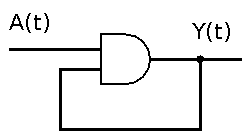

<!-- data-type="none" -->
| $A(t)$ | $Y(t)$ | $Y(t+\Delta t)$ | $Y(t+2\Delta t)$ | $Y(t+3\Delta t)$ |
| ------ | ------ | --------------- | ---------------- | ---------------- |
| 1      | 1      | 1               | 1                | 1                |
| 0      | 1      | 0               | 0                | 0                |
| 1      | 0      | 0               | 0                | 0                |
| 0      | 0      | 0               | 0                | 0                |

<!-- data-type="none" -->
| $A(t)$ | $Y(t+\Delta t)$ | $Y(t+2\Delta t)$ | $Y(t+3\Delta t)$ |
| ------ | --------------- | ---------------- | ---------------- |
| 1      | $Y(t)$          | $Y(t)$           | $Y(t)$           |
| 0      | 0               | 0                | 0                |

Bei $A = 1$ behält die Schaltung ihren Zustand bei, $A = 0$ „löscht“ ihn. Ist $Y$ aber einmal 0, kommt es nie wieder auf 1: Das rückgekoppelte UND kann nur löschen.

### Zweiter Ansatz

__Verwendung eines rückgekoppelten OR-Bausteins.__

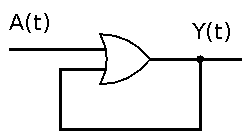

<!-- data-type="none" -->
| $A(t)$ | $Y(t)$ | $Y(t+\Delta t)$ | $Y(t+2\Delta t)$ | $Y(t+3\Delta t)$ |
| ------ | ------ | --------------- | ---------------- | ---------------- |
| 1      | 1      | 1               | 1                | 1                |
| 0      | 1      | 1               | 1                | 1                |
| 1      | 0      | 1               | 1                | 1                |
| 0      | 0      | 0               | 0                | 0                |

<!-- data-type="none" -->
| $A(t)$ | $Y(t+\Delta t)$ | $Y(t+2\Delta t)$ | $Y(t+3\Delta t)$ |
| ------ | --------------- | ---------------- | ---------------- |
| 1      | 1               | 1                | 1                |
| 0      | $Y(t)$          | $Y(t)$           | $Y(t)$           |

Das rückgekoppelte ODER ist das Gegenstück: Sobald $A$ einmal 1 war, bleibt $Y = 1$, egal was danach an $A$ anliegt. Es kann nur setzen. Probieren Sie es aus:

``` json @DigiSim.evalJson
{"router":"manhattan","devices":{"a":{"label":"A","type":"Button","propagation":0,"position":{"x":-85,"y":55}},"y":{"label":"Y","type":"Lamp","propagation":0,"position":{"x":275,"y":60}},"or":{"label":"or","type":"Or","propagation":0,"bits":1,"position":{"x":85,"y":70}}},"connectors":[{"from":{"id":"or","port":"out"},"to":{"id":"y","port":"in"}},{"from":{"id":"a","port":"out"},"to":{"id":"or","port":"in2"}},{"from":{"id":"or","port":"out"},"to":{"id":"or","port":"in1"},"vertices":[{"x":40,"y":50}]}],"subcircuits":{}}
```

**Was fehlt beiden Schaltungen noch zum brauchbaren Speicher?**

[( )] Ein zweiter Ausgang
[(X)] Ein Eingang, der den Wert in die jeweils andere Richtung ändert
[( )] Ein schnelleres Gatter
***************************************************************

Das UND kann nur löschen, das ODER nur setzen. Ein brauchbarer Speicher braucht beides: einen Eingang zum Setzen und einen zum Löschen. Der dritte Ansatz kombiniert deshalb ODER und UND.

***************************************************************

### Dritter Ansatz (SR-Latch)
__Gesteuerte Rückkopplung über OR-Baustein.__

Wir fügen eine weitere Eingangsgröße hinzu, die den Speicher auf Basis des rückgekoppelten ODER vervollständigt. Ein UND-Gatter in der Rückkopplungsschleife lässt die gespeicherte 1 nur durch, solange der Eingang `R` nicht selbst 1 ist. Liegt an `S` eine 1 an (bei $R = 0$), erscheint sie an $Y$ und bleibt gespeichert.

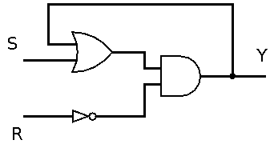

<!-- data-type="none" -->
| $R(t)$ | $S(t)$ | $Y(t)$ | $Y(t+2\Delta t)$ | Bedeutung      |
| ------ | ------ | ------ | ---------------- | -------------- |
| 0      | 0      | 0      | 0                | Speichern      |
| 0      | 0      | 1      | 1                | Speichern      |
| 0      | 1      | 0      | 1                | Setzen         |
| 0      | 1      | 1      | 1                | Setzen$^*$     |
| 1      | 0      | 0      | 0                | Rücksetzen$^*$ |
| 1      | 0      | 1      | 0                | Rücksetzen     |
| 1      | 1      | 0      | 0                | verboten$^*$   |
| 1      | 1      | 1      | 0                | verboten       |

Bei den mit * markierten Zeilen ist der Zielzustand von Setzen, Rücksetzen bzw. 0 schon erreicht, $Y$ ändert sich nicht. Gehen wir zum Beispiel von $Y = 0$ aus und legen $S = 1$ an, liefert die Schaltung nach $2\Delta t$ eine 1 (dritte Zeile). Bleibt $S = 1$, gilt danach die vierte Zeile.

Der Zeitversatz von $2\Delta t$ ergibt sich aus den zwei Gattern, die das Signal durchläuft. Im Schaubild oben stecken noch drei Gattertypen (OR, AND und NOT). Weiter unten bauen wir dieselbe Schaltung nur aus NOR- oder nur aus NAND-Gattern, dann kann man mit einer einheitlichen Laufzeit $\Delta t$ rechnen.

Liegen $S = R = 1$ an, setzt $R$ den Ausgang auf 0. Beim NOR-Latch weiter unten führen dann $Q$ und $\overline{Q}$ beide 0, der zweite Ausgang ist also nicht mehr das Komplement des ersten. Kritisch wird es, wenn beide Eingänge danach **gleichzeitig** auf 0 gehen: Dann hängt es von winzigen Laufzeitunterschieden ab, welcher Zustand übrig bleibt. In der Literatur heißt die Belegung deshalb „unbestimmt“ oder „verboten“.

``` json @DigiSim.evalJson
{"router":"manhattan","devices":{"s":{"label":"S","type":"Button","propagation":0,"position":{"x":0,"y":0}},"r":{"label":"R","type":"Button","propagation":0,"position":{"x":0,"y":55}},"y":{"label":"Y","type":"Lamp","propagation":0,"position":{"x":430,"y":25}},"or":{"label":"or","type":"Or","propagation":0,"bits":1,"position":{"x":135,"y":-45}},"and":{"label":"and","type":"And","propagation":0,"bits":1,"position":{"x":255,"y":-10}},"not":{"label":"not","type":"Not","propagation":0,"bits":1,"position":{"x":130,"y":50}}},"connectors":[{"from":{"id":"r","port":"out"},"to":{"id":"not","port":"in"}},{"from":{"id":"not","port":"out"},"to":{"id":"and","port":"in2"}},{"from":{"id":"s","port":"out"},"to":{"id":"or","port":"in2"}},{"from":{"id":"or","port":"out"},"to":{"id":"and","port":"in1"}},{"from":{"id":"and","port":"out"},"to":{"id":"or","port":"in1"},"vertices":[{"x":270,"y":-75}]},{"from":{"id":"and","port":"out"},"to":{"id":"y","port":"in"}}],"subcircuits":{}}
```

**$Y$ ist 0. Sie schalten $S$ ein und wieder aus. Welchen Wert hat $Y$ danach?**

[[1]]
***************************************************************

$S = 1$ setzt $Y$ auf 1. Nach dem Loslassen gilt $S = R = 0$, die Schaltung speichert: $Y$ bleibt 1. Genau das ist die Lampe mit Ein- und Aus-Taster aus dem Aufwärmen.

***************************************************************

Daraus folgt die Wertetabelle des SR-Latches. Anhand dieser Darstellung wird klar, dass die Eingangsgrößen $R$ und $S$ ihre Kürzel aus gutem Grund tragen: `Reset` und `Set`.

<!-- data-type="none" -->
| $R(t)$ | $S(t)$ | $Y'(t) = Y(t+2\Delta t)$ |
| ------ | ------ | ------------------------ |
| 0      | 0      | $Y(t)$                   |
| 0      | 1      | 1                        |
| 1      | 0      | 0                        |
| 1      | 1      | verboten                 |

Nun können wir mit dem Theorem von De Morgan einige Anpassungen vornehmen:

$$\begin{aligned} Y' &= (Y + S) \cdot \overline{R} \\
                     &= \overline{\overline{Y+S} + R}
\end{aligned}$$

Damit sind wir in der Lage, unseren bistabilen Speicher mit zwei Gattern gleichen Typs zu realisieren.

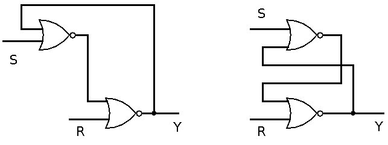

Das Latch lässt sich auch aus NAND-Gattern aufbauen. Beachten Sie dabei die Anpassung der Eingangsgrößen: Beim NAND-Latch sind die Eingänge low-aktiv, gesetzt wird mit $\overline{S} = 0$, gespeichert bei $\overline{S} = \overline{R} = 1$. In der Simulation stehen die Taster ~S und ~R (der Simulator schreibt ~ statt Querstrich, ~S steht für $\overline{S}$) anfangs auf 0, das ist die verbotene Belegung, und beide Lampen des NAND-Latches leuchten. Schalten Sie deshalb zuerst beide Taster ein.

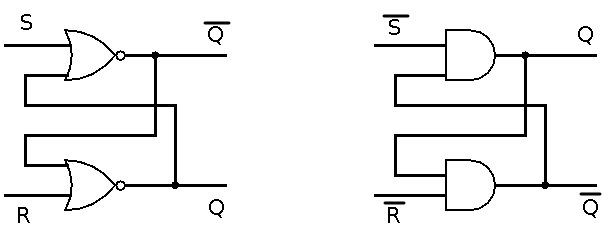

``` json @DigiSim.evalJson
{"router":"manhattan","devices":{"s":{"label":"S","type":"Button","propagation":0,"position":{"x":0,"y":0}},"r":{"label":"R","type":"Button","propagation":0,"position":{"x":0,"y":95}},"nots":{"label":"~S","type":"Button","propagation":0,"position":{"x":0,"y":180}},"notr":{"label":"~R","type":"Button","propagation":0,"position":{"x":0,"y":285}},"q1":{"label":"Q","type":"Lamp","propagation":0,"position":{"x":365,"y":85}},"notq1":{"label":"~Q","type":"Lamp","propagation":0,"position":{"x":370,"y":10}},"q2":{"label":"Q","type":"Lamp","propagation":0,"position":{"x":370,"y":205}},"notq2":{"label":"~Q","type":"Lamp","propagation":0,"position":{"x":365,"y":295}},"nor1":{"label":"nor","type":"Nor","propagation":0,"bits":1,"position":{"x":180,"y":80}},"nor2":{"label":"nor","type":"Nor","propagation":0,"bits":1,"position":{"x":175,"y":5}},"nand1":{"label":"nand","type":"Nand","propagation":0,"bits":1,"position":{"x":185,"y":185}},"nand2":{"label":"nand","type":"Nand","propagation":0,"bits":1,"position":{"x":185,"y":270}}},"connectors":[{"from":{"id":"s","port":"out"},"to":{"id":"nor2","port":"in1"}},{"from":{"id":"r","port":"out"},"to":{"id":"nor1","port":"in2"}},{"from":{"id":"nor2","port":"out"},"to":{"id":"notq1","port":"in"}},{"from":{"id":"nor1","port":"out"},"to":{"id":"q1","port":"in"}},{"from":{"id":"nor2","port":"out"},"to":{"id":"nor1","port":"in1"},"vertices":[{"x":255,"y":75}]},{"from":{"id":"nor1","port":"out"},"to":{"id":"nor2","port":"in2"},"vertices":[{"x":260,"y":55}]},{"from":{"id":"nots","port":"out"},"to":{"id":"nand1","port":"in1"}},{"from":{"id":"notr","port":"out"},"to":{"id":"nand2","port":"in2"}},{"from":{"id":"nand1","port":"out"},"to":{"id":"nand2","port":"in1"},"vertices":[{"x":265,"y":245}]},{"from":{"id":"nand2","port":"out"},"to":{"id":"nand1","port":"in2"},"vertices":[{"x":265,"y":260}]},{"from":{"id":"nand1","port":"out"},"to":{"id":"q2","port":"in"}},{"from":{"id":"nand2","port":"out"},"to":{"id":"notq2","port":"in"}}],"subcircuits":{}}
```

**Am NOR-Latch liegen $S = R = 1$ an. Was zeigen die beiden Lampen $Q$ und $\overline{Q}$?**

[(X)] Beide 0
[( )] Beide 1
[( )] $Q = 1$, $\overline{Q} = 0$
[( )] $Q = 0$, $\overline{Q} = 1$
***************************************************************

Ein NOR-Gatter liefert 0, sobald einer seiner Eingänge 1 ist. Beide NOR-Gatter haben einen Eingang auf 1, also sind beide Ausgänge 0. Probieren Sie es im Simulator aus und lassen Sie danach $S$ und $R$ nacheinander los: Der zuletzt losgelassene Eingang gewinnt.

***************************************************************

Das SR-Latch hat ein eigenes Symbol. Ab hier heißt der Ausgang $Q$ statt $Y$, der zweite Ausgang $\overline{Q}$. Für den Folgezustand schreiben wir wie in den folgenden Vorlesungen $Q(t+1)$, für den aktuellen Zustand $Q(t)$ oder kurz $Q$. Beim Latch ist $Q(t+1)$ der Zustand, der sich nach Ablauf der Gatterlaufzeiten einstellt, beim Flip-Flop der Zustand nach der nächsten wirksamen Taktflanke.

<!-- style="width: 15%; max-width: 500px" -->

> **Latch oder Flip-Flop?** In dieser Vorlesung heißt ein Speicherelement **Latch**, wenn es seine Eingänge übernimmt, solange ein Steuereingang aktiv ist (zustandsgesteuert). **Flip-Flop** heißt es, wenn es nur im Moment einer Taktflanke übernimmt (flankengesteuert). Viele Bücher nennen beides Flip-Flop, zum Beispiel „SR-Flip-Flop“ für das SR-Latch.

### D-Latch

Das D-Latch nutzt aus, dass bei den beiden aktiven Eingangskombinationen eines SR-Latches (01 und 10) $R$ das Komplement von $S$ ist. Es hat nur einen Dateneingang $D$ und erzeugt daraus $S = D$ und $R = \overline{D}$. Ein zweiter Eingang $E$ (Enable) legt fest, wann $D$ übernommen wird.

<table>
<tr>
<td>
SR-Latch

<!-- data-type="none" -->
| $R(t)$ | $S(t)$ | $Q(t+1)$ |
| ------ | ------ | -------- |
| 0      | 0      | $Q$      |
| 0      | 1      | 1        |
| 1      | 0      | 0        |
| 1      | 1      | verboten |
</td>
<td>
D-Latch

<!-- data-type="none" -->
| $E(t)$ | $D(t)$ | $Q(t+1)$ |
| ------ | ------ | -------- |
| 0      | 0      | $Q$      |
| 0      | 1      | $Q$      |
| 1      | 0      | 0        |
| 1      | 1      | 1        |
</td>
</tr>
</table>

Die Eingangs-NAND-Stufe wandelt die beiden D-Eingangszustände (0 und 1) durch Invertieren des Dateneingangssignals in diese beiden Eingangskombinationen für das nachfolgende SR-Latch um. Bei $E = 0$ liefern beide Eingangs-NAND eine 1, das NAND-Latch dahinter speichert.

<table>
<tr>
<td>
D-Latch auf der Basis eines NOR-Latches

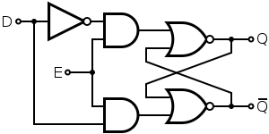<!-- style="max-width: 300px" -->
</td>
<td>
D-Latch auf der Basis eines NAND-Latches

<!-- style="max-width: 300px" -->
</td>
</tr>
</table>


``` json @DigiSim.evalJson
{"router":"manhattan","devices":{"d":{"label":"D","type":"Button","propagation":0,"position":{"x":-110,"y":110}},"e":{"label":"E","type":"Button","propagation":0,"position":{"x":-110,"y":210}},"q":{"label":"Q","type":"Lamp","propagation":0,"position":{"x":395,"y":130}},"notq":{"label":"~Q","type":"Lamp","propagation":0,"position":{"x":395,"y":230}},"nand1":{"label":"nand","type":"Nand","propagation":0,"bits":1,"position":{"x":235,"y":225}},"nand2":{"label":"nand","type":"Nand","propagation":0,"bits":1,"position":{"x":230,"y":125}},"nand3":{"label":"nand","type":"Nand","propagation":0,"bits":1,"position":{"x":55,"y":120}},"nand4":{"label":"nand","type":"Nand","propagation":0,"bits":1,"position":{"x":85,"y":215}}},"connectors":[{"from":{"id":"nand2","port":"out"},"to":{"id":"nand1","port":"in1"}},{"from":{"id":"nand1","port":"out"},"to":{"id":"nand2","port":"in2"}},{"from":{"id":"nand1","port":"out"},"to":{"id":"notq","port":"in"}},{"from":{"id":"nand2","port":"out"},"to":{"id":"q","port":"in"}},{"from":{"id":"e","port":"out"},"to":{"id":"nand4","port":"in2"}},{"from":{"id":"e","port":"out"},"to":{"id":"nand3","port":"in2"}},{"from":{"id":"d","port":"out"},"to":{"id":"nand3","port":"in1"}},{"from":{"id":"nand3","port":"out"},"to":{"id":"nand4","port":"in1"}},{"from":{"id":"nand3","port":"out"},"to":{"id":"nand2","port":"in1"}},{"from":{"id":"nand4","port":"out"},"to":{"id":"nand1","port":"in2"}}],"subcircuits":{}}
```

<!-- style="width: 15%; max-width: 500px" -->

**Im D-Latch ist $E = 0$ und $Q = 0$. $D$ wechselt von 0 auf 1. Was geschieht?**

[(X)] $Q$ bleibt 0
[( )] $Q$ wird 1
[( )] $Q$ und $\overline{Q}$ werden beide 1
***************************************************************

Bei $E = 0$ liefern beide Eingangs-NAND eine 1, das Latch dahinter speichert. $D$ wird erst übernommen, wenn $E = 1$ wird. Solange $E = 1$ ist, folgt $Q$ dagegen jeder Änderung von $D$: Das Latch ist „transparent“.

***************************************************************

> Legt man an $E$ einen Takt, übernimmt das D-Latch während der ganzen Phase $E = 1$ jede Änderung von $D$. Es ist also zustandsgesteuert und noch kein Flip-Flop. Wie man daraus ein flankengesteuertes Flip-Flop macht, zeigt der Abschnitt „Taktung von Schaltwerken“.

## Anwendungsbeispiele

__Anwendungsbeispiel 1: Übertemperatur festhalten__

<!--
style="width: 60%;"
-->
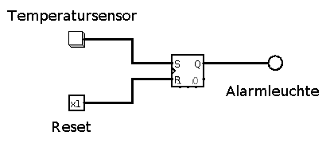

Der Temperatursensor hat einen digitalen Ausgang, der beim Überschreiten einer Grenztemperatur High-Pegel annimmt. Das SR-Latch hält dieses Ereignis in `Q` fest, auch wenn die Temperatur wieder sinkt, bis jemand den Alarm mit `R` quittiert.

<!--
style="width: 80%; min-width: 420px; max-width: 720px;"
-->
```ascii
           ^
Temperatur |       +------+      +--+           +------+
S          |       |      |      |  |           |      |
           | ------+      +------+  +-----------+      +-----------------
           |                                               +------+
R          |                                               |      |
           | ----------------------------------------------+      +------
           |         +---------------------------------------+
Q          |         |                                       |
           | --------+                                       +-----------
           +-----------------------------------------------------------------> .
                                                                        Zeit
```

__Anwendungsbeispiel 2: Taster entprellen__

    --{{0}}--
Ein mechanischer Kontakt prellt. Beim Schließen federt er einige Millisekunden lang zurück, und der Pegel springt mehrmals zwischen 0 und 1. Ein Zähler oder ein Mikrocontroller würde mehrere Tastendrücke sehen.

Ein Taster schaltet bei der Betätigung nicht zu einem definierten Zeitpunkt. Der Kontakt federt einige Millisekunden lang zurück („prellt“), und der Pegel springt mehrmals zwischen 0 und 1.

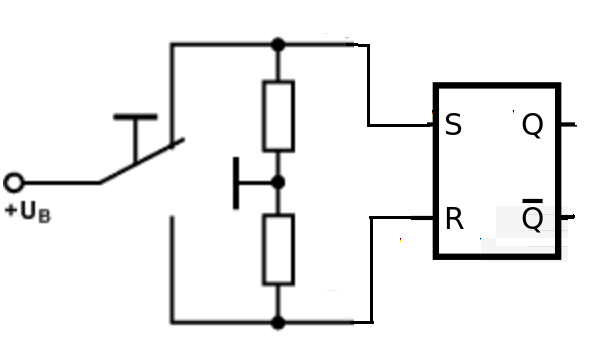<!-- style="width: 35%; max-width: 500px" -->

Die Schaltung nutzt einen **Umschalter** (Wechsler) und ein SR-Latch. Der Umschalter legt die Betriebsspannung $+U_B$ (zum Beispiel 5 V, also 1) entweder an $S$ oder an $R$. Die beiden Widerstände verbinden die Eingänge mit Masse und ziehen den jeweils offenen Eingang auf 0 („Pull-down“).

1. Der Kontakt verlässt $R$: Beide Eingänge sind 0, das Latch speichert den alten Wert.
2. Er berührt zum ersten Mal $S$: $Q$ wird 1.
3. Er prellt: $S$ wechselt zwischen 1 und 0, $R$ bleibt 0. Das Latch setzt oder speichert, $Q$ bleibt 1.

Der Kontakt springt nie bis zum anderen Anschluss zurück. Deshalb schaltet $Q$ genau einmal.

**Der Kontakt prellt beim Umschalten auf $S$ dreimal. Wie oft ändert sich $Q$?**

[[1]]
***************************************************************

Nur die erste Berührung von $S$ ändert $Q$. Bei jedem weiteren Prellen liegt entweder $S = 1$, $R = 0$ an (setzen, $Q$ ist schon 1) oder $S = R = 0$ (speichern).

***************************************************************

Am Mikrocontroller hängt meist ein einfacher Taster gegen Masse am Pin, mit dem internen Pull-up (`INPUT_PULLUP`), also low-aktiv. Entprellt wird dann in Software: Man wartet nach dem ersten Pegelwechsel einige Millisekunden, bevor man den Taster erneut abfragt. Das kommt mit den Interrupts in Vorlesung 14. In Hardware geht es auch mit einem RC-Glied, das die Sprünge glättet, und einem Schmitt-Trigger dahinter.

## Taktung von Schaltwerken

    --{{0}}--
Aus Vorlesung 04 kennen Sie die Glitches: Ein Schaltnetz liefert nach einem Eingangswechsel kurz falsche Werte, bis alle Signale durch die Gatter gelaufen sind. Am Ausgang eines Schaltnetzes stört das wenig. Hängt dahinter ein Latch, wird aus dem kurzen Fehler ein gespeicherter Fehler.

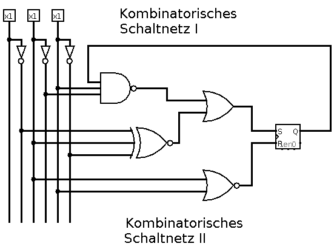

Zwei Schaltnetze berechnen $S$ und $R$ eines SR-Latches. Ihre Laufzeiten sind verschieden, und jedes kann kurz einen Glitch liefern (Vorlesung 04). Wann sind die Werte am Ausgang $Q$ gültig? Das Latch übernimmt jeden kurzen Fehler und hält ihn fest. Die Laufzeit der Schaltnetze bestimmt also das Verhalten des Speicherelements.

> Zielstellung: Eingangswerte nur zu festgelegten Zeiten übernehmen, wenn alle Schaltnetze davor eingeschwungen sind.

> **Takt:** ein periodisches Rechtecksignal `Clk` mit der Periodendauer $T$ und der Frequenz $f = 1/T$, beim ATmega328P auf dem Arduino Uno 16 MHz, also $T = 62{,}5\,\text{ns}$. Der Wechsel von 0 nach 1 heißt **steigende Flanke**, der von 1 nach 0 **fallende Flanke**.

__asynchrone Schaltwerke__

+ gesteuert durch Veränderung der Eingangssignale
+ Zeitpunkt, an dem wieder stabile Ausgangssignale vorliegen, ist nur durch Gatterlaufzeit festgelegt
+ aufwendiger Entwurf (Zeit ist „Echtzeit“)
+ sehr schnelle Schaltwerke möglich

__synchrone Schaltwerke__

+ gesteuert durch zentralen Takt
+ Übernahme der Änderung eines Eingangssignals erfolgt nur zu festen Zeiten (Zeiträumen oder Zeitpunkten)
+ einfacher, systematischer Entwurf (Zeit ist „Taktzeit“)
+ langsamste Komponente bestimmt maximale Taktfrequenz

### Synchrones SR-Latch

Für einen synchronisierten Zustandswechsel bekommt das Latch einen Takteingang `Clk`. Die Signale an $R$ und $S$ werden nur übernommen, wenn das Taktsignal aktiv ist:

+ bei Clk = 0 sind $R$ und $S$ irrelevant (d = „don't care“),
+ bei Clk = 1 stellt sich der neue Folgezustand $Q(t+1)$ ein.

<!-- data-type="none" -->
| $R(t)$                                | $S(t)$                                | Clk      | $Q(t+1)$      |
| ------------------------------------- | ------------------------------------- | -------- | ------------- |
| <span style="color: #ff0000">d</span> | <span style="color: #ff0000">d</span> | 0        | $Q$           |
| 0                                     | 0                                     | 1        | $Q$           |
| 0                                     | 1                                     | 1        | 1             |
| 1                                     | 0                                     | 1        | 0             |
| 1                                     | 1                                     | 1        | verboten      |

Beachten Sie, dass sich mit dem <span style="color: #ff0000">d</span>-Zustand die Wertetabelle deutlich verkürzt. In den Zeitdiagrammen steht „2t“ vereinfacht für eine Verzögerung von etwa zwei Gatterlaufzeiten $2\Delta t$. Genau genommen hängt sie vom Signalweg ab: Beim Setzen durchläuft das Signal hier drei Gatter (UND und beide NOR), beim Rücksetzen zwei.

<!--
style="width: 80%; min-width: 420px; max-width: 720px;"
-->
```ascii

    |       +------+      +------+      +------+      +------+
Clk |       |      |      |      |      |      |      |      |
    | ------+      +------+      +------+      +------+      +------
    |     +------+                        +--+    +--+
S   |     | :    |                        |  |    |  |
    | ----+ :    +------------------------+  +----+  +--------------
    |       :        +--+   +---+         :   +----+
R   |       :        |  |   |   |         :   |    |
    | ------:--------+  +---+   +---------:---+    +----------------
    |       :  +---------------+          :  +---+                    1
Q   |       :  |            :  |          :  |:  |
    |-------:--+            :  +----------:--+:  +------------------- 0
    +-------:--:------------:--:----------:--::--:-------------------->        .
             2t              2t            2t  2t
```

<table>
<tr>
<td>

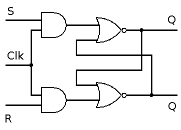
</td>
<td>

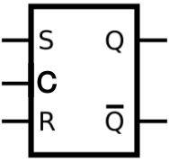<!-- style="width: 45%; max-width: 800px;" -->

</td>
</tr>
</table>


> Merke: Weil sich das getaktete SR-Latch in einer Taktphase mehrmals ändern kann, ist es für viele Anwendungen ungeeignet. Welche Idee hat die nachfolgende Schaltung, und warum wird sie nicht funktionieren?

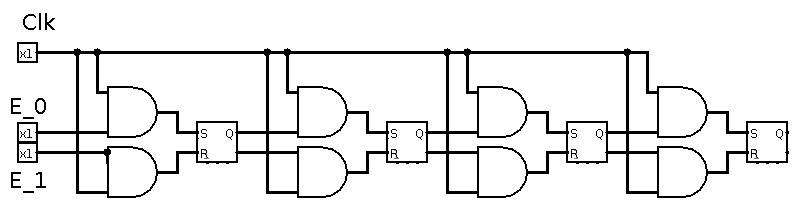<!-- style="width: 95%; max-width: 800px" -->

**Was geschieht, solange Clk = 1 ist, mit dem Wert am Eingang $E_0$/$E_1$?**

[( )] Er wird in das erste Latch übernommen und bleibt dort bis zum nächsten Takt
[(X)] Er läuft in derselben Taktphase durch alle vier Latches
[( )] Er wird nicht übernommen, weil die Latches erst bei Clk = 0 schalten
***************************************************************

Die Idee ist ein **Schieberegister**: Mit jedem Takt soll der Wert ein Latch weiterrücken. Solange Clk = 1 ist, sind aber alle Latches gleichzeitig transparent. Der Wert läuft in einer einzigen Taktphase durch die ganze Kette, nur gebremst durch die Gatterlaufzeit. Schieberegister bauen wir in Vorlesung 08, dann mit flankengesteuerten Flip-Flops.

***************************************************************

Gewünscht: Flip-Flop-Variante, die Änderungen nur zu einem definierten Zeitpunkt zulässt

### Main-Subsidiary-Flip-Flops

Ein Main-Subsidiary-SR-Flip-Flop besteht aus zwei hintereinandergeschalteten getakteten SR-Latches, „Main“ und „Subsidiary“ genannt. Ein zusätzlicher Inverter negiert das Taktsignal für „Subsidiary“. Früher hießen diese Flip-Flops Master-Slave-Flip-Flops.

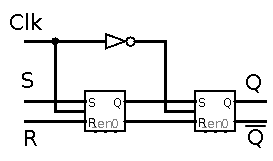

Ablauf einer Periode:

1. „Main“ übernimmt Eingangswerte bei Clk = 1 („Subsidiary“ ändert sich nicht)
2. „Subsidiary“ übernimmt Werte vom „Main“ bei Clk = 0 („Main“ ändert sich nicht)

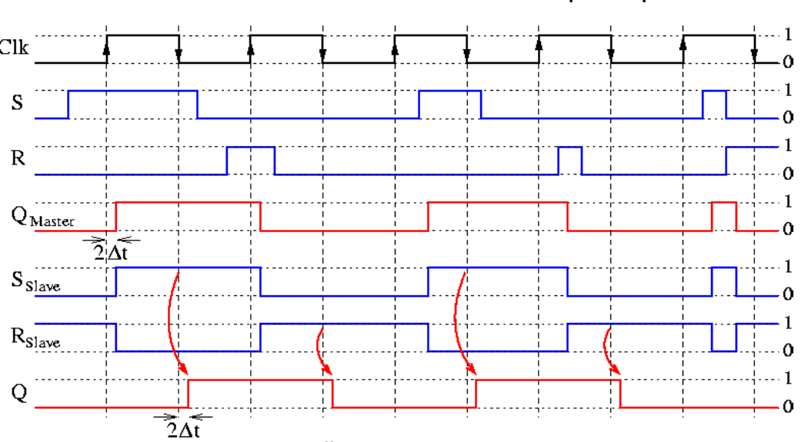<!-- style="width: 75%; max-width: 800px;" -->

**Welche maximale Verzögerung ergibt sich für ein eingehendes Signal?**

[( )] eine halbe Taktperiode
[(X)] etwa eine Taktperiode
[( )] zwei Taktperioden
***************************************************************

Ändert sich der Eingang kurz nachdem Clk auf 0 gegangen ist, wartet er eine halbe Periode, bis „Main“ bei Clk = 1 übernimmt. Am Ausgang erscheint er erst, wenn Clk wieder auf 0 geht und „Subsidiary“ übernimmt. Zusammen ist das fast eine ganze Taktperiode. Dafür ändert sich der Ausgang nur einmal pro Takt, an der fallenden Flanke.

***************************************************************

### Flankengesteuerte Flip-Flops

Durch eine spezielle Schaltungstechnik kann erreicht werden, dass auch die Eingangsleitungen nur

+ bei steigender Flanke (positive Flanke),
<!-- style="width: 10%; max-width: 300px;" -->

+ bei fallender Flanke (negative Flanke),
<!-- style="width: 10%; max-width: 300px;" -->

+ in beiden Fällen berücksichtigt werden!


Wie lässt sich ein Flankendetektor umsetzen? Wir machen uns das Laufzeitverhalten unserer Bauteile zu Nutze.

<table>
<tr>
<td>

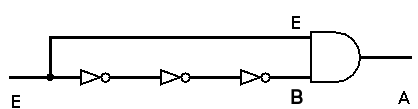<!-- style="width: 95%; max-width: 800px;" -->
</td>

<td>

<!--
style="width: 95%; max-width: 1000px;"
-->
```ascii
    ^
    |     +-------------- 1
E   |     |
    | ----+               0
    | -----+
I1  |      |
    |      +-------------
    |       +------------
I2  |       |
    | ------+
    |   -----+
B   |        |
    |        +-----------
    |
    |     +--+
A   |     |  |
    | ----+  +-------------
    +----------------------->    Zeit

```

</td>
</tr>
</table>

Das UND-Gatter bekommt $E$ direkt und über drei Inverter, also invertiert und verzögert als $B$. Im Zeitdiagramm sind $I_1$ und $I_2$ die Ausgänge des ersten und zweiten Inverters; jeder Inverter dreht den Pegel um und verzögert ihn um eine Gatterlaufzeit. Vor der Flanke ist $E = 0$ und $B = 1$. Springt $E$ auf 1, bleibt $B$ noch für drei Gatterlaufzeiten 1, und für diese kurze Zeit ist $A = E \cdot B = 1$. Danach ist $B = 0$ und $A = 0$. Aus jeder steigenden Flanke wird so ein kurzer Puls, der das Latch dahinter nur für einen Moment öffnet.

Die Signallaufzeiten sind für die ansteigende und fallende Signalflanke unterschiedlich und hängen von der Schaltkreisfamilie und der Versorgungsspannung ab: typisch 3–30 ns bei 5 V, beim 74HC00 etwa 7 ns.

Welches Verhalten ergibt sich für ein (positiv) flankengetriggertes SR-Flip-Flop daraus?

<table>
<tr>
<td>
Zustandsgesteuert

<!--
style="width: 80%; min-width: 420px; max-width: 720px;"
-->
```ascii

    |       +------+      +------+      +------+      +-----
Clk |       |      |      |      |      |      |      |
    | ------+      +------+      +------+      +------+
    |     +------+                           +--+
S   |     | :    |                           |  |
    | ----+ :    +---------------------------+  +------------
    |       :        +--+   +---+      +----+
R   |       :        |  |   |   |      |    |
    | ------:--------+  +---+   +------+    +----------------
    |       :  +---------------+             :  +-------------    1
Q   |       :  |            :  |             :  |
    |-------:--+            :  +-------------:--+                  0
    +-------:--:------------:--:-------------:--:--------------->          .
             2t              2t               2t
```
</td>
<td>
Positiv flankengesteuert

<!--
style="width: 80%; min-width: 420px; max-width: 720px;"
-->
```ascii

    |       +------+      +------+      +------+      +-----
Clk |       |      |      |      |      |      |      |
    | ------+      +------+      +------+      +------+
    |     +------+                      :    +--+
S   |     | :    |                      :    |  |
    | ----+ :    +----------------------:----+  +------------
    |       :        +--+   +---+      +----+
R   |       :        |  |   |   |      |:   |
    | ------:--------+  +---+   +------+:   +----------------
    |       :  +---------------------------+                    1
Q   |       :  |                        :  |
    |-------:--+                        :  +------------------- 0
    +-------:--:------------------------:--:-------------------->          .
             2t                          2t
```
</td>
</tr>
</table>

Links folgt $Q$ den Eingängen, solange Clk = 1 ist; am Ende der dritten Taktphase setzt $S$ den Ausgang noch einmal. Rechts zählen nur die Werte im Moment der steigenden Flanke: Bei der dritten Flanke ist $R = 1$, danach bleibt $Q = 0$. Dieselben Eingänge führen zu verschiedenen Endzuständen.

**Setup- und Haltezeit**

Auch ein flankengesteuertes Flip-Flop braucht den Eingang nicht nur genau im Moment der Flanke. Er muss eine kurze **Setup-Zeit** vor der Flanke und eine kurze **Haltezeit** danach stabil sein. Ändert er sich in diesem Fenster, kann das Flip-Flop **metastabil** werden: Sein Ausgang bleibt eine Weile zwischen 0 und 1 hängen, meist nur Nanosekunden, im ungünstigen Fall länger, bevor er zufällig in einen der beiden Zustände kippt. Bei einem synchronen Entwurf sorgt der Takt dafür, dass sich die Eingänge nur außerhalb dieses Fensters ändern. Signale von außen, etwa ein Taster, kennen den Takt aber nicht. Wie der ATmega328P damit umgeht, sehen wir am Ende der Vorlesung.

**Latch und Flip-Flop im Vergleich**

    --{{0}}--
In DigiSim gibt es das flankengesteuerte D-Flip-Flop als fertigen Baustein. Wir setzen es neben das D-Latch aus vier NAND-Gattern. Beide bekommen dieselben Signale D und C.

Oben das D-Latch aus vier NAND-Gattern, unten das flankengesteuerte D-Flip-Flop als fertiger Baustein. Beide hängen an denselben Eingängen $D$ und $C$ (Enable bzw. Takt). Setzen Sie $C = 1$ und schalten Sie dann $D$ um. Danach schalten Sie $C$ aus und wieder ein. Zu Beginn ist „Q Latch“ grau: Nach dem Einschalten ist der Wert der Rückkopplung unbestimmt, erst $C = 1$ legt ihn fest.

```json @DigiSim.evalJson
{"router":"manhattan","devices":{"d":{"type":"Button","label":"D","propagation":0,"position":{"x":0,"y":40}},"c":{"type":"Button","label":"C","propagation":0,"position":{"x":0,"y":230}},"n3":{"type":"Nand","propagation":1,"position":{"x":150,"y":50}},"n4":{"type":"Nand","propagation":1,"position":{"x":170,"y":140}},"n2":{"type":"Nand","propagation":1,"position":{"x":330,"y":55}},"n1":{"type":"Nand","propagation":1,"position":{"x":330,"y":145}},"ql":{"type":"Lamp","label":"Q Latch","propagation":0,"position":{"x":500,"y":60}},"ff":{"type":"Dff","bits":1,"initial":"0","propagation":1,"polarity":{"clock":true},"position":{"x":300,"y":250}},"qf":{"type":"Lamp","label":"Q Flip-Flop","propagation":0,"position":{"x":500,"y":255}}},"connectors":[{"from":{"id":"d","port":"out"},"to":{"id":"n3","port":"in1"}},{"from":{"id":"c","port":"out"},"to":{"id":"n3","port":"in2"}},{"from":{"id":"n3","port":"out"},"to":{"id":"n4","port":"in1"}},{"from":{"id":"c","port":"out"},"to":{"id":"n4","port":"in2"}},{"from":{"id":"n3","port":"out"},"to":{"id":"n2","port":"in1"}},{"from":{"id":"n1","port":"out"},"to":{"id":"n2","port":"in2"}},{"from":{"id":"n2","port":"out"},"to":{"id":"n1","port":"in1"}},{"from":{"id":"n4","port":"out"},"to":{"id":"n1","port":"in2"}},{"from":{"id":"n2","port":"out"},"to":{"id":"ql","port":"in"}},{"from":{"id":"d","port":"out"},"to":{"id":"ff","port":"in"}},{"from":{"id":"c","port":"out"},"to":{"id":"ff","port":"clk"}},{"from":{"id":"ff","port":"out"},"to":{"id":"qf","port":"in"}}],"subcircuits":{}}
```

**$C$ ist 1, $D$ ist 0, beide Lampen sind aus. Sie schalten $D$ auf 1. Welche Lampe leuchtet?**

[(X)] nur „Q Latch“
[( )] nur „Q Flip-Flop“
[( )] beide
***************************************************************

Das Latch ist bei $C = 1$ transparent und folgt $D$ sofort. Das Flip-Flop hat $D$ nur im Moment der steigenden Flanke von $C$ gelesen, da war $D$ noch 0. Es übernimmt die 1 erst bei der nächsten steigenden Flanke.

***************************************************************

### Weitere Flip-Flop-Konfigurationen

**JK-Flip-Flop**

Der Name hat vermutlich keine tiefere Bedeutung. Nach einem Bericht von 1968 hat Eldred Nelson bei Hughes Aircraft die Eingänge seiner Flip-Flops paarweise durchbuchstabiert, A/B, C/D, E/F, G/H, und J/K war das fünfte Paar. In einer Patentanmeldung von 1953 spricht er bereits von „j-input“ und „k-input“. Die oft genannte Ableitung von Jack Kilby, dem Erfinder der integrierten Schaltung (1958), ist nicht belegt.

JK-Flip-Flops basieren auf dem SR-Latch, sind aber flankengesteuert oder als Main-Subsidiary-Flip-Flop ausgeführt. Mit dem Taktsignal und der Eingangsbelegung $J = 1$, $K = 0$ wird am Ausgang eine 1 erzeugt und gespeichert, bei $K = 1$, $J = 0$ eine 0. Anders als beim SR-Latch ist $J = K = 1$ erlaubt: Dann wechselt der Ausgang mit jeder wirksamen Taktflanke („Toggle“).

<!-- data-type="none" -->
| $J(t)$                                | $K(t)$                                | $Q(t+1)$                         |
| ------------------------------------- | ------------------------------------- | ------------- |
| 0                                     | 0                                     | $Q$           |
| 0                                     | 1                                     | 0             |
| 1                                     | 0                                     | 1             |
| 1                                     | 1                                     | <span style="color: #ff0000">$\overline{Q}$</span>  |

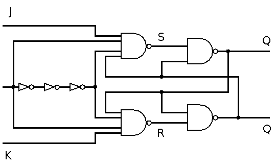<!-- style="width: 55%; max-width: 800px;" -->

<!--
style="width: 100%; min-width: 420px; max-width: 720px;"
-->
```ascii

    |       +------+      +------+      +------+      +-----
Clk |       |      |      |      |      |      |      |
    | ------+      +------+      +------+      +------+
    |     +------+        :            +----------------+
J   |     | :    |        :            |:             : |
    | ----+ :    +---------------------+:             : +---
    |       :        +------+   +---------+         +-----+
K   |       :        |    : |   |       : |         | :   |
    | ------:--------+    : +---+       : +---------+ :   +--
    |       :  +-------------+          :  +-------------+     1
Q   |       :  |          :  |          :  |          :  |
    |-------:--+          :  +-------------+          :  +---- 0
    +-------:--:------------------------:--:----------:--:------>          .
             2t                          2t
```

**Bei der dritten und vierten Flanke im Zeitdiagramm sind $J$ und $K$ beide 1. Was macht $Q$?**

[( )] $Q$ bleibt, wie es ist
[( )] $Q$ wird jeweils 0
[(X)] $Q$ wechselt jeweils
***************************************************************

Bei $J = K = 1$ kippt der Ausgang: an der dritten Flanke von 0 auf 1, an der vierten von 1 auf 0.

***************************************************************

**T-Flip-Flop**

Das T-Flip-Flop hat neben dem Takteingang Clk nur einen Eingang $T$ (toggle, hin- und herschalten). Ist $T = 1$, wechselt der Ausgang mit jeder aktiven Flanke, bei $T = 0$ bleibt er. Aus einem flankengesteuerten JK-Flip-Flop entsteht es, indem man $J$ und $K$ verbindet.

<!-- style="width: 10%; max-width: 800px;" -->

<!-- data-type="none" -->
| $T(t)$ | $Q(t+1)$                   |
| ------ | -------------------------- |
| 0      | $Q$                        |
| 1      | $\overline{Q}$             |

Die Tabelle ist genau die XOR-Verknüpfung: $Q(t+1) = T \oplus Q$. Ein T-Flip-Flop lässt sich deshalb auch aus einem D-Flip-Flop bauen, dessen Eingang $D = T \oplus Q$ bekommt:

```json @DigiSim.evalJson
{"router":"manhattan","devices":{"t":{"type":"Button","label":"T","propagation":0,"position":{"x":0,"y":20}},"c":{"type":"Button","label":"C","propagation":0,"position":{"x":0,"y":140}},"x":{"type":"Xor","propagation":0,"position":{"x":140,"y":30}},"ff":{"type":"Dff","bits":1,"initial":"0","propagation":1,"polarity":{"clock":true},"position":{"x":280,"y":40}},"q":{"type":"Lamp","label":"Q","propagation":0,"position":{"x":450,"y":45}}},"connectors":[{"from":{"id":"t","port":"out"},"to":{"id":"x","port":"in1"}},{"from":{"id":"ff","port":"out"},"to":{"id":"x","port":"in2"}},{"from":{"id":"x","port":"out"},"to":{"id":"ff","port":"in"}},{"from":{"id":"c","port":"out"},"to":{"id":"ff","port":"clk"}},{"from":{"id":"ff","port":"out"},"to":{"id":"q","port":"in"}}],"subcircuits":{}}
```

**$T = 1$, $Q = 0$. Sie erzeugen an $C$ drei steigende Flanken, schalten $C$ also dreimal ein und wieder aus. Welchen Wert hat $Q$?**

[[1]]
***************************************************************

Jede steigende Flanke kippt $Q$: 0 → 1 → 0 → 1. Mit $T = 0$ dagegen bleibt $Q$ bei jedem Takt erhalten, denn dann ist $D = 0 \oplus Q = Q$. Dieses Signal „kippt beim nächsten Takt“ brauchen wir in Vorlesung 08 für den synchronen Zähler.

***************************************************************

### Anwendungen

**Asynchroner 3-Bit-Zähler / Frequenzteiler**

Drei JK-Flip-Flops mit $J = K = 1$ arbeiten als T-Flip-Flops. Sie reagieren auf die fallende Flanke, und jedes bekommt als Takt den Ausgang des vorherigen. $Q_0$ kippt bei jeder fallenden Flanke von Clk, hat also die halbe Frequenz. $Q_1$ kippt bei jeder fallenden Flanke von $Q_0$ und hat ein Viertel der Frequenz, $Q_2$ ein Achtel.

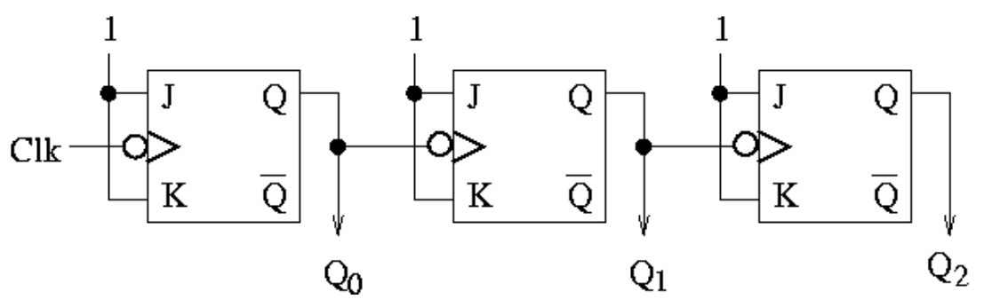<!-- style="width: 80%; max-width: 800px;" -->

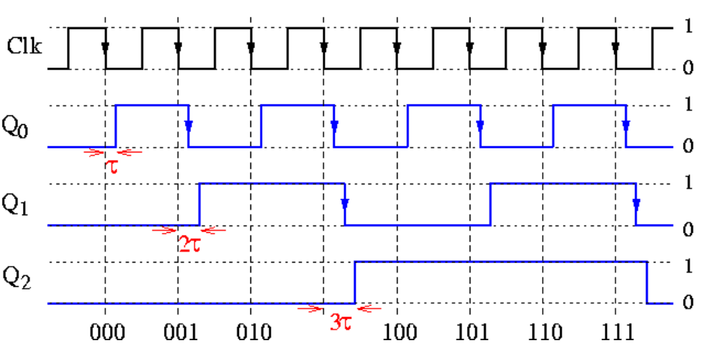<!-- style="width: 80%; max-width: 1200px;" -->

Liest man $Q_2 Q_1 Q_0$ als Binärzahl, zählt die Schaltung 0, 1, 2, … 7, 0. Weil jedes Flip-Flop erst schaltet, wenn das vorherige umgeschaltet hat, addieren sich die Verzögerungen.

> Beachten Sie die Verzögerung der flankengetriggerten JK-Flip-Flops: Sie bestimmt die maximale Taktfrequenz. Wie sich das auf die Zählerstände auswirkt und wie ein synchroner Zähler das Problem löst, sehen wir in Vorlesung 08.

### Zusammenfassung

<!-- data-type="none" -->
| Merkmal                      | Latch (zustandsgesteuert)                 | Flip-Flop (flankengesteuert)                        |
| ---------------------------- | ----------------------------------------- | --------------------------------------------------- |
| Steuereingang                | Enable $E$                                | Takt Clk                                            |
| übernimmt den Eingang        | solange $E$ aktiv ist (transparent)       | nur im Moment der Flanke                            |
| Änderungen pro Takt          | mehrere möglich                           | höchstens eine                                      |
| Aufwand                      | gering (D-Latch: 4 NAND)                  | höher (zwei Latches oder Flankenerkennung)          |
| Störungen am Eingang         | wirken, solange $E$ aktiv ist             | wirken nur im Fenster aus Setup- und Haltezeit      |
| Anwendungen                  | Zwischenspeicher, Stufe im Synchronizer   | Register, Zähler, Schieberegister, Frequenzteiler  |

## Aufbau mit dem 74HC00

Ein D-Latch braucht genau vier NAND-Gatter, so viele, wie im Baustein 74HC00 stecken. Der Baustein wird an Pin 14 mit der Versorgungsspannung (2–6 V, meist 5 V) und an Pin 7 mit Masse verbunden. Die LEDs an $Q$ und $\overline{Q}$ brauchen je einen Vorwiderstand.

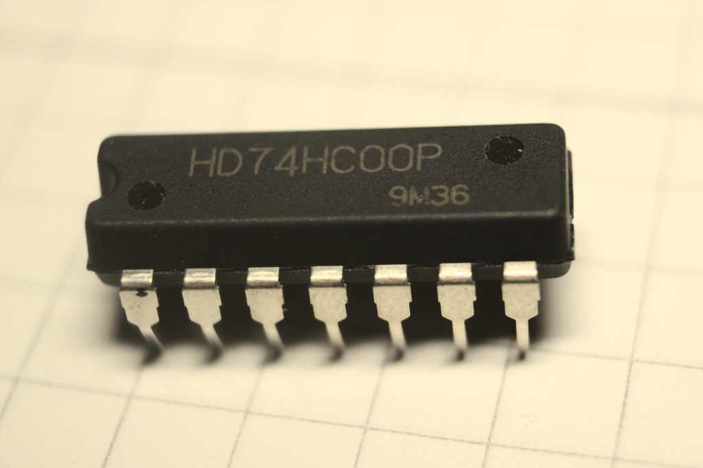<!-- style="width: 40%; max-width: 800px;" -->

Schaltung planen:

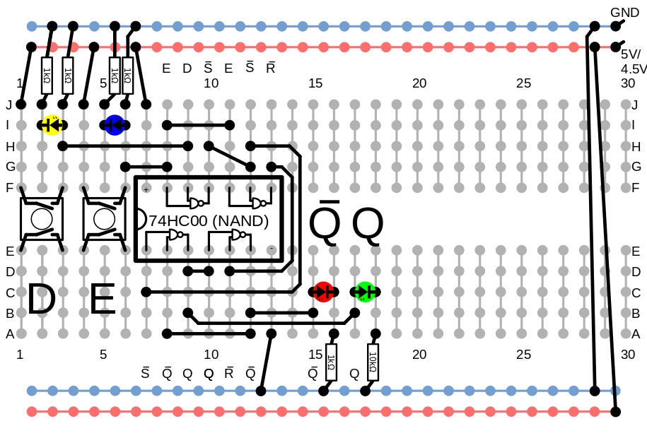

Aufbauen:

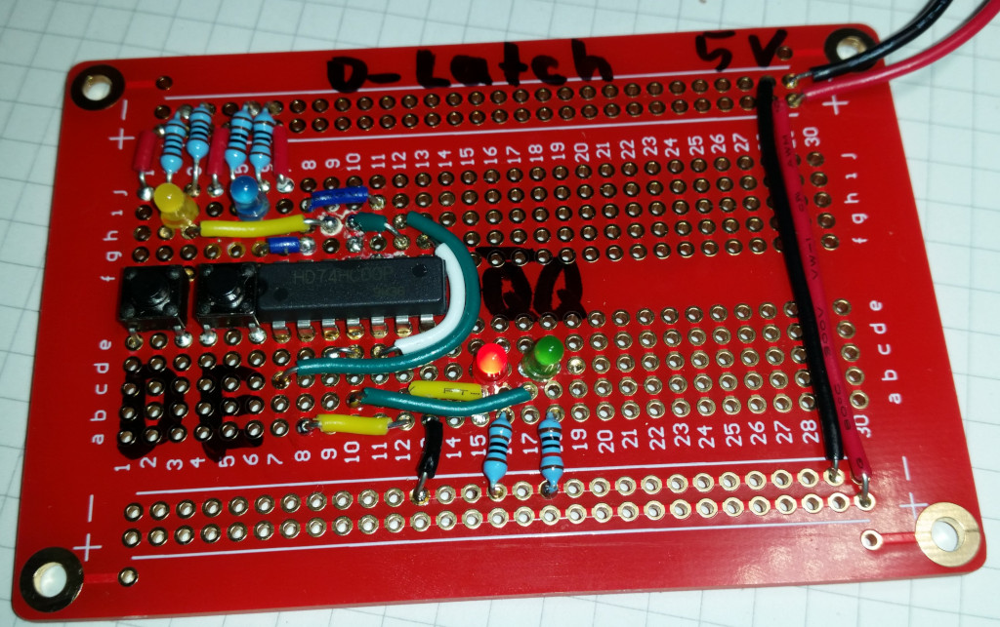<!-- style="width: 40%; max-width: 800px;" -->

## Und im ATmega328P?

    --{{0}}--
Jeder einzelne Pin des ATmega328P enthält mehrere der Speicherelemente von heute. Das Bild stammt aus dem Datenblatt und zeigt die Logik hinter einem Pin.

Das Datenblatt zeigt die Logik hinter jedem einzelnen Pin $P_{xn}$, zum Beispiel PB5 (Pin 13 auf dem Arduino Uno). Darin stecken vier Speicherelemente: die D-Flip-Flops DDxn und PORTxn sowie ein Latch und ein Flip-Flop im Synchronizer. Ein **Register** wie `PORTB` ist einfach eine Reihe solcher Flip-Flops, eines je Bit (mehr dazu in Vorlesung 08).

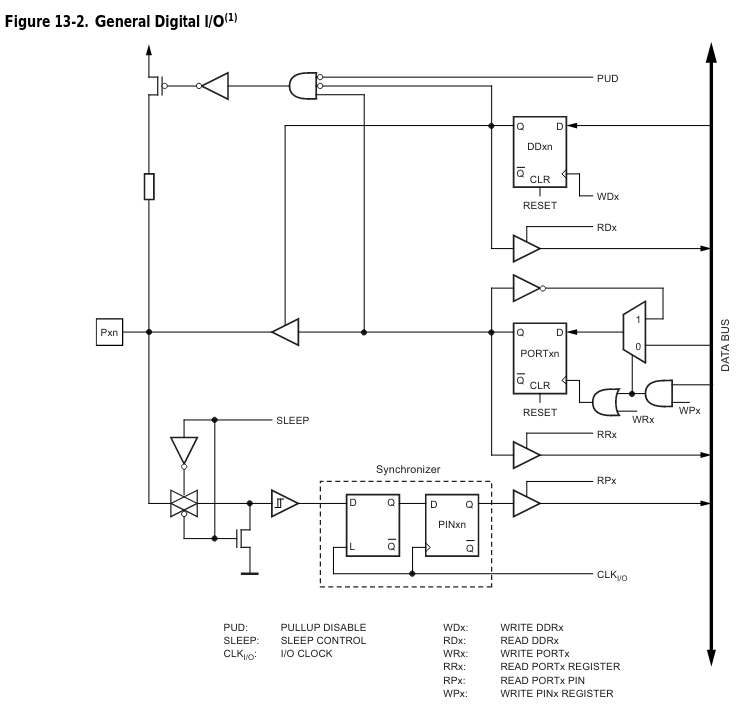<!-- style="width: 80%; max-width: 760px;" -->

[^1]: Microchip Technology: ATmega328P 8-bit AVR Microcontroller Datasheet, Abschnitt „I/O-Ports“, Figure „General Digital I/O“, [Link](https://ww1.microchip.com/downloads/en/DeviceDoc/Atmel-7810-Automotive-Microcontrollers-ATmega328P_Datasheet.pdf)

+ **DDxn** ist ein D-Flip-Flop. Es speichert, ob der Pin Eingang (0) oder Ausgang (1) ist, und wird beim Schreiben des Registers `DDRx` getaktet (WDx). `pinMode(13, OUTPUT)` setzt genau dieses Flip-Flop für PB5.
+ **PORTxn** ist ebenfalls ein D-Flip-Flop. Es speichert den Ausgangswert und übernimmt beim Schreiben von `PORTx` ein Bit vom Datenbus, der Leitung, über die der Prozessor Daten zu den Registern schickt. `digitalWrite(13, HIGH)` landet am Ende in diesem Flip-Flop.
  + **Ein T-Flip-Flop im Datenblatt:** Vor dem Eingang von PORTxn sitzt ein Multiplexer. Schreibt das Programm eine 1 in das Register `PINx` (WPx), wählt er statt des Datenbusses den eigenen Ausgang des Flip-Flops, invertiert über einen Inverter. Das Flip-Flop übernimmt dann seinen eigenen invertierten Wert und kippt.
+ **Synchronizer:** Das Signal von außen kennt den Takt des Controllers nicht. Ein Latch und ein Flip-Flop hintereinander übernehmen es mit dem Takt, bevor das Programm es aus `PINx` liest. Das macht es sehr unwahrscheinlich, dass ein metastabiler Wert das Programm erreicht, und kostet ½ bis 1½ Taktperioden Verzögerung, bei 16 MHz höchstens etwa 94 ns. Davor sitzt ein Schmitt-Trigger (das Symbol mit der Hysteresekurve), der langsame oder verrauschte Flanken säubert.

Den Trick mit `PINx` kann man direkt ausprobieren. Der Sketch schreibt jede Sekunde eine 1 in Bit 5 von `PINB` und gibt danach den Inhalt von PORTB5 aus:

<div id="pin13">
<wokwi-led color="red" pin="13" label="13"></wokwi-led>
</div>

```cpp       toggle.ino
void setup() {
  Serial.begin(9600);
  // (1 << 5) = 0b00100000: nur Bit 5 gesetzt
  DDRB = DDRB | (1 << 5);     // DDRB5 = 1: PB5 (Pin 13) ist Ausgang
}

void loop() {
  PINB = (1 << 5);            // 1 in PINB5 schreiben: PORTB5 kippt
  Serial.print("PORTB5 = ");
  // (PORTB >> 5) & 1: Bit 5 nach rechts, Rest ausblenden
  Serial.println((PORTB >> 5) & 1);
  delay(1000);
}
```
@AVR8js.sketch(pin13)

    --{{0}}--
Die Register DDRB, PORTB und PINB lernen Sie in Vorlesung 12 genauer kennen. Hier geht es nur darum, dass hinter jedem Bit ein Flip-Flop steckt.

**PORTB5 ist 0. Das Programm führt `PINB = (1 << 5);` dreimal aus. Welchen Wert hat PORTB5 danach?**

[[1]]
***************************************************************

Jedes Schreiben einer 1 in PINB5 kippt das Flip-Flop PORTxn: 0 → 1 → 0 → 1. Es verhält sich wie ein T-Flip-Flop mit $T = 1$, dessen Takt das Schreiben auf `PINB` ist. Die Register `DDRB`, `PORTB` und `PINB` kommen in Vorlesung 12 ausführlich.

***************************************************************

## Was Sie heute mitnehmen

    --{{0}}--
Diese Punkte fassen die Vorlesung zusammen. Wenn Sie die Fragen darunter beantworten können, haben Sie das Handwerkszeug, um in der nächsten Vorlesung aus Flip-Flops und Schaltnetzen eigene Schaltwerke zu entwerfen.

+ **Rückkopplung macht Speicher:** Schaltnetze sind zustandslos; erst ein rückgekoppelter Gatterausgang hält einen Wert. Die gesteuerte Rückkopplung ergibt das **SR-Latch** mit den Eingängen Set und Reset, aufgebaut aus zwei NOR- oder zwei NAND-Gattern.
+ **Das D-Latch** erzeugt aus einem Dateneingang $D$ die beiden Signale $S$ und $R$ als Komplement voneinander; die verbotene Belegung $S = R = 1$ kann so nicht mehr auftreten.
+ **Zustandsgesteuert oder flankengesteuert:** Ein Latch (zustandsgesteuert) übernimmt die Eingänge, solange der Takt aktiv ist, und kann sich in einer Taktphase mehrfach ändern. **Main-Subsidiary-** und **flankengesteuerte** Flip-Flops ändern ihren Ausgang nur zu einem definierten Zeitpunkt, einmal pro Takt. Dafür muss der Eingang während der Setup- und Haltezeit stabil sein.
+ **JK- und T-Flip-Flop:** Beim JK-Flip-Flop ist $J = K = 1$ erlaubt und lässt den Ausgang mit jeder wirksamen Flanke wechseln. Das **T-Flip-Flop** schaltet bei $T = 1$ mit jeder Flanke um; es entsteht aus einem JK-Flip-Flop mit verbundenen Eingängen oder aus einem D-Flip-Flop mit $D = T \oplus Q$.
+ **Anwendungen:** Flip-Flops halten Ereignisse fest (Temperaturüberwachung), entprellen Taster und teilen im asynchronen Zähler die Taktfrequenz. Im ATmega328P speichern D-Flip-Flops Richtung und Ausgangswert jedes Pins, und ein Synchronizer aus Latch und Flip-Flop liest den Eingang.

**Prüfen Sie sich:**

+ Warum braucht ein Rechner Speicherelemente, und warum kann ein Schaltnetz die Lampe mit Ein- und Aus-Taster nicht steuern?
+ Beschreiben Sie die Eingangsbelegungen und die zugehörigen Zustandsänderungen am SR-Latch. Was geschieht, wenn $S$ und $R$ gleichzeitig 1 sind und danach gleichzeitig auf 0 gehen?
+ Wie erzeugt das D-Latch aus einem Dateneingang die Signale $S$ und $R$, und welches Problem des SR-Latches ist damit gelöst?
+ Welche anderen Flip-Flop-Typen kennen Sie, und wo liegen ihre Vorteile gegenüber dem SR-Latch?
+ Erläutern Sie die Begriffe „zustandsgesteuert“ und „flankengesteuert“. Warum ist ein zustandsgesteuertes Flip-Flop für viele Anwendungen ungeeignet, und wie löst das Main-Subsidiary-Prinzip das Problem?
+ Was bedeuten Setup- und Haltezeit, und warum liest der ATmega328P einen Pin über einen Synchronizer?
+ Wie bauen Sie aus einem D-Flip-Flop ein T-Flip-Flop?
+ Wie teilt ein asynchroner Zähler aus JK-Flip-Flops die Taktfrequenz, und was begrenzt seine maximale Taktfrequenz?

## Hausaufgaben

Ab jetzt gibt es Übungen: Teil B dieser Hausaufgabe besprechen wir in der Übung am 07. bzw. 10.12. (Blatt 2). Planen Sie für Teil A etwa 30 Minuten ein, für Teil B etwa 30 Minuten. Teil A prüfen Sie direkt hier.

**Teil A – mit Selbstkontrolle**

**Aufgabe 1: SR-Latch verfolgen**

Ein NOR-SR-Latch hat anfangs $Q = 0$. Nacheinander liegen diese Belegungen an:

<!-- data-type="none" style="table-layout: fixed; max-width:500px;"-->
| Schritt | 1 | 2 | 3 | 4 | 5 | 6 |
| ------- | - | - | - | - | - | - |
| $S$     | 1 | 0 | 0 | 0 | 1 | 0 |
| $R$     | 0 | 0 | 1 | 0 | 0 | 0 |

**Welchen Wert hat $Q$ nach jedem Schritt? Geben Sie die sechs Werte ohne Leerzeichen ein.**

[[110011]]
***************************************************************

Setzen (1), Speichern (1), Rücksetzen (0), Speichern (0), Setzen (1), Speichern (1). Prüfen Sie die Folge mit dem NOR-Latch im Simulator.

***************************************************************

**Aufgabe 2: Latch oder Flip-Flop?**

In der Schaltung „Latch und Flip-Flop im Vergleich“ stehen $D$ und $C$ auf 0, „Q Latch“ ist grau, „Q Flip-Flop“ aus. Sie schalten nacheinander (1) $C$ auf 1, (2) $D$ auf 1, (3) $C$ auf 0 und (4) $D$ auf 0.

**Was zeigen die Lampen danach?**

[( )] beide aus
[(X)] „Q Latch“ an, „Q Flip-Flop“ aus
[( )] „Q Latch“ aus, „Q Flip-Flop“ an
[( )] beide an
***************************************************************

Bei (1) übernehmen beide $D = 0$. Bei (2) folgt nur das transparente Latch und zeigt 1, das Flip-Flop hat seine Flanke schon gehabt. Bei (3) schließt das Latch und hält die 1; die fallende Flanke ändert am Flip-Flop nichts. Bei (4) sind beide geschlossen. Probieren Sie es im Simulator aus.

***************************************************************

**Aufgabe 3: Frequenzteiler**

Ein asynchroner Zähler wie im Abschnitt „Anwendungen“ hat vier Stufen und wird mit 16 MHz getaktet, dem Takt des ATmega328P auf dem Arduino Uno.

**Welche Frequenz in MHz liegt am Ausgang der vierten Stufe?**

[[1]]
***************************************************************

Jede Stufe halbiert die Frequenz: $16\,\text{MHz} / 2^4 = 1\,\text{MHz}$. Nach dem gleichen Prinzip teilt der Vorteiler (Prescaler) der Timer im ATmega328P den Systemtakt herunter (Vorlesung 14).

***************************************************************

**Wie viele fallende Flanken von Clk braucht der 3-Bit-Zähler aus dem Abschnitt, um von 000 bis $Q_2 Q_1 Q_0 = 101$ zu zählen?**

[[5]]
***************************************************************

Jede fallende Flanke von Clk erhöht den Zählerstand um 1, und $101_2 = 5$.

***************************************************************

**Teil B – Besprechung in der Übung**

**Aufgabe 4: Das SR-Latch aus NOR-Gattern**

Im SR-Latch aus zwei NOR-Gattern gilt $Y' = \overline{\overline{Y+S} + R}$. Der Ausgang des ersten NOR-Gatters heißt $P = \overline{Y+S}$.

1. Weisen Sie nach, dass $P = \overline{Y}$ gilt, solange nicht $S = R = 1$ anliegt. Gehen Sie die Fälle Speichern, Setzen und Rücksetzen durch.
2. Was geschieht bei $S = R = 1$, und was, wenn danach beide Eingänge gleichzeitig auf 0 gehen?

Wer mag, probiert das SR-Latch zusätzlich in der Elektroniksimulation TinkerCAD aus (dort aus NAND-Gattern, also mit low-aktiven Eingängen): [Beispiel](https://www.tinkercad.com/things/2u00e0a3qoq-sr-flip-flop-using-nand-gate).

**Aufgabe 5: Entprellen**

Die Entprellschaltung aus dem Abschnitt „Anwendungsbeispiele“ braucht einen Umschalter. Viele Taster haben aber nur einen Schließer: einen Kontakt, der beim Drücken eine Leitung auf 1 legt. Warum lässt sich ein solcher Taster mit einem SR-Latch allein nicht entprellen? Was müsste die Schaltung stattdessen tun?

## Nächste Vorlesung

Am **Donnerstag, 26.11.**, geht es um Schaltwerke: Flip-Flops speichern einen Zustand, ein Schaltnetz davor berechnet aus Zustand und Eingängen den nächsten. Damit entwerfen wir Automaten, zum Beispiel einen Detektor, der in einem Bitstrom drei aufeinanderfolgende Einsen erkennt.
