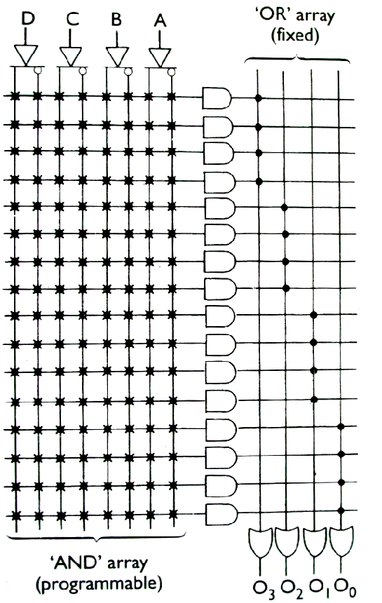
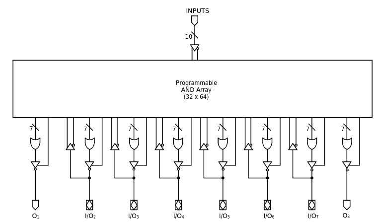
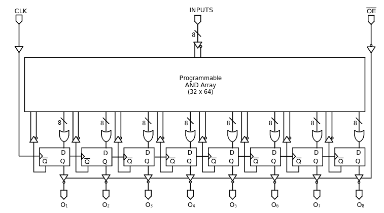
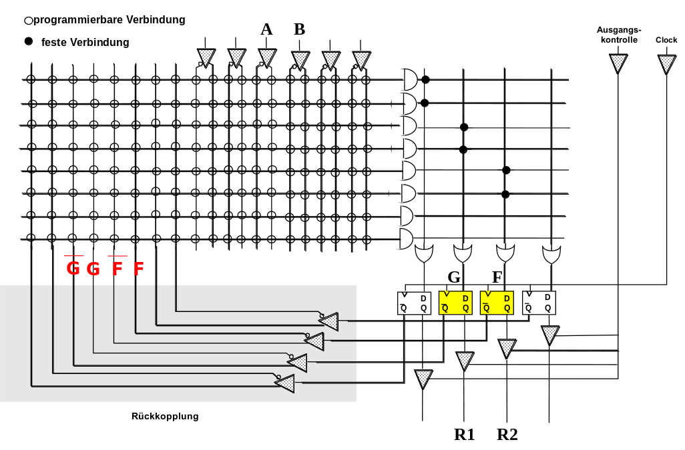
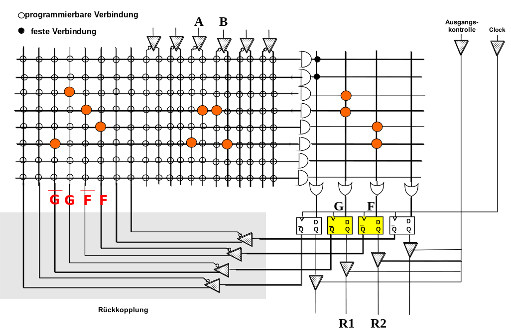

<!--

author:   Sebastian Zug & André Dietrich & Fabian Bär & Claude Code (Opus 5.5)
email:    sebastian.zug@informatik.tu-freiberg.de & andre.dietrich@informatik.tu-freiberg.de & fabian.baer@student.tu-freiberg.de
version:  0.1.1
language: de
narrator: Deutsch Female

import:   https://raw.githubusercontent.com/LiaTemplates/DigiSim/master/README.md
          https://raw.githubusercontent.com/liascript-templates/plantUML/master/README.md
          https://raw.githubusercontent.com/liaTemplates/AVR8js/main/README.md
          https://raw.githubusercontent.com/TUBAF-IfI-LiaScript/VL_EingebetteteSysteme/master/config.md
          https://raw.githubusercontent.com/LiaTemplates/KarnaughMap/0.1.0/README.md

mark: <span style="background-color: @0;
                           display: flex;
                           width: calc(100% + 32px);
                           margin: -16px;
                           padding: 6px 16px 6px 16px;
                           ">@1</span>

red:  @mark(#FF888888,@0)
blue: @mark(lightblue,@0)
gray: @mark(gray,@0)
-->

[](https://liascript.github.io/course/?https://raw.githubusercontent.com/TUBAF-IfI-LiaScript/VL_EingebetteteSysteme/master/07_Schaltwerke.md#1)

# Schaltwerke

| Parameter                | Kursinformationen                                                                                        |
| ------------------------ | -------------------------------------------------------------------------------------------------------- |
| **Veranstaltung:**       | @config.lecture                                                                                          |
| **Semester:**            | @config.semester                                                                                         |
| **Hochschule:**          | `Technische Universität Freiberg`                                                                        |
| **Inhalte:**             | `Endliche Automaten, Zustandsdiagramme, Moore- und Mealy-Automaten, Entwurf von Schaltwerken`          |
| **Link auf GitHub:**     | https://github.com/TUBAF-IfI-LiaScript/VL_EingebetteteSysteme/blob/master/07_Schaltwerke.md            |
| **Autoren:**             | @author                                                                                                  |


---------------------------------------------------------------------

**Lernziele:** Nach dieser Vorlesung können Sie

+ den Aufbau eines Schaltwerks aus Schaltnetz und Zustandsspeicher erklären und Moore-, Mealy- und Medwedew-Automaten unterscheiden,
+ für ein gegebenes Problem ein Zustandsdiagramm und eine Zustandstabelle aufstellen,
+ aus der Zustandstabelle über Zustandskodierung, invertierte Wahrheitstafel und Minimierung eine Schaltung mit D- oder JK-Flip-Flops entwerfen,
+ erklären, wie Race Conditions in Schaltwerken entstehen, wie synchrones Design sie vermeidet und was die maximale Taktfrequenz begrenzt,
+ einen Automaten als Zustandstabelle in einem Programm für den ATmega328P umsetzen.

<!-- kurslandkarte:knopf-start -->

<a href="https://tubaf-ifi-liascript.github.io/VL_EingebetteteSysteme/kurslandkarte/#termin=7" style="display: inline-block; padding: 0.5em 1.1em; background-color: #00718A; color: #ffffff; text-decoration: none; font-family: 'IBM Plex Sans', 'Segoe UI', system-ui, sans-serif; font-weight: 600;">🗺️ Diese Vorlesung in der Kurslandkarte →</a>

<!-- kurslandkarte:knopf-ende -->

--------------------------------------------------------------------

<!--
style="width: 80%; min-width: 420px; max-width: 720px;"
-->
```ascii

                Abstraktionsebenen

           +----------------------------+ -.
  Ebene 6  | Problemorientierte Sprache |  |
           +----------------------------+  |
                                           ⎬ Anwendungssoftware
           +----------------------------+  |
  Ebene 5  | Assemblersprache           |  |
           +----------------------------+ -.

           +----------------------------+
  Ebene 4  | Betriebssystem             |     Systemsoftware (fehlt beim ATmega328P)
           +----------------------------+

           +----------------------------+
  Ebene 3  | Instruktionsset            |     Maschinensprache
           +----------------------------+

           +----------------------------+  -.
  Ebene 2  | Mikroarchitektur           |   |
           +----------------------------+   |
                                            ⎬ Automaten, Speicher, Logik
           +----------------------------+   |       ╔═══════════════╗
  Ebene 1  | Digitale Logik             |   |    ◀══║ HIER SIND WIR!║
           +----------------------------+  -.       ╚═══════════════╝

           +----------------------------+
  Ebene 0  | E-Technik, Physik          |     Analoge Phänomene
           +----------------------------+                                      .
```

---------------------------------------------------------------------

## Aufwärmen

    --{{0}}--
Wir beginnen mit der einfachsten Steuerung, die sich etwas merken muss. An ihr sieht man schon alle Bestandteile, die wir heute systematisch zusammensetzen.

Eine Lampe hat nur einen Taster. Jeder Druck schaltet sie um: aus, an, aus, an …

**Wie viele Zustände muss die Steuerung unterscheiden?**

[[2]]
***************************************************************

„Lampe aus“ und „Lampe an“. Mehr muss die Steuerung nicht wissen, um beim nächsten Druck richtig zu reagieren.

***************************************************************

**Welcher Baustein aus Vorlesung 06 erledigt die Aufgabe allein, wenn jeder Tastendruck eine Taktflanke erzeugt?**

[( )] ein SR-Latch
[( )] ein D-Latch
[(X)] ein T-Flip-Flop mit $T = 1$
[( )] ein Multiplexer
***************************************************************

Das T-Flip-Flop mit $T = 1$ kippt bei jeder Flanke: $Q(t+1) = \overline{Q}$. Im Arduino-Programm schreibt man dafür `ledState = !ledState;` bei jedem erkannten Tastendruck. Ein echter Taster prellt allerdings (Vorlesung 06) und erzeugt mehrere Flanken, er muss also vorher entprellt werden. Das T-Flip-Flop ist das kleinste **Schaltwerk**: ein Flip-Flop speichert den Zustand, ein Schaltnetz (hier das XOR aus $D = T \oplus Q$) berechnet den Folgezustand. Heute lernen wir, wie man für beliebige Steuerungen mit mehr Zuständen und Eingängen dieses Schaltnetz systematisch entwirft.

***************************************************************

## Motivation

**In der kombinatorischen Logik:**

+ hängen die Ausgaben nur von den aktuellen Eingaben ab,
+ sind keine Rückkopplungen gestattet,
+ heißen die Schaltungen Schaltnetze,
+ lassen sich die Schaltungen als gerichteter azyklischer Graph darstellen.

<!--
style="width: 80%; min-width: 420px; max-width: 720px;"
-->
```ascii

Eingaben       +------------------+
  ------------>| Schaltnetz       |            Ausgaben
  ------------>|                  |------------>
  ------------>| kombinatorische  |------------>
  ------------>| Logik            |
               +------------------+                                            .
```

**In der sequenziellen Logik:**

+ hängen die Ausgaben zusätzlich vom gespeicherten Zustand ab, also von der Vorgeschichte,
+ sind Rückkopplungen über Speicherelemente gestattet,
+ heißen die Schaltungen Schaltwerke,
+ lassen sich die Schaltungen als gerichteter zyklischer Graph darstellen.

<!--
style="width: 80%; min-width: 420px; max-width: 720px;"
-->
```ascii

Eingaben       +------------------+           Ausgaben
  ------------>| Schaltnetz       |------------>
  ------------>|                  |------------>
  ------------>| kombinatorische  |------+
          +--->| Logik            |----+ |
          |    +------------------+    | |
          |                            | |
          |    +------------------+    | |
          +----| Zustandsspeicher |<---+ |
               | (Flip-Flops)     |<-----+
               +------------------+                                        .
```

> Und wo brauche ich sequenzielle Logik? Ein Prozessor arbeitet Befehle in mehreren Schritten ab. Der Zustandsspeicher hält fest, bei welchem Schritt er gerade ist, die Eingänge enthalten den Befehl. **Damit ist jeder Rechner ein Schaltwerk.** In Vorlesung 11 sehen wir das an der Modell-CPU.

### Wiederholung: Beschreibung von Flip-Flops

                          {{0-1}}
*******************************************************************************

Die **Wahrheitstafel** eines Speicherelements zeigt, welchen Folgezustand $Q(t+1)$ eine Belegung der Eingänge erzeugt, hier für das SR-Latch aus Vorlesung 06. Wie in Vorlesung 06 steht $Q(t+1)$ für den Zustand nach der nächsten wirksamen Taktflanke, $Q$ oder $Q(t)$ für den aktuellen.

<!-- data-type="none" style="table-layout: fixed; max-width:580px;"-->
| $R(t)$ | $S(t)$ | $Q(t+1)$  |
|--------|--------|-----------|
| 0      | 0      | $Q$       |
| 0      | 1      | 1         |
| 1      | 0      | 0         |
| 1      | 1      | verboten  |

Für den Entwurf eines Schaltwerks brauchen wir die umgekehrte Richtung. Die **invertierte Wahrheitstafel** zeigt, wie die Eingänge belegt sein müssen, damit aus $Q(t)$ ein gewünschter Zustand $Q(t+1)$ wird.

<!-- data-type="none" style="table-layout: fixed; max-width:620px;"-->
| $Q(t)$ | $Q(t+1)$ | $R$ | $S$ |
|--------|----------|-----|-----|
| 0      | 0        | d   | 0   |
| 0      | 1        | 0   | 1   |
| 1      | 0        | 1   | 0   |
| 1      | 1        | 0   | d   |

Ein „d“ (don't care) heißt: Der Eingang darf 0 oder 1 sein. Soll ein gesetztes Latch gesetzt bleiben, schadet ein erneutes Setzen nicht, also $S = d$.

> **Merke:** Die invertierte Wahrheitstafel beantwortet die Frage, wie die Eingänge beschaltet werden müssen, um einen bestimmten Zustandsübergang zu erreichen.

*******************************************************************************

                                {{1-3}}
*******************************************************************************

> **Aufgabe:** Stellen Sie die invertierte Wahrheitstafel für ein D-Flip-Flop auf!

__Wahrheitstafel des D-Flip-Flops__

<!-- data-type="none" style="table-layout: fixed; max-width:480px;"-->
| $D(t)$ | $Q(t+1)$ | Modus   |
|--------|----------|---------|
| 0      | $0$      | Löschen |
| 1      | $1$      | Setzen  |

__Invertierte Wahrheitstafel des D-Flip-Flops__

*******************************************************************************

{{1-2}}
<!-- data-type="none" style="table-layout: fixed; max-width:460px;"-->
| $Q(t)$ | $Q(t+1)$ | $D$ |
|--------|----------|-----|
| $0$    | $0$      |     |
| $0$    | $1$      |     |
| $1$    | $0$      |     |
| $1$    | $1$      |     |


{{2-3}}
<!-- data-type="none" style="table-layout: fixed; max-width:460px;"-->
| $Q(t)$ | $Q(t+1)$ | $D$ |
|--------|----------|-----|
| $0$    | $0$      | $0$ |
| $0$    | $1$      | $1$ |
| $1$    | $0$      | $0$ |
| $1$    | $1$      | $1$ |

{{2-3}}
Beim D-Flip-Flop ist $D$ einfach der gewünschte Folgezustand: $D = Q(t+1)$.

                      {{3-5}}
*******************************************************************************

> **Aufgabe:** ... und noch einmal für das JK-Flip-Flop!

__Wahrheitstafel des JK-Flip-Flops__

<!-- data-type="none" style="table-layout: fixed; max-width:760px;"-->
| $J(t)$ | $K(t)$ | $Q(t+1)$       | Modus       |
|--------|--------|----------------|-------------|
| 0      | 0      | $Q$            | Beibehalten |
| 0      | 1      | $0$            | Löschen     |
| 1      | 0      | $1$            | Setzen      |
| 1      | 1      | $\overline{Q}$ | Kippen      |


__Invertierte Wahrheitstafel des JK-Flip-Flops__

*******************************************************************************

{{3-4}}
<!-- data-type="none" style="table-layout: fixed; max-width:640px;"-->
| $Q(t)$ | $Q(t+1)$ | $J$ | $K$ |
|--------|----------|-----|-----|
| $0$    | $0$      |     |     |
| $0$    | $1$      |     |     |
| $1$    | $0$      |     |     |
| $1$    | $1$      |     |     |

{{4}}
<!-- data-type="none" style="table-layout: fixed; max-width:640px;"-->
| $Q(t)$ | $Q(t+1)$ | $J$ | $K$ |
|--------|----------|-----|-----|
| 0      | 0        | 0   | $d$ |
| 0      | 1        | 1   | $d$ |
| 1      | 0        | $d$ | $1$ |
| 1      | 1        | $d$ | $0$ |

{{4}}
Der Wechsel von 0 nach 1 gelingt durch Setzen ($J = 1$, $K = 0$) oder durch Kippen ($J = K = 1$), also ist $K$ egal. Das JK-Flip-Flop hat in jeder Zeile ein „d“, das wird beim Entwurf noch nützlich.

### Grundkonzept

Wie entwirft man systematisch ein synchrones Schaltwerk, ausgehend von der Problembeschreibung?

Das Modell dafür ist der **endliche Automat**:

+ eine endliche Menge von Zuständen, einer davon ist der Startzustand,
+ Zustandsübergänge in jedem Takt, abhängig von den Eingangssignalen,
+ Ausgangssignale, die ein Schaltnetz aus dem Zustand (und eventuell den Eingängen) erzeugt.

**Zur Einordnung, für alle, die die Theoretische Informatik schon kennen:** Dort begegnet Ihnen der deterministische endliche Automat $A = (Q, \Sigma, \delta, q_0, F)$ mit der Zustandsmenge $Q$, dem Eingabealphabet $\Sigma$, der Übergangsfunktion $\delta: Q \times \Sigma \rightarrow Q$, dem Startzustand $q_0 \in Q$ und der Menge $F \subseteq Q$ der akzeptierenden Endzustände. Er beantwortet nur die Frage „Wort akzeptiert oder nicht?“.

Ein Schaltwerk soll dagegen in jedem Takt etwas ausgeben. Statt der Endzustände bekommt der Automat deshalb ein Ausgabealphabet $\Omega$ und eine Ausgabefunktion $\lambda$:

$$A = (Q, \Sigma, \Omega, \delta, \lambda, q_0)$$

Je nachdem, wovon $\lambda$ abhängt, unterscheiden wir weiter unten Moore- und Mealy-Automaten. Für den Entwurf reicht das Zustandsdiagramm, die Formel brauchen Sie nicht. Beachten Sie: $Q$ und $F$ bezeichnen hier Mengen. Ab dem Beispiel sind $Q$, $F$ und $G$ wieder Flip-Flops beziehungsweise ihre Ausgänge.

Auch in der Praxis begegnen Ihnen die Begriffe: Werkzeuge wie Simulink/Stateflow oder die Zustandsdiagramme der UML unterscheiden ebenfalls Moore- und Mealy-Ausgaben.

> Beispiel:  __Zustand einer Tür__

Darstellung als Graph (Zustandsdiagramm): Kreise sind Zustände, beschriftete Pfeile Übergänge, der Pfeil ohne Ursprung zeigt auf den Startzustand.

```text @plantUML.png
@startdot
digraph finite_state_machine {
    rankdir=LR;
    node [shape = point ]; qi
    node[shape=circle]
    A[label="zu"];
    B[label="auf"];

    qi -> A;
    A  -> A  [ label = "schließen" ];
    A  -> B  [ label = "öffnen" ];
    B  -> B  [ label = "öffnen" ];
    B  -> A  [ label = "schließen" ];
}
@enddot
```

Darstellung in einer Übergangstabelle (Zustandstabelle)

<!-- data-type="none" style="table-layout: fixed; max-width:640px;"-->
|                     | „öffnen“            | „schließen“               |
|---------------------|---------------------|---------------------------|
| Zustand zu          | auf                 | zu (unverändert)          |
| Zustand auf         | auf (unverändert)   | zu                        |

### Codeschloss

Ein Codeschloss soll die Ziffernfolge `7022` erkennen. Mit jedem Takt kommt eine Ziffer $E$. Nach der richtigen Folge öffnet das Schloss für einen Takt.

```text @plantUML.png
@startdot
digraph finite_state_machine {
    node [shape = point ]; qi
    node[shape=Mrecord]
    A[label="{A|geschlossen}"];
    B[label="{B|geschlossen}"];
    C[label="{C|geschlossen}"];
    D[label="{D|geschlossen}"];
    O[label="{O|geöffnet}"];

    qi -> A;
    A  -> A  [ label = "E != 7" ];
    A  -> B  [ label = "E == 7" ];
    B  -> A  [ label = "E != 0" ];
    B  -> C  [ label = "E == 0" ];
    C  -> D  [ label = "E == 2" ];
    C  -> A  [ label = "E != 2" ];
    D  -> O  [ label = "E == 2" ];
    D  -> A  [ label = "E != 2" ];
    O  -> A  [ label = "beliebig" ];
}
@enddot
```

**Jemand tippt `707022`. Öffnet das Schloss?**

[( )] Ja, nach der letzten Ziffer
[(X)] Nein
***************************************************************

A –7→ B –0→ C –7→ A: Die zweite 7 führt von C zurück nach A, weil $E \neq 2$ ist. Damit ist sie „verbraucht“, obwohl sie der Anfang der richtigen Folge wäre. Danach bleibt der Automat bei 0, 2, 2 in A.

Das Diagramm ist vollständig, für jeden Zustand ist jede Eingabe abgedeckt. Falsch sind die Ziele der Rückfälle: Eine 7 ist immer der mögliche Anfang der Folge und muss deshalb nach B führen, egal aus welchem Zustand. Bei jedem Übergang muss man fragen: Was von der bisherigen Eingabe kann noch zur gesuchten Folge gehören?

***************************************************************

Das korrigierte Codeschloss:

```text @plantUML.png
@startdot
digraph finite_state_machine {
    node [shape = point ]; qi
    node[shape=Mrecord]
    A[label="{A|geschlossen}"];
    B[label="{B|geschlossen}"];
    C[label="{C|geschlossen}"];
    D[label="{D|geschlossen}"];
    O[label="{O|geöffnet}"];

    qi -> A;
    A  -> A  [ label = "E != 7" ];
    A  -> B  [ label = "E == 7" ];
    B  -> B  [ label = "E == 7", fontcolor=blue ];
    B  -> C  [ label = "E == 0" ];
    B  -> A  [ label = "sonst" ];
    C  -> D  [ label = "E == 2" ];
    C  -> B  [ label = "E == 7", fontcolor=blue ];
    C  -> A  [ label = "sonst" ];
    D  -> O  [ label = "E == 2" ];
    D  -> B  [ label = "E == 7", fontcolor=blue ];
    D  -> A  [ label = "sonst" ];
    O  -> B  [ label = "E == 7", fontcolor=blue ];
    O  -> A  [ label = "sonst" ];
}
@enddot
```

> **Wie realisieren wir das Modell des endlichen Automaten mit realen Bauteilen?**

### Beispiel

Wir entwerfen einen Binärsequenzdetektor, der drei aufeinanderfolgende `1` erkennt. Die Flip-Flops übernehmen die Werte mit der steigenden Flanke des Takts. Der Ausgang $Y$ ist 1, solange die letzten drei übernommenen Eingaben $E$ jeweils 1 waren.

<!--
style="width: 80%; min-width: 420px; max-width: 720px;"
-->
```ascii
      |   +---+   +---+   +---+   +---+   +---+   +---+   +---+   +---+   +---+
Takt  |   |   |   |   |   |   |   |   |   |   |   |   |   |   |   |   |   |   |
      |---+   +---+   +---+   +---+   +---+   +---+   +---+   +---+   +---+   +
      |
      | +------+        +------+        +-------------------------------+
E     | | 1    | 0      | 1    |  0     | 1       1       1       1     | 0
      |-+      +--------+      +--------+                               +-------
      |
      |                                                   +---------------+
Y     |                                                   | 1       1     | 0
      |---------------------------------------------------+               +-------
      +-------------------------------------------------------------------------->
```

**1. Schritt: Zustandsdiagramm**

```text @plantUML.png
@startdot
digraph finite_state_machine {
    rankdir=LR;

    node [shape = point ]; qi
    node[shape=circle]
    A[label="A \n Y=0"];
    B[label="B \n Y=0"];
    C[label="C \n Y=0"];
    D[label="D \n Y=1"];

    qi -> A;
    A  -> A  [ label = "E=0" ];
    A  -> B  [ label = "E=1" ];
    B  -> A  [ label = "E=0" ];
    B  -> C  [ label = "E=1" ];
    C  -> A  [ label = "E=0" ];
    C  -> D  [ label = "E=1", fontcolor=blue ];
    D  -> D  [ label = "E=1", fontcolor=blue ];
    D  -> A  [ label = "E=0" ];
}
@enddot
```

- Zustand `A`: Die letzte Eingabe war keine `1` (`0` oder Start).
- Zustand `B`: Die letzte Eingabe war `1`, die davor nicht.
- Zustand `C`: Die letzten beiden Eingaben waren `1`, die davor nicht.
- Zustand `D`: Mindestens die letzten drei Eingaben waren `1`.

**2. Schritt: Zustandstabelle**

<!-- data-type="none" style="table-layout: fixed; max-width:560px;"-->
| aktueller Zustand | Eingabe $E$ | Folgezustand |
|-------------------|-------------|--------------|
| A                 | 0           | A            |
| B                 | 0           | A            |
| C                 | 0           | A            |
| D                 | 0           | A            |
| A                 | 1           | B            |
| B                 | 1           | C            |
| C                 | 1           | D            |
| D                 | 1           | D            |

**3. Schritt: Zustandskodierung**

Für die Flip-Flops müssen wir die Zustände mit `0` und `1` kodieren. Mit $k$ Flip-Flops lassen sich $2^k$ Zustände unterscheiden, für $n$ Zustände brauchen wir also mindestens $\lceil \log_2 n \rceil$ Flip-Flops.

<!-- data-type="none" style="table-layout: fixed; max-width:899px;"-->
| Zustände | Flip-Flops | Mögliche Zustände | Ungenutzte Zustände |
|----------|------------|-------------------|---------------------|
| 2        | 1          | 2                 | 0                   |
| 3        | 2          | 4                 | 1                   |
| 4        | 2          | 4                 | 0                   |
| 5        | 3          | 8                 | 3                   |
| ...      |            |                   |                     |
| 8        | 3          | 8                 | 0                   |
| 9        | 4          | 16                | 7                   |

Für vier Zustände genügen zwei Flip-Flops, wir nennen sie $F$ und $G$. Ihre Werte nach dem nächsten Takt schreiben wir kurz $F'$ und $G'$, also $F' = F(t+1)$.

<!-- data-type="none" style="table-layout: fixed; max-width:620px;"-->
| Zustand | $F$ | $G$ |
|---------|-----|-----|
| A       | 0   | 0   |
| B       | 0   | 1   |
| C       | 1   | 0   |
| D       | 1   | 1   |

Damit ergibt sich die binäre Zustandstabelle. Sie ist die Übergangsfunktion $\delta$ aus dem Grundkonzept, die Kodierung ordnet jedem Zustand eine Bitfolge zu:

<!-- data-type="none" style="table-layout: fixed; max-width:820px;"-->
| Zustand | $F$ | $G$ | $E$ | Folgezustand | $F'$ | $G'$ |
|---------|-----|-----|-----|--------------|------|------|
| A       | 0   | 0   | 0   | A            | 0    | 0    |
| B       | 0   | 1   | 0   | A            | 0    | 0    |
| C       | 1   | 0   | 0   | A            | 0    | 0    |
| D       | 1   | 1   | 0   | A            | 0    | 0    |
| A       | 0   | 0   | 1   | B            | 0    | 1    |
| B       | 0   | 1   | 1   | C            | 1    | 0    |
| C       | 1   | 0   | 1   | D            | 1    | 1    |
| D       | 1   | 1   | 1   | D            | 1    | 1    |

**4. Schritt: Ansteuerung der Flip-Flops**

Gesucht ist ein Schaltnetz, das aus $F$, $G$ und $E$ die Eingänge der beiden Flip-Flops und den Ausgang $Y$ berechnet. Die Flip-Flops übernehmen dessen Ergebnis mit der nächsten Taktflanke.

Wie die Eingänge belegt werden müssen, sagt die invertierte Wahrheitstafel des gewählten Flip-Flop-Typs. Für D-Flip-Flops ist das besonders einfach, denn $D = Q(t+1)$: Die Spalten $F'$ und $G'$ sind schon die gesuchten Funktionen $D_F$ und $D_G$.

> **Merke:** Unterschiedliche Flip-Flop-Typen führen zu unterschiedlichen Beschaltungen derselben Zustandstabelle.

**5. Schritt: Minimierung**

Die Variablenreihenfolge im KV-Diagramm ist $F$, $G$, $E$; Feld $m_5$ ist also $F = 1$, $G = 0$, $E = 1$.

<table>
<tr>
<td>

$F'$

@Karnaugh.map(F G E,3 5 7,-)

</td>
<td>

$G'$

@Karnaugh.map(F G E,1 5 7,-)

</td>
<td>

$Y$

@Karnaugh.map(F G E,6 7,-)

</td>
</tr>
</table>

$$
\begin{aligned}
F' &= \overline{F}GE + F\overline{G}E + FGE = GE + FE = E\,(F + G) \\
G' &= \overline{F}\,\overline{G}E + F\overline{G}E + FGE = \overline{G}E + FE = E\,(F + \overline{G}) \\
Y  &= FG
\end{aligned}
$$

**6. Schritt: Aufbau und Test**

Die Flip-Flops starten in der Simulation mit 0, also im Zustand A. Legen Sie $E$ fest und erzeugen Sie dann mit `Clk` eine steigende Flanke (einschalten, ausschalten). Die Lampen $F$ und $G$ zeigen den Zustand.

```json @DigiSim.evalJson
{"router":"manhattan","devices":{"e":{"type":"Button","label":"E","propagation":0,"position":{"x":0,"y":60}},"clk":{"type":"Button","label":"Clk","propagation":0,"position":{"x":0,"y":260}},"o1":{"type":"Or","propagation":0,"position":{"x":150,"y":0}},"a1":{"type":"And","propagation":0,"position":{"x":270,"y":20}},"ng":{"type":"Not","propagation":0,"position":{"x":120,"y":140}},"o2":{"type":"Or","propagation":0,"position":{"x":210,"y":130}},"a2":{"type":"And","propagation":0,"position":{"x":300,"y":150}},"ff":{"type":"Dff","bits":1,"initial":"0","propagation":1,"polarity":{"clock":true},"position":{"x":420,"y":25},"label":"F"},"fg":{"type":"Dff","bits":1,"initial":"0","propagation":1,"polarity":{"clock":true},"position":{"x":420,"y":155},"label":"G"},"ay":{"type":"And","propagation":0,"position":{"x":590,"y":250}},"lf":{"type":"Lamp","label":"F","propagation":0,"position":{"x":590,"y":30}},"lg":{"type":"Lamp","label":"G","propagation":0,"position":{"x":590,"y":160}},"y":{"type":"Lamp","label":"Y","propagation":0,"position":{"x":720,"y":255}}},"connectors":[{"from":{"id":"fg","port":"out"},"to":{"id":"o1","port":"in1"}},{"from":{"id":"ff","port":"out"},"to":{"id":"o1","port":"in2"}},{"from":{"id":"e","port":"out"},"to":{"id":"a1","port":"in1"}},{"from":{"id":"o1","port":"out"},"to":{"id":"a1","port":"in2"}},{"from":{"id":"a1","port":"out"},"to":{"id":"ff","port":"in"}},{"from":{"id":"fg","port":"out"},"to":{"id":"ng","port":"in"}},{"from":{"id":"ng","port":"out"},"to":{"id":"o2","port":"in1"}},{"from":{"id":"ff","port":"out"},"to":{"id":"o2","port":"in2"}},{"from":{"id":"e","port":"out"},"to":{"id":"a2","port":"in1"}},{"from":{"id":"o2","port":"out"},"to":{"id":"a2","port":"in2"}},{"from":{"id":"a2","port":"out"},"to":{"id":"fg","port":"in"}},{"from":{"id":"clk","port":"out"},"to":{"id":"ff","port":"clk"}},{"from":{"id":"clk","port":"out"},"to":{"id":"fg","port":"clk"}},{"from":{"id":"ff","port":"out"},"to":{"id":"lf","port":"in"}},{"from":{"id":"fg","port":"out"},"to":{"id":"lg","port":"in"}},{"from":{"id":"ff","port":"out"},"to":{"id":"ay","port":"in1"}},{"from":{"id":"fg","port":"out"},"to":{"id":"ay","port":"in2"}},{"from":{"id":"ay","port":"out"},"to":{"id":"y","port":"in"}}],"subcircuits":{}}
```

**Sie halten $E = 1$ und erzeugen drei steigende Flanken. Welchen Zustand zeigen die Lampen $F$ und $G$ danach?**

[( )] B ($F = 0$, $G = 1$)
[( )] C ($F = 1$, $G = 0$)
[(X)] D ($F = 1$, $G = 1$)
***************************************************************

A → B → C → D. Erst im Zustand D ist $Y = FG = 1$. Eine vierte Flanke mit $E = 1$ lässt den Automaten in D, eine Flanke mit $E = 0$ führt zurück nach A.

***************************************************************

## Vorgehensweise

Der Entwurf folgt immer denselben Schritten:

1. **Zustandsdiagramm** aus der Problembeschreibung aufstellen
2. **Zustandstabelle**: für jeden Zustand und jede Eingabe den Folgezustand (und die Ausgabe) eintragen
3. **Zustandskodierung**: mindestens $\lceil \log_2 n \rceil$ Flip-Flops; ungenutzte Kodierungen werden zu Don't-Cares, dann muss ein Rücksetzeingang dafür sorgen, dass der Automat nie in einer ungenutzten Kodierung startet
4. **Flip-Flop-Typ** wählen und mit seiner invertierten Wahrheitstafel die Ansteuerung jedes Flip-Flops bestimmen
5. **Minimieren**: Ansteuer- und Ausgabefunktionen als DNF oder KNF aufstellen und vereinfachen (KV-Diagramm, Quine-McCluskey)
6. **Aufbauen und prüfen**, zum Beispiel im Simulator mit einer Eingabefolge, deren Ergebnis man kennt

### Automaten Typen

**Moore-Automat**

Edward Forrest Moore (1925 – 2003, Bell Labs)

<!--
style="width: 80%; min-width: 420px; max-width: 720px;"
-->
```ascii
  +------------------------------------------+
  |   +--------------+     +--------------+  |   +--------------+
  +-->|              |     |              |  |   |              |   Y
      | Eingabelogik |---->| Speicher     |--+-->| Ausgabelogik |---->
----->| (Schaltnetz) |     | (Flip-Flops) |      | (Schaltnetz) |
 E    +--------------+     +--------------+      +--------------+
                                                                               .
```

> **Beim Moore-Automaten hängt die Ausgabe $Y$ nur vom aktuellen Zustand ab:** $\lambda: Q \rightarrow \Omega$. Im Zustandsdiagramm steht die Ausgabe deshalb im Zustand, so wie beim Sequenzdetektor oben.

**Mealy-Automat**

George H. Mealy (1927 – 2010, IBM)

<!--
style="width: 80%; min-width: 420px; max-width: 720px;"
-->
```ascii
  +------------------------------------------+
  |   +--------------+     +--------------+  |
  +-->|              |     |              |  |   +--------------+
      | Eingabelogik |---->| Speicher     |--+-->|              |    Y
---+->| (Schaltnetz) |     | (Flip-Flops) |      | Ausgabelogik |---->
 E |  +--------------+     +--------------+      | (Schaltnetz) |
   +-------------------------------------------->|              |
                                                 +--------------+
                                                                               .
```

> **Beim Mealy-Automaten hängt die Ausgabe $Y$ vom aktuellen Zustand und von der Eingabe $E$ ab:** $\lambda: Q \times \Sigma \rightarrow \Omega$. Im Zustandsdiagramm steht die Ausgabe deshalb am Pfeil, als „Eingabe / Ausgabe“.

Der Mealy-Automat ist die allgemeinere Form, der Moore-Automat unterbindet den direkten Einfluss des Eingangs. Eine weitere Spezialisierung ist der **Medwedew-Automat**: Er verzichtet ganz auf die Ausgabelogik, die Flip-Flop-Ausgänge sind die Ausgabe. Die Zähler in Vorlesung 08 sind Medwedew-Automaten.

<!-- data-type="none" style="table-layout: fixed; max-width:900px;"-->
|          | Mealy-Automat                                                                                         | Moore-Automat                                                                                                  |
|----------|-------------------------------------------------------------------------------------------------------|----------------------------------------------------------------------------------------------------------------|
| Vorteile | reagiert schneller: Die Ausgabe ändert sich sofort mit der Eingabe, nicht erst mit dem nächsten Takt   | taktsynchrone Ausgabe: Störungen und Glitches am Eingang erreichen $Y$ nicht direkt (die Ausgabelogik selbst kann beim Zustandswechsel noch glitchen, siehe Race Conditions)                          |
|          | kommt oft mit weniger Zuständen aus, wenn Übergänge in denselben Zustand unterschiedliche Ausgaben brauchen | einfachere Ausgabelogik, wenn die Ausgabe ohnehin nur vom Zustand abhängt                                  |

**Der Sequenzdetektor als Mealy-Automat**

Übersetzt man das Diagramm direkt, wandert die Ausgabe an die Pfeile: Jeder Pfeil bekommt die Ausgabe des Zustands, in dem er endet, $\lambda_{\text{Mealy}}(q, e) = \lambda_{\text{Moore}}(\delta(q, e))$. Jeder Pfeil, der in D endet, gibt also $Y = 1$ aus:

```text @plantUML.png
@startdot
digraph finite_state_machine {
    rankdir=LR;

    node [shape = point ]; qi
    node[shape=circle]
    A[label="A"];
    B[label="B"];
    C[label="C"];
    D[label="D"];

    qi -> A;
    A  -> A  [ label = "0 / 0" ];
    A  -> B  [ label = "1 / 0" ];
    B  -> A  [ label = "0 / 0" ];
    B  -> C  [ label = "1 / 0" ];
    C  -> A  [ label = "0 / 0", fontcolor=green];
    C  -> D  [ label = "1 / 1", fontcolor=blue ];
    D  -> D  [ label = "1 / 1", fontcolor=blue ];
    D  -> A  [ label = "0 / 0", fontcolor=green];
}
@enddot
```

**Vergleichen Sie die Pfeile, die C und D verlassen. Was fällt auf?**

[( )] Sie führen in verschiedene Zustände
[(X)] Sie sind gleich: Bei 0 geht es mit Ausgabe 0 nach A, bei 1 mit Ausgabe 1 nach D
[( )] D hat keinen Pfeil mit Ausgabe 1
***************************************************************

C und D verhalten sich gleich, man kann sie zu einem Zustand zusammenfassen. Die Schleife „1 / 1“ an C ersetzt den Zustand D. Beim Moore-Automaten geht das nicht, weil C die Ausgabe 0 und D die Ausgabe 1 hat.

***************************************************************

```text @plantUML.png
@startdot
digraph finite_state_machine {
    rankdir=LR;

    node [shape = point ]; qi1
    node[shape=circle]
    A1[label="A"];
    B1[label="B"];
    C1[label="C"];

    qi1 -> A1;
    A1  -> A1  [ label = "0 / 0" ];
    A1  -> B1  [ label = "1 / 0" ];
    B1  -> A1  [ label = "0 / 0" ];
    B1  -> C1  [ label = "1 / 0" ];
    C1  -> A1  [ label = "0 / 0", fontcolor=green ];
    C1  -> C1  [ label = "1 / 1", fontcolor=blue ];
}
@enddot
```

Mit der gleichen Kodierung wie oben (A = 00, B = 01, C = 10) bleibt die Kodierung 11 ungenutzt. Ihre Zeilen werden zu Don't-Cares (d):

<!-- data-type="none" style="table-layout: fixed; max-width:780px;"-->
| Zustand    | $F$ | $G$ | $E$ | Folgezustand | $F'$ | $G'$ | $Y$ |
|------------|-----|-----|-----|--------------|------|------|-----|
| A          | 0   | 0   | 0   | A            | 0    | 0    | 0   |
| B          | 0   | 1   | 0   | A            | 0    | 0    | 0   |
| C          | 1   | 0   | 0   | A            | 0    | 0    | 0   |
| (11)       | 1   | 1   | 0   | –            | d    | d    | d   |
| A          | 0   | 0   | 1   | B            | 0    | 1    | 0   |
| B          | 0   | 1   | 1   | C            | 1    | 0    | 0   |
| C          | 1   | 0   | 1   | C            | 1    | 0    | 1   |
| (11)       | 1   | 1   | 1   | –            | d    | d    | d   |

<table>
<tr>
<td>

$F'$

@Karnaugh.map(F G E,3 5,6 7)

</td>
<td>

$G'$

@Karnaugh.map(F G E,1,6 7)

</td>
<td>

$Y$

@Karnaugh.map(F G E,5,6 7)

</td>
</tr>
</table>

$$
\begin{aligned}
F' &= \overline{F}GE + F\overline{G}E \;\rightarrow\; GE + FE = E\,(F + G) \qquad \text{(Don't-Care } m_7 \text{ als 1 gewählt)}\\
G' &= \overline{F}\,\overline{G}E \\
Y  &= F\overline{G}E \;\rightarrow\; FE \qquad \text{(Don't-Care } m_7 \text{ als 1 gewählt)}
\end{aligned}
$$

Der Pfeil $\rightarrow$ bedeutet: gleich auf allen genutzten Kodierungen, nur in $m_7$ (Kodierung 11) unterschiedlich. $F'$ ist dann dieselbe Funktion wie beim Moore-Automaten, $G'$ wird ein UND mit drei Eingängen. Neu ist, dass $E$ direkt in die Ausgabe eingeht.

```json @DigiSim.evalJson
{"router":"manhattan","devices":{"e":{"type":"Button","label":"E","propagation":0,"position":{"x":0,"y":60}},"clk":{"type":"Button","label":"Clk","propagation":0,"position":{"x":0,"y":260}},"o1":{"type":"Or","propagation":0,"position":{"x":150,"y":0}},"a1":{"type":"And","propagation":0,"position":{"x":270,"y":20}},"nf":{"type":"Not","propagation":0,"position":{"x":120,"y":120}},"ng":{"type":"Not","propagation":0,"position":{"x":120,"y":180}},"a2":{"type":"And","propagation":0,"position":{"x":270,"y":140},"inputs":3},"ff":{"type":"Dff","bits":1,"initial":"0","propagation":1,"polarity":{"clock":true},"position":{"x":420,"y":25},"label":"F"},"fg":{"type":"Dff","bits":1,"initial":"0","propagation":1,"polarity":{"clock":true},"position":{"x":420,"y":155},"label":"G"},"ay":{"type":"And","propagation":0,"position":{"x":590,"y":250}},"lf":{"type":"Lamp","label":"F","propagation":0,"position":{"x":590,"y":30}},"lg":{"type":"Lamp","label":"G","propagation":0,"position":{"x":590,"y":160}},"y":{"type":"Lamp","label":"Y","propagation":0,"position":{"x":720,"y":255}}},"connectors":[{"from":{"id":"fg","port":"out"},"to":{"id":"o1","port":"in1"}},{"from":{"id":"ff","port":"out"},"to":{"id":"o1","port":"in2"}},{"from":{"id":"e","port":"out"},"to":{"id":"a1","port":"in1"}},{"from":{"id":"o1","port":"out"},"to":{"id":"a1","port":"in2"}},{"from":{"id":"a1","port":"out"},"to":{"id":"ff","port":"in"}},{"from":{"id":"ff","port":"out"},"to":{"id":"nf","port":"in"}},{"from":{"id":"fg","port":"out"},"to":{"id":"ng","port":"in"}},{"from":{"id":"nf","port":"out"},"to":{"id":"a2","port":"in1"}},{"from":{"id":"ng","port":"out"},"to":{"id":"a2","port":"in2"}},{"from":{"id":"e","port":"out"},"to":{"id":"a2","port":"in3"}},{"from":{"id":"a2","port":"out"},"to":{"id":"fg","port":"in"}},{"from":{"id":"clk","port":"out"},"to":{"id":"ff","port":"clk"}},{"from":{"id":"clk","port":"out"},"to":{"id":"fg","port":"clk"}},{"from":{"id":"ff","port":"out"},"to":{"id":"lf","port":"in"}},{"from":{"id":"fg","port":"out"},"to":{"id":"lg","port":"in"}},{"from":{"id":"ff","port":"out"},"to":{"id":"ay","port":"in1"}},{"from":{"id":"e","port":"out"},"to":{"id":"ay","port":"in2"}},{"from":{"id":"ay","port":"out"},"to":{"id":"y","port":"in"}}],"subcircuits":{}}
```

**Der Automat steht in C ($F = 1$, $G = 0$). Sie schalten $E$ auf 1, ohne einen Takt zu erzeugen. Was zeigt $Y$?**

[(X)] $Y = 1$, sofort
[( )] $Y = 0$, erst die nächste Flanke setzt $Y = 1$
***************************************************************

$Y = FE$ ist ein Schaltnetz ohne Takt: Die Ausgabe folgt dem Eingang sofort. Der Mealy-Automat meldet die dritte 1 also schon, während sie anliegt, der Moore-Automat erst nach der nächsten Taktflanke. Die Kehrseite: Jeder Glitch und jedes Prellen an $E$ erscheint auch an $Y$. Probieren Sie es aus, indem Sie $E$ im Zustand C mehrmals umschalten.

***************************************************************

<!-- data-type="none" style="table-layout: fixed; max-width:720px;"-->
|                   | Moore                                       | Mealy                                |
|-------------------|---------------------------------------------|--------------------------------------|
| Zustände          | 4                                           | 3                                    |
| Gleichungen       | $F' = E(F+G)$, $G' = E(F+\overline{G})$, $Y = FG$ | $F' = E(F+G)$, $G' = \overline{F}\,\overline{G}E$, $Y = FE$ |
| $Y$ wird 1        | nach der Flanke, die die dritte 1 übernimmt | sobald die dritte 1 anliegt          |

### Bedeutung des Flip-Flop Typs

Warum noch ein Flip-Flop-Typ? Zum einen gibt es JK-Flip-Flops als fertige Logikbausteine (zum Beispiel 74HC107), und die Ampel in Vorlesung 08 ist mit ihnen entworfen. Zum anderen sieht man hier am deutlichsten, wie die Don't-Cares der invertierten Wahrheitstafel die Ansteuerlogik verkleinern.

Nehmen wir also an, dass der Moore-Automat nicht mit D-, sondern mit JK-Flip-Flops umgesetzt werden soll. Die Zustandstabelle bleibt gleich, nur die Ansteuerung ändert sich. Für jede Zeile lesen wir in der invertierten Wahrheitstafel nach, wie $J$ und $K$ belegt sein müssen:

<!-- data-type="none" style="table-layout: fixed; max-width:640px;"-->
| $Q(t)$ | $Q(t+1)$ | $J$ | $K$ |
|--------|----------|-----|-----|
| 0      | 0        | 0   | $d$ |
| 0      | 1        | 1   | $d$ |
| 1      | 0        | $d$ | 1   |
| 1      | 1        | $d$ | 0   |

Beginnen wir mit dem Flip-Flop $F$ und seinen Eingängen $J_F$ und $K_F$. Maßgeblich sind die Spalten $F$ (rot) und $F'$ (grün):

<!-- data-type="none" style="table-layout: fixed; max-width:790px;"-->
| $F$                                   | $G$ | $E$ | $F'$                                  | $G'$ | $J_F$ | $K_F$ | $J_G$ | $K_G$ |
|---------------------------------------|-----|-----|---------------------------------------|------|-------|-------|-------|-------|
| <span style="color: #ff0000">0</span> | 0   | 0   | <span style="color: #00a000">0</span> | 0    | 0     | d     |       |       |
| <span style="color: #ff0000">0</span> | 1   | 0   | <span style="color: #00a000">0</span> | 0    | 0     | d     |       |       |
| <span style="color: #ff0000">1</span> | 0   | 0   | <span style="color: #00a000">0</span> | 0    | d     | 1     |       |       |
| <span style="color: #ff0000">1</span> | 1   | 0   | <span style="color: #00a000">0</span> | 0    | d     | 1     |       |       |
| <span style="color: #ff0000">0</span> | 0   | 1   | <span style="color: #00a000">0</span> | 1    | 0     | d     |       |       |
| <span style="color: #ff0000">0</span> | 1   | 1   | <span style="color: #00a000">1</span> | 0    | 1     | d     |       |       |
| <span style="color: #ff0000">1</span> | 0   | 1   | <span style="color: #00a000">1</span> | 1    | d     | 0     |       |       |
| <span style="color: #ff0000">1</span> | 1   | 1   | <span style="color: #00a000">1</span> | 1    | d     | 0     |       |       |

Analog füllen wir die Spalten für $J_G$ und $K_G$ aus den Spalten $G$ (rot) und $G'$ (grün):

<!-- data-type="none" style="table-layout: fixed; max-width:790px;"-->
| $F$ | $G$                                   | $E$ | $F'$ | $G'$                                  | $J_F$ | $K_F$ | $J_G$ | $K_G$ |
|-----|---------------------------------------|-----|------|---------------------------------------|-------|-------|-------|-------|
| 0   | <span style="color: #ff0000">0</span> | 0   | 0    | <span style="color: #00a000">0</span> | 0     | d     | 0     | d     |
| 0   | <span style="color: #ff0000">1</span> | 0   | 0    | <span style="color: #00a000">0</span> | 0     | d     | d     | 1     |
| 1   | <span style="color: #ff0000">0</span> | 0   | 0    | <span style="color: #00a000">0</span> | d     | 1     | 0     | d     |
| 1   | <span style="color: #ff0000">1</span> | 0   | 0    | <span style="color: #00a000">0</span> | d     | 1     | d     | 1     |
| 0   | <span style="color: #ff0000">0</span> | 1   | 0    | <span style="color: #00a000">1</span> | 0     | d     | 1     | d     |
| 0   | <span style="color: #ff0000">1</span> | 1   | 1    | <span style="color: #00a000">0</span> | 1     | d     | d     | 1     |
| 1   | <span style="color: #ff0000">0</span> | 1   | 1    | <span style="color: #00a000">1</span> | d     | 0     | 1     | d     |
| 1   | <span style="color: #ff0000">1</span> | 1   | 1    | <span style="color: #00a000">1</span> | d     | 0     | d     | 0     |

Jede Ansteuerfunktion hat viele Don't-Cares. Die Felder sind wieder nach $F$, $G$, $E$ nummeriert:

<table>
<tr>
<td>

$J_F$

@Karnaugh.map(F G E,3,4 5 6 7)

</td>
<td>

$K_F$

@Karnaugh.map(F G E,4 6,0 1 2 3)

</td>
</tr>
<tr>
<td>

$J_G$

@Karnaugh.map(F G E,1 5,2 3 6 7)

</td>
<td>

$K_G$

@Karnaugh.map(F G E,2 3 6,0 1 4 5)

</td>
</tr>
</table>

$$
\begin{aligned}
J_F &= GE & K_F &= \overline{E} \\
J_G &= E  & K_G &= \overline{E} + \overline{F}
\end{aligned}
$$

Die Ausgabe hängt nicht davon ab, mit welchen Flip-Flops die Zustände gespeichert werden. Es bleibt beim Moore-Automaten $Y = FG$.

DigiSim hat kein fertiges JK-Flip-Flop. Wir bauen es deshalb als Kasten aus einem D-Flip-Flop und der Gleichung $D = J\overline{Q} + \overline{K}Q$, die genau die JK-Wahrheitstafel erfüllt. Die beiden Kästen $F$ und $G$ verhalten sich nach außen wie JK-Flip-Flops.

```json @DigiSim.evalJson
{"router":"manhattan","devices":{"e":{"type":"Button","label":"E","propagation":0,"position":{"x":0,"y":60}},"clk":{"type":"Button","label":"Clk","propagation":0,"position":{"x":0,"y":300}},"ne":{"type":"Not","propagation":0,"position":{"x":110,"y":130}},"nf":{"type":"Not","propagation":0,"position":{"x":110,"y":220}},"jf":{"type":"And","propagation":0,"position":{"x":230,"y":10}},"kg":{"type":"Or","propagation":0,"position":{"x":230,"y":200}},"ff":{"type":"Subcircuit","celltype":"JK-Flip-Flop","label":"F","propagation":0,"position":{"x":400,"y":10}},"fg":{"type":"Subcircuit","celltype":"JK-Flip-Flop","label":"G","propagation":0,"position":{"x":400,"y":160}},"ay":{"type":"And","propagation":0,"position":{"x":600,"y":280}},"lf":{"type":"Lamp","label":"F","propagation":0,"position":{"x":600,"y":30}},"lg":{"type":"Lamp","label":"G","propagation":0,"position":{"x":600,"y":180}},"y":{"type":"Lamp","label":"Y","propagation":0,"position":{"x":730,"y":285}}},"connectors":[{"from":{"id":"fg","port":"Q"},"to":{"id":"jf","port":"in1"}},{"from":{"id":"e","port":"out"},"to":{"id":"jf","port":"in2"}},{"from":{"id":"jf","port":"out"},"to":{"id":"ff","port":"J"}},{"from":{"id":"e","port":"out"},"to":{"id":"ne","port":"in"}},{"from":{"id":"ne","port":"out"},"to":{"id":"ff","port":"K"}},{"from":{"id":"e","port":"out"},"to":{"id":"fg","port":"J"}},{"from":{"id":"ff","port":"Q"},"to":{"id":"nf","port":"in"}},{"from":{"id":"ne","port":"out"},"to":{"id":"kg","port":"in1"}},{"from":{"id":"nf","port":"out"},"to":{"id":"kg","port":"in2"}},{"from":{"id":"kg","port":"out"},"to":{"id":"fg","port":"K"}},{"from":{"id":"clk","port":"out"},"to":{"id":"ff","port":"C"}},{"from":{"id":"clk","port":"out"},"to":{"id":"fg","port":"C"}},{"from":{"id":"ff","port":"Q"},"to":{"id":"lf","port":"in"}},{"from":{"id":"fg","port":"Q"},"to":{"id":"lg","port":"in"}},{"from":{"id":"ff","port":"Q"},"to":{"id":"ay","port":"in1"}},{"from":{"id":"fg","port":"Q"},"to":{"id":"ay","port":"in2"}},{"from":{"id":"ay","port":"out"},"to":{"id":"y","port":"in"}}],"subcircuits":{"JK-Flip-Flop":{"devices":{"j":{"type":"Input","net":"J","bits":1,"label":"J","position":{"x":0,"y":0}},"c":{"type":"Input","net":"C","bits":1,"label":"C","position":{"x":0,"y":200}},"k":{"type":"Input","net":"K","bits":1,"label":"K","position":{"x":0,"y":100}},"nk":{"type":"Not","propagation":0,"position":{"x":110,"y":100}},"nq":{"type":"Not","propagation":0,"position":{"x":110,"y":30}},"a1":{"type":"And","propagation":0,"position":{"x":230,"y":10}},"a2":{"type":"And","propagation":0,"position":{"x":230,"y":100}},"o":{"type":"Or","propagation":0,"position":{"x":350,"y":50}},"d":{"type":"Dff","bits":1,"initial":"0","propagation":1,"polarity":{"clock":true},"position":{"x":460,"y":60}},"q":{"type":"Output","net":"Q","bits":1,"label":"Q","position":{"x":620,"y":65}}},"connectors":[{"from":{"id":"d","port":"out"},"to":{"id":"nq","port":"in"}},{"from":{"id":"j","port":"out"},"to":{"id":"a1","port":"in1"}},{"from":{"id":"nq","port":"out"},"to":{"id":"a1","port":"in2"}},{"from":{"id":"k","port":"out"},"to":{"id":"nk","port":"in"}},{"from":{"id":"nk","port":"out"},"to":{"id":"a2","port":"in1"}},{"from":{"id":"d","port":"out"},"to":{"id":"a2","port":"in2"}},{"from":{"id":"a1","port":"out"},"to":{"id":"o","port":"in1"}},{"from":{"id":"a2","port":"out"},"to":{"id":"o","port":"in2"}},{"from":{"id":"o","port":"out"},"to":{"id":"d","port":"in"}},{"from":{"id":"c","port":"out"},"to":{"id":"d","port":"clk"}},{"from":{"id":"d","port":"out"},"to":{"id":"q","port":"in"}}]}}}
```

**Welche Unterschiede sehen Sie gegenüber der Realisierung mit D-Flip-Flops?**

<!-- data-type="none" style="table-layout: fixed; max-width:760px;"-->
|               | JK-Flip-Flop                                                                  | D-Flip-Flop                                        |
|---------------|-------------------------------------------------------------------------------|----------------------------------------------------|
| Gleichungen   | $J_F = GE$, $K_F = \overline{E}$, $J_G = E$, $K_G = \overline{E}+\overline{F}$ | $D_F = E(F+G)$, $D_G = E(F+\overline{G})$         |
| Ausgabe       | $Y = FG$                                                                      | $Y = FG$                                           |
| Gatter        | 2 × NICHT, 1 × UND, 1 × ODER (dazu UND für $Y$)                                | 1 × NICHT, 2 × ODER, 2 × UND (dazu UND für $Y$)     |

> **Merke:** Jeder getaktete Flip-Flop-Typ kann für die Umsetzung verwendet werden. Die Don't-Cares der invertierten Wahrheitstafel entscheiden, wie aufwendig das Schaltnetz wird. Das JK-Flip-Flop selbst ist dafür aufwendiger als das D-Flip-Flop; in programmierbaren Bausteinen und Prozessoren verwendet man fast ausschließlich D-Flip-Flops.

### Realisierung von Schaltwerken

Eine Umsetzungsmöglichkeit für Schaltnetze sind die PAL-Bausteine (Programmable Array Logic) aus [Vorlesung 04](https://liascript.github.io/course/?https://raw.githubusercontent.com/TUBAF-IfI-LiaScript/VL_EingebetteteSysteme/master/04_Schaltnetze.md#15): Ein programmierbares UND-Feld bildet die Produktterme, ein festes ODER-Feld fasst sie zusammen.

 <!--style="width: 30%;" -->

 <!--style="width: 60%;"-->

[^1]: Datenblatt PAL16R8 Family, Advanced Micro Devices, [link](http://www.applelogic.org/files/PAL16R8.pdf), 1996

Für Schaltwerke kommen die Speicherglieder und ihre Rückkopplung dazu. Beachten Sie im PAL16R8 die D-Flip-Flops auf der Ausgangsseite, die gemeinsame Taktleitung und die Leitungen, die die Flip-Flop-Ausgänge zurück in das UND-Feld führen. PALs werden heute kaum noch eingesetzt. Ihre Nachfolger GAL, CPLD und FPGA arbeiten nach demselben Prinzip aus programmierbarer Logik und Flip-Flops, nur mit sehr viel mehr Zellen.

 <!--style="width: 60%;"-->

[^2]: Datenblatt PAL16R8 Family, Advanced Micro Devices, [link](http://www.applelogic.org/files/PAL16R8.pdf), 1996

## Beispielanwendung

**Serieller Binärzahlenvergleicher**

Zwei Zahlen $A$ und $B$ kommen bitweise nacheinander an, die höchstwertige Stelle zuerst, je ein Bit pro Takt. Das liefert zum Beispiel eine serielle Leitung oder ein Schieberegister, das Sie in Vorlesung 08 kennenlernen. Das Schaltwerk soll anzeigen, ob $A = B$, $A > B$ oder $A < B$ ist.

<!--
style="width: 80%; min-width: 420px; max-width: 720px;"
-->
```ascii

           <------ Linksschieben
         +---+---+---+---+---+---+---+
  +----- | 1 | 1 | 0 | 0 | 1 | 0 | 1 |   Zahl A (z. B. Schieberegister, VL 08)
  |      +---+---+---+---+---+---+---+
  |
  |
  |      +---+---+---+---+---+---+---+
  |  +-- | 1 | 1 | 0 | 1 | 1 | 1 | 0 |   Zahl B
  |  |   +---+---+---+---+---+---+---+
  |  |
  |  |   +-------------+               +------------------+----+----+
  |  |   |             |               |                  | R1 | R2 |
  |  +-> | Vergleicher | --> R1        +------------------+----+----+
  |      |             |               | gleich:  A = B   | 0  | 0  |
  |      |             |               | größer:  A > B   | 1  | 0  |
  +----> |             | --> R2        | kleiner: A < B   | 0  | 1  |
         |             |               +------------------+----+----+
         +-------------+                                                       .
```

Der Vergleich der höchstwertigen Stelle entscheidet, solange die Zahlen dort verschieden sind; sind sie gleich, entscheidet die nächste Stelle. Das ist dieselbe Regel wie beim Komparator aus Vorlesung 05: größer, wenn die höhere Stelle größer ist, oder wenn sie gleich und die niedrigere größer ist. Hier wird sie aber nicht für jede Stelle mit eigenen Gattern aufgebaut, sondern Takt für Takt mit demselben kleinen Schaltwerk wiederholt.

**1. Schritt: Zustandsdiagramm**

```text @plantUML.png
@startdot
digraph finite_state_machine {
    rankdir=LR;

    node [shape = point ]; qi
    node[shape=circle]
    E[label="gleich"];
    G[label="größer"];
    L[label="kleiner"];

    qi -> E;
    E  -> E  [ label = "AB = 00, 11" ];
    E  -> G  [ label = "AB = 10" ];
    G  -> G  [ label = "AB = beliebig"];
    E  -> L  [ label = "AB = 01" ];
    L  -> L  [ label = "AB = beliebig"];
}
@enddot
```

Sobald eine Stelle verschieden ist, steht das Ergebnis fest; der Automat bleibt dann in „größer“ oder „kleiner“.

**2. Schritt: Zustandstabelle**

<!-- data-type="none" style="table-layout: fixed; max-width:860px;"-->
| aktueller Zustand | $AB = 00$ | $AB = 01$ | $AB = 10$ | $AB = 11$ |
|-------------------|-----------|-----------|-----------|-----------|
| gleich            | gleich    | kleiner   | größer    | gleich    |
| größer            | größer    | größer    | größer    | größer    |
| kleiner           | kleiner   | kleiner   | kleiner   | kleiner   |

**3. Schritt: Zustandskodierung**

Drei Zustände brauchen zwei Flip-Flops $F$ und $G$. Wir kodieren so, dass die Flip-Flops direkt die Ausgabe sind: $R_1 = G$, $R_2 = F$. Das ist ein **Medwedew-Automat**, eine Ausgabelogik entfällt.

<!-- data-type="none" style="table-layout: fixed; max-width:520px;"-->
| Zustand | $F$ | $G$ |
|---------|-----|-----|
| gleich  | 0   | 0   |
| größer  | 0   | 1   |
| kleiner | 1   | 0   |

Damit ergibt sich die binäre Zustandstabelle; die ungenutzte Kodierung 11 liefert Don't-Cares (d):

<!-- data-type="none" style="table-layout: fixed; max-width:560px;"-->
| $F$ | $G$ | $A$ | $B$ | $F'$ | $G'$ |
|-----|-----|-----|-----|------|------|
| 0   | 0   | 0   | 0   | 0    | 0    |
| 0   | 0   | 0   | 1   | 1    | 0    |
| 0   | 0   | 1   | 0   | 0    | 1    |
| 0   | 0   | 1   | 1   | 0    | 0    |
| 0   | 1   | 0   | 0   | 0    | 1    |
| 0   | 1   | 0   | 1   | 0    | 1    |
| 0   | 1   | 1   | 0   | 0    | 1    |
| 0   | 1   | 1   | 1   | 0    | 1    |
| 1   | 0   | 0   | 0   | 1    | 0    |
| 1   | 0   | 0   | 1   | 1    | 0    |
| 1   | 0   | 1   | 0   | 1    | 0    |
| 1   | 0   | 1   | 1   | 1    | 0    |
| 1   | 1   | 0   | 0   | d    | d    |
| 1   | 1   | 0   | 1   | d    | d    |
| 1   | 1   | 1   | 0   | d    | d    |
| 1   | 1   | 1   | 1   | d    | d    |

**4. und 5. Schritt: D-Flip-Flops und Minimierung**

Mit D-Flip-Flops gilt wieder $D_F = F'$ und $D_G = G'$.

> **Aufgabe:** Lesen Sie die minimalen Funktionen für $D_F$ und $D_G$ ab!

<table>
<tr>
<td>

$D_F$

@Karnaugh.map(F G A B,1 8 9 10 11,12 13 14 15)

</td>
<td>

$D_G$

@Karnaugh.map(F G A B,2 4 5 6 7,12 13 14 15)

</td>
</tr>
</table>

$$
\begin{aligned}
D_F &= F + \overline{G}\,\overline{A}\,B\\
D_G &= G + \overline{F}\,A\,\overline{B}
\end{aligned}
$$

Lesen kann man das direkt: $F$ bleibt gesetzt, sobald es einmal gesetzt ist, und wird gesetzt, wenn der Automat noch nicht in „größer“ steht ($\overline{G}$) und jetzt $A = 0$, $B = 1$ anliegt. Steht er in „kleiner“, hält ihn ohnehin der Term $F$.

**6. Schritt: Test**

Geben Sie zwei Zahlen ein, höchstwertige Stelle zuerst: Bits an $A$ und $B$ einstellen, dann eine steigende Flanke an `Clk`. Für einen neuen Vergleich laden Sie die Seite neu. Eine echte Schaltung bekäme dafür einen Rücksetzeingang, der auch etwas anderes verhindert: Mit den gewählten Don't-Cares gilt in der ungenutzten Kodierung 11 $D_F = D_G = 1$. Gerät der Automat etwa durch eine Störung dorthin, kommt er nie wieder heraus.

```json @DigiSim.evalJson
{"router":"manhattan","devices":{"a":{"type":"Button","label":"A","propagation":0,"position":{"x":0,"y":40}},"b":{"type":"Button","label":"B","propagation":0,"position":{"x":0,"y":160}},"clk":{"type":"Button","label":"Clk","propagation":0,"position":{"x":0,"y":330}},"na":{"type":"Not","propagation":0,"position":{"x":110,"y":70}},"nb":{"type":"Not","propagation":0,"position":{"x":110,"y":190}},"nf":{"type":"Not","propagation":0,"position":{"x":110,"y":250}},"ng":{"type":"Not","propagation":0,"position":{"x":110,"y":0}},"t1":{"type":"And","propagation":0,"position":{"x":250,"y":20},"inputs":3},"o1":{"type":"Or","propagation":0,"position":{"x":370,"y":40}},"t2":{"type":"And","propagation":0,"position":{"x":250,"y":180},"inputs":3},"o2":{"type":"Or","propagation":0,"position":{"x":370,"y":200}},"ff":{"type":"Dff","bits":1,"initial":"0","propagation":1,"polarity":{"clock":true},"position":{"x":480,"y":45},"label":"F"},"fg":{"type":"Dff","bits":1,"initial":"0","propagation":1,"polarity":{"clock":true},"position":{"x":480,"y":205},"label":"G"},"ll":{"type":"Lamp","label":"A < B","propagation":0,"position":{"x":650,"y":50}},"lg":{"type":"Lamp","label":"A > B","propagation":0,"position":{"x":650,"y":210}}},"connectors":[{"from":{"id":"a","port":"out"},"to":{"id":"na","port":"in"}},{"from":{"id":"b","port":"out"},"to":{"id":"nb","port":"in"}},{"from":{"id":"ff","port":"out"},"to":{"id":"nf","port":"in"}},{"from":{"id":"fg","port":"out"},"to":{"id":"ng","port":"in"}},{"from":{"id":"ng","port":"out"},"to":{"id":"t1","port":"in1"}},{"from":{"id":"na","port":"out"},"to":{"id":"t1","port":"in2"}},{"from":{"id":"b","port":"out"},"to":{"id":"t1","port":"in3"}},{"from":{"id":"ff","port":"out"},"to":{"id":"o1","port":"in1"}},{"from":{"id":"t1","port":"out"},"to":{"id":"o1","port":"in2"}},{"from":{"id":"o1","port":"out"},"to":{"id":"ff","port":"in"}},{"from":{"id":"nf","port":"out"},"to":{"id":"t2","port":"in1"}},{"from":{"id":"a","port":"out"},"to":{"id":"t2","port":"in2"}},{"from":{"id":"nb","port":"out"},"to":{"id":"t2","port":"in3"}},{"from":{"id":"fg","port":"out"},"to":{"id":"o2","port":"in1"}},{"from":{"id":"t2","port":"out"},"to":{"id":"o2","port":"in2"}},{"from":{"id":"o2","port":"out"},"to":{"id":"fg","port":"in"}},{"from":{"id":"clk","port":"out"},"to":{"id":"ff","port":"clk"}},{"from":{"id":"clk","port":"out"},"to":{"id":"fg","port":"clk"}},{"from":{"id":"ff","port":"out"},"to":{"id":"ll","port":"in"}},{"from":{"id":"fg","port":"out"},"to":{"id":"lg","port":"in"}}],"subcircuits":{}}
```

**Sie vergleichen $A = 1101$ mit $B = 1011$. Nach welchem Takt leuchtet „A > B“?**

[( )] nach dem ersten
[(X)] nach dem zweiten
[( )] nach dem vierten
***************************************************************

Im ersten Takt sind beide Bits 1, der Automat bleibt in „gleich“. Im zweiten Takt ist $A = 1$, $B = 0$: Der Automat wechselt nach „größer“ und bleibt dort, egal was folgt.

***************************************************************

**Was spart der serielle Vergleicher gegenüber dem parallelen Komparator aus Vorlesung 05, und was kostet er?**

[[X]] Für beliebig viele Stellen genügen dieselben zwei Flip-Flops und wenige Gatter.
[[X]] Für $n$ Stellen braucht er $n$ Takte.
[[ ]] Er ist für $n$ Stellen schneller als der parallele Komparator.
***************************************************************

Der parallele Komparator braucht für jede Stelle eigene Gatter, liefert das Ergebnis aber in einem Durchlauf, ohne auf Takte zu warten. Der serielle Vergleicher tauscht Hardware gegen Zeit. Dieser Tausch begegnet Ihnen immer wieder, zum Beispiel bei seriellen und parallelen Schnittstellen.

***************************************************************

**Umsetzung mit einem PAL**

> **Aufgabe:** Setzen Sie die Gleichungen mit einem PAL um!

{{0-1}}
 <!--style="width: 80%;"-->

{{1}}
 <!--style="width: 80%;"-->

{{1}}
Die Rückkopplung von $F$ und $G$ (und ihren Negationen) führt in das UND-Feld zurück. Je Ausgang belegt die Lösung zwei Produktterme. Welche UND-Zeile welchen Term bildet, ist egal, solange beide Terme auf dasselbe ODER-Gatter führen.

## Race Conditions in Schaltwerken

In Vorlesung 04 haben Sie Glitches in Schaltnetzen kennengelernt: Kurzzeitig falsche Ausgänge, weil Signale unterschiedlich lange laufen. In Schaltwerken gibt es dasselbe Problem eine Ebene höher.

Eine **Race Condition** (Wettlauf) liegt vor, wenn das Verhalten einer Schaltung davon abhängt, welches von mehreren Signalen zuerst ankommt.

+ **kritisch:** Der Endzustand hängt vom Timing ab.
+ **unkritisch:** Nur der Weg dorthin hängt vom Timing ab, der Endzustand nicht.

**Beispiel:** Beim Sequenzdetektor führt $E = 0$ im Zustand D ($FG = 11$) nach A ($FG = 00$). Beide Flip-Flops sollen gleichzeitig kippen. Ganz gleich schnell sind sie nie:

<!--
style="width: 80%; min-width: 420px; max-width: 720px;"
-->
```ascii
Zustandsübergang D → A:  FG = 11 → 00

Mögliche Zwischenzustände für einige Nanosekunden:
  11 → 01 → 00   (F schaltet zuerst; 01 ist der Zustand B)
  11 → 10 → 00   (G schaltet zuerst; 10 ist der Zustand C)
  11 → 00        (beide gleichzeitig)                                    .
```

+ **Im synchronen Schaltwerk ist das für den Zustand unkritisch:** Die Flip-Flops übernehmen den nächsten Zustand erst mit der nächsten Taktflanke. Bis dahin hat sich das Schaltnetz längst beruhigt.
+ **Für Ausgänge, die einen Zustand dekodieren, entsteht ein Glitch:** Der Endzustand stimmt, aber eine Lampe „Zustand B erreicht“ mit $Y_B = \overline{F}G$ leuchtet kurz auf, wenn $F$ zuerst schaltet. Steuert dieser Ausgang etwas Schnelles, zum Beispiel einen Zähler, zählt er falsch.
+ **In einem asynchronen Schaltwerk ohne Takt** wird der Zwischenzustand sofort weiterverarbeitet. Dann kann der Automat in einem falschen Zustand landen: Das ist eine kritische Race Condition.

**Ein Automat wechselt von 011 nach 100. Wie viele verschiedene Zwischenzustände können kurzzeitig auftreten, wenn die drei Flip-Flops in beliebiger Reihenfolge schalten?**

[[6]]
***************************************************************

Alle drei Bits ändern sich. Jede Kombination außer Start (011) und Ziel (100) kann kurz auftreten: $2^3 - 2 = 6$. Deshalb wählt man für Zustände, die oft aufeinander folgen, gern eine Kodierung, bei der sich nur ein Bit ändert (Gray-Code, Vorlesung 03).

***************************************************************

### Vermeidungsstrategien

**1. Synchrones Design:** Alle Flip-Flops hängen am selben Takt, Zustände ändern sich nur mit der Taktflanke, keine Rückkopplung ohne Flip-Flop und keine Latches im Zustandsspeicher (Vorlesung 06).

**2. Takt nicht zu schnell:** Nach einer Taktflanke muss das Signal durch das Flip-Flop und das Schaltnetz laufen und dann vor der nächsten Flanke mindestens die Setup-Zeit lang stabil anliegen:

$$T_{\min} = t_{\text{FF}} + t_{\text{Schaltnetz}} + t_{\text{Setup}} \qquad f_{\max} = \frac{1}{T_{\min}}$$

**Ein Flip-Flop braucht 5 ns, bis sein Ausgang wechselt, das Schaltnetz 12 ns, die Setup-Zeit beträgt 3 ns. Wie hoch darf die Taktfrequenz höchstens sein (in MHz)?**

[[50]]
***************************************************************

$T_{\min} = 5 + 12 + 3 = 20\,\text{ns}$, also $f_{\max} = 1/20\,\text{ns} = 50\,\text{MHz}$. Der längste Weg durch das Schaltnetz bestimmt die Taktfrequenz. Zum Vergleich: Der ATmega328P auf dem Arduino Uno läuft mit 16 MHz, also 62,5 ns pro Takt. Laut Datenblatt sind bei 4,5–5,5 V bis 20 MHz zulässig, ab 2,7 V nur bis 10 MHz, denn mit sinkender Spannung werden die Gatter langsamer.

***************************************************************

**3. Asynchrone Eingänge synchronisieren:** Ein Taster oder ein Sensor kennt den Takt nicht. Sein Signal kann sich mitten in der Setup-Zeit ändern. Ein Synchronizer aus zwei hintereinandergeschalteten Speicherelementen übernimmt es zuerst in den Takt. Er schützt vor Metastabilität, entprellt aber nicht: Ein prellender Taster liefert hinter dem Synchronizer immer noch mehrere Flanken. Im Eingang jedes Pins des ATmega328P sind das ein Latch und ein Flip-Flop (Vorlesung 06).

**4. Ausgänge aus Flip-Flops nehmen:** Beim Medwedew-Automaten sind die Ausgänge Flip-Flop-Ausgänge und damit frei von Glitches der Ausgabelogik. Wo eine Ausgabelogik nötig ist, kann man ihr Ergebnis noch einmal in einem Flip-Flop speichern.

## Und im ATmega328P?

    --{{0}}--
Automaten gibt es im Controller auf beiden Seiten: als Hardware in den Peripheriemodulen und als Software, die Sie selbst schreiben. Für die Software brauchen Sie genau die Zustandstabelle von heute.

**Automaten in Hardware:** Die Peripheriemodule des ATmega328P sind Schaltwerke. Das TWI-Modul (I²C) zum Beispiel arbeitet das Übertragungsprotokoll als Automat ab. TWI ist der Zweidrahtbus, über den der Controller zum Beispiel Sensoren oder Displays anspricht. Nach jedem Schritt meldet das Modul in den oberen fünf Bits des Statusregisters `TWSR`, in welchem Zustand es steht, etwa `0x08` für „Startbedingung gesendet“. Die unteren Bits gehören zum Vorteiler, das Programm liest deshalb `TWSR & 0xF8`. Das Programm reagiert auf diesen Code wie ein Leser des Zustandsdiagramms.

**Automaten in Software:** Viele Programme für Mikrocontroller sind selbst Automaten: eine Ampel, ein Codeschloss, ein Protokoll auf der seriellen Schnittstelle. Die Zustandstabelle lässt sich direkt als Feld in den Code übernehmen. Der Sketch setzt den Sequenzdetektor als Moore-Automaten um. Jede Sekunde ist ein „Takt“: Er liest das nächste Eingabebit, schlägt den Folgezustand in der Tabelle nach und zeigt $Y$ an der LED. Hier kommen die Eingaben aus einem Feld; an einem echten Pin würde man sie mit `digitalRead()` lesen (Vorlesung 12).

<div id="led07">
<wokwi-led color="red" pin="13" label="Y"></wokwi-led>
</div>

```cpp       detektor.ino
enum Zustand {A, B, C, D};        // Namen für 0, 1, 2, 3

// Zustandstabelle: naechster[Zustand][E]
const Zustand naechster[4][2] = {
  {A, B},   // A
  {A, C},   // B
  {A, D},   // C
  {A, D}    // D
};
const byte ausgabe[4] = {0, 0, 0, 1};   // Y je Zustand (Moore)

const byte eingabe[] = {1, 0, 1, 1, 1, 1, 0, 1};
Zustand z = A;
byte i = 0;

void setup() {
  Serial.begin(9600);
  pinMode(13, OUTPUT);
}

void loop() {
  byte e = eingabe[i];
  z = naechster[z][e];             // ein "Takt"
  digitalWrite(13, ausgabe[z]);
  Serial.print("Schritt ");
  Serial.print(i + 1);
  Serial.print(": E = ");
  Serial.print(e);
  Serial.print(", Zustand ");
  Serial.print("ABCD"[z]);         // Buchstabe Nummer z
  Serial.print(", Y = ");
  Serial.println(ausgabe[z]);
  i = i + 1;
  // sizeof(eingabe): Anzahl der Bytes im Feld, hier 8
  if (i == sizeof(eingabe)) {      // Folge von vorn, Neustart in A
    i = 0;
    z = A;
  }
  delay(1000);
}
```
@AVR8js.sketch(led07)

**In welchen Schritten leuchtet die LED?**

[[ ]] 3
[[ ]] 4
[[X]] 5
[[X]] 6
[[ ]] 8
***************************************************************

Die Zustandsfolge ist B, A, B, C, D, D, A, B. Nur im Zustand D ist $Y = 1$, also in den Schritten 5 und 6.

***************************************************************

**Sie wollen statt des Moore- den Mealy-Automaten mit drei Zuständen programmieren. Was ändert sich im Code?**

[[X]] Die Tabelle `naechster` braucht nur drei Zeilen, und aus C führt $E = 1$ nach C.
[[X]] `ausgabe` hängt von Zustand und Eingabe ab, wird also eine Tabelle `ausgabe[3][2]`.
[[ ]] Die Funktion `loop()` muss zweimal pro Takt aufgerufen werden.
***************************************************************

Beim Mealy-Automaten ist $\lambda: Q \times \Sigma \rightarrow \Omega$, die Ausgabe braucht also wie der Folgezustand einen Index für die Eingabe. Im Code wird sie dann aus dem alten Zustand und $e$ berechnet, bevor `z` überschrieben wird. Den Geschwindigkeitsvorteil der Hardware hat die Software-Variante allerdings nicht, sie fragt den Eingang ohnehin nur einmal pro Durchlauf ab.

***************************************************************

## Was Sie heute mitnehmen

    --{{0}}--
Diese Punkte fassen die Vorlesung zusammen. Wenn Sie die Fragen darunter beantworten und den Entwurfsweg an einem eigenen kleinen Automaten durchspielen können, sind Sie gut auf die Standardschaltwerke in der nächsten Vorlesung vorbereitet.

+ **Schaltwerk gleich Schaltnetz plus Zustandsspeicher:** Durch die Rückkopplung über Flip-Flops hängt die Ausgabe nicht nur von der aktuellen Eingabe, sondern auch von der Vorgeschichte ab. Das Modell ist der **endliche Automat** mit Zuständen, Übergängen und einer Ausgabefunktion.
+ **Moore, Mealy, Medwedew:** Beim **Moore-Automaten** hängt die Ausgabe nur vom Zustand ab, beim **Mealy-Automaten** zusätzlich von der Eingabe; beim **Medwedew-Automaten** ist der Zustand selbst die Ausgabe. Der Mealy-Automat reagiert schneller und kommt beim Sequenzdetektor mit einem Zustand weniger aus, gibt aber Störungen am Eingang direkt weiter.
+ **Entwurf in festen Schritten:** Zustandsdiagramm, Zustandstabelle, Zustandskodierung ($\lceil \log_2 n \rceil$ Flip-Flops für $n$ Zustände, ungenutzte Kodierungen als Don't-Cares), Ansteuerung über die invertierte Wahrheitstafel, Minimierung, Test.
+ **Die invertierte Wahrheitstafel** gibt an, wie die Flip-Flop-Eingänge beschaltet werden müssen, um einen Zustandsübergang zu erreichen. Beim D-Flip-Flop ist $D = Q(t+1)$; mit JK-Flip-Flops entstehen andere Gleichungen mit vielen Don't-Cares.
+ **Race Conditions** entstehen, wenn das Ergebnis vom relativen Timing der Signale abhängt. Synchrones Design, ein Takt mit $T \geq t_{\text{FF}} + t_{\text{Schaltnetz}} + t_{\text{Setup}}$ und Synchronizer für äußere Signale vermeiden sie.
+ **Im ATmega328P** stecken Automaten in den Peripheriemodulen; in Software wird die Zustandstabelle zu einem Feld im Programm.

**Prüfen Sie sich:**

+ Welche Kernelemente hat ein Schaltwerk?
+ Was verstehen Sie unter einem endlichen Automaten, und wozu braucht der Automat eines Schaltwerks eine Ausgabefunktion?
+ Worin unterscheiden sich Moore- und Mealy-Automat, und warum kommt der Sequenzdetektor für drei aufeinanderfolgende Einsen als Mealy-Automat mit einem Zustand weniger aus?
+ Wie erstellen Sie ein Zustandsdiagramm für ein gegebenes Problem? Skizzieren Sie es für einen Detektor, der die Folge `101` erkennt.
+ Welche Schritte führen von der Problembeschreibung zur Schaltung eines Schaltwerks, und wie viele Flip-Flops brauchen Sie für $n$ Zustände?
+ Was gibt die invertierte Wahrheitstafel eines Flip-Flops an, und in welchem Entwurfsschritt brauchen Sie sie?
+ Warum ergibt dieselbe Zustandstabelle mit JK-Flip-Flops eine andere Beschaltung als mit D-Flip-Flops?
+ Was ist eine Race Condition in einem Schaltwerk, wie lässt sie sich vermeiden, und was begrenzt die Taktfrequenz?

## Hausaufgaben

Teil B dieser Hausaufgabe besprechen wir in der Übung am 07. bzw. 10.12. (Blatt 2). Planen Sie für Teil A etwa 30 Minuten ein, für Teil B etwa 45 Minuten. Teil A prüfen Sie direkt hier.

**Teil A – mit Selbstkontrolle**

**Aufgabe 1: Wie viele Flip-Flops?**

Ein Automat für eine Ampel an einer Fußgängerfurt hat die Zustände Rot, Rot-Gelb, Grün, Gelb und „Fußgänger frei“.

**Wie viele Flip-Flops braucht die Umsetzung mindestens?**

[[3]]
***************************************************************

Fünf Zustände, $\lceil \log_2 5 \rceil = 3$. Drei Flip-Flops können acht Zustände unterscheiden; die drei ungenutzten Kodierungen werden beim Entwurf zu Don't-Cares.

***************************************************************

**Aufgabe 2: Welcher Automatentyp?**

Ein Schaltwerk mit den Flip-Flops $F$, $G$ und dem Eingang $E$ hat die Gleichungen $F' = G$, $G' = E$ und $Y = F\overline{G}E$.

**Um welchen Automatentyp handelt es sich?**

[( )] Moore-Automat
[(X)] Mealy-Automat
[( )] Medwedew-Automat
***************************************************************

Die Ausgabe $Y$ hängt direkt vom Eingang $E$ ab, nicht nur von den Zustandsbits $F$ und $G$. Das kennzeichnet den Mealy-Automaten.

***************************************************************

**Aufgabe 3: Ein Flip-Flop als Automat**

Ein Automat mit einem D-Flip-Flop $Q$ soll bei $E = 1$ mit jedem Takt seinen Zustand wechseln und bei $E = 0$ seinen Zustand behalten.

**Welche Gleichung gilt für den Eingang $D$?**

[( )] $D = E$
[( )] $D = QE$
[(X)] $D = Q \oplus E$
[( )] $D = Q + E$
***************************************************************

Zustandstabelle: $Q = 0, E = 0 \rightarrow 0$; $Q = 1, E = 0 \rightarrow 1$; $Q = 0, E = 1 \rightarrow 1$; $Q = 1, E = 1 \rightarrow 0$. Das ist das XOR. Sie kennen die Schaltung aus Vorlesung 06: das T-Flip-Flop aus D-Flip-Flop und XOR, mit $E$ als $T$.

***************************************************************

**Aufgabe 4: JK-Ansteuerung**

**Ein JK-Flip-Flop steht auf $Q = 1$ und soll nach dem nächsten Takt wieder $Q = 1$ zeigen. Welche Belegung ist richtig?**

[( )] $J = 1$, $K = 1$
[( )] $J = 0$, $K = d$
[(X)] $J = d$, $K = 0$
[( )] $J = 1$, $K = d$
***************************************************************

Bei $K = 0$ bleibt eine 1 erhalten, egal ob $J = 0$ (Speichern) oder $J = 1$ (Setzen). $K = 1$ würde löschen ($J = 0$) oder kippen ($J = 1$).

***************************************************************

**Aufgabe 5: Maximale Taktfrequenz**

Ein Schaltwerk hat Flip-Flops mit 10 ns Verzögerung und 5 ns Setup-Zeit. Der längste Weg durch das Schaltnetz dauert 25 ns.

**Wie hoch darf die Taktfrequenz höchstens sein (in MHz)?**

[[25]]
***************************************************************

$T_{\min} = 10 + 25 + 5 = 40\,\text{ns}$, also $f_{\max} = 25\,\text{MHz}$.

***************************************************************

**Teil B – Besprechung in der Übung**

**Aufgabe 6: Sequenzdetektor für `011`**

Ein Schaltwerk erhält mit jeder steigenden Taktflanke ein Bit $x$. Der Ausgang $y$ soll nach einem Takt 1 sein, wenn die letzten drei übernommenen Bits $0, 1, 1$ waren. Die Bezeichnungen $x$, $y$, $Q_1$, $Q_0$ entsprechen Blatt 2. Beispiel: $x = 0\,1\,1\,1\,0\,1\,1$ ergibt $y = 0\,0\,1\,0\,0\,0\,1$.

1. Worin unterscheiden sich Moore- und Mealy-Automat? Welche Vor- und Nachteile haben beide?
2. Zeichnen Sie den Zustandsgraphen als Moore-Automat und als Mealy-Automat. Wie viele Zustände brauchen Sie jeweils?
3. Setzen Sie den Moore-Automaten mit zwei D-Flip-Flops $Q_1 Q_0$ um: Zustandskodierung, Folgezustandstabelle, minimierte Gleichungen für $Q_1'$, $Q_0'$ und $y$.
4. Prüfen Sie Ihre Lösung, indem Sie die Tabellen im Sketch aus „Und im ATmega328P?“ anpassen und die Beispielfolge eingeben.

## Nächste Vorlesung

Am **Mittwoch, 02.12.**, geht es um Standardschaltwerke. Zum Einstieg wenden wir den Entwurfsweg von heute auf eine Ampelsteuerung mit JK-Flip-Flops an. Danach bauen wir aus Flip-Flops Register, Schieberegister und Zähler, die Bausteine, aus denen der Prozessor in Vorlesung 10 und 11 besteht.

**Übungen:** Die erste Übung findet am **Montag, 30.11.**, bzw. **Donnerstag, 03.12.**, jeweils um 18:00 Uhr in KKB-2097 statt. Blatt 1 wiederholt und vertieft Vorlesung 02–05.
