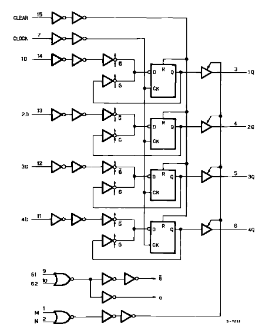
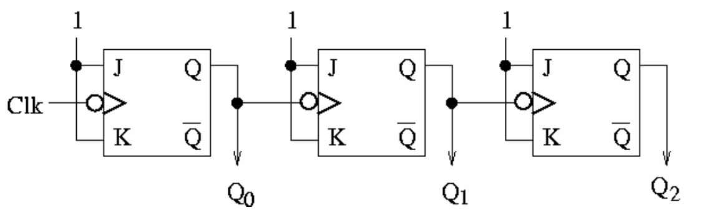
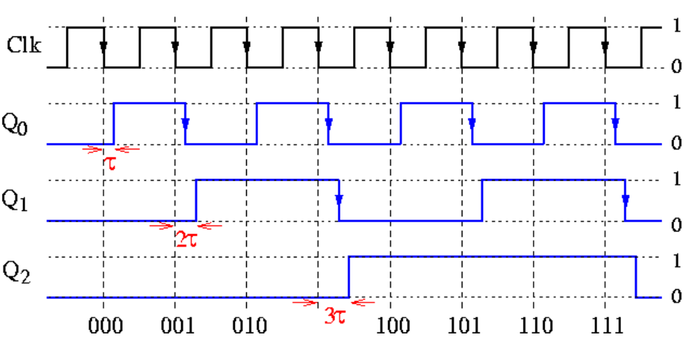
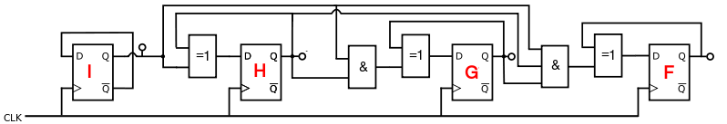

<!--

author:   Sebastian Zug & André Dietrich & Fabian Bär & Claude Code (Opus 5.5)
email:    sebastian.zug@informatik.tu-freiberg.de & andre.dietrich@informatik.tu-freiberg.de & fabian.baer@student.tu-freiberg.de
version:  0.1.0
language: de
narrator: Deutsch Female

import:   https://raw.githubusercontent.com/liascript-templates/plantUML/master/README.md
          https://raw.githubusercontent.com/LiaTemplates/DigiSim/master/README.md
          https://raw.githubusercontent.com/liaTemplates/AVR8js/main/README.md
          https://raw.githubusercontent.com/TUBAF-IfI-LiaScript/VL_EingebetteteSysteme/master/config.md

mark: <span style="background-color: @0;
                                  display: flex;
                                  width: calc(100% + 32px);
                                  margin: -16px;
                                  padding: 6px 16px 6px 16px;
                                  ">@1</span>
red:  @mark(#FF888888,@0)
blue: @mark(lightblue,@0)
gray: @mark(gray,@0)

-->

[](https://liascript.github.io/course/?https://raw.githubusercontent.com/TUBAF-IfI-LiaScript/VL_EingebetteteSysteme/master/08_StandardSchaltwerke.md#1)

# Standardschaltwerke

| Parameter                | Kursinformationen                                                                                                                                                                                          |
| ------------------------ | ------------------------------------------------------------------------------------------------------------------------------------------------------------------------------------------ |
| **Veranstaltung:**       | @config.lecture                                                                                          |
| **Semester:**            | @config.semester                                                                                         |
| **Hochschule:**          | `Technische Universität Freiberg`                                                                        |
| **Inhalte:**             | `Ampelsteuerung als Schaltwerk, Register und Registerbank, Schieberegister, asynchrone und synchrone Zähler, Register und Zähler im ATmega328P`                 |
| **Link auf GitHub:**     | https://github.com/TUBAF-IfI-LiaScript/VL_EingebetteteSysteme/blob/master/08_StandardSchaltwerke.md    |
| **Autoren:**             | @author                                                                                                  |


---------------------------------------------------------------------

**Lernziele:** Nach dieser Vorlesung können Sie

+ den Entwurfsweg für Schaltwerke an einem Moore-Automaten mit JK-Flip-Flops anwenden (Ampelsteuerung),
+ ein Register aus D-Flip-Flops und Multiplexern aufbauen und erklären, wie Dekodierer und Multiplexer in einer Registerbank das Register zum Schreiben und Lesen auswählen,
+ den Aufbau eines Schieberegisters erklären und die Varianten SISO, SIPO, PISO und PIPO unterscheiden,
+ asynchrone und synchrone Zähler vergleichen, die falschen Zwischenwerte des asynchronen Zählers begründen und einen synchronen Binärzähler mit D-Flip-Flops herleiten,
+ Registerbank, Zähler und Schieberegister im ATmega328P wiederfinden.

<!-- kurslandkarte:knopf-start -->

<a href="https://tubaf-ifi-liascript.github.io/VL_EingebetteteSysteme/kurslandkarte/#termin=8" style="display: inline-block; padding: 0.5em 1.1em; background-color: #00718A; color: #ffffff; text-decoration: none; font-family: 'IBM Plex Sans', 'Segoe UI', system-ui, sans-serif; font-weight: 600;">🗺️ Diese Vorlesung in der Kurslandkarte →</a>

<!-- kurslandkarte:knopf-ende -->

--------------------------------------------------------------------

<!--
style="width: 80%; min-width: 420px; max-width: 720px;"
-->
```ascii

                Abstraktionsebenen

           +----------------------------+ -.
  Ebene 6  | Problemorientierte Sprache |  |
           +----------------------------+  |
                                           ⎬ Anwendungssoftware
           +----------------------------+  |
  Ebene 5  | Assemblersprache           |  |
           +----------------------------+ -.

           +----------------------------+
  Ebene 4  | Betriebssystem             |     Systemsoftware (fehlt beim ATmega328P)
           +----------------------------+

           +----------------------------+
  Ebene 3  | Instruktionsset            |     Maschinensprache
           +----------------------------+

           +----------------------------+  -.
  Ebene 2  | Mikroarchitektur           |   |
           +----------------------------+   |
                                            ⎬ Automaten, Speicher, Logik
           +----------------------------+   |       ╔═══════════════╗
  Ebene 1  | Digitale Logik             |   |    ◀══║ HIER SIND WIR!║
           +----------------------------+  -.       ╚═══════════════╝

           +----------------------------+
  Ebene 0  | E-Technik, Physik          |     Analoge Phänomene
           +----------------------------+                                      .
```

---------------------------------------------------------------------

## Aufwärmen

    --{{0}}--
In VL 06 haben wir Flipflops kennengelernt, in VL 07 daraus Schaltwerke entworfen. Heute geht es um Schaltwerke, die man so oft braucht, dass es sie als fertige Bausteine gibt, genau wie Dekodierer und Multiplexer bei den Schaltnetzen in VL 05.

Ein Zähler soll die Zahlen von 0 bis 15 durchlaufen. Jedes Flip-Flop speichert ein Bit.

**Wie viele Flip-Flops braucht der Zähler mindestens?**

[[4]]
***************************************************************

Der Zähler muss sich 16 verschiedene Zustände merken. Mit $n$ Flip-Flops lassen sich $2^n$ Zustände unterscheiden, also reichen $n = 4$: $2^4 = 16$. Vier Flip-Flops mit gemeinsamem Takt, die zusammen eine Zahl speichern, sind ein **Register**. Ein Zähler ist ein Register, das bei jedem Takt seinen Inhalt um eins erhöht.

***************************************************************

## Ampelsteuerung

    --{{0}}--
Zum Wiedereinstieg wenden wir den Entwurfsweg aus VL 07 noch einmal vollständig an, diesmal mit JK-Flip-Flops. Danach verlassen wir die Einzelentwürfe und bauen die Standardschaltwerke Register, Schieberegister und Zähler.

                          {{0-1}}
*******************************************************************************

Wir wollen eine Ampelanlage entwerfen, die durch einen Eingang $E$ getrieben wird, wobei der Wechsel zwischen den Zuständen von E eine Änderung der Ampelphase bewirkt. Die Umsetzung erfolgt als Moore-Automat.

<!--
style="width: 80%; min-width: 420px; max-width: 720px;"
-->
```ascii
      ^
      | --+--------+----------------+-----------+--------+--
Phase |   | Rot    | Rot-Gelb       | Grün      | Gelb   |
      | --+--------+----------------+-----------+--------+--
      |
      |   +--------+                +-----------+
E     |   |        |                |           |
      |---+        +----------------+           +---------
      +--------------------------------------------------+                          .
```

**1. Schritt: Aufstellen des Automatenmodels**

```text @plantUML.png
@startdot
digraph finite_state_machine {
    rankdir=LR;

    node [shape = point ]; qi
    node[shape=circle]
    A[label="Rot"];
    B[label="Rot\nGelb"];
    C[label="Grün"];
    D[label="Gelb"];

    qi -> A;
    A  -> A  [ label = "E=1" ];
    A  -> B  [ label = "E=0" ];
    B  -> B  [ label = "E=0"];
    B  -> C  [ label = "E=1" ];
    C  -> C  [ label = "E= 1"];
    C  -> D  [ label = "E= 0"];
    D  -> D  [ label = "E= 0"];
    D  -> A [ label = "E= 1"];
}
@enddot
```


*******************************************************************************

                               {{0-3}}
*******************************************************************************
**2. Schritt: Erstellen der Zustandstabelle**

<!-- data-type="none" -->
| Vorhergehender Zustand | Eingabe $E$ | Nachfolgezustand |
| ---------------------- | ----------- | ---------------- |
| Rot                    | 0           | RotGelb          |
| Rot                    | 1           | Rot              |
| RotGelb                | 0           | RotGelb          |
| RotGelb                | 1           | Grün             |
| Grün                   | 0           | Gelb             |
| Grün                   | 1           | Grün             |
| Gelb                   | 0           | Gelb             |
| Gelb                   | 1           | Rot              |


*******************************************************************************

                               {{1-3}}
*******************************************************************************

**Schritt 3: Auswahl einer binären Zustandskodierung und Generierung einer binären Zustandstabelle**

<!-- data-type="none" -->
| Zustand | G   | F   |
| ------- | --- | --- |
| Rot     | 0   | 0   |
| RotGelb | 0   | 1   |
| Grün    | 1   | 0   |
| Gelb    | 1   | 1   |

> **Aufgabe:** Ergänzen Sie die Zustandsübergangstabelle!

<!-- data-type="none" -->
| G   | F   | E   | G'  | F'  |
| --- | --- | --- | --- | --- |
|     |     | 0   |     |     |
|     |     | 1   |     |     |
|     |     | 0   |     |     |
|     |     | 1   |     |     |
|     |     | 0   |     |     |
|     |     | 1   |     |     |
|     |     | 0   |     |     |
|     |     | 1   |     |     |

*******************************************************************************

                               {{2-3}}
*******************************************************************************

Lösung:

<!-- data-type="none" -->
| Vorhergehender Zustand | G   | F   | Eingabe $E$ | Nachfolgezustand | G'  | F'  |
| ---------------------- | --- | --- | ----------- | ---------------- | --- | --- |
| Rot                    | 0   | 0   | 0           | RotGelb          | 0   | 1   |
| Rot                    | 0   | 0   | 1           | Rot              | 0   | 0   |
| RotGelb                | 0   | 1   | 0           | RotGelb          | 0   | 1   |
| RotGelb                | 0   | 1   | 1           | Grün             | 1   | 0   |
| Grün                   | 1   | 0   | 0           | Gelb             | 1   | 1   |
| Grün                   | 1   | 0   | 1           | Grün             | 1   | 0   |
| Gelb                   | 1   | 1   | 0           | Gelb             | 1   | 1   |
| Gelb                   | 1   | 1   | 1           | Rot              | 0   | 0   |

*******************************************************************************

                              {{3-5}}
*******************************************************************************

**Schritt 4: Auswahl eines Flip-Flop Typs und Ermittlung der für jeden Zustandsübergang benötigten Flip-Flop Ansteuerungen**

Wir entscheiden uns für einen JK-Flip-Flop für die Realisierung. Die entsprechende invertierte Wahrheitstafel haben Sie zwischenzeitlich im Kopf:

<!-- data-type="none" -->
| $Q(t)$ | $Q(t+1)$ | $J$ | $K$ |
| ------ | -------- | --- | --- |
| 0      | 0        | 0   | $d$ |
| 0      | 1        | 1   | $d$ |
| 1      | 0        | $d$ | 1   |
| 1      | 1        | $d$ | 0   |

Schauen wir zunächst auf den Flip-Flop G, dessen Eingangsbelegung muss also auf die erwarteten Zustandsübergänge abgebildet werden.

<!-- data-type="none" -->
| @blue(G) | F   | E   | @blue(G') | F'  | @gray(JG) | @gray(KG) | JF  | KF  |
| -------- | --- | --- | --------- | --- | --------- | --------- | --- | --- |
| @blue(0) | 0   | 0   | @blue(0)  | 1   | @gray(0)  | @gray(d)  |     |     |
| @blue(0) | 0   | 1   | @blue(0)  | 0   | @gray(0)  | @gray(d)  |     |     |
| @blue(0) | 1   | 0   | @blue(0)  | 1   | @gray(0)  | @gray(d)  |     |     |
| @blue(0) | 1   | 1   | @blue(1)  | 0   | @gray(1)  | @gray(d)  |     |     |
| @blue(1) | 0   | 0   | @blue(1)  | 1   | @gray(d)  | @gray(0)  |     |     |
| @blue(1) | 0   | 1   | @blue(1)  | 0   | @gray(d)  | @gray(0)  |     |     |
| @blue(1) | 1   | 0   | @blue(1)  | 1   | @gray(d)  | @gray(0)  |     |     |
| @blue(1) | 1   | 1   | @blue(0)  | 0   | @gray(d)  | @gray(1)  |     |     |

> **Aufgabe:** Ergänzen Sie die Einträge für $JF$ und $KF$!

*******************************************************************************

                              {{4-5}}
*******************************************************************************

<!-- data-type="none" -->
| G   | @blue(F) | E   | G'  | @blue(F') | JG  | KG  | @gray(JF) | @gray(KF) |
| --- | -------- | --- | --- | --------- | --- | --- | --------- | --------- |
| 0   | @blue(0) | 0   | 0   | @blue(1)  | 0   | d   | @gray(1)  | @gray(d)  |
| 0   | @blue(0) | 1   | 0   | @blue(0)  | 0   | d   | @gray(0)  | @gray(d)  |
| 0   | @blue(1) | 0   | 0   | @blue(1)  | 0   | d   | @gray(d)  | @gray(0)  |
| 0   | @blue(1) | 1   | 1   | @blue(0)  | 1   | d   | @gray(d)  | @gray(1)  |
| 1   | @blue(0) | 0   | 1   | @blue(1)  | d   | 0   | @gray(1)  | @gray(d)  |
| 1   | @blue(0) | 1   | 1   | @blue(0)  | d   | 0   | @gray(0)  | @gray(d)  |
| 1   | @blue(1) | 0   | 1   | @blue(1)  | d   | 0   | @gray(d)  | @gray(0)  |
| 1   | @blue(1) | 1   | 0   | @blue(0)  | d   | 1   | @gray(d)  | @gray(1)  |

*******************************************************************************

                              {{5-7}}
*******************************************************************************

**Minimieren der Schaltung**

<!-- data-type="none" -->
| G   | F   | E   | JG  | KG  | JF  | KF  |
| --- | --- | --- | --- | --- | --- | --- |
| 0   | 0   | 0   | 0   | d   | 1   | d   |
| 0   | 0   | 1   | 0   | d   | 0   | d   |
| 0   | 1   | 0   | 0   | d   | d   | 0   |
| 0   | 1   | 1   | 1   | d   | d   | 1   |
| 1   | 0   | 0   | d   | 0   | 1   | d   |
| 1   | 0   | 1   | d   | 0   | 0   | d   |
| 1   | 1   | 0   | d   | 0   | d   | 0   |
| 1   | 1   | 1   | d   | 1   | d   | 1   |

> **Aufgabe:** Lesen Sie die minimierten Funktionen für die Flip-Flop-Eingänge ab!

*******************************************************************************

                              {{6-7}}
*******************************************************************************

<!--
style="width: 80%; min-width: 420px; max-width: 720px;"
-->
```ascii
         __    _           _               __    _          _
JG       GF    GF    GF   GF        JF     GF    GF   GF   GF
     _  +----+----+----+----+         _  +----+----+----+----+
     E  |    |    |  d | d  |         E  | 1  | d  | d  | 1  |
        +----+----+----+----+            +----+----+----+----+
     E  |    |  1 |  d | d  |         E  |    | d  | d  |    |
        +----+----+----+----+            +----+----+----+----+

         __    _          _                __   _          _
KG       GF    GF   GF   GF         KF     GF   GF   GF   GF
     _  +----+----+----+----+         _  +----+----+----+----+
     E  | d  | d  |    |    |         E  | d  |    |    | d  |
        +----+----+----+----+            +----+----+----+----+
     E  | d  | d  |  1 |    |         E  | d  | 1  | 1  | d  |
        +----+----+----+----+            +----+----+----+----+                .
```

Damit lassen sich folgende Funktionen ablesen:

$$
\begin{aligned}
JG &= FE \\
KG &= FE \\
JF &= \overline{E} \\
KF &= E \\
\end{aligned}
$$

*******************************************************************************

                              {{7-8}}
*******************************************************************************

**Ausgabelogik**

Die Ansteuerung der drei Ausgabeleitungen R, Gr, Ge ergibt sich aus den Zuständen:

<!-- data-type="none" -->
| Zustand | G   | F   | @gray($R$) | @gray($Gr$) | @gray($Ge$) |
| ------- | --- | --- | ---------- | ----------- | ----------- |
| Rot     | 0   | 0   | @gray($1$) | @gray($0$)  | @gray($0$)  |
| RotGelb | 0   | 1   | @gray($1$) | @gray($0$)  | @gray($1$)  |
| Grün    | 1   | 0   | @gray($0$) | @gray($1$)  | @gray($0$)  |
| Gelb    | 1   | 1   | @gray($0$) | @gray($0$)  | @gray($1$)  |

$$
\begin{aligned}
R  &= \overline{G} \\
Gr &= G\overline{F} \\
Ge &= F
\end{aligned}
$$

*******************************************************************************

                              {{8-9}}
*******************************************************************************

> Wie sehen alternative Umsetzungen aus?

<div>
  <wokwi-led color="red" pin="13" port="B" label="13"></wokwi-led>
  <wokwi-led color="yellow" pin="12" port="B" label="12"></wokwi-led>
  <wokwi-led color="green" pin="11" port="B" label="11"></wokwi-led>
  <span id="simulation-time"></span>
</div>

```cpp       statemachine.cpp
typedef struct {
    int state;
    int next;
    int A_red;
    int A_yellow;
    int A_green;
    int timer;
} tl_state_t;    // Traffic light state

tl_state_t states[4] = {
// state     A_red             timer
//  |   next  |  A_yellow       |
//  |    |    |   |    A_green  |
//----------------------------------------------
{   0,   1,   1,  0,    0,      3},
{   1,   2,   1,  1,    0,      1 },
{   2,   3,   0,  0,    1,      3},
{   3,   0,   0,  1,    0,      1,}
};

const int greenPin = 11;
const int yellowPin = 12;
const int redPin = 13;
int state = 0;

void setup() {
  pinMode(greenPin, OUTPUT);
  pinMode(yellowPin, OUTPUT);
  pinMode(redPin, OUTPUT);
}

void loop() {
  if (states[state].A_red == 1) digitalWrite(redPin, HIGH);
  else digitalWrite(redPin, LOW);
  if (states[state].A_yellow == 1) digitalWrite(yellowPin, HIGH);
  else digitalWrite(yellowPin, LOW);
  if (states[state].A_green == 1) digitalWrite(greenPin, HIGH);
  else digitalWrite(greenPin, LOW);
  delay(states[state].timer*1000);
  state =  states[state].next;
}
```
@AVR8js.sketch


| Methode                         | Bauteilkosten | Entwurf      | Variabilität |
| :------------------------------ | :------------ | :----------- | :----------- |
| Analoge Schaltung               | minimal       | aufwändig    | gering       |
| Digitale Logik                  | gering        | einfach      | mittel       |
| Software (eingebetteter $\mu$C) | überschaubar  | einfach      | hoch         |
| Software (PC)                   | hoch          | sehr einfach | hoch         |

*******************************************************************************

## Register

    --{{0}}--
Ein Register speichert ein Datenwort, zum Beispiel 4 oder 8 Bit. Wir bauen es in drei Schritten: zuerst eine Speicherzelle für ein Bit, dann vier davon nebeneinander, und schließlich mehrere Register, aus denen eine Adresse eines auswählt.

> **Merke:** Ein Register besteht aus mehreren D-Flip-Flops mit gemeinsamem Takt. Zusammen speichern sie ein Datenwort.

**Schritt 1: Eine Speicherzelle für ein Bit**

Ein D-Flip-Flop übernimmt bei jeder steigenden Taktflanke den Wert an $D$. Ein Speicher soll aber nur dann einen neuen Wert annehmen, wenn wir es wollen. Dafür sorgt ein Multiplexer aus VL 05 vor dem Eingang $D$:

<!--
style="width: 80%; min-width: 420px; max-width: 620px;"
-->
```ascii
         +--------------------------------------+
         |      +-----+                         |
         +----->| 0   |        +-------+        |
                | MUX +------->| D   Q +--------+-----> Q
  Daten ------->| 1   |     +->|▷      |
                +--+--+     |  +-------+
                   ^        |
                   |        |
               Schreiben   Takt                                     .
```

+ **Schreiben = 0:** Der Multiplexer gibt $Q$ zurück an $D$. Bei jedem Takt übernimmt das Flip-Flop seinen eigenen Wert, der Inhalt bleibt erhalten.
+ **Schreiben = 1:** Der Multiplexer legt die Daten an $D$. Mit der nächsten steigenden Taktflanke übernimmt das Flip-Flop den neuen Wert.

Probieren Sie es aus: Setzen Sie **Daten** auf 1 und klicken Sie zweimal auf **Takt** (einmal an, einmal aus). $Q$ bleibt 0. Schalten Sie dann **Schreiben** ein und takten Sie erneut.

``` json @DigiSim.evalJson
{"router":"manhattan","devices":{"d":{"type":"Button","label":"Daten","propagation":0,"position":{"x":0,"y":90}},"we":{"type":"Button","label":"Schreiben","propagation":0,"position":{"x":0,"y":0}},"clk":{"type":"Button","label":"Takt","propagation":0,"position":{"x":0,"y":190}},"mux":{"type":"Mux","bits":{"in":1,"sel":1},"propagation":0,"position":{"x":160,"y":60}},"ff":{"type":"Dff","bits":1,"initial":"0","propagation":1,"polarity":{"clock":true},"position":{"x":300,"y":70}},"q":{"type":"Lamp","label":"Q","propagation":0,"position":{"x":480,"y":75}}},"connectors":[{"from":{"id":"ff","port":"out"},"to":{"id":"mux","port":"in0"}},{"from":{"id":"d","port":"out"},"to":{"id":"mux","port":"in1"}},{"from":{"id":"we","port":"out"},"to":{"id":"mux","port":"sel"}},{"from":{"id":"mux","port":"out"},"to":{"id":"ff","port":"in"}},{"from":{"id":"clk","port":"out"},"to":{"id":"ff","port":"clk"}},{"from":{"id":"ff","port":"out"},"to":{"id":"q","port":"in"}}]}
```

**Was passiert ohne den Multiplexer, wenn die Daten direkt an $D$ hängen?**

[( )] Das Flip-Flop behält seinen Wert, bis Schreiben auf 1 geht.
[(X)] Jede Taktflanke überschreibt den gespeicherten Wert mit dem, was gerade an den Daten anliegt.
[( )] Das Flip-Flop speichert gar nichts mehr.
***************************************************************

Ein D-Flip-Flop übernimmt bei jeder Taktflanke den Wert an $D$. Der Takt läuft aber ständig, im Rechner viele Millionen Mal pro Sekunde. Erst der Multiplexer entscheidet, ob bei einer Flanke der neue Wert oder der alte Inhalt übernommen wird.

***************************************************************

**Schritt 2: Vier Zellen nebeneinander**

Ein 4-Bit-Register besteht aus vier solchen Zellen. Alle vier teilen sich Takt und Schreiben, jede hat ihr eigenes Datenbit. In der Simulation sind die vier Zellen zu einem 4-Bit-Multiplexer und einem 4-Bit-Flip-Flop zusammengefasst; die Leitungen tragen 4 Bit.

``` json @DigiSim.evalJson
{"router":"manhattan","devices":{"d":{"type":"NumEntry","label":"D","bits":4,"numbase":"bin","propagation":0,"position":{"x":0,"y":90}},"we":{"type":"Button","label":"Schreiben","propagation":0,"position":{"x":0,"y":0}},"clk":{"type":"Button","label":"Takt","propagation":0,"position":{"x":0,"y":190}},"mux":{"type":"Mux","bits":{"in":4,"sel":1},"propagation":0,"position":{"x":160,"y":60}},"ff":{"type":"Dff","bits":4,"initial":"0000","propagation":1,"polarity":{"clock":true},"position":{"x":300,"y":70}},"q":{"type":"NumDisplay","label":"Q","bits":4,"numbase":"bin","propagation":0,"position":{"x":480,"y":75}}},"connectors":[{"from":{"id":"ff","port":"out"},"to":{"id":"mux","port":"in0"}},{"from":{"id":"d","port":"out"},"to":{"id":"mux","port":"in1"}},{"from":{"id":"we","port":"out"},"to":{"id":"mux","port":"sel"}},{"from":{"id":"mux","port":"out"},"to":{"id":"ff","port":"in"}},{"from":{"id":"clk","port":"out"},"to":{"id":"ff","port":"clk"}},{"from":{"id":"ff","port":"out"},"to":{"id":"q","port":"in"}}]}
```

Als fertiger Baustein heißt das zum Beispiel 74HC173. Im Logikplan aus dem Datenblatt finden Sie unsere Zelle viermal wieder:



[^1]: SGS Thomson, Datenblatt 74HC173, "Quad D-Type Register", [Link](https://cdn-reichelt.de/documents/datenblatt/A240/74HC173%23STM.pdf)

+ Vor jedem Flip-Flop stehen zwei Treiber, die mit $G$ und $\overline{G}$ abwechselnd durchschalten. Einer leitet das Datenbit 1D … 4D weiter, der andere die Rückführung von $Q$. Zusammen sind sie unser 2:1-Multiplexer.
+ $G$ entsteht aus den Eingängen G1 und G2 über ein NOR: Nur wenn beide auf 0 liegen, übernimmt das Register neue Daten. Das ist unser Eingang **Schreiben**.
+ CLEAR setzt alle vier Flip-Flops auf 0. Über M und N lassen sich die Ausgänge 1Q … 4Q abschalten. Dann kann ein anderer Baustein dieselben Leitungen benutzen.

**Wie viele D-Flip-Flops enthält ein 8-Bit-Register?**

[[8]]
***************************************************************

Ein Flip-Flop pro Bit, also acht. Alle acht teilen sich den Takt und das Signal Schreiben.

***************************************************************

### Registerbank

    --{{0}}--
Ein Rechner braucht mehr als ein Register. Würden wir jedes einzeln verdrahten, bräuchte jedes eigene Daten- und Steuerleitungen. Stattdessen nummerieren wir die Register und wählen über eine Adresse aus, welches beschrieben und welches gelesen wird. Dafür brauchen wir genau die beiden Bausteine aus VL 05.

Vier Register teilen sich die Datenleitungen und den Takt. Eine **Adresse** legt fest, welches Register beschrieben und welches gelesen wird:

+ **Schreiben:** Ein **Dekodierer** macht aus der 2-Bit-Schreibadresse vier Leitungen WE0 … WE3, von denen genau eine aktiv ist. Nur das ausgewählte Register übernimmt beim Takt die Daten. Der Eingang EN des Dekodierers schaltet alle vier Leitungen ab, wenn nicht geschrieben werden soll.
+ **Lesen:** Ein **Multiplexer** schaltet den Inhalt des Registers, das die Leseadresse angibt, auf den Ausgang.

<!--
style="width: 80%; min-width: 420px; max-width: 720px;"
-->
```ascii
                                      +----+
              +-------- WE0 --------->| R0 +------------->+-----+
              |                       +----+              |     |
          +---+----+                                      |     |
          |        |                  +----+              |     |
 Adresse  |  Deko- +------ WE1 ------>| R1 +------------->|     |
 -------->|  dierer|                  +----+              |     |
          |        |                                      | MUX +----> gelesen
 -------->|        |                  +----+              |     |
 Schreiben|        +------ WE2 ------>| R2 +------------->|     |
          |        |                  +----+              |     |
          +---+----+                                      |     |
              |                       +----+              |     |
              +-------- WE3 --------->| R3 +------------->+--+--+
                                      +----+                 ^
                                                             |
      Daten und Takt gehen an alle Register            Leseadresse     .
```

Der Kasten „Register“ ist die Schaltung aus Schritt 2, der Kasten „2-zu-4-Dekodierer“ ein Dekodierer aus UND- und NICHT-Gattern wie in VL 05. Schreiben Sie zum Beispiel 9 in R2: Schreibadresse 2, Daten 1001, Schreiben ein, dann einmal takten. Lesen Sie danach verschiedene Register über die Leseadresse aus.

``` json @DigiSim.evalJson
{"router":"manhattan","devices":{"wadr":{"type":"NumEntry","label":"Schreibadresse","bits":2,"numbase":"dec","propagation":0,"position":{"x":0,"y":20}},"we":{"type":"Button","label":"Schreiben","propagation":0,"position":{"x":0,"y":90}},"d":{"type":"NumEntry","label":"Daten","bits":4,"numbase":"bin","propagation":0,"position":{"x":0,"y":190}},"clk":{"type":"Button","label":"Takt","propagation":0,"position":{"x":0,"y":270}},"dec":{"type":"Subcircuit","celltype":"2-zu-4-Dekodierer","propagation":0,"position":{"x":130,"y":30}},"radr":{"type":"NumEntry","label":"Leseadresse","bits":2,"numbase":"dec","propagation":0,"position":{"x":520,"y":0}},"mux":{"type":"Mux","bits":{"in":4,"sel":2},"propagation":0,"position":{"x":630,"y":120}},"out":{"type":"NumDisplay","label":"gelesen","bits":4,"numbase":"bin","propagation":0,"position":{"x":720,"y":140}},"r0":{"type":"Subcircuit","celltype":"Register","label":"R0","propagation":0,"position":{"x":310,"y":10}},"v0":{"type":"NumDisplay","label":"R0","bits":4,"numbase":"bin","propagation":0,"position":{"x":490,"y":40}},"r1":{"type":"Subcircuit","celltype":"Register","label":"R1","propagation":0,"position":{"x":310,"y":98}},"v1":{"type":"NumDisplay","label":"R1","bits":4,"numbase":"bin","propagation":0,"position":{"x":490,"y":128}},"r2":{"type":"Subcircuit","celltype":"Register","label":"R2","propagation":0,"position":{"x":310,"y":186}},"v2":{"type":"NumDisplay","label":"R2","bits":4,"numbase":"bin","propagation":0,"position":{"x":490,"y":216}},"r3":{"type":"Subcircuit","celltype":"Register","label":"R3","propagation":0,"position":{"x":310,"y":274}},"v3":{"type":"NumDisplay","label":"R3","bits":4,"numbase":"bin","propagation":0,"position":{"x":490,"y":304}}},"connectors":[{"from":{"id":"wadr","port":"out"},"to":{"id":"dec","port":"A"}},{"from":{"id":"we","port":"out"},"to":{"id":"dec","port":"EN"}},{"from":{"id":"radr","port":"out"},"to":{"id":"mux","port":"sel"}},{"from":{"id":"mux","port":"out"},"to":{"id":"out","port":"in"}},{"from":{"id":"d","port":"out"},"to":{"id":"r0","port":"D"}},{"from":{"id":"dec","port":"y0"},"to":{"id":"r0","port":"WE"}},{"from":{"id":"clk","port":"out"},"to":{"id":"r0","port":"Takt"}},{"from":{"id":"r0","port":"Q"},"to":{"id":"v0","port":"in"}},{"from":{"id":"r0","port":"Q"},"to":{"id":"mux","port":"in0"}},{"from":{"id":"d","port":"out"},"to":{"id":"r1","port":"D"}},{"from":{"id":"dec","port":"y1"},"to":{"id":"r1","port":"WE"}},{"from":{"id":"clk","port":"out"},"to":{"id":"r1","port":"Takt"}},{"from":{"id":"r1","port":"Q"},"to":{"id":"v1","port":"in"}},{"from":{"id":"r1","port":"Q"},"to":{"id":"mux","port":"in1"}},{"from":{"id":"d","port":"out"},"to":{"id":"r2","port":"D"}},{"from":{"id":"dec","port":"y2"},"to":{"id":"r2","port":"WE"}},{"from":{"id":"clk","port":"out"},"to":{"id":"r2","port":"Takt"}},{"from":{"id":"r2","port":"Q"},"to":{"id":"v2","port":"in"}},{"from":{"id":"r2","port":"Q"},"to":{"id":"mux","port":"in2"}},{"from":{"id":"d","port":"out"},"to":{"id":"r3","port":"D"}},{"from":{"id":"dec","port":"y3"},"to":{"id":"r3","port":"WE"}},{"from":{"id":"clk","port":"out"},"to":{"id":"r3","port":"Takt"}},{"from":{"id":"r3","port":"Q"},"to":{"id":"v3","port":"in"}},{"from":{"id":"r3","port":"Q"},"to":{"id":"mux","port":"in3"}}],"subcircuits":{"Register":{"devices":{"d":{"type":"Input","net":"D","bits":4,"label":"D","position":{"x":0,"y":90}},"we":{"type":"Input","net":"WE","bits":1,"label":"WE","position":{"x":0,"y":0}},"clk":{"type":"Input","net":"Takt","bits":1,"label":"Takt","position":{"x":0,"y":190}},"mux":{"type":"Mux","bits":{"in":4,"sel":1},"propagation":0,"position":{"x":160,"y":60}},"ff":{"type":"Dff","bits":4,"initial":"0000","propagation":1,"polarity":{"clock":true},"position":{"x":300,"y":70}},"q":{"type":"Output","net":"Q","bits":4,"label":"Q","position":{"x":480,"y":75}}},"connectors":[{"from":{"id":"ff","port":"out"},"to":{"id":"mux","port":"in0"}},{"from":{"id":"d","port":"out"},"to":{"id":"mux","port":"in1"}},{"from":{"id":"we","port":"out"},"to":{"id":"mux","port":"sel"}},{"from":{"id":"mux","port":"out"},"to":{"id":"ff","port":"in"}},{"from":{"id":"clk","port":"out"},"to":{"id":"ff","port":"clk"}},{"from":{"id":"ff","port":"out"},"to":{"id":"q","port":"in"}}]},"2-zu-4-Dekodierer":{"devices":{"a":{"type":"Input","net":"A","bits":2,"label":"A","position":{"x":0,"y":60}},"en":{"type":"Input","net":"EN","bits":1,"label":"EN","position":{"x":0,"y":250}},"split":{"type":"BusUngroup","groups":[1,1],"propagation":0,"position":{"x":100,"y":60}},"n0":{"type":"Not","propagation":0,"position":{"x":180,"y":20}},"n1":{"type":"Not","propagation":0,"position":{"x":180,"y":110}},"g0":{"type":"And","propagation":0,"position":{"x":320,"y":0},"inputs":3},"g1":{"type":"And","propagation":0,"position":{"x":320,"y":80},"inputs":3},"g2":{"type":"And","propagation":0,"position":{"x":320,"y":160},"inputs":3},"g3":{"type":"And","propagation":0,"position":{"x":320,"y":240},"inputs":3},"y0":{"type":"Output","net":"y0","bits":1,"label":"y0","position":{"x":460,"y":10}},"y1":{"type":"Output","net":"y1","bits":1,"label":"y1","position":{"x":460,"y":90}},"y2":{"type":"Output","net":"y2","bits":1,"label":"y2","position":{"x":460,"y":170}},"y3":{"type":"Output","net":"y3","bits":1,"label":"y3","position":{"x":460,"y":250}}},"connectors":[{"from":{"id":"a","port":"out"},"to":{"id":"split","port":"in"}},{"from":{"id":"split","port":"out0"},"to":{"id":"n0","port":"in"}},{"from":{"id":"split","port":"out1"},"to":{"id":"n1","port":"in"}},{"from":{"id":"en","port":"out"},"to":{"id":"g0","port":"in1"}},{"from":{"id":"n1","port":"out"},"to":{"id":"g0","port":"in2"}},{"from":{"id":"n0","port":"out"},"to":{"id":"g0","port":"in3"}},{"from":{"id":"en","port":"out"},"to":{"id":"g1","port":"in1"}},{"from":{"id":"n1","port":"out"},"to":{"id":"g1","port":"in2"}},{"from":{"id":"split","port":"out0"},"to":{"id":"g1","port":"in3"}},{"from":{"id":"en","port":"out"},"to":{"id":"g2","port":"in1"}},{"from":{"id":"split","port":"out1"},"to":{"id":"g2","port":"in2"}},{"from":{"id":"n0","port":"out"},"to":{"id":"g2","port":"in3"}},{"from":{"id":"en","port":"out"},"to":{"id":"g3","port":"in1"}},{"from":{"id":"split","port":"out1"},"to":{"id":"g3","port":"in2"}},{"from":{"id":"split","port":"out0"},"to":{"id":"g3","port":"in3"}},{"from":{"id":"g0","port":"out"},"to":{"id":"y0","port":"in"}},{"from":{"id":"g1","port":"out"},"to":{"id":"y1","port":"in"}},{"from":{"id":"g2","port":"out"},"to":{"id":"y2","port":"in"}},{"from":{"id":"g3","port":"out"},"to":{"id":"y3","port":"in"}}]}}}
```

An der Registerbank sieht man zwei zentrale Größen einer Rechnerarchitektur:

+ Die **Wortbreite** (Datenbusbreite) gibt an, wie viele Bit ein Register fasst, hier 4, beim ATmega328P 8, bei heutigen PC-Prozessoren 64.
+ Die **Adressbreite** gibt an, wie viele Register sich unterscheiden lassen: Mit $n$ Adressbits sind es $2^n$.

**Wie viele Adressbits braucht eine Registerbank mit 32 Registern?**

[[5]]
***************************************************************

$2^5 = 32$. Genau diese Registerbank hat der ATmega328P, mehr dazu am Ende der Vorlesung.

***************************************************************

## Schieberegister

    --{{0}}--
Bisher übernimmt jedes Flip-Flop eines Registers sein eigenes Datenbit. Verbindet man stattdessen den Ausgang jedes Flip-Flops mit dem Eingang des nächsten, wandert der Inhalt bei jedem Takt eine Stelle weiter. Das ist ein Schieberegister.

In einem **Schieberegister** hängt der Ausgang $Q$ jedes Flip-Flops am Eingang $D$ des nächsten. Alle Flip-Flops teilen sich den Takt. Bei jeder Taktflanke übernimmt jedes Flip-Flop den Wert seines linken Nachbarn, der Inhalt wandert eine Stelle nach rechts. Das erste Flip-Flop übernimmt den Wert am seriellen Eingang.

<!--
style="width: 80%; min-width: 420px; max-width: 900px;"
-->
```ascii
                             Q3              Q2              Q1              Q0
                             ^               ^               ^               ^
                 +-------+   |   +-------+   |   +-------+   |   +-------+   |
 seriell ein --->| D   Q +---+-->| D   Q +---+-->| D   Q +---+-->| D   Q +---+---> seriell aus
                 | ▷     |       | ▷     |       | ▷     |       | ▷     |
                 +---+---+       +---+---+       +---+---+       +---+---+
                     |               |               |               |
 Takt ---------------+---------------+---------------+---------------+                .
```

Bei jeder Flanke geschieht das gleichzeitig: Jedes Flip-Flop übernimmt den Wert, den sein Nachbar **vor** der Flanke hatte. Das funktioniert, weil flankengesteuerte Flip-Flops ihren Eingang nur im Moment der Flanke lesen (VL 06).

Schicken Sie die Zahl $1101_2 = 13$ hinein, das niederwertigste Bit zuerst: Eingang 1, Takt an und aus; Eingang 0, Takt; Eingang 1, Takt; Eingang 1, Takt. Danach steht die Zahl parallel an Q3 … Q0.

``` json @DigiSim.evalJson
{"router":"manhattan","devices":{"s":{"type":"Button","label":"Eingang","propagation":0,"position":{"x":0,"y":30}},"clk":{"type":"Button","label":"Takt","propagation":0,"position":{"x":0,"y":130}},"grp":{"type":"BusGroup","groups":[1,1,1,1],"propagation":0,"position":{"x":620,"y":200}},"num":{"type":"NumDisplay","label":"Q3 Q2 Q1 Q0","bits":4,"numbase":"bin","propagation":0,"position":{"x":700,"y":215}},"f3":{"type":"Dff","bits":1,"initial":"0","propagation":1,"polarity":{"clock":true},"position":{"x":110,"y":30},"label":"Q3"},"f2":{"type":"Dff","bits":1,"initial":"0","propagation":1,"polarity":{"clock":true},"position":{"x":260,"y":30},"label":"Q2"},"f1":{"type":"Dff","bits":1,"initial":"0","propagation":1,"polarity":{"clock":true},"position":{"x":410,"y":30},"label":"Q1"},"f0":{"type":"Dff","bits":1,"initial":"0","propagation":1,"polarity":{"clock":true},"position":{"x":560,"y":30},"label":"Q0"},"so":{"type":"Lamp","label":"seriell aus","propagation":0,"position":{"x":720,"y":35}}},"connectors":[{"from":{"id":"grp","port":"out"},"to":{"id":"num","port":"in"}},{"from":{"id":"s","port":"out"},"to":{"id":"f3","port":"in"}},{"from":{"id":"clk","port":"out"},"to":{"id":"f3","port":"clk"}},{"from":{"id":"f3","port":"out"},"to":{"id":"grp","port":"in3"}},{"from":{"id":"f3","port":"out"},"to":{"id":"f2","port":"in"}},{"from":{"id":"clk","port":"out"},"to":{"id":"f2","port":"clk"}},{"from":{"id":"f2","port":"out"},"to":{"id":"grp","port":"in2"}},{"from":{"id":"f2","port":"out"},"to":{"id":"f1","port":"in"}},{"from":{"id":"clk","port":"out"},"to":{"id":"f1","port":"clk"}},{"from":{"id":"f1","port":"out"},"to":{"id":"grp","port":"in1"}},{"from":{"id":"f1","port":"out"},"to":{"id":"f0","port":"in"}},{"from":{"id":"clk","port":"out"},"to":{"id":"f0","port":"clk"}},{"from":{"id":"f0","port":"out"},"to":{"id":"grp","port":"in0"}},{"from":{"id":"f0","port":"out"},"to":{"id":"so","port":"in"}}]}
```

**Nach wie vielen Takten erscheint das erste eingegebene Bit am seriellen Ausgang eines 8-Bit-Schieberegisters?**

[[8]]
***************************************************************

Mit dem ersten Takt landet das Bit im ersten Flip-Flop, mit jedem weiteren Takt eine Stelle weiter. Nach 8 Takten steht es im letzten Flip-Flop und damit am Ausgang. Ein Schieberegister verzögert ein Signal also um so viele Takte, wie es Stellen hat.

***************************************************************

**Parallel laden, seriell ausgeben**

Für die umgekehrte Richtung, also ein Datenwort auf einmal laden und dann Bit für Bit ausgeben, kommt wieder ein Multiplexer vor jedes Flip-Flop. Er wählt zwischen dem Nachbarn (**schieben**, Laden = 0) und dem parallelen Eingang (**laden**, Laden = 1). Laden Sie 1011 und schieben Sie dann viermal: Am seriellen Ausgang erscheinen 1, 1, 0, 1, das niederwertigste Bit zuerst.

``` json @DigiSim.evalJson
{"router":"manhattan","devices":{"p":{"type":"NumEntry","label":"parallel ein","bits":4,"numbase":"bin","propagation":0,"position":{"x":0,"y":250}},"split":{"type":"BusUngroup","groups":[1,1,1,1],"propagation":0,"position":{"x":110,"y":250}},"load":{"type":"Button","label":"Laden","propagation":0,"position":{"x":0,"y":0}},"clk":{"type":"Button","label":"Takt","propagation":0,"position":{"x":0,"y":160}},"zero":{"type":"Constant","constant":"0","propagation":0,"position":{"x":110,"y":75}},"grp":{"type":"BusGroup","groups":[1,1,1,1],"propagation":0,"position":{"x":680,"y":230}},"num":{"type":"NumDisplay","label":"Q3 Q2 Q1 Q0","bits":4,"numbase":"bin","propagation":0,"position":{"x":750,"y":245}},"m3":{"type":"Mux","bits":{"in":1,"sel":1},"propagation":0,"position":{"x":170,"y":60}},"f3":{"type":"Dff","bits":1,"initial":"0","propagation":1,"polarity":{"clock":true},"position":{"x":230,"y":70},"label":"Q3"},"m2":{"type":"Mux","bits":{"in":1,"sel":1},"propagation":0,"position":{"x":310,"y":60}},"f2":{"type":"Dff","bits":1,"initial":"0","propagation":1,"polarity":{"clock":true},"position":{"x":370,"y":70},"label":"Q2"},"m1":{"type":"Mux","bits":{"in":1,"sel":1},"propagation":0,"position":{"x":450,"y":60}},"f1":{"type":"Dff","bits":1,"initial":"0","propagation":1,"polarity":{"clock":true},"position":{"x":510,"y":70},"label":"Q1"},"m0":{"type":"Mux","bits":{"in":1,"sel":1},"propagation":0,"position":{"x":590,"y":60}},"f0":{"type":"Dff","bits":1,"initial":"0","propagation":1,"polarity":{"clock":true},"position":{"x":650,"y":70},"label":"Q0"},"so":{"type":"Lamp","label":"seriell aus","propagation":0,"position":{"x":780,"y":75}}},"connectors":[{"from":{"id":"p","port":"out"},"to":{"id":"split","port":"in"}},{"from":{"id":"grp","port":"out"},"to":{"id":"num","port":"in"}},{"from":{"id":"zero","port":"out"},"to":{"id":"m3","port":"in0"}},{"from":{"id":"split","port":"out3"},"to":{"id":"m3","port":"in1"}},{"from":{"id":"load","port":"out"},"to":{"id":"m3","port":"sel"}},{"from":{"id":"m3","port":"out"},"to":{"id":"f3","port":"in"}},{"from":{"id":"clk","port":"out"},"to":{"id":"f3","port":"clk"}},{"from":{"id":"f3","port":"out"},"to":{"id":"grp","port":"in3"}},{"from":{"id":"f3","port":"out"},"to":{"id":"m2","port":"in0"}},{"from":{"id":"split","port":"out2"},"to":{"id":"m2","port":"in1"}},{"from":{"id":"load","port":"out"},"to":{"id":"m2","port":"sel"}},{"from":{"id":"m2","port":"out"},"to":{"id":"f2","port":"in"}},{"from":{"id":"clk","port":"out"},"to":{"id":"f2","port":"clk"}},{"from":{"id":"f2","port":"out"},"to":{"id":"grp","port":"in2"}},{"from":{"id":"f2","port":"out"},"to":{"id":"m1","port":"in0"}},{"from":{"id":"split","port":"out1"},"to":{"id":"m1","port":"in1"}},{"from":{"id":"load","port":"out"},"to":{"id":"m1","port":"sel"}},{"from":{"id":"m1","port":"out"},"to":{"id":"f1","port":"in"}},{"from":{"id":"clk","port":"out"},"to":{"id":"f1","port":"clk"}},{"from":{"id":"f1","port":"out"},"to":{"id":"grp","port":"in1"}},{"from":{"id":"f1","port":"out"},"to":{"id":"m0","port":"in0"}},{"from":{"id":"split","port":"out0"},"to":{"id":"m0","port":"in1"}},{"from":{"id":"load","port":"out"},"to":{"id":"m0","port":"sel"}},{"from":{"id":"m0","port":"out"},"to":{"id":"f0","port":"in"}},{"from":{"id":"clk","port":"out"},"to":{"id":"f0","port":"clk"}},{"from":{"id":"f0","port":"out"},"to":{"id":"grp","port":"in0"}},{"from":{"id":"f0","port":"out"},"to":{"id":"so","port":"in"}}]}
```

**Vier Varianten**

Je nachdem, ob die Daten bitweise nacheinander (seriell) oder alle zugleich (parallel) hinein- und herausgehen, unterscheidet man vier Varianten:

<!--
style="width: 80%; min-width: 420px; max-width: 720px;"
-->
```ascii
                                      |   |   |   |
SISO                          PISO    v   v   v   v
      +---+---+---+---+             +---+---+---+---+
 ---->|   |   |   |   |---->        |   |   |   |   |---->
      +---+---+---+---+             +---+---+---+---+

                                      |   |   |   |
SIPO                          PIPO    v   v   v   v
      +---+---+---+---+             +---+---+---+---+
 ---->|   |   |   |   |             |   |   |   |   |
      +---+---+---+---+             +---+---+---+---+
        |   |   |   |                 |   |   |   |
        v   v   v   v                 v   v   v   v                            .
```

<!-- data-type="none" -->
| Variante | Bedeutung                     | Anwendung                                                            |
| -------- | ----------------------------- | -------------------------------------------------------------------- |
| SISO     | seriell rein, seriell raus    | Verzögerung um $n$ Takte                                             |
| SIPO     | seriell rein, parallel raus   | Empfangen: serielle Daten (z. B. von einer Schnittstelle) in ein Datenwort umwandeln |
| PISO     | parallel rein, seriell raus   | Senden: ein Datenwort Bit für Bit über eine Leitung ausgeben         |
| PIPO     | parallel rein, parallel raus  | reines Zwischenspeichern, das Register aus dem vorigen Abschnitt     |

Die erste Simulation ist SISO und SIPO zugleich, je nachdem, ob man nur den seriellen Ausgang oder alle vier Ausgänge benutzt. Die zweite ist PISO.

> Der **Schieber** aus VL 05 verschiebt ein Datenwort in einem Schritt um beliebig viele Stellen. Er ist ein Schaltnetz und speichert nichts. Das **Schieberegister** speichert sein Datenwort und verschiebt es pro Takt um genau eine Stelle.

## Zähler

    --{{0}}--
Ein Zähler ist ein Schaltwerk, das bei jedem Impuls in den nächsten Zustand wechselt. Wir vergleichen zwei Bauweisen. Die einfache, asynchrone hat einen Haken, den Sie in der Simulation sehen können.

Ein **Zähler** ist ein Schaltwerk, das Eingangsimpulse auf aufeinanderfolgende Zustände abbildet. Mit Zählern lassen sich Ereignisse zählen, Zeiten messen und Folgen von Signalen erzeugen. Man unterscheidet sie nach drei Merkmalen:

+ **Taktung:** In einem **synchronen** Zähler hängen alle Flip-Flops an derselben Taktleitung und schalten gleichzeitig. In einem **asynchronen** Zähler taktet jedes Flip-Flop das nächste. Das ist einfacher, aber das Ergebnis hängt von den Laufzeiten der Bauteile ab.
+ **Zahlenformat:** Binärzähler zählen im Dualsystem. Es gibt auch Dezimalzähler im BCD-Code oder Zähler im Gray-Code, bei denen sich von Schritt zu Schritt immer nur ein Bit ändert.
+ **Zählrichtung:** Vorwärtszähler erhöhen, Rückwärtszähler verringern den Zählerstand. Zähler für beide Richtungen brauchen eine zusätzliche Steuerleitung.

### Asynchroner Zähler

Jedes Flip-Flop arbeitet als **Kipp-Flip-Flop**: Bei jeder Taktflanke wechselt es seinen Zustand. Im Bild ist das ein JK-Flip-Flop mit $J = K = 1$ (VL 06), in der Simulation unten ein D-Flip-Flop, dessen Ausgang über ein NICHT-Gatter auf $D$ zurückgeführt ist. Den Takt für das nächste Flip-Flop liefert der Ausgang des vorigen:

+ $Q_0$ wechselt bei jeder fallenden Flanke des Takts.
+ $Q_1$ wechselt, wenn $Q_0$ von 1 auf 0 fällt, $Q_2$, wenn $Q_1$ fällt, und so weiter.

Das ergibt genau die Dualzahlen: Ein Bit wechselt immer dann, wenn das nächst niedrigere von 1 auf 0 springt.

<!-- style="width: 80%; max-width: 800px;" -->

Jedes Flip-Flop braucht eine Laufzeit $\tau$, bis sein Ausgang wechselt. Im Zeitverlauf sieht man, dass sich die Verzögerungen addieren: $Q_1$ wechselt erst $2\tau$ nach der Taktflanke, $Q_2$ erst $3\tau$ danach.

<!-- style="width: 80%; max-width: 1200px;" -->

In der Simulation ist $\tau = 0{,}3$ s. Das ist stark verlangsamt, echte Flip-Flops brauchen wenige Nanosekunden, aber das Prinzip ist dasselbe. Damit ein Klick sofort zählt, reagiert das erste Flip-Flop hier auf die steigende Flanke. Klicken Sie den Zähler bis 7 (jeder Takt: einmal an, einmal aus) und beobachten Sie den Zählerstand beim nächsten Takt genau.

``` json @DigiSim.evalJson
{"router":"manhattan","devices":{"clk":{"type":"Button","label":"Takt","propagation":0,"position":{"x":0,"y":40}},"grp":{"type":"BusGroup","groups":[1,1,1,1],"propagation":0,"position":{"x":640,"y":200}},"num":{"type":"NumDisplay","label":"Zählerstand","bits":4,"numbase":"dec","propagation":0,"position":{"x":720,"y":190}},"bin":{"type":"NumDisplay","label":"binär","bits":4,"numbase":"bin","propagation":0,"position":{"x":720,"y":260}},"f0":{"type":"Dff","bits":1,"initial":"0","propagation":30,"polarity":{"clock":true},"position":{"x":120,"y":30},"label":"Q0"},"n0":{"type":"Not","propagation":0,"position":{"x":70,"y":110}},"f1":{"type":"Dff","bits":1,"initial":"0","propagation":30,"polarity":{"clock":false},"position":{"x":270,"y":30},"label":"Q1"},"n1":{"type":"Not","propagation":0,"position":{"x":220,"y":110}},"f2":{"type":"Dff","bits":1,"initial":"0","propagation":30,"polarity":{"clock":false},"position":{"x":420,"y":30},"label":"Q2"},"n2":{"type":"Not","propagation":0,"position":{"x":370,"y":110}},"f3":{"type":"Dff","bits":1,"initial":"0","propagation":30,"polarity":{"clock":false},"position":{"x":570,"y":30},"label":"Q3"},"n3":{"type":"Not","propagation":0,"position":{"x":520,"y":110}}},"connectors":[{"from":{"id":"grp","port":"out"},"to":{"id":"num","port":"in"}},{"from":{"id":"grp","port":"out"},"to":{"id":"bin","port":"in"}},{"from":{"id":"clk","port":"out"},"to":{"id":"f0","port":"clk"}},{"from":{"id":"f0","port":"out"},"to":{"id":"n0","port":"in"}},{"from":{"id":"n0","port":"out"},"to":{"id":"f0","port":"in"}},{"from":{"id":"f0","port":"out"},"to":{"id":"grp","port":"in0"}},{"from":{"id":"f0","port":"out"},"to":{"id":"f1","port":"clk"}},{"from":{"id":"f1","port":"out"},"to":{"id":"n1","port":"in"}},{"from":{"id":"n1","port":"out"},"to":{"id":"f1","port":"in"}},{"from":{"id":"f1","port":"out"},"to":{"id":"grp","port":"in1"}},{"from":{"id":"f1","port":"out"},"to":{"id":"f2","port":"clk"}},{"from":{"id":"f2","port":"out"},"to":{"id":"n2","port":"in"}},{"from":{"id":"n2","port":"out"},"to":{"id":"f2","port":"in"}},{"from":{"id":"f2","port":"out"},"to":{"id":"grp","port":"in2"}},{"from":{"id":"f2","port":"out"},"to":{"id":"f3","port":"clk"}},{"from":{"id":"f3","port":"out"},"to":{"id":"n3","port":"in"}},{"from":{"id":"n3","port":"out"},"to":{"id":"f3","port":"in"}},{"from":{"id":"f3","port":"out"},"to":{"id":"grp","port":"in3"}}]}
```

**Welche Werte zeigt der Zähler kurzzeitig beim Übergang von 7 nach 8?**

[[ ]] 5
[[X]] 6
[[X]] 4
[[ ]] 2
[[X]] 0
***************************************************************

$Q_0$ fällt zuerst, der Zähler zeigt $0110_2 = 6$. Das kippt $Q_1$: $0100_2 = 4$. Das kippt $Q_2$: $0000_2 = 0$. Erst dann steigt $Q_3$ auf 1 und der Zähler zeigt 8. Der Wechsel läuft wie eine Welle durch die Kette, deshalb heißt der asynchrone Zähler auf Englisch auch *ripple counter*. Wer den Zählerstand in diesem Moment liest, bekommt einen falschen Wert.

***************************************************************

### Synchroner Zähler

    --{{0}}--
Beim synchronen Zähler hängen alle Flip-Flops am selben Takt. Damit schalten alle gleichzeitig, und es gibt keine falschen Zwischenwerte. Dafür muss eine Logik vor den Flip-Flops ausrechnen, welche Bits beim nächsten Takt wechseln.

Beim synchronen Zähler hängen alle Flip-Flops am selben Takt. Eine Logik vor den Flip-Flops berechnet den nächsten Zählerstand. Wir leiten sie mit dem Entwurfsweg aus VL 07 her. Der Zähler hat einen Eingang $E$: Bei $E = 1$ zählt er weiter, bei $E = 0$ bleibt er stehen.

```text @plantUML.png
@startdot
digraph finite_state_machine {
    rankdir=LR;

    node [shape = point ]; qi
    node[shape=circle]
    A[label="0000"];
    B[label="0001"];
    C[label="..."];
    D[label="1111"];

    qi -> A;
    A  -> A  [ label = "E=0" ];
    A  -> B  [ label = "E=1" ];
    B  -> B  [ label = "E=0"];
    B  -> C  [ label = "E=1" ];
    C  -> C  [ label = "E= 0"];
    C  -> D  [ label = "E= 1"];
    D  -> D  [ label = "E= 0"];
    D  -> A  [ label = "E= 1"];
}
@enddot
```

Für die Zahlen 0 bis 15 braucht der Zähler 16 Zustände, also 4 Flip-Flops $F$, $G$, $H$, $I$ ($F$ ist das höchstwertige Bit). Die Tabelle zeigt die Übergänge für $E = 1$. Den Fall $E = 0$ ergänzen wir unten.

<!-- data-type="none" -->
| F   | G   | H   | I   | F'  | G'  | H'  | I'  |
| --- | --- | --- | --- | --- | --- | --- | --- |
| 0   | 0   | 0   | 0   | 0   | 0   | 0   | 1   |
| 0   | 0   | 0   | 1   | 0   | 0   | 1   | 0   |
| 0   | 0   | 1   | 0   | 0   | 0   | 1   | 1   |
| 0   | 0   | 1   | 1   | 0   | 1   | 0   | 0   |
| 0   | 1   | 0   | 0   | 0   | 1   | 0   | 1   |
| 0   | 1   | 0   | 1   | 0   | 1   | 1   | 0   |
| 0   | 1   | 1   | 0   | 0   | 1   | 1   | 1   |
| 0   | 1   | 1   | 1   | 1   | 0   | 0   | 0   |
| 1   | 0   | 0   | 0   | 1   | 0   | 0   | 1   |
| 1   | 0   | 0   | 1   | 1   | 0   | 1   | 0   |
| 1   | 0   | 1   | 0   | 1   | 0   | 1   | 1   |
| 1   | 0   | 1   | 1   | 1   | 1   | 0   | 0   |
| 1   | 1   | 0   | 0   | 1   | 1   | 0   | 1   |
| 1   | 1   | 0   | 1   | 1   | 1   | 1   | 0   |
| 1   | 1   | 1   | 0   | 1   | 1   | 1   | 1   |
| 1   | 1   | 1   | 1   | 0   | 0   | 0   | 0   |

Mit D-Flip-Flops ist der nächste Zustand direkt der Wert an $D$: $D_F = F'$, $D_G = G'$ usw. Minimiert ergibt sich:

$$
\begin{aligned}
D_F &= \overline{I}F + \overline{G}F + \overline{H}F + IHG\overline{F} \\
D_G &= \overline{I}G + \overline{H}G + IH\overline{G}\\
D_H &= I\overline{H}+\overline{I}H\\
D_I &= \overline{I} \\
\end{aligned}
$$

Die Schaltung setzt diese Gleichungen mit XOR- und UND-Gattern um:

<!-- style="width: 80%; max-width: 800px;" -->

**Aufgabe:** Leiten Sie die gezeigte Realisierung aus den Gleichungen her.

    {{1}}
***************************************************************

Für $D_I$ und $D_H$ ist die Lösung direkt abzulesen: $D_I = \overline{I}$ und $D_H = I \oplus H$. Für $D_G$ muss man den Term umstellen. Die Schaltung setzt $D_G = IH \oplus G$ um:

$$
\begin{aligned}
D_G &= IH\oplus G \\
   &=  \overline{IH}G + IH\overline{G}\\
   &=  (\overline{I}+\overline{H})G + IH\overline{G}\\
   &= \overline{I}G + \overline{H}G + IH\overline{G}\\
\end{aligned}
$$

Ebenso ist $D_F = IHG \oplus F$.

***************************************************************

**Das Muster dahinter: Bits kippen mit XOR**

Die Gleichungen folgen einem einfachen Muster: Ein Zählerbit **wechselt**, wenn alle niederwertigeren Bits 1 sind, denn dann springt das nächst niedrigere Bit von 1 auf 0. Das bedingte Wechseln erledigt ein XOR:

$$
x \oplus 0 = x \qquad x \oplus 1 = \overline{x}
$$

Für einen Zähler mit den Bits $a$, $b$, $c$, $d$ ($a$ höchstwertig, $d$ niederwertigst) und dem Eingang *Zählen* gibt die Hilfsgröße $x_{flip}$ an, ob das Bit $x$ beim nächsten Takt wechselt:

$$
\begin{aligned}
d_{flip} &= \text{Zählen} & d' &= d \oplus d_{flip}\\
c_{flip} &= d_{flip} \cdot d & c' &= c \oplus c_{flip}\\
b_{flip} &= c_{flip} \cdot c & b' &= b \oplus b_{flip}\\
a_{flip} &= b_{flip} \cdot b & a' &= a \oplus a_{flip}\\
\text{Übertrag} &= a_{flip} \cdot a
\end{aligned}
$$

Damit ist auch der Fall $E = 0$ erledigt: Ist *Zählen* 0, sind alle $x_{flip}$ 0 und kein Bit wechselt. Der **Übertrag** wird 1, wenn der Zähler von 15 auf 0 überläuft. Er kann einen zweiten Zähler weiterschalten.

In der Simulation braucht jedes Flip-Flop wieder 0,3 s. Schalten Sie **Zählen** ein, zählen Sie bis 7 und beobachten Sie den Schritt auf 8:

``` json @DigiSim.evalJson
{"router":"manhattan","devices":{"count":{"type":"Button","label":"Zählen","propagation":0,"position":{"x":0,"y":230}},"clk":{"type":"Button","label":"Takt","propagation":0,"position":{"x":0,"y":320}},"cand":{"type":"And","propagation":0,"position":{"x":160,"y":0}},"carry":{"type":"Lamp","label":"Übertrag","propagation":0,"position":{"x":640,"y":5}},"grp":{"type":"BusGroup","groups":[1,1,1,1],"propagation":0,"position":{"x":640,"y":150}},"num":{"type":"NumDisplay","label":"Zählerstand","bits":4,"numbase":"dec","propagation":0,"position":{"x":720,"y":130}},"bin":{"type":"NumDisplay","label":"binär","bits":4,"numbase":"bin","propagation":0,"position":{"x":720,"y":200}},"xa":{"type":"Xor","propagation":0,"position":{"x":310,"y":60}},"fa":{"type":"Dff","bits":1,"initial":"0","propagation":30,"polarity":{"clock":true},"position":{"x":450,"y":60},"label":"a"},"ga":{"type":"And","propagation":0,"position":{"x":160,"y":90}},"xb":{"type":"Xor","propagation":0,"position":{"x":310,"y":130}},"fb":{"type":"Dff","bits":1,"initial":"0","propagation":30,"polarity":{"clock":true},"position":{"x":450,"y":130},"label":"b"},"gb":{"type":"And","propagation":0,"position":{"x":160,"y":160}},"xc":{"type":"Xor","propagation":0,"position":{"x":310,"y":200}},"fc":{"type":"Dff","bits":1,"initial":"0","propagation":30,"polarity":{"clock":true},"position":{"x":450,"y":200},"label":"c"},"gc":{"type":"And","propagation":0,"position":{"x":160,"y":230}},"xd":{"type":"Xor","propagation":0,"position":{"x":310,"y":270}},"fd":{"type":"Dff","bits":1,"initial":"0","propagation":30,"polarity":{"clock":true},"position":{"x":450,"y":270},"label":"d"}},"connectors":[{"from":{"id":"grp","port":"out"},"to":{"id":"num","port":"in"}},{"from":{"id":"grp","port":"out"},"to":{"id":"bin","port":"in"}},{"from":{"id":"xa","port":"out"},"to":{"id":"fa","port":"in"}},{"from":{"id":"clk","port":"out"},"to":{"id":"fa","port":"clk"}},{"from":{"id":"fa","port":"out"},"to":{"id":"xa","port":"in1"}},{"from":{"id":"fa","port":"out"},"to":{"id":"grp","port":"in3"}},{"from":{"id":"gb","port":"out"},"to":{"id":"ga","port":"in1"}},{"from":{"id":"fb","port":"out"},"to":{"id":"ga","port":"in2"}},{"from":{"id":"ga","port":"out"},"to":{"id":"xa","port":"in2"}},{"from":{"id":"xb","port":"out"},"to":{"id":"fb","port":"in"}},{"from":{"id":"clk","port":"out"},"to":{"id":"fb","port":"clk"}},{"from":{"id":"fb","port":"out"},"to":{"id":"xb","port":"in1"}},{"from":{"id":"fb","port":"out"},"to":{"id":"grp","port":"in2"}},{"from":{"id":"gc","port":"out"},"to":{"id":"gb","port":"in1"}},{"from":{"id":"fc","port":"out"},"to":{"id":"gb","port":"in2"}},{"from":{"id":"gb","port":"out"},"to":{"id":"xb","port":"in2"}},{"from":{"id":"xc","port":"out"},"to":{"id":"fc","port":"in"}},{"from":{"id":"clk","port":"out"},"to":{"id":"fc","port":"clk"}},{"from":{"id":"fc","port":"out"},"to":{"id":"xc","port":"in1"}},{"from":{"id":"fc","port":"out"},"to":{"id":"grp","port":"in1"}},{"from":{"id":"count","port":"out"},"to":{"id":"gc","port":"in1"}},{"from":{"id":"fd","port":"out"},"to":{"id":"gc","port":"in2"}},{"from":{"id":"gc","port":"out"},"to":{"id":"xc","port":"in2"}},{"from":{"id":"xd","port":"out"},"to":{"id":"fd","port":"in"}},{"from":{"id":"clk","port":"out"},"to":{"id":"fd","port":"clk"}},{"from":{"id":"fd","port":"out"},"to":{"id":"xd","port":"in1"}},{"from":{"id":"fd","port":"out"},"to":{"id":"grp","port":"in0"}},{"from":{"id":"count","port":"out"},"to":{"id":"xd","port":"in2"}},{"from":{"id":"ga","port":"out"},"to":{"id":"cand","port":"in1"}},{"from":{"id":"fa","port":"out"},"to":{"id":"cand","port":"in2"}},{"from":{"id":"cand","port":"out"},"to":{"id":"carry","port":"in"}}]}
```

Alle vier Flip-Flops schalten gleichzeitig, der Zähler springt direkt von 7 auf 8. Dafür muss die UND-Kette vor dem nächsten Takt fertig gerechnet haben: Bei vielen Bits läuft $x_{flip}$ durch viele Gatter. Dieselbe Kette begegnet uns in VL 09 beim Übertrag des Addierers wieder.

<!-- data-type="none" -->
|                         | asynchron                     | synchron                                   |
| ----------------------- | ----------------------------- | ------------------------------------------ |
| Takt                    | jedes Flip-Flop taktet das nächste | alle Flip-Flops am selben Takt        |
| Aufwand                 | nur Flip-Flops                | zusätzlich XOR- und UND-Gatter             |
| Zwischenwerte           | kurzzeitig falsche Zählerstände | keine                                    |
| Zählerstand gültig      | erst nach bis zu $n$ Flip-Flop-Laufzeiten | nach einer Flip-Flop-Laufzeit |
| höchster Takt begrenzt durch | Laufzeit eines Flip-Flops | Laufzeit der UND-Kette            |

### Zähler als Baustein

Ein synchroner Zähler ist ein Register, das bei jedem Takt den Wert $Q + 1$ übernimmt. Als Bausteine gezeichnet sind das ein Addierer, der 1 addiert, und das Register aus dem ersten Abschnitt. Der Multiplexer wählt wieder zwischen „behalten“ (Zählen = 0) und „neuer Wert“ (Zählen = 1):

``` json @DigiSim.evalJson
{"router":"manhattan","devices":{"en":{"type":"Button","label":"Zählen","propagation":0,"position":{"x":120,"y":0}},"clk":{"type":"Button","label":"Takt","propagation":0,"position":{"x":0,"y":190}},"one":{"type":"Constant","constant":"0001","propagation":0,"position":{"x":0,"y":110}},"add":{"type":"Addition","bits":{"in1":4,"in2":4,"out":4},"label":"+1","propagation":0,"position":{"x":100,"y":80}},"mux":{"type":"Mux","bits":{"in":4,"sel":1},"propagation":0,"position":{"x":260,"y":60}},"ff":{"type":"Dff","bits":4,"initial":"0000","propagation":30,"polarity":{"clock":true},"position":{"x":400,"y":70}},"num":{"type":"NumDisplay","label":"Zählerstand","bits":4,"numbase":"dec","propagation":0,"position":{"x":580,"y":40}},"bin":{"type":"NumDisplay","label":"binär","bits":4,"numbase":"bin","propagation":0,"position":{"x":580,"y":110}}},"connectors":[{"from":{"id":"ff","port":"out"},"to":{"id":"add","port":"in1"}},{"from":{"id":"one","port":"out"},"to":{"id":"add","port":"in2"}},{"from":{"id":"ff","port":"out"},"to":{"id":"mux","port":"in0"}},{"from":{"id":"add","port":"out"},"to":{"id":"mux","port":"in1"}},{"from":{"id":"en","port":"out"},"to":{"id":"mux","port":"sel"}},{"from":{"id":"mux","port":"out"},"to":{"id":"ff","port":"in"}},{"from":{"id":"clk","port":"out"},"to":{"id":"ff","port":"clk"}},{"from":{"id":"ff","port":"out"},"to":{"id":"num","port":"in"}},{"from":{"id":"ff","port":"out"},"to":{"id":"bin","port":"in"}}]}
```

> Genau so arbeitet der **Programmzähler** eines Prozessors: Ein Register hält die Adresse des nächsten Befehls und wird nach jedem Befehl um eins erhöht. Wie der Kasten „+1“ innen aussieht, ist Thema von VL 09; den Programmzähler sehen wir in VL 10 und VL 11 im Modellrechner wieder.

## Und im ATmega328P?

    --{{0}}--
Alle drei Standardschaltwerke von heute stecken im Mikrocontroller auf dem Arduino Uno: eine Registerbank, mehrere Zähler und Schieberegister in den seriellen Schnittstellen.

**Registerbank R0 … R31**

Der ATmega328P hat eine Registerbank mit 32 Registern zu je 8 Bit, R0 bis R31. Die Rechenbefehle arbeiten direkt auf diesen Registern. Den Befehl `add r24, r22`, also r24 = r24 + r22, übersetzt der Assembler in das 16-Bit-Befehlswort `0x0F86`:

<!-- data-type="none" -->
| Bits       | 0000 11 | r | d | dddd | rrrr |
| ---------- | ------- | - | - | ---- | ---- |
| `add r24, r22` | 0000 11 | 1 | 1 | 1000 | 0110 |

Die 5-Bit-Adresse des Zielregisters $d = 11000_2 = 24$ und die des Quellregisters $r = 10110_2 = 22$ stehen direkt im Befehlswort. Eine Addition liest **zwei** Register zugleich und schreibt das Ergebnis zurück, laut Datenblatt in einem einzigen Takt. Die Registerbank braucht dafür zwei Leseausgänge, also zwei Lese-Multiplexer wie in unserer Simulation: einen für $d$ und einen für $r$.

**Timer/Counter 0: ein Zähler, der von selbst läuft**

Der ATmega328P hat drei Zähler-Bausteine, Timer/Counter 0, 1 und 2. Timer/Counter 0 ist ein synchroner 8-Bit-Zähler, mehr dazu in VL 14. Seinen Zählerstand kann man im Register `TCNT0` lesen. Den Takt liefert ein Vorteiler: Die Arduino-Umgebung stellt ihn so ein, dass `TCNT0` bei 16 MHz Systemtakt alle 64 Takte, also alle 4 µs, um eins weiterzählt. Der Sketch liest den Zähler zwölfmal im Abstand von 100 µs:

```cpp       tcnt0.ino
void setup() {
  Serial.begin(9600);
  uint8_t wert[12];
  for (int i = 0; i < 12; i++) {
    wert[i] = TCNT0;           // Zählerstand von Timer/Counter 0
    delayMicroseconds(100);
  }
  for (int i = 0; i < 12; i++) {
    Serial.println(wert[i]);
  }
}

void loop() {}
```
@AVR8js.sketch

Zwischen zwei Messungen wächst der Wert um etwa 25, denn $100\,\mu s / 4\,\mu s = 25$. Nach 255 springt der Zähler auf 0 zurück, wie unser 4-Bit-Zähler nach 15; deshalb ist der letzte Wert wieder klein.

**Nach wie vielen Mikrosekunden läuft `TCNT0` einmal über, also von 255 zurück auf 0?**

[[1024]]
***************************************************************

Der Zähler durchläuft 256 Zustände zu je 4 µs: $256 \cdot 4\,\mu s = 1024\,\mu s$. Bei jedem Überlauf löst er eine Unterbrechung (Interrupt, VL 14) aus, und die Arduino-Bibliothek erhöht ihren Millisekundenzähler. Daher kommt der Wert, den `millis()` liefert. Weil 1024 µs etwas mehr als eine Millisekunde sind, gleicht die Bibliothek die Differenz von Zeit zu Zeit aus.

***************************************************************

**Schieberegister in den seriellen Schnittstellen**

Der Controller spricht mit anderen Bausteinen über Schnittstellen, die die Bits nacheinander über eine Leitung schicken, zum Beispiel SPI oder die serielle Schnittstelle (USART), über die `Serial.println()` sendet. Beide arbeiten mit Schieberegistern:

+ **Senden (PISO):** Das Programm schreibt ein Byte in ein Datenregister, zum Beispiel `SPDR` bei SPI. Die Hardware lädt es parallel in ein Schieberegister und schiebt es Takt für Takt auf die Leitung.
+ **Empfangen (SIPO):** Die ankommenden Bits werden in ein Schieberegister geschoben. Sind alle 8 Bit da, kann das Programm das Byte parallel lesen.

Die serielle Schnittstelle sendet wie unser Schieberegister das niederwertigste Bit zuerst.

## Was Sie heute mitnehmen

    --{{0}}--
Diese Punkte fassen die Vorlesung zusammen. Register, Schieberegister und Zähler kehren in jedem Rechner wieder, ab VL 10 im Modellrechner und ab VL 12 im ATmega328P. Prüfen Sie mit den Fragen darunter, ob Sie ihren Aufbau erklären können.

+ **Der Entwurfsweg trägt auch größere Aufgaben:** Die Ampelsteuerung entsteht als Moore-Automat mit vier Zuständen, zwei JK-Flip-Flops und einer Ausgabelogik, die aus dem Zustand die drei Lampen ansteuert.
+ **Register** bestehen aus D-Flip-Flops mit gemeinsamem Takt. Ein Multiplexer vor jedem Flip-Flop entscheidet, ob es den neuen Wert übernimmt oder seinen alten behält.
+ **Registerbank:** Ein Dekodierer wählt über die Schreibadresse das Register, das beschrieben wird, ein Multiplexer über die Leseadresse das Register, das gelesen wird. Mit $n$ Adressbits lassen sich $2^n$ Register unterscheiden.
+ **Schieberegister** entstehen, wenn jedes Flip-Flop den Ausgang seines Nachbarn übernimmt. Sie wandeln seriell in parallel (SIPO) und umgekehrt (PISO); das braucht jede serielle Schnittstelle.
+ **Zähler:** Asynchrone Zähler sind einfach, zeigen aber kurzzeitig falsche Werte, weil sich die Laufzeiten der Flip-Flops addieren. Synchrone Zähler schalten alle Flip-Flops gleichzeitig; ein Zählerbit kippt per XOR, wenn alle niederwertigeren Bits 1 sind.
+ **Vom Gatter zum Baustein:** Ein synchroner Zähler ist ein Register mit einem Addierer, der 1 addiert. So arbeitet auch der Programmzähler eines Prozessors.

**Prüfen Sie sich:**

+ Wie leiten Sie für die Ampelsteuerung aus der Zustandstabelle die Beschaltung der JK-Flip-Flops und die Ausgabelogik ab?
+ Warum braucht eine Registerzelle einen Multiplexer vor dem D-Flip-Flop? Was passiert ohne ihn?
+ Wie viele Adressbits braucht eine Registerbank mit 16 Registern, und welche Bausteine aus VL 05 wählen das Register beim Schreiben und beim Lesen aus?
+ Wie ist ein Schieberegister aufgebaut, und welche Ein- und Ausgabevarianten (SISO, SIPO, PISO, PIPO) gibt es?
+ Welche Werte zeigt ein asynchroner 4-Bit-Zähler kurzzeitig beim Übergang von 15 auf 0?
+ Wie viele Flip-Flops braucht ein synchroner Zähler für die Zahlen 0 bis 15, und warum lässt sich jedes Zählerbit mit einem XOR-Gatter umschalten?
+ Wie oft läuft `TCNT0` im ATmega328P pro Sekunde über, wenn er alle 4 µs weiterzählt?

## Hausaufgaben

Die Übung am 07. bzw. 10.12. vertieft Flip-Flops, Schaltwerke und Standardschaltwerke (VL 06–08). Teil A prüfen Sie direkt hier, Teil B bringen Sie in die Übung mit.

**Teil A – mit Selbstkontrolle**

**Aufgabe 1: Johnson-Zähler**

Ein **Johnson-Zähler** ist ein Schieberegister, dessen Eingang der *invertierte* letzte Ausgang ist. Bauen Sie ihn aus dem Schieberegister. Die Schaltung unten ist als Text beschrieben und lässt sich bearbeiten. Klicken Sie zuerst auf **Ausführen** unter dem Block, dann erscheint das Schieberegister aus der Vorlesung. Ändern Sie danach den Text und klicken Sie erneut auf Ausführen.

1. Ersetzen Sie in der Zeile `"s": {"type": "Button", ...}` den Taster durch ein NICHT-Gatter: `"s": {"type": "Not", "propagation": 0, "position": {"x": 20, "y": 40}}`.
2. Ergänzen Sie in der Liste `"connectors"` eine Verbindung vom Ausgang des letzten Flip-Flops zum Eingang des NICHT-Gatters: `{"from": {"id": "f0", "port": "out"}, "to": {"id": "s", "port": "in"}}`. Achten Sie auf das Komma zwischen zwei Einträgen.
3. Takten Sie den Zähler ab 0000 und notieren Sie die Zustände Q3 Q2 Q1 Q0.

``` json
{
  "router": "manhattan",
  "devices": {
    "s": {"type": "Button", "label": "Eingang", "propagation": 0, "position": {"x": 0, "y": 30}},
    "clk": {"type": "Button", "label": "Takt", "propagation": 0, "position": {"x": 0, "y": 130}},
    "grp": {"type": "BusGroup", "groups": [1, 1, 1, 1], "propagation": 0, "position": {"x": 620, "y": 200}},
    "num": {"type": "NumDisplay", "label": "Q3 Q2 Q1 Q0", "bits": 4, "numbase": "bin", "propagation": 0, "position": {"x": 700, "y": 215}},
    "f3": {"type": "Dff", "bits": 1, "initial": "0", "propagation": 1, "polarity": {"clock": true}, "position": {"x": 110, "y": 30}, "label": "Q3"},
    "f2": {"type": "Dff", "bits": 1, "initial": "0", "propagation": 1, "polarity": {"clock": true}, "position": {"x": 260, "y": 30}, "label": "Q2"},
    "f1": {"type": "Dff", "bits": 1, "initial": "0", "propagation": 1, "polarity": {"clock": true}, "position": {"x": 410, "y": 30}, "label": "Q1"},
    "f0": {"type": "Dff", "bits": 1, "initial": "0", "propagation": 1, "polarity": {"clock": true}, "position": {"x": 560, "y": 30}, "label": "Q0"},
    "so": {"type": "Lamp", "label": "seriell aus", "propagation": 0, "position": {"x": 720, "y": 35}}
  },
  "connectors": [
    {"from": {"id": "grp", "port": "out"}, "to": {"id": "num", "port": "in"}},
    {"from": {"id": "s", "port": "out"}, "to": {"id": "f3", "port": "in"}},
    {"from": {"id": "clk", "port": "out"}, "to": {"id": "f3", "port": "clk"}},
    {"from": {"id": "f3", "port": "out"}, "to": {"id": "grp", "port": "in3"}},
    {"from": {"id": "f3", "port": "out"}, "to": {"id": "f2", "port": "in"}},
    {"from": {"id": "clk", "port": "out"}, "to": {"id": "f2", "port": "clk"}},
    {"from": {"id": "f2", "port": "out"}, "to": {"id": "grp", "port": "in2"}},
    {"from": {"id": "f2", "port": "out"}, "to": {"id": "f1", "port": "in"}},
    {"from": {"id": "clk", "port": "out"}, "to": {"id": "f1", "port": "clk"}},
    {"from": {"id": "f1", "port": "out"}, "to": {"id": "grp", "port": "in1"}},
    {"from": {"id": "f1", "port": "out"}, "to": {"id": "f0", "port": "in"}},
    {"from": {"id": "clk", "port": "out"}, "to": {"id": "f0", "port": "clk"}},
    {"from": {"id": "f0", "port": "out"}, "to": {"id": "grp", "port": "in0"}},
    {"from": {"id": "f0", "port": "out"}, "to": {"id": "so", "port": "in"}}
  ]
}
```
@DigiSim.runJson

**Wie viele verschiedene Zustände durchläuft der Johnson-Zähler mit 4 Flip-Flops, bevor er wieder bei 0000 ankommt?**

[[8]]
***************************************************************

0000 → 1000 → 1100 → 1110 → 1111 → 0111 → 0011 → 0001 → 0000: Erst laufen Einsen hinein, dann Nullen. Mit $n$ Flip-Flops sind es $2n$ Zustände statt $2^n$ beim Binärzähler, dafür ändert sich von Schritt zu Schritt immer nur ein Bit, und man braucht keine Logik zwischen den Flip-Flops.

***************************************************************

**Aufgabe 2: Zähler ablesen**

Ein asynchroner 4-Bit-Zähler steht auf 15. **Welchen Wert zeigt er, nachdem die Taktflanke gekommen ist und erst das erste Flip-Flop ($Q_0$) umgeschaltet hat?**

[[14]]
***************************************************************

Nur $Q_0$ ist von 1 auf 0 gefallen: $1110_2 = 14$. Danach folgen $1100_2 = 12$, $1000_2 = 8$ und schließlich $0000_2 = 0$.

***************************************************************

**Teil B – für die Übung**

**Aufgabe 3: Vor- und Rückwärtszähler**

Entwerfen Sie einen synchronen 3-Bit-Zähler mit einem Eingang $R$: Bei $R = 0$ zählt er vorwärts, bei $R = 1$ rückwärts. Stellen Sie die Zustandstabelle auf, bestimmen Sie die Gleichungen für die D-Eingänge und überlegen Sie: Wann kippt beim Rückwärtszählen ein Bit?

**Aufgabe 4: Registerbank mit zwei Leseports**

Erweitern Sie die Registerbank aus der Vorlesung so, dass zwei Register gleichzeitig gelesen werden können, wie im ATmega328P für `add r24, r22`. Welche Bausteine kommen hinzu, und wie viele Adressbits braucht ein Befehl, der zwei von 32 Registern liest und eines davon beschreibt?

## Nächste Vorlesung

Am **Mittwoch, 09.12.**, geht es um Rechnerarithmetik: Wie stellt ein Rechner negative Zahlen dar, und wie sieht der Kasten „+1“ aus dem Zähler innen aus? Aus Halb- und Volladdierern bauen wir ein Addierwerk, und die UND-Kette des synchronen Zählers begegnet uns dort als Übertragskette wieder.
